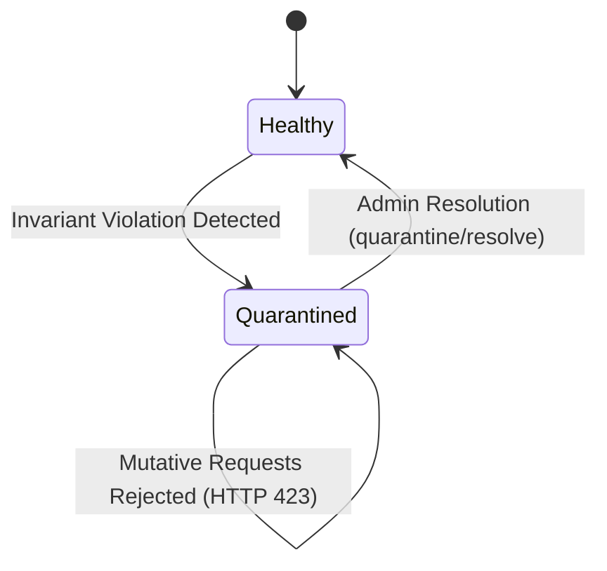

# Decision OS - Consolidated Architecture & Technical Specifications

> **Document Version**: 1.3.0 (Certified)  
> **Status**: Authoritative Architectural Specification  
> **Consolidation Sources**: `docs/ARCHITECTURE.md`, `BATCH_4_PHASE_1_2_ARCHITECTURE_DESIGN.md`, `BATCH_4_PHASE_1_2_FAILURE_STATE_MATRIX.md`, `BATCH_4_PHASE_0_ARCHITECTURE_AMENDMENTS.md`, `BATCH_4_PHASE_0_CONCURRENCY_AMENDMENTS.md`, `FRONTEND_BACKEND_INTEGRATION_MATRIX.md`, `FUTURE_BACKEND_ARCHITECTURE.md`.

---

## 1. Monorepo Structure & System Overview

Decision OS is architected as an enterprise-grade monorepo containing three core workspaces:

```text
Decision-OS/
├── apps/
│   ├── api/                    # Fastify backend, Mongoose/MongoDB, domain services & routes
│   │   ├── src/
│   │   │   ├── config/         # Environment, DB, and topology configurations
│   │   │   ├── db/             # MongoDB connection pooling & topology detection
│   │   │   ├── errors/         # Typed domain errors (ConflictError, QuarantineError, etc.)
│   │   │   ├── models/         # Mongoose models & outbox schemas
│   │   │   ├── plugins/        # Fastify plugins (JWT auth, error handler, rate limit)
│   │   │   ├── repositories/   # Storage & atomic CAS write operations
│   │   │   ├── routes/         # 12 domain route modules (48 REST endpoints)
│   │   │   ├── services/       # Domain services, recovery worker, audit service
│   │   │   └── utils/          # Canonical hash calculation, PRNG, sanitization
│   │   └── tests/              # 23 test suites covering unit, integration & concurrency
│   └── web/                    # React 19 + Vite frontend application
│       └── src/
│           ├── api/            # Fully typed API client SDK
│           ├── components/     # UI components, modals, visualizers
│           ├── context/        # Auth and decision state contexts
│           └── hooks/          # React custom hooks
├── packages/
│   └── decision-engine/        # Pure TypeScript MCDA Engine (Zero Dependencies)
│       ├── src/                # Scoring, normalization, sensitivity, Monte Carlo
│       └── tests/              # Golden fixtures (G1–G10), tie-breaking, ties
└── docs/                       # Detailed API route schemas and performance benchmarks
```

---

## 2. Core Architectural Principles

1. **Pure TypeScript Engine Decoupling**: All MCDA mathematics (linear algebra scoring, Hare-Niemeyer Largest Remainder normalization, closed-form sensitivity analysis, and Mulberry32 Monte Carlo simulations) reside exclusively in `packages/decision-engine`.
2. **Backend Mathematical Authority**: While the frontend performs optimistic calculations for instant 60fps UI feedback, all saved decisions, rankings, sensitivity points, and audit logs are authoritatively validated and sealed by `apps/api`.
3. **Cryptographic Immutability**: All decisions, versions, and audit entries are fingerprinted using SHA-256 hashes forming tamper-evident hash chains.
4. **Advisory AI Isolation**: AI services (Fastify routes under `/api/v1/ai`) are strictly advisory. No LLM ever calculates scores or alters authoritative calculations.

---

## 3. Tiered Dual-Topology Model (MongoDB)

To ensure high availability in production while supporting lightweight single-node development, the architecture defines two explicit database execution topologies:

```mermaid
graph TD
    Client[Client Request] --> API[Fastify API Gateway]
    API --> TopCheck{Topology Detection}
    
    TopCheck -->|Replica Set| TopA[Topology A: Multi-Document ACID Transactions]
    TopCheck -->|Standalone| TopB[Topology B: Durable Embedded Outbox Pattern]
    
    subgraph Topology A (Production)
        TopA --> Tx[withTransaction / Snapshot Isolation]
        Tx --> M1[Mutate Decision]
        Tx --> M2[Mutate Contributions]
        Tx --> M3[Append Audit Event]
        Tx --> OutboxA[Transactional Notification Outbox]
        Tx --> Commit[Majority Write Concern Commit]
    end
    
    subgraph Topology B (Standalone / Dev)
        TopB --> CAS[Single-Doc Atomic CAS on Decision]
        CAS --> OutboxB[Embedded Outbox Command]
        OutboxB --> Disp[Single-Flight Dispatcher]
        Disp --> Proj1[Project DecisionContributionModel]
        Disp --> Proj2[Append Audit Chained Event]
        Disp --> Comp[Two-Phase Compaction to Archive]
    end
```

### 3.1 Topology A: MongoDB Replica Set (Production Standard)
- **Isolation**: Multi-document ACID transactions with snapshot isolation (`readConcern: 'snapshot'`, `writeConcern: 'majority'`).
- **Atomicity**: Changes across `DecisionModel`, `DecisionContributionModel`, `CommentModel`, and `AuditEventModel` commit atomically in a single transaction.
- **Commit Timeout Recovery**: If a client commit times out due to transient network failure, the transaction is retried using idempotent operation tokens.

### 3.2 Topology B: Standalone MongoDB (Single-Node / Development)
- **Problem Solved**: Standalone MongoDB does not support multi-document transactions. Separate writes to `DecisionModel` and external collections risk partial failure (split-brain).
- **Embedded Outbox Pattern**: State mutations and command payloads are stored atomically inside an embedded `outbox` array within the single `DecisionModel` document via a single atomic CAS operation.
- **Single-Flight Dispatcher**: An asynchronous dispatcher executes external projections (`DecisionContributionModel`, `AuditEventModel`) sequentially.
- **Monotonic 5-Point Write Guard**: The dispatcher verifies:
  1. `pendingOperationId === command.operationId`
  2. `command.sequenceNumber === lastCompletedSequenceNumber + 1`
  3. `leaseExpiresAt > $$NOW`
  4. `leaseToken === activeLeaseToken`
  5. `auditIntegrityStatus !== 'quarantined'`

---

## 4. Concurrency, Leases & Fencing Protocols

### 4.1 Database-Side Clock Lease Management (`$$NOW`)
Application server clocks drift. To prevent split-brain execution across multiple workers, all lease acquisition, renewal, and expiration checks evaluate strictly on the MongoDB server using `$$NOW`:

```typescript
// Atomic Lease Acquisition Filter
{
  _id: decisionId,
  $or: [
    { recoveryLeaseExpiresAt: { $lt: '$$NOW' } },
    { recoveryWorkerId: null },
    { recoveryWorkerId: currentWorkerId }
  ],
  auditIntegrityStatus: { $ne: 'quarantined' }
}
```

### 4.2 Two-Phase Compaction Protocol
The embedded outbox has a strict budget ($\le 20$ commands, $\le 256\text{ KB}$). Compaction must never prune unprojected commands or drop historical commands without archival:
1. **Phase 1 (Archive)**: Fully projected commands are bulk-inserted into `decision_outbox_archive` with duplicate key tolerance.
2. **Phase 2 (Prune)**: Only after Phase 1 verifies cryptographic persistence, pruned command IDs are pulled from the embedded `outbox` array via `$pull` guarded by version fencing.

### 4.3 Quarantine State Machine
When an unrecoverable invariant violation occurs (such as audit sequence divergence or corrupted outbox payload), the decision transitions to `quarantined`:



- While quarantined, all business mutations return HTTP 423 Locked.
- Only an authenticated administrator can call `/api/v1/decisions/:id/quarantine/resolve`.
- Resolution forces a monotonic version bump, appends an immutable audit event, and resets the lease.

---

## 5. Cryptographic Audit Chaining

Every state change creates an immutable audit event chained cryptographically via SHA-256:

$$\text{eventHash}_n = \text{SHA-256}\left(\text{eventHash}_{n-1} \parallel \text{decisionId} \parallel \text{action} \parallel \text{payloadHash} \parallel \text{sequenceNumber}\right)$$

### 5.1 Chain Integrity Guarantees
- The collection enforces a unique compound index on `{ decisionId: 1, sequenceNumber: 1 }` and `{ decisionId: 1, previousEventHash: 1 }`.
- Any attempt to insert a conflicting event or fork history fails with a duplicate key error, immediately triggering quarantine safety.

---

## 6. Failure State Matrix & Recovery Protocol

The system defines 12 explicit failure boundaries and their deterministic recovery paths:

| Boundary ID | Failure Point | Top. A Recovery | Top. B Recovery | Resulting State |
|:---|:---|:---|:---|:---|
| **FB-01** | Client disconnect before DB receive | Connection abort | Connection abort | No state change |
| **FB-02** | Crash during outbox CAS write | Transaction aborted | Single-doc write rollback | Zero state change |
| **FB-03** | Crash after CAS, before dispatcher spawn | N/A (Atomic Tx) | Lease expires via `$$NOW`; sweeper claims command | Safe deferred projection |
| **FB-04** | Dispatcher crash during projection write | N/A (Atomic Tx) | Command retained; next worker re-applies idempotently | Single-flight consistency |
| **FB-05** | Audit append network failure | Transaction aborts | Retry with deterministic `sequenceNumber` | Hash chain intact |
| **FB-06** | Outbox archive crash during Phase 1 | N/A | Archival re-attempted; unique index ignores duplicates | No command loss |
| **FB-07** | Outbox prune crash during Phase 2 | N/A | Prune re-executed; idempotent `$pull` | Clean compaction |
| **FB-08** | Split-brain worker lease contention | Monotonic lock | Rejected by CAS filter on `leaseToken` | Split-brain prevented |
| **FB-09** | Outbox capacity limit exceeded ($>20$) | HTTP 429 | HTTP 429 backpressure returned | Storage budget protected |
| **FB-10** | Database hard storage crash | Replica failover | Unsaved memory dirty state dropped | Journal recovery |
| **FB-11** | Corrupt payload or sequence mismatch | Abort transaction | Auto-quarantine decision; alert ops | Quarantine safety |
| **FB-12** | Admin quarantine resolution crash | Transaction aborts | Monotonic version check prevents partial reset | Safe admin state |

---

## 7. Frontend-Backend API Integration Matrix

The backend exposes 12 domain route modules totaling 48 REST endpoints, fully integrated with the frontend SDK (`apps/web/src/api/client.ts`):

| Module | Route Prefix | Endpoints | Frontend Integration Target | Status |
|:---|:---|:---:|:---|:---:|
| **Auth** | `/api/v1/auth` | 4 | `AuthContext.tsx`, `LoginModal.tsx`, `RegisterModal.tsx` | Complete |
| **Decisions** | `/api/v1/decisions` | 8 | `Dashboard.tsx`, `InteractiveModal.tsx`, `useDecisionModel.ts` | Complete |
| **Sharing** | `/api/v1/decisions/:id/shares` | 4 | `ShareModal.tsx`, Invite link handlers | Complete |
| **Contributions** | `/api/v1/decisions/:id/contributions` | 6 | `ContributionsModal.tsx`, Collaboration sidebar | Complete |
| **Evidence** | `/api/v1/decisions/:id/evidence` | 4 | `EvidenceModal.tsx`, Criterion attachments | Complete |
| **AI Analyst** | `/api/v1/ai` | 3 | `AiAnalystModal.tsx`, Insight briefings | Complete |
| **Analytics** | `/api/v1/decisions/:id/analytics` | 4 | `AnalyticsModal.tsx`, `WorkspaceAnalyticsModal.tsx` | Complete |
| **Disagreements** | `/api/v1/decisions/:id/disagreements`| 3 | `DisagreementsModal.tsx`, Consensus views | Complete |
| **Calibration** | `/api/v1/decisions/:id/calibration` | 3 | `ExpertCalibrationModal.tsx`, Brier scoring | Complete |
| **Audit** | `/api/v1/decisions/:id/audit` | 4 | `AuditExportModal.tsx`, Merkle verification | Complete |
| **Collaboration** | `/api/v1/decisions/:id/collaboration`| 3 | Real-time presence & cursor streams | Complete |
| **Health** | `/health` | 2 | Operational diagnostics & topology probe | Complete |

---

## 8. Future Backend Architecture (Phase 2 Roadmap)

From `FUTURE_BACKEND_ARCHITECTURE.md`, the next evolution of Decision OS includes:
1. **CRDT Real-Time Synchronization**: Adopting Yjs / Automerge for sub-50ms peer-to-peer weight slider adjustments.
2. **Tamper-Evident Merkle Proofs**: Compiling chained audit events into public cryptographic Merkle roots for board and regulatory verification.
3. **Zero-Knowledge Ephemeral Rooms**: In-memory decision deliberation sessions that generate signed briefings and purge all raw voting records immediately upon room closure.
