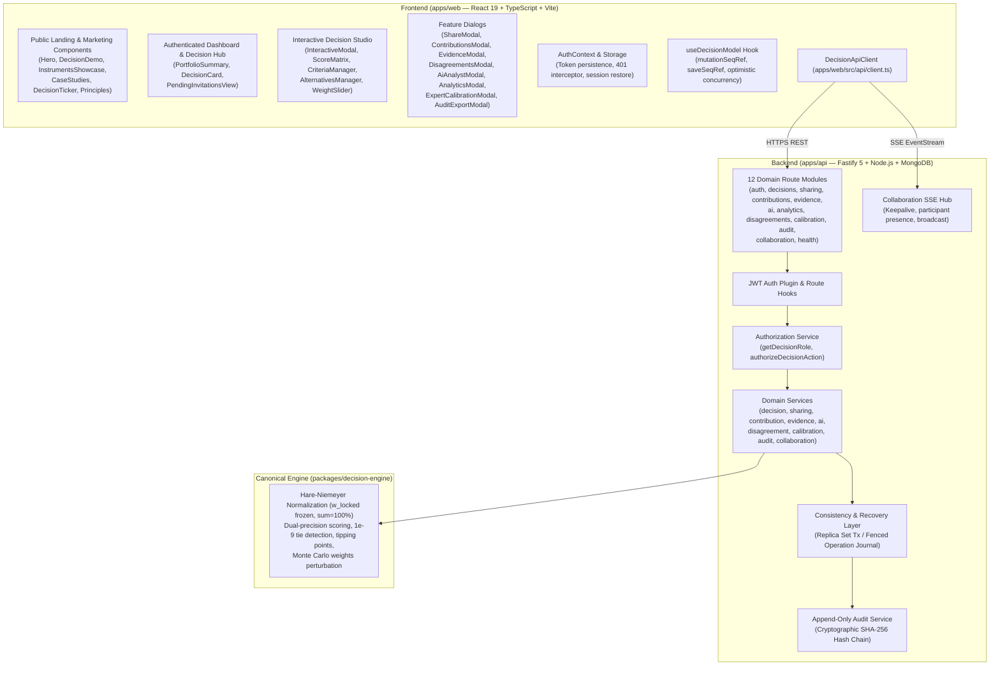
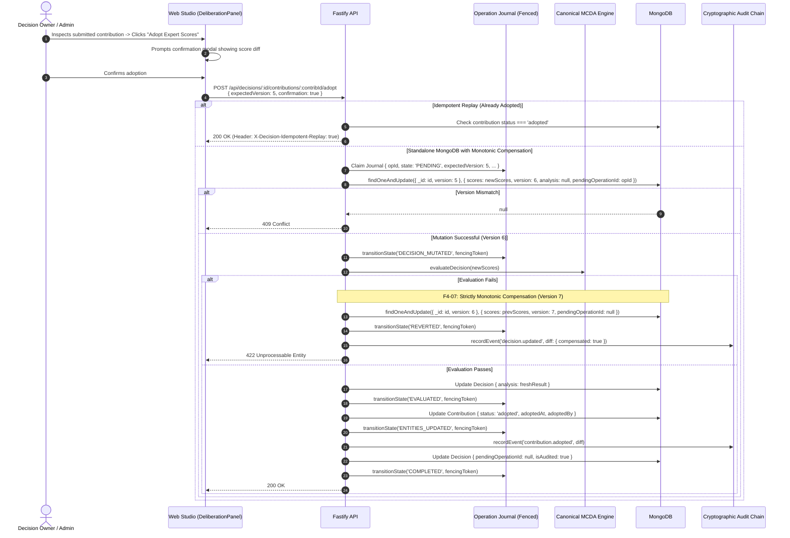
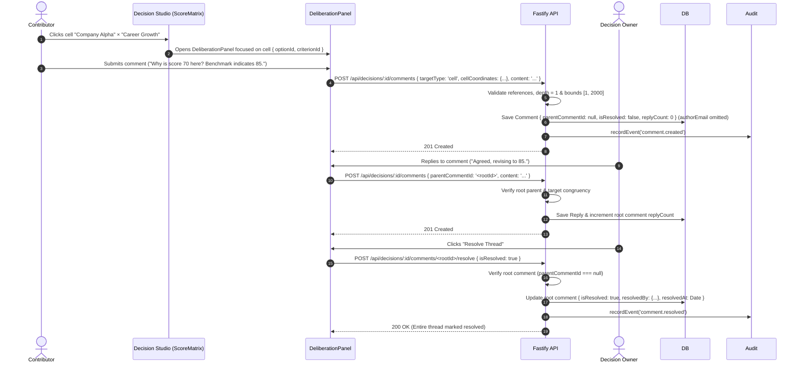

# Decision OS — Batch 4 Implementation Plan
## Collaborative Deliberation & Landing Page Integration (Final Concurrency Revision)

**Document Version**: 1.3.0  
**Phase**: Phase 0 — Repository Inspection & Implementation Planning (Final Concurrency Revision)  
**Target Milestone**: Batch 4 Delivery  
**Author**: Principal Software Architect, Senior Full-Stack Engineer, Security Engineer & Product Designer  
**Status**: APPROVED IN PRINCIPLE — WITH FINAL CONCURRENCY & LEASE FENCING AMENDMENTS  
**Workspace Root**: `C:/Users/tiwar/Downloads/Decision-OS-main/Decision-OS-main`  
**Governing Documents**:
- `CANONICAL_DECISION_ENGINE_V1_SPEC.md`
- `FRONTEND_BACKEND_INTEGRATION_MATRIX.md`
- `BATCH_1_INDEPENDENT_AUDIT.md` & `BATCH_1_REMEDIATION_REPORT.md`
- `BATCH_2_FINAL_INDEPENDENT_AUDIT.md` & `BATCH_2_REMEDIATION_REPORT.md`
- `BATCH_3_INDEPENDENT_AUDIT.md` & `BATCH_3_REMEDIATION_FINAL_AUDIT.md`
- `BATCH_4_PHASE_0_ARCHITECTURE_AMENDMENTS.md` (v1.3.0)
- `BATCH_4_PHASE_0_CONCURRENCY_AMENDMENTS.md` (v1.0.0)

---

## 1. Executive Summary

Decision OS is an explainable multi-criteria decision analysis (MCDA) workspace designed to make complex choices defensible, transparent, and mathematically rigorous. 

- **Batch 1** delivered production authentication, token persistence, and automatic session restoration.
- **Batch 2** delivered the Authenticated Dashboard, decision lifecycle management, and portfolio KPI analytics.
- **Batch 3** transitioned the product into an active MCDA studio with dynamic criteria and alternatives management, canonical Hare-Niemeyer weight normalization, locked criteria semantics, and score matrix completeness validation.
- **Batch 3 Remediation** resolved in-flight mutation sequence hazards (`F-B3-01`) and hard-guarded score matrix inputs during calculations (`F-B3-04`), achieving **VERDICT A: PASS — CERTIFIED PRODUCTION-READY** across 576 automated test suites.

### Objective of Batch 4
The objective of **Batch 4** is twofold:
1. **Collaborative Deliberation**: Elevate Decision OS from an isolated multi-user tool to a collaborative decision workspace. We will unify role-aware deliberation, structured discussion threads (comments on decisions, criteria, alternatives, and scoring cells), explicit suggestions lifecycle (accept/adopt vs. reject with rationale), real-time presence, and a unified decision activity feed.
2. **Landing Page Integration**: Bridge the public marketing experience and authenticated workspace into a unified product. Public visitors will be able to test the interactive MCDA studio, clone real case studies into live workspace decisions, authenticate without losing draft work, and navigate seamlessly with deep linking.

### Core Architectural Invariants Maintained
- **Mathematical Core Immutability**: The canonical decision engine (`packages/decision-engine`) remains 100% untouched. All golden test vectors (G1–G10), Largest Remainder normalization, dual-precision scoring, and tipping-point formulas are strictly preserved.
- **Strictly Monotonic Versioning (F4-07)**: Decision versions are strictly monotonic and never decrement. Compensating rollbacks restore prior state while incrementing version ($v5 \to v6 \to v7$), eliminating ABA concurrency hazards.
- **Exclusive Lease & Fencing Tokens (F4-08)**: Standalone recovery operations are claimed via atomic conditional updates, guarded by lease expiration and monotonically increasing fencing tokens to prevent split-brain worker executions.
- **Decoupled Deliberation Boundaries**: Comments, evidence, AI proposals, and expert contributions **never** silently mutate authoritative decision inputs. Any accepted contribution passes through atomic optimistic concurrency (`expectedVersion`), invalidates stale evaluations, requires server recalculation, and appends dual-timestamp cryptographic audit records.
- **Role-Based Authorization Enforced at Backend**: Global administrator role is `'admin'`. Decision roles are `'owner'`, `'editor'`, `'contributor'`, `'viewer'`.

---

## 2. Current Architecture Assessment



---

## 3. Existing Collaboration Functionality Inventory

The existing codebase already contains substantial backend foundations for multi-user collaboration:

| Domain | Backend Route(s) | Role Enforced | Frontend Component / Hook | Status | Existing Capabilities |
| :--- | :--- | :--- | :--- | :--- | :--- |
| **Sharing & Invitations** | `POST /decisions/:id/invitations`<br>`GET /decisions/:id/invitations`<br>`DELETE /decisions/:id/invitations/:id`<br>`GET /decisions/:id/access`<br>`PUT /decisions/:id/access/:id`<br>`DELETE /decisions/:id/access/:id`<br>`POST /invitations/accept`<br>`GET /invitations/details`<br>`GET /invitations/pending` | Owner only for invite/revoke/update role.<br>Authenticated user for accept/pending.<br>Unrelated user gets 404. | `ShareModal.tsx`<br>`AcceptInvitationModal.tsx`<br>`PendingInvitationsView.tsx` | **Functional** | Owner creates invitations with email and role (`editor`, `contributor`, `viewer`). Single-use crypto token with expiry. Recipient accepts via modal or banner. Access list shows collaborators. |
| **Expert Contributions** | `GET /decisions/:id/contributions`<br>`GET /decisions/:id/contributions/mine`<br>`POST /decisions/:id/contributions` (draft)<br>`POST /decisions/:id/contributions/submit`<br>`POST /decisions/:id/contributions/withdraw`<br>`POST /decisions/:id/contributions/lock`<br>`POST /decisions/:id/contributions/unlock`<br>`POST /decisions/:id/contributions/:id/adopt` | Read: owner, editor, contributor, viewer.<br>Contribute: owner, editor, contributor.<br>Lock/Unlock/Adopt: owner only. | `ContributionsModal.tsx` | **Functional** | Contributors draft preferred option, confidence, criterion scores and reasoning, and prediction statement. Owner can lock rounds and adopt expert scores into decision model. |
| **Evidence & Provenance** | `GET /decisions/:id/evidence`<br>`POST /decisions/:id/evidence`<br>`GET /decisions/:id/evidence/:id`<br>`PATCH /decisions/:id/evidence/:id`<br>`DELETE /decisions/:id/evidence/:id` | Read: all roles.<br>Create: owner, editor, contributor.<br>Update/Delete: author or decision owner. | `EvidenceModal.tsx` | **Functional** | Target types: `option`, `criterion`, `decision`, `contribution`. Evidence types: `url`, `document`, `quote`, `data`. Validates HTTP/HTTPS URLs (SSRF defense). Attaches provenance author. |
| **Disagreements Intelligence** | `GET /decisions/:id/disagreements`<br>`PATCH /decisions/:id/disagreements/:id/resolution`<br>`POST /decisions/:id/disagreements/explain` | Read: all roles.<br>Resolution: owner, editor.<br>AI Explain: all roles. | `DisagreementsModal.tsx` | **Functional** | Computes variance across contributions, flags high/critical disagreements, tracks human resolution status (`open`, `acknowledged`, `resolved`) with rationale, provides AI advisory explanation. |
| **Real-Time Presence** | `GET /decisions/:id/collaboration/stream`<br>`POST /decisions/:id/collaboration/presence`<br>`GET /decisions/:id/collaboration/participants` | Read: all roles. | `RealtimePresenceBar.tsx`<br>`useRealtimeCollaboration.ts` | **Functional** | SSE heartbeat every 15s. Participant presence with status (`active`, `idle`) and current view. Event broadcast for `decision.updated` and `decision.calculation.updated`. |
| **AI Suggestions** | `POST /decisions/:id/ai/analyze`<br>`POST /decisions/:id/ai/proposals/apply` | Read: all roles.<br>Apply: owner, editor. | `AiAnalystModal.tsx` | **Functional** | Generates suggestions for missing criteria, alternative stress-testing, and bias detection. Owner/editor can explicitly apply criterion proposals to the decision model. |

---

## 4. Proposed User Workflows

### Workflow 1: Transactional & Fenced Contribution Adoption (F4-01A, F4-07, F4-08)


### Workflow 2: Structured Deliberation & Thread Management (F4-02A)


---

## 5. Permission Matrix (F4-06A)

| Capability / Action | Global Admin (`role: 'admin'`) | Decision Owner | Editor | Contributor | Viewer | Unrelated User |
| :--- | :---: | :---: | :---: | :---: | :---: | :---: |
| **Read Inputs, Results & Comments** | ✅ | ✅ | ✅ | ✅ | ✅ | ❌ (404) |
| **Directly Mutate Decision Inputs (Matrix, Criteria, Options, Weights)** | ✅ | ✅ | ✅ | ❌ (403) | ❌ (403) | ❌ (404) |
| **Trigger Authoritative Calculation (`POST /analyze`)** | ✅ | ✅ | ✅ | ❌ (403) | ❌ (403) | ❌ (404) |
| **Delete Decision** | ✅ | ✅ | ❌ (403) | ❌ (403) | ❌ (403) | ❌ (404) |
| **Manage Sharing & Invitations** | ✅ | ✅ | ❌ (403) | ❌ (403) | ❌ (403) | ❌ (404) |
| **Lock / Unlock Contribution Round** | ✅ | ✅ | ❌ (403) | ❌ (403) | ❌ (403) | ❌ (404) |
| **Submit Expert Contribution** | ✅ | ✅ | ✅ | ✅ | ❌ (403) | ❌ (404) |
| **Adopt Expert Scores (F4-01A)** | ✅ | ✅ | ❌ (403) | ❌ (403) | ❌ (403) | ❌ (404) |
| **Reject Expert Contribution with Rationale** | ✅ | ✅ | ❌ (403) | ❌ (403) | ❌ (403) | ❌ (404) |
| **Attach Supporting Evidence** | ✅ | ✅ | ✅ | ✅ | ❌ (403) | ❌ (404) |
| **Edit / Delete Own Evidence** | ✅ | ✅ | ✅ | ✅ | ❌ (403) | ❌ (404) |
| **Delete Any Collaborator Evidence (Moderation)** | ✅ | ✅ | ❌ (403) | ❌ (403) | ❌ (403) | ❌ (404) |
| **Post Comment or Reply** | ✅ | ✅ | ✅ | ✅ | ❌ (403) | ❌ (404) |
| **Edit Own Comment Content** | ✅ | ✅ | ✅ | ✅ | ❌ (403) | ❌ (404) |
| **Delete Own Comment (Tombstone if has replies)** | ✅ | ✅ | ✅ | ✅ | ❌ (403) | ❌ (404) |
| **Delete Any Collaborator Comment (Moderation)** | ✅ | ✅ | ❌ (403) | ❌ (403) | ❌ (403) | ❌ (404) |
| **Resolve / Reopen Discussion Thread (Root Comment Only)** | ✅ | ✅ | ✅ | ❌ (403) | ❌ (403) | ❌ (404) |
| **Resolve Disagreement Rationale** | ✅ | ✅ | ✅ | ❌ (403) | ❌ (403) | ❌ (404) |
| **Apply Suggested AI Proposal** | ✅ | ✅ | ✅ | ❌ (403) | ❌ (403) | ❌ (404) |
| **Reject Suggested AI Proposal** | ✅ | ✅ | ✅ | ❌ (403) | ❌ (403) | ❌ (404) |
| **View Deliberation Activity Feed** | ✅ | ✅ | ✅ | ✅ | ✅ | ❌ (404) |
| **Clone Case Study / Predefined Template** | ✅ | ✅ | ✅ | ✅ | ✅ | ✅ (Upon auth) |

---

## 6. Backend API and Database Models

### 6.1 Database Models & Schemas

#### 1. Comment Model (`apps/api/src/models/comment.model.ts`)
```typescript
export interface IComment {
  decisionId: Types.ObjectId;
  authorId: string;
  authorName: string;
  authorRole: 'owner' | 'editor' | 'contributor' | 'viewer';
  targetType: 'decision' | 'option' | 'criterion' | 'cell' | 'contribution';
  targetId: string;
  cellCoordinates?: { optionId: string; criterionId: string } | null;
  content: string; // 1 to 2000 chars, trimmed
  parentCommentId?: Types.ObjectId | null;
  isResolved: boolean;
  resolvedBy?: { id: string; name: string } | null;
  resolvedAt?: Date | null;
  isDeleted: boolean;
  deletedAt?: Date | null;
  editedAt?: Date | null;
  replyCount: number;
  createdAt: Date;
  updatedAt: Date;
}
```
*(Privacy invariant: `authorEmail` permanently removed).*

#### 2. Enhanced Operation Journal Model (`apps/api/src/models/operationJournal.model.ts`)
```typescript
export interface IOperationJournal {
  operationId: string;
  decisionId: Types.ObjectId;
  action: AuditAction;
  actor: { id: string; role: string; name?: string; email?: string };
  expectedVersion: number;
  targetVersion: number;
  compensatingVersion?: number | null;
  payload: Record<string, unknown>;
  previousSnapshot: Record<string, unknown>;
  auditDraft: {
    eventId: string;
    entityType: string;
    entityId: string;
    summary: string;
    diff: AuditDiff;
  };
  state: 'PENDING' | 'DECISION_MUTATED' | 'EVALUATED' | 'ENTITIES_UPDATED' | 'AUDITED' | 'COMPENSATING' | 'COMPLETED' | 'REVERTED' | 'UNRECOVERABLE';
  
  recoveryOwner: string | null;
  leaseExpiresAt: Date | null;
  fencingToken: number;
  heartbeatAt: Date;
  retryCount: number;
  errorDetails?: string | null;
}
```

#### 3. Cryptographic Audit Event (`apps/api/src/models/audit.types.ts`)
```typescript
export interface IAuditEvent {
  eventId: string;
  decisionId: Types.ObjectId;
  actorId: string;
  actorEmail?: string;
  actorName?: string;
  action: AuditAction;
  entityType: string;
  entityId: string;
  summary: string;
  diff: AuditDiff;
  originalTimestamp: Date; // Real-world action time
  timestamp: Date;         // Chain append monotonic sequence time
  eventHash: string;
  previousEventHash: string;
  schemaVersion: number;
}
```

#### 4. Decision DTO with In-Payload Quarantine (`apps/api/src/models/decision.types.ts`)
```typescript
export interface DecisionDto {
  id: string;
  title: string;
  version: number;
  isAudited: boolean;
  auditIntegrityStatus: 'healthy' | 'pending_reconciliation' | 'quarantined';
  pendingOperationId: string | null;
  quarantineReason?: string | null;
}
```

---

## 7. Testing Strategy

1. **Phase 1 Backend Suites**:
   - `apps/api/tests/comments.test.ts` (Nesting depth limit, target congruency, root resolution, tombstones)
   - `apps/api/tests/collaborationDeliberation.test.ts` (Rejection lifecycle, idempotent adoption replay)
   - `apps/api/tests/recoveryConcurrency.test.ts` (Monotonic version rollback $v5 \to v6 \to v7$, 7 lease & fencing token concurrency scenarios)
2. **Subsequent Phase Suites**:
   - `apps/api/tests/templateCloning.test.ts`
   - `apps/web/src/tests/deliberationIntegration.test.ts`
   - `apps/web/src/tests/landingIntegration.test.ts`
   - `apps/web/src/tests/batch4Regression.test.ts`
3. **Regression & Quality Gates**:
   - Monorepo test suite: target 100% pass across >630 tests.
   - 0 lint errors, 0 typecheck errors, clean build.
   - Golden fixtures G1–G10 pass with zero diffs.

---

## 8. Phase-by-Phase Implementation Sequence

### Phase 0: Repository Inspection and Implementation Plan (COMPLETE)
- Baseline verification: 576 tests passing.
- Architectural amendments incorporated (`F4-01A` through `F4-08`).
- Produced `BATCH_4_PHASE_0_CONCURRENCY_AMENDMENTS.md`, `BATCH_4_PHASE_0_ARCHITECTURE_AMENDMENTS.md` (v1.3.0), and `BATCH_4_PHASE_0_FINAL_REVIEW.md` (v1.1.0).

### Phase 1: Collaboration Backend Foundations (STRICT BACKEND BOUNDARY)
- Create `apps/api/src/models/comment.types.ts`, `comment.schema.ts`, and `comment.model.ts`.
- Update `contribution.model.ts` and `contribution.types.ts` (`status: 'rejected'`, rationale fields).
- Update `apps/api/src/services/authorization.service.ts` with collaboration actions.
- Create `apps/api/src/repositories/comment.repository.ts`.
- Create `apps/api/src/services/comment.service.ts` (target congruency, depth = 1 guard, root resolution).
- Update `apps/api/src/services/contribution.service.ts` (idempotent adoption replay, monotonic compensation).
- Implement `operationJournal.repository.ts` and `recoveryWorker.service.ts` (atomic lease claim, fencing token verification, heartbeat loop).
- Update `audit.service.ts` with dual timestamps (`originalTimestamp` vs `timestamp`).
- Write backend test suites (`comments.test.ts`, `collaborationDeliberation.test.ts`, `recoveryConcurrency.test.ts`).
- *(Deferred: No frontend UI, landing page changes, template cloning, or SSE in Phase 1).*

### Phase 2: Deliberation APIs, Discussion Routes & Activity Feed
- Create `routes/comments.ts` and register in `app.ts`.
- Add rejection endpoints in `routes/contributions.ts` and `routes/ai.ts`.
- Add `GET /decisions/:id/collaboration/activity` in `routes/collaboration.ts`.
- Add `POST /decisions/templates/:templateId/clone` in `routes/decisions.ts`.
- Update `apps/web/src/api/client.ts` SDK methods.

### Phase 3: Deliberation Frontend Components & Workspace Integration
- Create `DeliberationPanel.tsx`.
- Update `InteractiveModal.tsx` to add `Deliberation` workspace tab.
- Update `ScoreMatrix.tsx` with comment badges, evidence counts, and disagreement highlights.
- Update `Dashboard.tsx` with Deliberation quick action.

### Phase 4: Landing Page Integration & Template Cloning
- Update `DecisionDemo.tsx` with 4-stage session-preserving flow (`Available` → `Claimed` → `Decision Created` → `Consumed`).
- Update `CaseStudies.tsx` with "Clone to Workspace" buttons.
- Enhance `Navbar.tsx` and `App.tsx` with deep query routing.

### Phase 5: Real-Time Deliberation Synchronization (SSE)
- Broadcast deliberation events via SSE hub. Update `useRealtimeCollaboration.ts` on web.

### Phase 6: Security, Regression & End-to-End Verification
- Monorepo test run, lint, typecheck, production build. Produce `BATCH_4_IMPLEMENTATION_REPORT.md`.

---

## 9. Phase 0 Verification & Confirmation

Phase 0 inspection confirms:
1. The repository is healthy, builds cleanly, and passes all 576 unit, integration, and regression tests.
2. Canonical decision engine (`packages/decision-engine`) is completely untouched and all golden fixtures G1–G10 pass.
3. No features or application source files have been modified during Phase 0.

**STOP**: Awaiting architectural approval before initiating Phase 1.
