# Decision OS — Batch 4 Phase 0 Architecture Amendments
## Mandatory Architectural Clarifications & Governance Specifications (Final Concurrency Revision)

**Document Version**: 1.3.0  
**Status**: APPROVED — FINAL ARCHITECTURAL AMENDMENT SPECIFICATION  
**Author**: Principal Software Architect, Senior Full-Stack Engineer, Security Engineer & Product Designer  
**Scope**: Amendments to Batch 4 Implementation Plan (`F4-01A` through `F4-08`)  
**Target Milestone**: Batch 4 Delivery  
**Workspace Root**: `C:/Users/tiwar/Downloads/Decision-OS-main/Decision-OS-main`  
**Governing Documents**:
- `CANONICAL_DECISION_ENGINE_V1_SPEC.md`
- `FRONTEND_BACKEND_INTEGRATION_MATRIX.md`
- `BATCH_4_IMPLEMENTATION_PLAN.md` (v1.3.0)
- `BATCH_4_PHASE_0_CONCURRENCY_AMENDMENTS.md` (v1.0.0)

---

## 1. Overview & Purpose

Following architectural review of `BATCH_4_IMPLEMENTATION_PLAN.md` and initial Phase 0 specifications, this final amendment specification resolves all data-integrity issues and defines rigorous consistency protocols before initiating Phase 1 implementation:

- **F4-01A**: Contribution Adoption Protocol, Idempotent Replay & Failure Recovery
- **F4-02A**: Comment Thread Model, Reply Invariants, Tombstones & Privacy Hardening
- **F4-03A**: Crash-Recoverable Audit Consistency Protocol (Transactions & Operation Journal)
- **F4-04A**: Safe Template Cloning & Privacy Boundaries
- **F4-05A**: Guest Playground Staged Consumption Lifecycle (`Available` → `Claimed` → `Decision Created` → `Consumed`)
- **F4-06A**: Centralized Permission Matrix, Authenticated Role Clarifications & Complete API Contracts
- **F4-07**: Strictly Monotonic Decision Versioning During Compensating Rollback
- **F4-08**: Exclusive Recovery Worker Ownership via Atomic Lease Acquisition & Fencing Tokens

Additionally, this document enforces a **strict Phase 1 implementation boundary** restricted exclusively to backend collaboration foundations.

---

## 2. F4-01A — Contribution Adoption Failure Recovery, Idempotency & Protocol

### 2.1 Problem & Vulnerability Context
Adopting expert scores directly modifies the decision model's primary input matrix. Without deterministic concurrency control, explicit confirmation, input validation, and transactional boundaries:
1. Concurrent decision edits can be silently overwritten (lost updates).
2. Calculation failures or partial crashes can leave decision scores updated with stale or invalid evaluations presented as authoritative winners.
3. Contributions can be double-adopted or left in intermediate states after process failures.

### 2.2 Complete Adoption Protocol & State Machine

```mermaid
sequenceDiagram
    autonumber
    actor Owner as Decision Owner / Admin
    participant API as Fastify API (/contributions/:id/adopt)
    participant Authz as Authorization Service
    participant ContribSvc as Contribution Service
    participant Journal as Operation Journal / Tx
    participant Engine as Canonical MCDA Engine
    participant DB as MongoDB
    participant Audit as Cryptographic Audit Chain

    Owner->>API: POST /api/decisions/:id/contributions/:contribId/adopt<br/>{ expectedVersion: 3, confirmation: true, selectedCriterionIds?: [...] }
    
    rect rgb(15, 23, 42)
        note over API,Authz: Step 1: Authentication & Authorization Guard
        API->>Authz: authorizeDecisionAction(decision, 'edit', requester)
        Authz-->>API: Verified role === 'owner' (or global 'admin')
    end

    rect rgb(15, 23, 42)
        note over ContribSvc,DB: Step 2: Strict Pre-Validation & Idempotency Check
        API->>ContribSvc: adoptExpertScores(decisionId, contribId, payload, requester)
        ContribSvc->>ContribSvc: Validate confirmation === true
        ContribSvc->>ContribSvc: Validate expectedVersion is positive integer
        ContribSvc->>DB: Fetch Decision (id: decisionId) & Contribution (id: contribId)
        
        alt Idempotent Replay (Already Adopted by Owner)
            ContribSvc->>ContribSvc: contribution.status === 'adopted' && contribution.adoptedBy === requester.id
            ContribSvc-->>API: Return existing DecisionDocument (Header: X-Decision-Idempotent-Replay: true)
        end

        ContribSvc->>ContribSvc: Verify contribution.decisionId == decisionId
        ContribSvc->>ContribSvc: Verify contribution.status == 'submitted' (reject if 'rejected', 'draft', 'withdrawn')
        ContribSvc->>ContribSvc: Verify decision.version == expectedVersion
        ContribSvc->>ContribSvc: Validate preferredOptionId exists in decision.options
        ContribSvc->>ContribSvc: Validate each criterionId in contribution.criterionScores exists in decision.criteria
        ContribSvc->>ContribSvc: Validate every score value v: Number.isFinite(v) && v >= 0 && v <= 100
    end

    alt Topology: MongoDB Replica Set (Multi-Document Transaction)
        rect rgb(30, 41, 59)
            note over ContribSvc,Audit: Path A: Atomic Multi-Document Transaction
            ContribSvc->>DB: Start ClientSession & session.withTransaction()
            ContribSvc->>Engine: evaluateDecision(candidateScores)
            alt Engine Calculation Fails
                Engine-->>ContribSvc: Throws ValidationError / EngineError
                ContribSvc->>ContribSvc: Abort transaction (analysis: null, no score merge)
                ContribSvc-->>API: HTTP 422 Unprocessable Entity
            else Engine Calculation Succeeds
                Engine-->>ContribSvc: Fresh EngineResult { winner, ranking, calculationHash, inputHash }
                ContribSvc->>DB: Update Decision { scores: newScores, analysis: freshResult, version: expectedVersion + 1 } (with session)
                ContribSvc->>DB: Update Contribution { status: 'adopted', adoptedAt, adoptedBy, adoptedOptionId } (with session)
                ContribSvc->>Audit: Append AuditEvent ('contribution.adopted', diff) (with session)
                ContribSvc->>DB: Commit Transaction (Atomic Commit Point)
            end
        end
    else Topology: MongoDB Standalone (Durable Operation Journal)
        rect rgb(30, 41, 59)
            note over ContribSvc,Journal: Path B: Durable Operation Journal State Machine
            ContribSvc->>Journal: Write Journal { opId, state: 'PENDING', decisionId, expectedVersion, payload, auditDraft }
            ContribSvc->>DB: Atomic findOneAndUpdate({ _id: decisionId, version: expectedVersion },<br/>{ scores: newScores, version: expectedVersion + 1, analysis: null, pendingOperationId: opId, isAudited: false })
            alt Version Mismatch (Concurrent Write)
                DB-->>ContribSvc: null (Version conflict)
                ContribSvc->>Journal: Update Journal { state: 'ABORTED', error: 'Version conflict' }
                ContribSvc-->>API: Throw DecisionConflictError (HTTP 409 Conflict)
            end
            ContribSvc->>Journal: Update Journal { state: 'DECISION_MUTATED' }
            
            note over ContribSvc,Engine: Step 3B: Synchronous Authoritative Recalculation
            ContribSvc->>Engine: evaluateDecision(candidateScores)
            alt Engine Evaluation Fails
                Engine-->>ContribSvc: Throws ValidationError
                note over ContribSvc,DB: F4-07: Strictly Monotonic Compensating Rollback (version + 1)
                ContribSvc->>DB: Atomic findOneAndUpdate({ _id: decisionId, version: expectedVersion + 1 },<br/>{ scores: previousSnapshot.scores, version: expectedVersion + 2, pendingOperationId: null, isAudited: false })
                ContribSvc->>Journal: Update Journal { state: 'REVERTED', error: 'Calculation failed' }
                ContribSvc->>Audit: Append AuditEvent ('decision.updated', diff: { compensated: true })
                ContribSvc->>DB: Update Decision { isAudited: true }
                ContribSvc-->>API: HTTP 422 Unprocessable Entity ("Authoritative evaluation failed")
            else Engine Evaluation Succeeds
                ContribSvc->>DB: Update Decision { analysis: freshResult }
                ContribSvc->>Journal: Update Journal { state: 'EVALUATED' }
                ContribSvc->>DB: Update Contribution { status: 'adopted', adoptedAt, adoptedBy, adoptedOptionId }
                ContribSvc->>Journal: Update Journal { state: 'ENTITIES_UPDATED' }
                ContribSvc->>Audit: Append AuditEvent ('contribution.adopted', diff) with E11000 retry
                ContribSvc->>DB: Update Decision { pendingOperationId: null, isAudited: true }
                ContribSvc->>Journal: Update Journal { state: 'COMPLETED' }
            end
        end
    end

    ContribSvc-->>API: Return updated DecisionDocument with authoritative calculation
    API-->>Owner: HTTP 200 OK
```



### 2.3 Strict Invariants & Decision Commit Criteria

1. **Owner Confirmation**:
   - The request schema strictly requires `confirmation: true`. Accidental requests without explicit confirmation are rejected with `400 Bad Request`.
2. **Duplicate Adoption Prevention & Idempotent Replay**:
   - If an owner retries adoption for an already adopted contribution (`status === 'adopted'`), the service verifies ownership and scores, returning **HTTP 200 OK** with `X-Decision-Idempotent-Replay: true`. Zero duplicate mutations occur.
   - If adoption is in-flight, concurrent requests receive **HTTP 409 Conflict**.
   - If a contribution is `rejected`, `draft`, or `withdrawn`, the endpoint rejects with `400 Bad Request`.
3. **Optimistic Concurrency Guard (`expectedVersion`)**:
   - The caller MUST provide `expectedVersion: number`. If `expectedVersion !== decision.version`, the operation immediately halts and throws `DecisionConflictError` (HTTP 409 Conflict).
   - In the database, the update condition matches `{ _id: decisionId, version: expectedVersion }`, preventing lost updates.
4. **Input and Reference Validation**:
   - `contribution.recommendation.preferredOptionId` must match an active alternative ID in `decision.options`.
   - Every key in `contribution.criterionScores` must match an active criterion ID in `decision.criteria`.
   - Every score value must satisfy `Number.isFinite(v) && v >= 0 && v <= 100`. Missing or non-numeric values are rejected.
5. **Authoritative Calculation Invariant**:
   - Merging scores temporarily invalidates the previous analysis (`analysis: null`).
   - The canonical engine (`evaluateDecision`) is synchronously executed on the candidate input matrix.
   - **Calculation Failure Rule**: If calculation fails or if the matrix remains incomplete, `analysis` MUST remain `null`. The decision is **never** presented as having a successful current evaluation. If the engine throws an unexpected error, a monotonic compensating rollback executes to restore the prior state at version $v+1$.
6. **Exact Commit Point & Status Transition**:
   - **Transactional Deployment**: The operation is considered committed and the contribution becomes `adopted` **if and only if** the MongoDB multi-document transaction successfully commits.
   - **Standalone Deployment**: The operation is considered committed when the atomic decision update succeeds and passes engine evaluation. The contribution becomes `adopted` when its status document update succeeds. The entire operation is finalized when the audit event is appended and the journal entry transitions to `COMPLETED`.

---

## 3. F4-02A — Comment Thread Model, Reply Invariants & Privacy Hardening

### 3.1 Data Model & Mongoose Schema (`apps/api/src/models/comment.model.ts`)

> [!IMPORTANT]
> **Data Privacy Hardening**: In accordance with privacy and security requirements, `authorEmail` has been **permanently removed** from the comment schema and DTOs. Storing user emails in comment records creates unnecessary PII denormalization, violates data minimization principles, and introduces GDPR synchronization overhead. Contributor identity is established by `authorId` (foreign key to `User._id`), `authorName`, and `authorRole`.

```typescript
import mongoose, { Schema, type Model, type Types } from 'mongoose';

export type CommentTargetType = 'decision' | 'option' | 'criterion' | 'cell' | 'contribution';

export interface IComment {
  decisionId: Types.ObjectId;
  authorId: string;
  authorName: string;
  authorRole: 'owner' | 'editor' | 'contributor' | 'viewer';
  targetType: CommentTargetType;
  targetId: string; // e.g. optionId, criterionId, contributionId, or 'decision'
  cellCoordinates?: {
    optionId: string;
    criterionId: string;
  } | null;
  content: string;
  parentCommentId?: Types.ObjectId | null;
  isResolved: boolean;
  resolvedBy?: {
    id: string;
    name: string;
  } | null;
  resolvedAt?: Date | null;
  isDeleted: boolean;
  deletedAt?: Date | null;
  editedAt?: Date | null;
  replyCount: number;
  createdAt: Date;
  updatedAt: Date;
}
```

### 3.2 Comment Reply Invariants & Target Congruency
To prevent corrupt thread trees and misplaced discussions, replies must satisfy four strict invariants:

1. **Root Reference Verification**:
   - A reply comment MUST supply `parentCommentId`.
   - The parent comment MUST exist in the database and must itself be a root comment (`parentComment.parentCommentId === null`).
2. **Same-Decision Boundary**:
   - The parent comment's `decisionId` must match the URL route `decisionId` (`parentComment.decisionId.toString() === decisionId`).
3. **Target Congruency**:
   - A reply comment **must inherit and match** the root comment's exact target scope:
     - `reply.targetType === parentComment.targetType`
     - `reply.targetId === parentComment.targetId`
     - `reply.cellCoordinates` matches `parentComment.cellCoordinates`
   - If a client supplies differing target parameters, the server ignores client inputs and anchors the reply to the root parent's target scope.
4. **Single-Level Depth Limit (Depth = 1)**:
   - Nested replies (reply to a reply) are strictly prohibited.
   - If a request passes the ID of an existing reply as `parentCommentId`, the server rejects the request with **HTTP 400 Bad Request** ("Replies cannot be nested deeper than 1 level; reply directly to the root comment").

### 3.3 Thread Resolution Semantics
1. **Thread-Level Resolution (Root Comment Only)**:
   - Discussion resolution is strictly a **thread-level operation** applied to the root comment (`parentCommentId === null`).
   - Child replies do NOT maintain independent resolution states.
   - An API request attempting to resolve or reopen a child reply (`parentCommentId !== null`) is rejected with `400 Bad Request` ("Resolution status can only be toggled on root comments").
   - Resolving a root comment (`isResolved: true`) updates `resolvedBy: { id: requester.id, name: requester.name }` and `resolvedAt: new Date()`.
   - When a thread is resolved, the root comment and all its child replies are considered resolved, collapsing the thread in the Deliberation UI while preserving auditability.
   - Reopening (`isResolved: false`) clears `resolvedBy` and `resolvedAt`.
2. **Authorized Roles for Resolution**:
   - Only the **Decision Owner** or an **Editor** (or global `'admin'`) may resolve or reopen a thread. Contributors and Viewers receive `403 Forbidden`.

### 3.4 Tombstone Lifecycle & API Visibility
When a comment deletion is requested:
1. **Zero Replies (`replyCount === 0`)**:
   - The comment is permanently deleted from MongoDB (or marked `isDeleted: true` and excluded from regular API queries).
   - If the comment was a child reply, the parent's `replyCount` is decremented by 1 atomically (`$inc: { replyCount: -1 }`).
2. **One or More Replies (`replyCount > 0`)**:
   - The comment is **tombstoned** to preserve thread context and prevent orphaned replies:
     - `isDeleted = true`
     - `deletedAt = new Date()`
     - `content = "[This comment was deleted by its author]"` (or `"[This comment was removed by moderator]"` if deleted by the owner)
     - `authorName = "[Deleted]"`
     - `authorRole` is retained for badge context.
     - `targetType`, `targetId`, and `cellCoordinates` are retained so replies remain anchored to the correct decision element.
3. **API Visibility**:
   - `GET /api/decisions/:id/comments` returns tombstoned comments so the client can reconstruct the discussion tree.
   - Tombstoned comments have `isDeleted: true` and masked content.
   - Clients must disable edit actions and quote actions on tombstoned records.

---

## 4. F4-03A — Crash-Recoverable Audit Consistency Protocol

### 4.1 Topology-Aware Architecture Overview

| Dimension | Path A: Replica Set / Sharded Cluster | Path B: Standalone MongoDB |
| :--- | :--- | :--- |
| **Consistency Guarantee** | Full ACID Multi-Document Atomicity | Eventual Consistency via Durable Operation Journal |
| **Transaction Boundary** | `session.withTransaction()` across Decision, Entities & Audit | Sequential state machine with pre-allocated journal record |
| **Outbox Mechanism** | Transactional Outbox pattern or atomic audit insertion | Pre-mutation journal entry (`operation_journal` collection) |
| **Crash Invariant** | Uncommitted transactions automatically roll back on disconnect | Lease-fenced startup recovery worker reconciles incomplete operations |
| **Audit Certainty** | Decision mutation and audit event commit simultaneously | Mutation cannot be marked finalized without audit confirmation |

---

### 4.2 Path A: Transactional Deployments (Replica Set / Sharded)
When the MongoDB client detects replica set support (`client.topology.description.type === 'ReplicaSetWithPrimary'` or sharded):
1. The mutation executes inside `session.withTransaction()`.
2. Steps inside transaction:
   - Atomic update of decision document with optimistic concurrency match `{ _id, version: expectedVersion }`.
   - Update of associated entities (e.g. contribution status to `'adopted'`, comment tombstone).
   - Direct append of `AuditEvent` (or insert into `audit_outbox` table within the same transaction).
3. If any step fails, the entire transaction is aborted. Zero partial mutations occur.
4. If the process crashes mid-transaction, MongoDB automatically aborts the open transaction.

---

### 4.3 Path B: Non-Transactional Deployments (Durable Operation Journal)
For standalone MongoDB deployments where multi-document transactions cannot run:

#### 1. Operation Journal Schema (`operation_journal` collection)
```typescript
export type OperationState =
  | 'PENDING'
  | 'DECISION_MUTATED'
  | 'EVALUATED'
  | 'ENTITIES_UPDATED'
  | 'AUDITED'
  | 'COMPENSATING'
  | 'COMPLETED'
  | 'REVERTED'
  | 'UNRECOVERABLE';

export interface IOperationJournal {
  operationId: string; // UUIDv4 idempotency key
  decisionId: Types.ObjectId;
  action: AuditAction;
  actor: {
    id: string;
    role: string;
    name?: string;
    email?: string;
  };
  expectedVersion: number;
  targetVersion: number;
  compensatingVersion?: number | null;
  payload: Record<string, unknown>;
  previousSnapshot: Record<string, unknown>;
  auditDraft: {
    eventId: string;
    entityType: string;
    entityId: string;
    summary: string;
    diff: AuditDiff;
  };
  state: OperationState;
  
  // Lease and Fencing Metadata (F4-08)
  recoveryOwner: string | null;
  leaseExpiresAt: Date | null;
  fencingToken: number;
  heartbeatAt: Date;
  retryCount: number;
  errorDetails?: string | null;

  createdAt: Date;
  updatedAt: Date;
}
```

---

## 5. F4-07 — Strictly Monotonic Decision Versioning During Compensation

### 5.1 Prohibition of Version Decrement
Resetting or decrementing versions introduces ABA optimistic concurrency hazards. In Decision OS:
1. Decision versions must be strictly monotonic: $\text{version}_{k+1} > \text{version}_k$.
2. Never decrement or reuse a previously committed version.
3. A compensating rollback must restore the appropriate decision data (snapshot before the failed operation) while **incrementing** the document version.

### 5.2 Version Transition Example
- **Original version**: `5` (Scores: `{ optA: { crit1: 80 } }`)
- **Failed mutation version**: `6` (Scores: `{ optA: { crit1: 95 } }`, `analysis: null`, `isAudited: false`)
- **Compensating rollback version**: `7` (Restores snapshot from version 5, but sets `version: 7`)

```typescript
// Atomic conditional compensation
await DecisionModel.findOneAndUpdate(
  { _id: decisionId, version: 6, pendingOperationId: operationId },
  {
    $set: {
      scores: previousSnapshot.scores,
      criteria: previousSnapshot.criteria,
      options: previousSnapshot.options,
      version: 7, // Strictly monotonic increment
      analysis: null,
      isAudited: false,
    },
  }
);
```

- Clients submitting updates with `expectedVersion: 5` or `expectedVersion: 6` receive **HTTP 409 Conflict**.
- An audit event `decision.updated` (`action: 'decision.updated'`, `diff: { compensated: true, restoredVersion: 5, currentVersion: 7 }`) is appended to the chain before clearing `pendingOperationId` and marking `isAudited: true`.

---

## 6. F4-08 — Exclusive Recovery Worker Ownership via Leases & Fencing Tokens

### 6.1 Lease Acquisition and Fencing Algorithm
To coordinate multiple API instances without distributed lock daemons:
1. **Atomic Claim**:
   Workers claim incomplete journal entries via `findOneAndUpdate`:
   ```typescript
   OperationJournalModel.findOneAndUpdate(
     {
       state: { $in: ['PENDING', 'DECISION_MUTATED', 'EVALUATED', 'ENTITIES_UPDATED', 'AUDITED', 'COMPENSATING'] },
       $or: [{ recoveryOwner: null }, { leaseExpiresAt: { $lt: new Date() } }],
       retryCount: { $lt: 5 },
     },
     {
       $set: { recoveryOwner: workerId, leaseExpiresAt: new Date(Date.now() + 30000), heartbeatAt: new Date() },
       $inc: { fencingToken: 1, retryCount: 1 },
     },
     { new: true, sort: { createdAt: 1 } }
   );
   ```
2. **Heartbeat Renewal Loop**:
   Active workers renew `leaseExpiresAt` every 10 seconds, conditional on `{ operationId, recoveryOwner: workerId, fencingToken }`.
3. **Fenced Transitions**:
   Every state update matches the worker's `fencingToken`. Stale or zombie workers are rejected with `0` matched documents and halt immediately.
4. **Crash Recovery**:
   If a worker crashes, its lease expires after 30 seconds. Another worker claims the operation with an incremented `fencingToken`, ensuring single-active-worker semantics.

---

## 7. Canonical Cryptographic Audit & Timestamps

### 7.1 Dual-Timestamp Preservation
```typescript
export interface IAuditEvent {
  eventId: string;                  // Stable UUIDv4
  decisionId: Types.ObjectId;
  actorId: string;
  actorEmail?: string;
  actorName?: string;
  action: AuditAction;
  entityType: string;
  entityId: string;
  summary: string;
  diff: AuditDiff;
  
  originalTimestamp: Date;          // Real-world user action time (preserved across retries)
  timestamp: Date;                  // Cryptographic sequence time (strictly monotonic)
  
  eventHash: string;
  previousEventHash: string;
  schemaVersion: number;
}
```

### 7.2 Cryptographic Formulas
$$\text{eventHash} = \text{SHA-256}(\text{JSON.stringify}(\text{canonicalizeJson}(\{\text{action}, \text{actorId}, \text{decisionId}, \text{diff}, \text{entityId}, \text{entityType}, \text{eventId}, \text{originalTimestamp}, \text{previousEventHash}, \text{schemaVersion}, \text{summary}, \text{timestamp}\})));$$

- **Genesis Hash**: `GENESIS_PREVIOUS_HASH = '0'.repeat(64)`.
- **Timestamp Format**: ISO 8601 UTC with ms (`YYYY-MM-DDTHH:mm:ss.sssZ`).
- **Concurrent E11000 Retry**: Re-fetch latest `eventHash`, increment sequence timestamp by $\ge 1\text{ms}$, recompute hash, and retry with exponential jitter (max 5 retries).

---

## 8. In-DTO Quarantine Visibility

```typescript
export interface DecisionDto {
  id: string;
  title: string;
  version: number;
  isAudited: boolean;
  auditIntegrityStatus: 'healthy' | 'pending_reconciliation' | 'quarantined';
  pendingOperationId: string | null;
  quarantineReason?: string | null;
}
```
- If `auditIntegrityStatus === 'quarantined'`, all mutation endpoints return **HTTP 423 Locked**.

---

## 9. Strict Phase 1 Implementation Boundary

Phase 1 is strictly restricted to **Backend Collaboration Foundations**:
1. `Comment` model, repository, service (root resolution, target congruency, depth = 1, tombstoning, `authorEmail` removed).
2. `Contribution` rejection status, rationale fields, and idempotent adoption replay.
3. Centralized authorization in `authorization.service.ts`.
4. Append-only cryptographic audit event integration with dual timestamps.
5. Standalone recovery: `OperationJournal` model, atomic lease acquisition, fencing tokens, and monotonic compensation.
6. Backend Vitest test suites:
   - `apps/api/tests/comments.test.ts`
   - `apps/api/tests/collaborationDeliberation.test.ts`
   - `apps/api/tests/recoveryConcurrency.test.ts`

*Explicitly Excluded*: Frontend UI, landing page, template cloning, guest draft handoff, SSE sync.

---

## 10. Review Gate & Next Steps

Awaiting final architectural approval to proceed to Phase 1 backend implementation.
