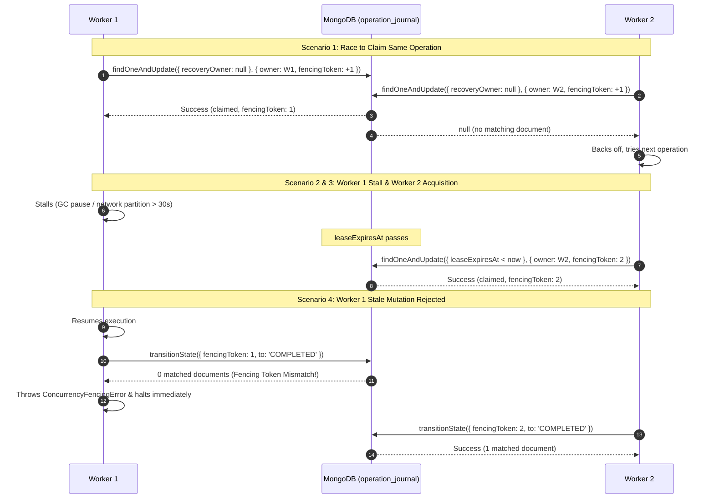

# Decision OS — Batch 4 Phase 0 Concurrency Amendments
## Standalone Recovery Protocol & Lease-Fenced Concurrency Specifications

**Document Version**: 1.0.0  
**Status**: APPROVED — FINAL ARCHITECTURAL AMENDMENT SPECIFICATION  
**Author**: Principal Software Architect, Senior Distributed Systems Engineer & Security Engineer  
**Scope**: Concurrency Hardening for Standalone MongoDB & Backend Deliberation (`F4-07`, `F4-08`)  
**Target Milestone**: Batch 4 Delivery  
**Workspace Root**: `C:/Users/tiwar/Downloads/Decision-OS-main/Decision-OS-main`  
**Governing Documents**:
- `CANONICAL_DECISION_ENGINE_V1_SPEC.md`
- `FRONTEND_BACKEND_INTEGRATION_MATRIX.md`
- `BATCH_4_IMPLEMENTATION_PLAN.md` (v1.2.0)
- `BATCH_4_PHASE_0_ARCHITECTURE_AMENDMENTS.md` (v1.2.0)
- `BATCH_4_PHASE_0_FINAL_REVIEW.md` (v1.0.0)

---

## 1. Executive Summary & Problem Context

During final architectural review of the standalone MongoDB recovery protocols, two critical concurrency vulnerabilities were identified in the crash-recovery and journal design:

1. **ABA Version Regression (`F4-07`)**: The previously drafted standalone compensating rollback restored the `previousSnapshot` and reset `decision.version` back to `expectedVersion`. Reverting or decrementing version numbers violates optimistic concurrency invariants, creates ABA vulnerabilities where concurrent clients or stale caches mistake reverted data for original data, and allows stale writes with outdated `expectedVersion` to succeed.
2. **Unfenced Concurrent Recovery Workers (`F4-08`)**: When multiple API server instances run concurrently or when a server restarts while a background reconciliation loop is active, two recovery workers could attempt to reconcile the same incomplete operation journal entry simultaneously. Without exclusive ownership and fencing, race conditions can cause split-brain executions, duplicate audit events, or corrupted compensations.

This document formally specifies:
- **Strictly Monotonic Decision Versioning During Compensating Rollback (`F4-07`)**.
- **Atomic Lease Acquisition & Fencing Token Protocol for Recovery Workers (`F4-08`)**.
- **Target Congruency and Nesting Rules for Comment Replies**.
- **Idempotent Replay Semantics for Contribution Adoption**.
- **Dual-Timestamp Audit Preservation (`originalTimestamp` vs. `timestamp`)**.
- **Explicit In-DTO Quarantine Visibility (`auditIntegrityStatus`, `isAudited`, `pendingOperationId`)**.

---

## 2. F4-07 — Strictly Monotonic Decision Versioning During Compensation

### 2.1 The ABA Concurrency Hazard
In optimistic concurrency systems, document versioning represents an unbroken causal timeline:
$$\text{version}_0 < \text{version}_1 < \text{version}_2 < \dots < \text{version}_n$$

If an operation at version $5$ attempts mutation to version $6$, but fails during canonical evaluation or entity updates, reverting the document back to version $5$ creates an **ABA hazard**:
1. Client A attempted mutation from $v5 \to v6$.
2. The mutation failed; the server reverted the document to $v5$.
3. Client B, holding cached $v5$, submits an edit with `expectedVersion: 5`.
4. Client B's edit is erroneously accepted because `version === 5`, even though the state underwent two state changes ($v5 \to v6 \to v5$).
5. In addition, HTTP ETags and client-side mutation sequence counters (`mutationSeqRef`, `saveSeqRef`) desynchronize, causing lost updates or stale cache hits.

### 2.2 Strictly Monotonic Compensation Invariant
Decision OS mandates that **decision versions are strictly monotonic and irreversible**:
1. **Never Decrement**: A decision document version must NEVER be decremented under any circumstance.
2. **Never Reuse**: A version number once assigned to a decision document can NEVER be reused.
3. **Compensation Increments Version**: A compensating rollback restores the appropriate decision data (snapshot from before the failed operation) while **incrementing** the document version.

### 2.3 Concrete Version Transition Example

| Step | Action | Stored Version | Data State | Audit Status | Client `expectedVersion` Allowed |
| :---: | :--- | :---: | :--- | :--- | :---: |
| **0** | Baseline stable state | **`5`** | Original scores (Score A = 80) | `isAudited: true` | `5` |
| **1** | Failed Adoption / Edit Attempt | **`6`** | Candidate scores (Score A = 95), `analysis: null` | `isAudited: false`<br>`pendingOperationId: op-1` | Rejects `5` (409 Conflict) |
| **2** | Canonical Evaluation Fails | **`6`** | Unchanged (evaluation threw `ValidationError`) | `isAudited: false` | Rejects `5` & `6` |
| **3** | **Compensating Rollback Executed** | **`7`** | Restored scores (Score A = 80), `analysis: null` | `isAudited: false`<br>`pendingOperationId: op-1` | Rejects `5` & `6` (409 Conflict) |
| **4** | Compensation Audit Event Appended | **`7`** | Restored scores, fresh evaluation if complete | `isAudited: true`<br>`pendingOperationId: null` | Only `7` accepted |

> [!IMPORTANT]
> At Step 3, the decision data matches the original content of version 5, but the document version is strictly **`7`**. Any client attempting an update with `expectedVersion: 5` or `expectedVersion: 6` is decisively rejected with **HTTP 409 Conflict**.

---

### 2.4 Conditional Atomic Compensation Algorithm

Compensating rollback is executed via an atomic conditional `findOneAndUpdate` against MongoDB:

```typescript
export async function executeCompensatingRollback(
  decisionId: string,
  failedVersion: number,
  previousSnapshot: Record<string, unknown>,
  operationId: string,
  fencingToken: number
): Promise<DecisionDocument> {
  const compensatingVersion = failedVersion + 1;

  // 1. Conditional Atomic Reversion: matches strictly on the failed version
  const revertedDoc = await DecisionModel.findOneAndUpdate(
    {
      _id: decisionId,
      version: failedVersion,
      pendingOperationId: operationId,
    },
    {
      $set: {
        scores: previousSnapshot.scores,
        criteria: previousSnapshot.criteria,
        options: previousSnapshot.options,
        version: compensatingVersion,
        analysis: null, // Clear stale or partial evaluation
        isAudited: false, // Remains un-audited until compensation event is confirmed
      },
    },
    { new: true }
  );

  if (!revertedDoc) {
    // If version changed, another write occurred or another worker intervened
    throw new ConcurrencyFencingError(
      `Failed to execute compensation: decision ${decisionId} version mismatch (expected: ${failedVersion})`
    );
  }

  // 2. Invalidate evaluation cache
  evaluationCache.invalidate(decisionId);

  // 3. Append Compensation Audit Event
  const auditEvent = await auditService.recordEvent({
    decisionId,
    action: 'decision.updated',
    entityType: 'decision',
    entityId: decisionId,
    actor: { id: 'system', role: 'admin', name: 'System Recovery Worker' },
    summary: `Compensating rollback to restore baseline inputs following failed operation ${operationId}`,
    diff: {
      before: { version: failedVersion },
      after: { version: compensatingVersion, isCompensated: true },
    },
  });

  // 4. Mark Decision Audited & Clear In-Flight Marker
  await DecisionModel.updateOne(
    { _id: decisionId, version: compensatingVersion },
    {
      $set: {
        isAudited: true,
        pendingOperationId: null,
      },
    }
  );

  return revertedDoc;
}
```

### 2.5 Failure of the Compensating Write Itself
If the compensating update fails (e.g. database network disconnection or process crash during step 1 or step 3):
1. The operation journal remains in state `COMPENSATING`.
2. The lease eventually expires (`leaseExpiresAt < now`).
3. The next recovery worker claims the operation with an incremented `fencingToken`.
4. The worker inspects `decision.version`:
   - If `decision.version === failedVersion`: re-attempts the compensating write to `failedVersion + 1`.
   - If `decision.version === compensatingVersion`: the write succeeded before the crash; worker resumes from step 2 (cache invalidation and audit append).
5. If after 5 retry attempts the compensation cannot be finalized, the journal transitions to `UNRECOVERABLE`, and the decision is marked `auditIntegrityStatus: 'quarantined'`, blocking further mutations.

---

## 3. F4-08 — Exclusive Recovery Worker Ownership via Leases & Fencing Tokens

### 3.1 Distributed Recovery Worker Hazards
In multi-node production deployments:
- Two API instances running reconciliation workers simultaneously could attempt to recover the same journal entry.
- A slow worker (experiencing GC pause or network stall) could wake up and execute a stale mutation after another worker has already taken over and completed recovery.

To guarantee safety, Decision OS implements **Atomic Lease Acquisition with Monotonic Fencing Tokens**.

---

### 3.2 Enhanced Operation Journal Schema (`operation_journal`)

```typescript
export type OperationState =
  | 'PENDING'
  | 'DECISION_MUTATED'
  | 'EVALUATED'
  | 'ENTITIES_UPDATED'
  | 'AUDITED'
  | 'COMPENSATING'
  | 'COMPLETED'
  | 'REVERTED'
  | 'UNRECOVERABLE';

export interface IOperationJournal {
  operationId: string; // UUIDv4 idempotency key
  decisionId: Types.ObjectId;
  action: AuditAction;
  actor: {
    id: string;
    role: string;
    name?: string;
    email?: string;
  };
  expectedVersion: number;
  targetVersion: number;
  compensatingVersion?: number | null;
  payload: Record<string, unknown>;
  previousSnapshot: Record<string, unknown>;
  auditDraft: {
    eventId: string;
    entityType: string;
    entityId: string;
    summary: string;
    diff: AuditDiff;
  };
  state: OperationState;
  
  // ─── Lease and Fencing Metadata (F4-08) ──────────────────────────────────
  recoveryOwner: string | null;     // Worker instance ID (e.g. 'worker-node-1-pid-4128')
  leaseExpiresAt: Date | null;      // UTC expiration timestamp of current lease
  fencingToken: number;             // Monotonically increasing generation number
  heartbeatAt: Date;                // Timestamp of last active worker heartbeat
  retryCount: number;               // Number of recovery attempts (max 5)
  errorDetails?: string | null;     // Diagnostic error stack trace on failure
  
  createdAt: Date;
  updatedAt: Date;
}
```

Compound index for worker claim queries:
```typescript
OperationJournalSchema.index({ state: 1, leaseExpiresAt: 1 });
OperationJournalSchema.index({ decisionId: 1, state: 1 });
```

---

### 3.3 Atomic Lease Acquisition Algorithm

A recovery worker claims an unleased or expired operation using atomic `findOneAndUpdate`:

```typescript
export async function claimJournalOperation(
  workerId: string,
  leaseDurationMs: number = 30000
): Promise<IOperationJournal | null> {
  const now = new Date();
  const leaseExpiration = new Date(now.getTime() + leaseDurationMs);

  const nonTerminalStates: OperationState[] = [
    'PENDING',
    'DECISION_MUTATED',
    'EVALUATED',
    'ENTITIES_UPDATED',
    'AUDITED',
    'COMPENSATING',
  ];

  return OperationJournalModel.findOneAndUpdate(
    {
      state: { $in: nonTerminalStates },
      $or: [
        { recoveryOwner: null },
        { leaseExpiresAt: { $lt: now } },
      ],
      retryCount: { $lt: 5 },
    },
    {
      $set: {
        recoveryOwner: workerId,
        leaseExpiresAt: leaseExpiration,
        heartbeatAt: now,
      },
      $inc: {
        fencingToken: 1, // Strictly increments fencing generation
        retryCount: 1,
      },
    },
    {
      new: true,
      sort: { createdAt: 1 }, // FIFO processing of oldest pending operations
    }
  );
}
```

---

### 3.4 Periodic Heartbeat Renewal Loop

While an operation is being processed, the worker maintains a background timer (every $\text{leaseDuration} / 3$, e.g., every 10 seconds):

```typescript
export async function renewOperationLease(
  operationId: string,
  workerId: string,
  fencingToken: number,
  leaseDurationMs: number = 30000
): Promise<boolean> {
  const now = new Date();
  const newExpiration = new Date(now.getTime() + leaseDurationMs);

  const result = await OperationJournalModel.updateOne(
    {
      operationId,
      recoveryOwner: workerId,
      fencingToken, // Strict fencing token match
    },
    {
      $set: {
        leaseExpiresAt: newExpiration,
        heartbeatAt: now,
      },
    }
  );

  return result.matchedCount === 1;
}
```
If `result.matchedCount === 0`, the worker's lease was stolen or revoked. The worker **must immediately abort processing**.

---

### 3.5 Fenced State Machine Transitions

Every state update on the journal document must include the fencing token:

```typescript
export async function transitionJournalState(
  operationId: string,
  workerId: string,
  fencingToken: number,
  fromState: OperationState,
  toState: OperationState,
  extraFields: Record<string, unknown> = {}
): Promise<void> {
  const now = new Date();
  const result = await OperationJournalModel.updateOne(
    {
      operationId,
      recoveryOwner: workerId,
      fencingToken, // Guarantees this worker still holds the valid lease
      state: fromState,
    },
    {
      $set: {
        state: toState,
        heartbeatAt: now,
        ...extraFields,
      },
    }
  );

  if (result.matchedCount === 0) {
    throw new ConcurrencyFencingError(
      `Fencing violation: Worker ${workerId} with token ${fencingToken} lost lease for operation ${operationId}`
    );
  }
}
```

---

### 3.6 Seven Concrete Concurrency Test Scenarios



#### Detailed Test Scenarios:
1. **Two Workers Attempting to Claim the Same Operation**:
   - Both execute atomic `findOneAndUpdate`.
   - Exactly one worker succeeds, obtaining `fencingToken: 1`.
   - The second worker receives `null` and gracefully inspects other pending operations.
2. **Worker A Lease Expiration**:
   - Worker A claims operation with 30s lease.
   - Worker A hangs or experiences an extended pause exceeding 30s without renewing its lease.
3. **Worker B Acquiring the Expired Operation**:
   - Worker B queries for `leaseExpiresAt < now`.
   - Worker B claims the operation, incrementing `fencingToken: 2` and assigning `recoveryOwner: 'worker-B'`.
4. **Worker A Attempting to Continue with Obsolete Fencing Token**:
   - Worker A resumes and attempts to mutate the decision or transition journal state using `fencingToken: 1`.
   - The query condition matches 0 documents.
   - Worker A receives `ConcurrencyFencingError` and halts without writing corrupted data.
5. **Server Restart During an Operation**:
   - Server crashes mid-operation. Lease expires after 30s.
   - On reboot, the startup reconciliation worker detects the expired lease, claims it with new `fencingToken`, and reconciles deterministically.
6. **Slow Operation with Active Heartbeat Renewal**:
   - A long-running evaluation takes 45s.
   - Every 10s, the worker renews `leaseExpiresAt = now + 30s`.
   - No other worker can claim the operation while heartbeats are active.
7. **Duplicate Recovery Attempt After Completion**:
   - Once state reaches terminal `COMPLETED` or `REVERTED`, the operation is excluded from worker claim queries (`state: { $in: nonTerminalStates }`).
   - Retries return `null`.

---

## 4. Additional Refinements

### 4.1 Comment Reply Hierarchy & Target Congruency

To prevent corrupt thread trees and misplaced discussions, replies must satisfy four strict invariants:

1. **Root Reference Verification**:
   - A reply comment MUST supply `parentCommentId`.
   - The parent comment MUST exist in the database and must itself be a root comment (`parentComment.parentCommentId === null`).
2. **Same-Decision Boundary**:
   - The parent comment's `decisionId` must match the URL route `decisionId` (`parentComment.decisionId.toString() === decisionId`).
3. **Target Congruency**:
   - A reply comment **must inherit and match** the root comment's exact target scope:
     - `reply.targetType === parentComment.targetType`
     - `reply.targetId === parentComment.targetId`
     - `reply.cellCoordinates` matches `parentComment.cellCoordinates`
   - If a client supplies differing target parameters, the server ignores client inputs and anchors the reply to the root parent's target scope.
4. **Single-Level Depth Limit (Depth = 1)**:
   - Nested replies (reply to a reply) are strictly prohibited.
   - If a request passes the ID of an existing reply as `parentCommentId`, the server rejects the request with **HTTP 400 Bad Request** ("Replies cannot be nested deeper than 1 level; reply directly to the root comment").

---

### 4.2 Contribution Adoption Idempotency

When network retries or repeated user clicks dispatch duplicate adoption requests:
1. **In-Flight Duplicate Adoption**:
   - If an adoption operation is actively in-flight (`status === 'adopting'` or decision has `pendingOperationId`), concurrent requests receive **HTTP 409 Conflict** with `Retry-After: 2` header.
2. **Completed Adoption Replay**:
   - If an owner retries `POST /api/decisions/:id/contributions/:contribId/adopt` on a contribution that already has `status === 'adopted'`:
     - The service verifies that `contribution.adoptedBy === requester.id` and `contribution.decisionId === decisionId`.
     - The service checks if the contribution's scores are currently reflected in `decision.scores`.
     - **Idempotent Success**: The server returns **HTTP 200 OK** with the current `DecisionDocument`, attaching header `X-Decision-Idempotent-Replay: true`.
     - Zero additional mutations, version increments, or duplicate audit events are generated.

---

### 4.3 Dual-Timestamp Cryptographic Audit Records

To ensure audit events can be audited both by chronological real-world occurrence and by strict cryptographic sequencing:

```typescript
export interface IAuditEvent {
  eventId: string;                  // Stable UUIDv4 assigned at event creation
  decisionId: Types.ObjectId;
  actorId: string;
  actorEmail?: string;
  actorName?: string;
  action: AuditAction;
  entityType: string;
  entityId: string;
  summary: string;
  diff: AuditDiff;
  
  originalTimestamp: Date;          // Real-world timestamp when the action occurred
  timestamp: Date;                  // Strictly monotonic timestamp when appended to hash chain
  
  eventHash: string;
  previousEventHash: string;
  schemaVersion: number;
}
```

1. **`originalTimestamp`**:
   - Set once when the operation or user action is initiated (`Date.now()`).
   - Retained unchanged across retries and reconciliation passes.
2. **`timestamp`**:
   - Assigned at the moment the record is inserted into the SHA-256 hash chain.
   - Under E11000 concurrent retry: adjusted to `new Date(Math.max(Date.now(), latestEvent.timestamp.getTime() + 1))` to guarantee strictly monotonic chain time.
3. **Canonical Event Hash Invariant**:
   - Both timestamps are included in canonical serialization, ensuring complete tamper-evidence.

---

### 4.4 Quarantine & In-DTO Audit Integrity Representation

Audit status must be fully transparent to clients in the JSON payload, not solely in HTTP headers:

#### Decision Document Schema & DTO Extensions
```typescript
export type AuditIntegrityStatus = 'healthy' | 'pending_reconciliation' | 'quarantined';

export interface DecisionDto {
  id: string;
  title: string;
  version: number;
  // ... MCDA fields ...
  
  // ─── Explicit Audit Integrity Metadata ─────────────────────────────────────
  isAudited: boolean;
  auditIntegrityStatus: AuditIntegrityStatus;
  pendingOperationId: string | null;
  quarantineReason?: string | null;
}
```

#### API Behavior on Quarantined Decisions
1. **Read Requests (`GET /api/decisions/:id`)**:
   - Returns HTTP 200 OK with `auditIntegrityStatus: 'quarantined'` and `quarantineReason: "Audit chain desynchronization detected; reconciliation required"`.
   - Web client displays prominent amber warning banner: *"This decision is in quarantine mode pending administrative integrity verification."*
2. **Mutation Requests (`PUT`, `PATCH`, `POST /analyze`, `POST /adopt`)**:
   - Rejects immediately with **HTTP 423 Locked**:
     ```json
     {
       "error": "DecisionQuarantinedError",
       "message": "Decision is quarantined due to unrecoverable audit desynchronization. Mutations are disabled.",
       "decisionId": "507f1f77bcf86cd799439011",
       "statusCode": 423
     }
     ```
3. **Administrative Recovery Endpoint**:
   - Platform administrators can inspect and clear quarantined records via `POST /api/admin/decisions/:id/reconcile-audit`.

---

## 5. Refined Phase 1 Implementation Boundary

The Phase 1 scope remains **strictly restricted to Backend Collaboration Foundations**.

### Included in Phase 1:
1. **Comment Model, Schema, Repository, and Service**:
   - Root comment resolution lifecycle (`isResolved` on root only).
   - Target congruency validation and depth = 1 reply limit.
   - Tombstone deletion with reply count management.
   - PII exclusion (`authorEmail` permanently omitted).
2. **Contribution Model & Service Extensions**:
   - Contribution rejection status and rationale persistence.
   - Idempotent adoption replay.
   - Transactional adoption (Replica Sets) and journaled adoption (Standalone).
3. **Standalone Recovery & Concurrency Safeguards**:
   - `OperationJournal` model and repository.
   - Atomic lease claim with fencing tokens (`claimJournalOperation`).
   - Periodic lease renewal loop (`renewOperationLease`).
   - Monotonic version increment during compensating rollback ($v_{\text{comp}} = v_{\text{failed}} + 1$).
4. **Centralized Authorization & Audit Integration**:
   - Central authorization policies in `authorization.service.ts`.
   - Dual-timestamp audit records (`originalTimestamp` vs. `timestamp`).
   - E11000 retry protocol and canonical diff hashing.
5. **Backend Vitest Test Suites**:
   - `apps/api/tests/comments.test.ts`
   - `apps/api/tests/collaborationDeliberation.test.ts`
   - `apps/api/tests/recoveryConcurrency.test.ts` (Testing all 7 lease and fencing scenarios).

### Explicitly Excluded from Phase 1:
- ❌ NO frontend deliberation components (`DeliberationPanel.tsx`, `ScoreMatrix.tsx`).
- ❌ NO landing page modifications (`DecisionDemo.tsx`, `CaseStudies.tsx`).
- ❌ NO template cloning endpoints or UI.
- ❌ NO guest draft handoff execution.
- ❌ NO client-side SSE collaboration stream consumption.
- ❌ NO modifications to `packages/decision-engine` or golden fixtures G1–G10.

---

## 6. Review Gate & Next Steps

This amendment completes all pre-implementation requirements. Phase 1 backend implementation will proceed immediately upon final architectural confirmation.
