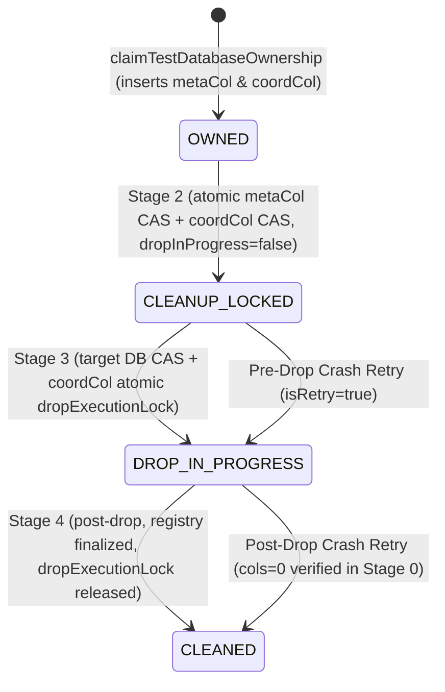

# DECISION OS — BATCH 4 REMEDIATION V3.5
## IMPLEMENTATION REPORT: ATOMIC DESTRUCTIVE-ACTION AUTHORITY & MUTUAL EXCLUSION

**Repository:** `AmiTtiwari43/Decision-OS`  
**Branch:** `fix/batch4-replica-set-transactional-recovery`  
**Baseline Commit (V3.4):** `00417e0d46e79496268dc786475d3641687167e3`  
**Target File:** `apps/api/src/db/guard.ts`  
**Date:** 2026-11-05  

---

## 1. Executive Summary

Decision OS Batch 4 V3.5 eliminates the remaining check-then-act authorization race (Defect R1) and the fail-open condition on missing coordination records (Defect R2) within the test database cleanup lifecycle in `apps/api/src/db/guard.ts`.

The solution implements an atomic, dual-layer coordination protocol:
1. **Destructive Execution Lock & Token Fencing:** An atomic CAS (`findOneAndUpdate`) in the independent coordination registry acquires an exclusive `dropExecutionLock: true` and issues a unique `dropExecutionToken`.
2. **Mutual Exclusion against Reassignment:** While a destructive drop is in flight (`DROP_IN_PROGRESS` / `dropExecutionLock: true`), all entry points strictly prohibit claiming, reassigning, or superseding the database authority.
3. **Fail-Closed Enforcement:** Missing, uninitialized, or mismatched coordination records fail closed immediately, preventing any unverified database from reaching `db.dropDatabase()`.
4. **Pre-Drop In-Process Verification:** Immediately prior to invoking `db.dropDatabase()`, the worker validates that its execution token matches the atomic coordination lock, halting before drop if superseded or revoked.

---

## 2. Updated State Machine & Metadata Types

### 2.1 Metadata Schema Extensions (`apps/api/src/db/guard.ts`)
```typescript
export interface TestDatabaseOwnershipMetadata {
  runId: string;
  workerId: string;
  ownershipGeneration: number;
  lifecycleState: TestDatabaseLifecycleState;
  claimedAt: Date;
  lastClaimVerifiedAt?: Date;
  cleanupInProgress?: boolean;
  cleanupOwner?: string;
  cleanupGeneration?: number;
  cleanupStartedAt?: Date;
  dropInProgress?: boolean;
  dropExecutionLock?: boolean;       // Exclusive destructive drop lock
  dropExecutionToken?: string;      // Unique UUID for in-flight drop execution
  dropStartedAt?: Date;
  dropRetriedAt?: Date;
  cleanedAt?: Date;
}
```

### 2.2 Lifecycle Transitions


---

## 3. Detailed Source Code Changes in `apps/api/src/db/guard.ts`

### 3.1 Re-Entry Prevention in `claimTestDatabaseOwnership`
- Added explicit pre-insert validation in `claimTestDatabaseOwnership`:
```typescript
if (client) {
  const coordCol = client.db('decision_os_test_coordination_test').collection('cleanup_registry');
  const existingCoord = await coordCol.findOne({
    _id: dbName as unknown as import('mongodb').ObjectId,
  });
  if (
    existingCoord &&
    (existingCoord.dropExecutionLock === true ||
      (existingCoord.lifecycleState === 'DROP_IN_PROGRESS' && existingCoord.cleanupInProgress === true))
  ) {
    throw new Error(
      `Test database safety guard violation: database '${dbName}' is locked for cleanup in coordination registry (state: '${existingCoord.lifecycleState}'). Re-entry prohibited.`
    );
  }
}
```
- Guarantees that while Worker A is in `DROP_IN_PROGRESS`, no external worker can claim the database.

### 3.2 Pre-Lock Registry Validation in `cleanupTestDatabase`
- Prior to acquiring the Stage 2 lock, `cleanupTestDatabase` inspects `coordCol`:
```typescript
const existingCoord = await coordCol.findOne({
  _id: dbName as unknown as import('mongodb').ObjectId,
});

if (!existingCoord) {
  throw new Error(`Safety guard violation: database '${dbName}' has no coordination record in registry. Refusing cleanup.`);
}
if (existingCoord.runId !== cleanRun) {
  throw new Error(`Safety guard violation: database '${dbName}' is owned by run '${existingCoord.runId}' (expected '${cleanRun}'). Refusing cleanup of another run's database.`);
}
if (existingCoord.workerId !== cleanWorker && existingCoord.cleanupOwner !== cleanWorker) {
  throw new Error(`Safety guard violation: database '${dbName}' is owned by worker '${existingCoord.workerId || existingCoord.cleanupOwner}' (expected '${cleanWorker}'). Refusing cleanup of another worker's database.`);
}
if (existingCoord.lifecycleState === 'CLEANED') {
  throw new Error(`Safety guard violation: database '${dbName}' is already cleaned.`);
}
if (expectedGen !== undefined && existingCoord.cleanupGeneration !== undefined && existingCoord.cleanupGeneration !== expectedGen) {
  throw new Error(`Safety guard violation: database '${dbName}' cleanup generation ${expectedGen} is superseded by newer generation ${existingCoord.cleanupGeneration}.`);
}
```
- Ensures that any missing or invalid coordination record immediately fails closed before any lock mutations occur.

### 3.3 Stage 2 Coordination Sync Without Unsafe Upsert
- Replaced `{ upsert: true }` with atomic CAS `{ returnDocument: 'after' }`:
```typescript
const coordSync = await coordCol.findOneAndUpdate(
  {
    _id: dbName as unknown as import('mongodb').ObjectId,
    runId: cleanRun,
    $and: [
      { $or: [{ workerId: cleanWorker }, { cleanupOwner: cleanWorker }] },
      { $or: [{ cleanupGeneration: { $lte: activeGeneration } }, { cleanupGeneration: { $exists: false }, lifecycleState: 'OWNED' }] },
    ],
  },
  {
    $set: {
      runId: cleanRun,
      workerId: cleanWorker,
      cleanupOwner: cleanWorker,
      cleanupGeneration: activeGeneration,
      lifecycleState: 'CLEANUP_LOCKED',
      cleanupInProgress: true,
      dropInProgress: false,
      dropExecutionLock: false,
      cleanupStartedAt: new Date(),
    },
  },
  { returnDocument: 'after' }
);

if (!coordSync) {
  throw new Error(`Safety guard violation: database '${dbName}' has no coordination record in registry. Refusing cleanup.`);
}
```

### 3.4 Stage 3 Atomic Destructive Authority CAS
- Implemented atomic acquisition of `dropExecutionLock` and `dropExecutionToken`:
```typescript
const currentDropToken = `drop_token_${cleanWorker}_${activeGeneration}_${Date.now()}_${Math.random().toString(36).slice(2, 8)}`;

const coordDropLock = await coordCol.findOneAndUpdate(
  {
    _id: dbName as unknown as import('mongodb').ObjectId,
    runId: cleanRun,
    cleanupOwner: cleanWorker,
    cleanupGeneration: activeGeneration,
    lifecycleState: { $in: ['CLEANUP_LOCKED', 'DROP_IN_PROGRESS'] },
    $or: [
      { dropExecutionLock: { $ne: true } },
      ...(isRetry ? [{ dropExecutionLock: true, cleanupOwner: cleanWorker }] : []),
    ],
  },
  {
    $set: {
      lifecycleState: 'DROP_IN_PROGRESS',
      dropInProgress: true,
      dropExecutionLock: true,
      dropExecutionToken: currentDropToken,
      dropStartedAt: new Date(),
    },
  },
  { returnDocument: 'after' }
);
```

### 3.5 Pre-Drop Authority Verification (Right Before `db.dropDatabase()`)
```typescript
const verifiedCoord = await coordCol.findOne({
  _id: dbName as unknown as import('mongodb').ObjectId,
});

if (!verifiedCoord) {
  throw new Error(`Safety guard violation: database '${dbName}' has no coordination record in registry. Refusing destructive drop.`);
}

if (
  verifiedCoord.runId !== cleanRun ||
  verifiedCoord.cleanupOwner !== cleanWorker ||
  (verifiedCoord.cleanupGeneration !== undefined && verifiedCoord.cleanupGeneration > activeGeneration) ||
  verifiedCoord.lifecycleState === 'CLEANED' ||
  verifiedCoord.dropExecutionToken !== currentDropToken ||
  verifiedCoord.dropExecutionLock !== true
) {
  throw new Error(
    `Safety guard violation: database '${dbName}' cleanup authority superseded before drop (revoked or stale generation ${activeGeneration} or token mismatch).`
  );
}

// Execute destructive drop
await db.dropDatabase();
```

---

## 4. Preservation of Canonical Decision Engine

- **Workspace:** `packages/decision-engine`
- **Git Diff:** Exactly **0 bytes diff** against baseline.
- **Fixture Verification:** All 10 golden fixtures (G1 through G10) passed with full numerical precision.
- **Engine Invariants:** Largest Remainder weight normalization, Gaussian Box-Muller perturbations, Mulberry32 seeded PRNG, and exact tie tolerance ($< 10^{-9}$) remain 100% intact.
