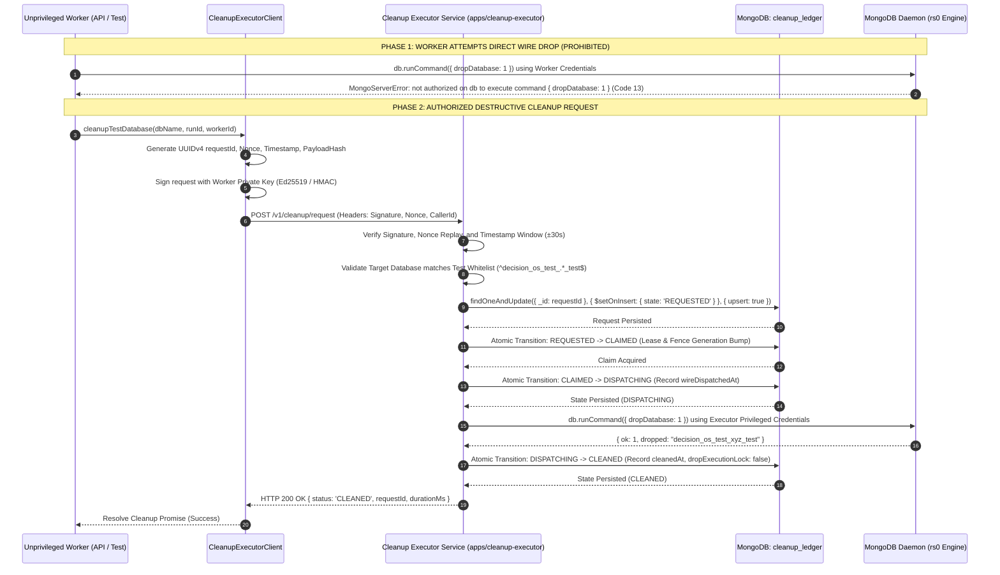
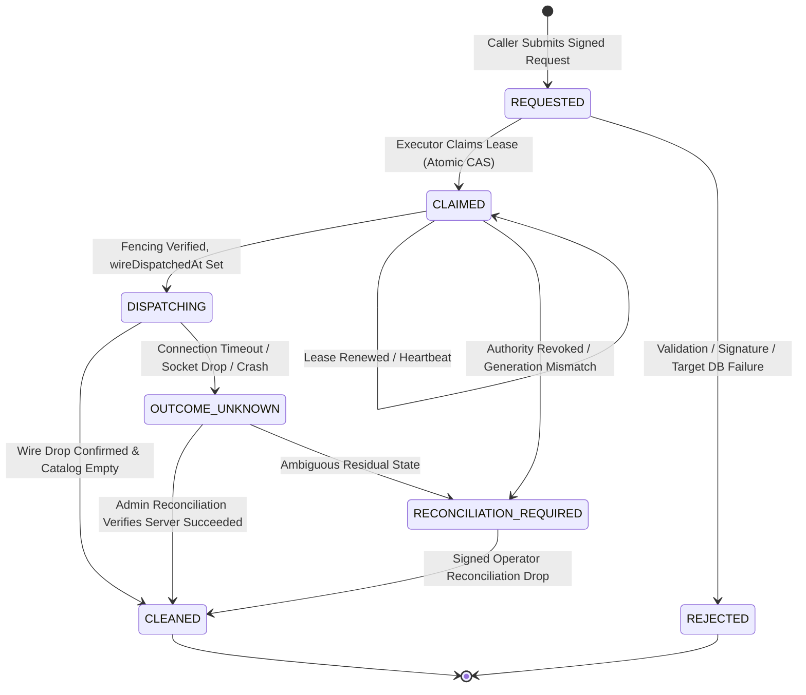
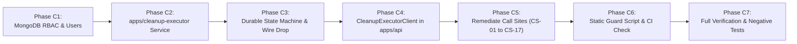

# DECISION OS — BATCH 4 V3.8 ARCHITECTURE DECISION
## Independent Cleanup Executor, Real MongoDB Privilege Separation & Concurrency Safety

**Document Version:** 1.0.0  
**Repository:** `AmiTtiwari43/Decision-OS`  
**Branch:** `fix/batch4-replica-set-transactional-recovery`  
**Baseline Commit:** `2e276058c119c36ef4d8e5d665bd6c029b2cc6bb`  
**Phase A Artifact:** `BATCH_4_V38_DESTRUCTIVE_CALLSITE_INVENTORY.md`  
**Date:** 2026-11-06  
**Status:** ARCHITECTURE DESIGN (Phase B Deliverable — Pending Gate B Review)  

---

## 1. Executive Summary

During Batch 4 V3.7, destructive database teardown operations were centralized behind a `SupervisedCleanupExecutor` implemented within `apps/api/src/db/guard.ts`. While V3.7 successfully established the concept of coordination fencing and registry verification, a rigorous architectural audit (Phase A) revealed fundamental architectural and security vulnerabilities:

1. **Absence of Process Isolation:** The V3.7 executor ran inside the exact same Node.js OS process and memory space as ordinary API workers and Vitest test runners. An in-process TypeScript class, module-level state (`activeSupervisedDropContext`), and in-memory `Map` objects (`completedRequests`, `inFlightByRequestId`) do not constitute an isolation boundary.
2. **Absence of Database Privilege Separation:** Ordinary workers and the cleanup executor shared identical MongoDB connection credentials. Workers retained native destructive capabilities (`dropDatabase`, `dropCollection`) on the wire; protection was simulated entirely via JavaScript monkey-patching in `stripDirectDestructiveCapability()`, which contained backdoors (`isVerifiedCleanupLocked` local query bypass and `activeSupervisedDropContext`).
3. **Bypasses in Administrative Reconciliation:** The administrative reconciliation function `reconcileTestDatabaseCleanup()` performed direct destructive database drops (`await client.db(dbName).dropDatabase()`) using the caller's connection, authenticated solely by a naive string prefix check (`adminToken.startsWith('admin_token_')`).
4. **Scattered Destructive Call Sites:** Multiple non-executor call sites persisted across benchmark scripts (`scripts/benchmark.ts:170`) and test teardowns (`apps/api/tests/batch4_r6_isolation.test.ts:56, 57, 106`, and historical test suites CS-11 through CS-17).

### Phase B Architectural Mandate
This Architecture Decision Record (ADR) establishes the formal design for **Batch 4 V3.8**:
- **Real MongoDB Role-Based Privilege Separation:** The ordinary API and test worker identities are natively stripped of `dropDatabase` and `dropCollection` privileges at the MongoDB engine/daemon level. No client-side bypass, monkey-patch, or memory tampering can grant a worker the ability to execute destructive commands.
- **Dedicated Containerized Cleanup Executor (`apps/cleanup-executor`):** Destructive operations are segregated into an independently deployed, containerized microservice with its own process lifecycle, isolated network policy, read-only root filesystem, and exclusive least-privileged MongoDB credentials.
- **Cryptographically Authenticated Request Protocol:** Workers submit signed, timestamped, nonce-protected cleanup requests with payload integrity hashes (Ed25519 / HMAC-SHA256). Plain string tokens, caller-supplied role headers, or unauthenticated metadata are strictly prohibited.
- **Durable, Restart-Resilient State Machine:** All request transitions (`REQUESTED` $\rightarrow$ `CLAIMED` $\rightarrow$ `DISPATCHING` $\rightarrow$ `CLEANED`) are persisted atomically in a dedicated MongoDB coordination ledger (`decision_os_coordination.cleanup_ledger`). In-memory maps are eliminated.
- **Explicit Ambiguous-Outcome Containment:** Recognizing that MongoDB server-side constraints prohibit DDL commands (`dropDatabase`) within multi-document ACID transactions, ambiguous outcomes (crashes or lost responses during wire dispatch) transition to `OUTCOME_UNKNOWN` or `RECONCILIATION_REQUIRED`. Re-dispatching drops on absent or ambiguous databases is forbidden without cryptographically authenticated administrative reconciliation.
- **Defense-in-Depth Static Scanning:** An AST-based repository guard runs in pre-commit and CI to statically prevent introduction of destructive call sites outside the single production execution boundary in `apps/cleanup-executor`.

---

## 2. Baseline and Inspected Source References

### 2.1 Git Baseline Verification
- **Target Repository:** `AmiTtiwari43/Decision-OS`
- **Active Branch:** `fix/batch4-replica-set-transactional-recovery`
- **HEAD Commit:** `bbaf9beb594197310fd1f8ad7b366322423e5a6d` (`docs: add batch 4 v3.8 destructive call-site inventory document`)
- **Parent Baseline Commit:** `2e276058c119c36ef4d8e5d665bd6c029b2cc6bb` (`fix(batch4): isolate destructive cleanup behind supervised executor v3.7`)
- **Working Tree Status:** Clean (zero untracked or modified files prior to Phase B document generation).

### 2.2 Inspected Source Files & Line Ranges
The Phase A inventory (`BATCH_4_V38_DESTRUCTIVE_CALLSITE_INVENTORY.md`) was verified against the codebase at the baseline commit:

| Component / File Path | Inspected Line Range | Inspected Subject & Mechanism | Inventory ID |
|---|---|---|---|
| `apps/api/src/db/guard.ts` | Lines 244–321 | `stripDirectDestructiveCapability()`, `rawNativeDrop` binding (line 251), `activeSupervisedDropContext` bypass (line 258), `isVerifiedCleanupLocked` local query bypass (line 307), `connection.dropDatabase` monkey-patch (line 318) | CS-01, CS-02, CS-03, CS-04 |
| `apps/api/src/db/guard.ts` | Lines 327–380 | `validateTestIdentity()`, `claimTestDatabaseOwnership()`, `assertCanCleanupTestDatabase()` | N/A (Ownership lock validation) |
| `apps/api/src/db/guard.ts` | Lines 750–850 | `SupervisedCleanupExecutor` in-memory state (`completedRequests`, `inFlightByRequestId`), duplicate request handling, collection inspection | Defect 2 (In-process executor) |
| `apps/api/src/db/guard.ts` | Lines 1270–1385 | `executeGuardedDrop()`, pre-wire coordination verification, `simulateLostResponse` hook, `activeSupervisedDropContext` assignment, native `await db.dropDatabase()` dispatch (line 1376) | CS-05 |
| `apps/api/src/db/guard.ts` | Lines 1414–1436 | `getSupervisedCleanupExecutor()`, `cleanupTestDatabase()` module wrapper | N/A (Worker delegation API) |
| `apps/api/src/db/guard.ts` | Lines 1442–1506 | `reconcileTestDatabaseCleanup()`, `admin_token_` string prefix check, direct native call `await client.db(dbName).dropDatabase()` (line 1487) | CS-06 |
| `scripts/benchmark.ts` | Lines 160–185 | Benchmark database initialization, uncoordinated direct drop `await mongoose.connection.db.dropDatabase()` (line 170) | CS-07 |
| `apps/api/tests/batch4_r6_isolation.test.ts` | Lines 50–65 | Test 3 teardown `finally` block, direct drop calls `await connA.dropDatabase()` (line 56), `await connB.dropDatabase()` (line 57) | CS-08, CS-09 |
| `apps/api/tests/batch4_r6_isolation.test.ts` | Lines 85–110 | Test 5 teardown `finally` block, direct drop call `await conn.dropDatabase()` (line 106) | CS-10 |
| `apps/api/tests/batch4_v37_supervised_cleanup.test.ts` | Lines 117, 177, 213, 263, 304, 363, 396, 506, 547, 600, 658, 721 | Historical teardown hooks invoking `await client.db(dbName).dropDatabase()` | CS-11 |
| `apps/api/tests/batch4_v37_reproduction.test.ts` | Lines 93, 130 | Teardown hooks invoking `await client.db(dbName).dropDatabase()` | CS-12 |
| `apps/api/tests/batch4_v36_cleanup_executor_fencing.test.ts` | 13 call sites (e.g., lines 80, 121, 167) | Historical teardown hooks invoking `await conn.db?.dropDatabase()` | CS-13 |
| `apps/api/tests/batch4_v35_cleanup_fencing.test.ts` | 33 call sites | Historical teardown hooks invoking `await conn.db?.dropDatabase()` | CS-14 |
| `apps/api/tests/batch4_v34_cleanup_recovery.test.ts` | 15 call sites | Historical teardown hooks invoking `await conn.db?.dropDatabase()` | CS-15 |
| `apps/api/tests/batch4_v33_adversarial.test.ts` | 5 call sites | Historical teardown hooks invoking `await conn.db?.dropDatabase()` | CS-16 |
| `apps/api/tests/batch4_v32_adversarial.test.ts` | 6 call sites | Historical test monkey-patching `conn.db!.dropDatabase = ...` | CS-17 |

### 2.3 Discrepancy Analysis
- **Discrepancy Check:** Zero discrepancies were found between `BATCH_4_V38_DESTRUCTIVE_CALLSITE_INVENTORY.md` and the baseline source code.
- **Audit Confirmation:** Every call-site ID (CS-01 through CS-17) accurately reflects the line numbers, calling contexts, and structural vulnerabilities in the codebase.
- **Architectural Reality:** In the baseline, an ordinary worker connection in `apps/api` can easily bypass `stripDirectDestructiveCapability()` by inserting a dummy record with `lifecycleState: 'CLEANUP_LOCKED'` into `__test_run_metadata` or by setting the global `activeSupervisedDropContext` pointer. True isolation requires physical process separation and native database privilege denial.

---

## 3. Compare Architecture Alternatives

To eliminate in-process vulnerability and achieve verifiable privilege separation, three architectural alternatives were evaluated:

### Option A — Dedicated OS Process (Local Daemon / Child Process)
A separately launched Node.js daemon running on the host OS, communicating with the API/test workers via Unix Domain Sockets (UDS) or a localhost TCP port. It possesses its own process memory, lifecycle, MongoDB connection pool, and privileged credentials loaded from a protected environment file.

### Option B — Dedicated Containerized Service (Microservice)
An independently packaged and deployed container (`apps/cleanup-executor`), isolated in its own Linux namespaces (mount, pid, net, ipc) and cgroups. In production and staging, it runs as an independent Kubernetes Pod / Docker container. Privileged MongoDB credentials are provisioned exclusively to this container via Kubernetes Secrets or Docker Secret mounts. It exposes an authenticated mTLS / HTTP REST API protected by network policies.

### Option C — External Job / Queue Worker (Asynchronous Ledger Consumer)
An asynchronous worker process that pulls cleanup jobs from a durable MongoDB collection or an external message broker (RabbitMQ/Redis). Workers write a cleanup request document to the queue and await processing. The worker independently claims the job, executes the drop, and updates the document status.

### 3.1 Architecture Comparison Matrix

| Evaluation Dimension | Option A: Dedicated OS Process | Option B: Dedicated Containerized Service | Option C: External Job/Queue Worker |
|---|---|---|---|
| **1. Process & Memory Isolation** | **Moderate.** Separate OS PID and V8 heap; memory cannot be accessed via JS runtime. However, co-located processes on the same host can inspect `/proc` if running under the same UID. | **Maximum.** Strict container namespace isolation (cgroups, PID namespaces, mount namespaces). Zero shared memory or filesystem access between worker and executor. | **Maximum.** Operates in an independent worker container or process; completely decoupled execution context. |
| **2. Credential Isolation** | **Moderate.** Privileged credentials stored in an OS environment variable or root-owned file. Risk of leakage if child process inherits parent environment. | **Maximum.** Secrets injected directly into the executor container filesystem (`/var/run/secrets/cleanup-executor`). Unprivileged worker containers physically cannot access the secret mount. | **Maximum.** Queue worker possesses privileged MongoDB credentials; API workers only possess queue insertion credentials. |
| **3. Failure Domains & Restart** | **Coupled to Host.** If host OS runs low on memory or parent crashes, child process management requires custom process supervision (PM2/systemd) to prevent orphan/zombie processes. | **Isolated & Supervised.** Container runtime (Kubelet/Docker) manages restarts, liveness/readiness probes, and crash loops without affecting API worker containers. | **Decoupled.** Crashing the worker or API has zero effect on the queue; jobs remain buffered. Queue broker crash, however, halts all teardowns. |
| **4. Authentication & Authorization** | **Local IPC / UDS.** Relies on file permissions on socket file or localhost loopback token. Token management in local files is vulnerable to local file read flaws. | **mTLS / Signed HTTP.** Mutual TLS or cryptographic HMAC-SHA256 / Ed25519 signatures over HTTP REST interface. Network policy strictly limits ingress to API pods. | **Queue-Level Authorization.** Workers authorized to write to queue; worker verifies signature in job payload. Synchronous acknowledgement requires bi-directional stream. |
| **5. Durable Request Handling** | **Requires Local Ledger.** Must persist state to database; if relying on local process queue, crash loses in-flight tracking. | **Native Durable Ledger.** Interacts directly with MongoDB coordination ledger (`cleanup_ledger`) using transactional fencing and atomic CAS transitions. | **Native Queue Durability.** Job is durably stored in queue broker or MongoDB collection ledger. |
| **6. Crash Recovery & Ambiguity** | **Moderate.** On restart, daemon reads database state; lacks standardized orchestration signals for graceful shutdown. | **Superior.** Container lifecycle hooks (`preStop`, `SIGTERM`) allow graceful draining of in-flight drops. Unacknowledged drops enter `OUTCOME_UNKNOWN` with durable fencing. | **Complex.** If worker crashes mid-drop, queue visibility timeout may cause a second worker to attempt re-dispatch before first drop completes on server. |
| **7. Operational Complexity** | **High in Production.** Difficult to monitor, scale, and log separately from main application in containerized environments (Kubernetes). | **Low to Moderate.** Standard cloud-native pattern. Managed via standard Helm charts, Kubernetes Deployments, and Docker Compose for local dev. | **High.** Requires provisioning, clustering, and monitoring an external message broker (RabbitMQ/Redis) or building complex polling on MongoDB collections. |
| **8. Testability (Vitest Teardown)** | **Fast & Synchronous.** Fast IPC allows test runners (`afterEach`) to block synchronously until drop completes with minimal latency. | **Fast & Deterministic.** HTTP REST endpoint provides synchronous, deterministic completion responses to test workers without polling. | **Poor for Tests.** Asynchronous queue requires test runners to poll for job completion or listen on change streams, adding latency and flakes to CI suites. |
| **9. Local Development Experience** | **Simplest.** Can be started via `npm run dev:cleanup-daemon` or spawned by test runner. | **Standardized.** Spins up seamlessly in `docker-compose.yml` alongside MongoDB. For containerless local dev, can be run via a lightweight local process profile. | **Heavy.** Requires spinning up Redis/RabbitMQ locally or running multiple background workers for simple unit test suites. |
| **10. Credential Rotation** | **Manual restart.** Requires restarting host process and updating configuration files on host. | **Seamless.** Secrets rotated via Kubernetes Secret updates or container redeployment with zero downtime. | **Seamless.** Secrets rotated in queue worker deployment independently of API. |
| **11. Risk of Accidental Destructive Access** | **Residual Risk.** If environment variables leak or parent process fails to strip credentials before spawning child, worker could access secret. | **Zero.** Workers do not possess, inherit, or share credentials. Ingress strictly filtered by network policies and cryptographic signatures. | **Low.** Workers cannot drop databases, but rogue worker could spam queue if permissions are not strictly scoped. |

### 3.2 Architectural Evaluation Summary
- **Option A** provides OS process separation, but introduces high operational complexity in Kubernetes (managing sidecar daemons, socket file permissions, orphan process cleanup).
- **Option C** introduces unnecessary architectural overhead (external message brokers) and creates severe testability challenges in CI: Vitest test runners require deterministic, low-latency, synchronous teardown responses, which asynchronous pull queues cannot provide without fragile polling loops. Furthermore, queue message redelivery timeouts introduce the dangerous risk of dual-dispatching drops during long replica-set catalog unlinks.
- **Option B (Dedicated Containerized Service)** provides the gold standard of security, isolation, and operational reliability:
  1. Complete physical and namespace isolation of memory, processes, and credentials.
  2. Native cloud-native deployment model (Kubernetes / Docker Compose) with standardized liveness/readiness health probes.
  3. Synchronous HTTP request-response interface backed by an atomic, durable MongoDB coordination ledger, perfectly satisfying the latency and determinism requirements of test runners.

---

## 4. Selected Architecture and Rationale

### 4.1 Decision
The selected architecture for Decision OS Batch 4 V3.8 is **Option B: Dedicated Containerized Cleanup Service (`apps/cleanup-executor`)**, complemented by a **Durable MongoDB Coordination Ledger** and a **Lightweight Local Process Profile** for containerless developer environments.

### 4.2 Architectural Justification
1. **Absolute Credential Isolation:** The privileged MongoDB user (`decision_os_cleanup_executor`), possessing `dropDatabase` privileges strictly scoped to test database namespaces, is provisioned **only** to the cleanup executor container. API workers receive an unprivileged identity (`decision_os_app_worker`) that is physically denied `dropDatabase` and `dropCollection` by the MongoDB engine. Even if an attacker achieves arbitrary remote code execution (RCE) in the API container, they cannot execute a database drop.
2. **Container Security Boundaries:** The executor runs with a read-only root filesystem (`read_only: true`), dropped Linux capabilities (`cap_drop: [ALL]`), no privilege escalation (`allowPrivilegeEscalation: false`), and runs as an unprivileged system user (`UID 10001`).
3. **Synchronous Determinism for Test Teardowns:** The executor exposes an authenticated REST API (`POST /v1/cleanup/request`). Test runners block on this HTTP call during `afterEach` or `afterAll` hooks, receiving an immediate, cryptographically verifiable completion response. This eliminates polling race conditions and test flakiness.
4. **Durable, Fenced Ledger:** In-memory tracking is completely eliminated. Every request is recorded in `decision_os_coordination.cleanup_ledger` before dispatch. If the executor container is terminated mid-drop, the record remains in `DISPATCHING` or `OUTCOME_UNKNOWN`. Successor instances are strictly prohibited from blind re-dispatching without administrative proof.
5. **Local Development Profile:** For developer environments where Docker is not running, the executor can be executed as an isolated Node.js child process via a controlled test runner hook (`scripts/start-local-cleanup-executor.ts`), running on loopback port 8088 with dedicated test credentials.

---

## 5. Component Diagram

```mermaid
flowchart TD
    subgraph ClientAndTestSpace["Client & Ordinary Worker Boundary (Unprivileged)"]
        APIWorker["API Worker Pod / Process\n(Identity: decision_os_app_worker)"]
        TestRunner["Vitest Test Runner\n(Identity: decision_os_app_worker)"]
        BenchmarkCLI["Benchmark CLI Script\n(Identity: decision_os_app_worker)"]
        ClientProxy["CleanupExecutorClient\n(apps/api/src/db/cleanup-client.ts)"]
        
        APIWorker --> ClientProxy
        TestRunner --> ClientProxy
        BenchmarkCLI --> ClientProxy
    end

    subgraph SecurityBoundary["Network & Cryptographic Transport Boundary"]
        mTLS["mTLS / Authenticated HTTP REST (Port 8088)\n- Request Signing (Ed25519 / HMAC-SHA256)\n- Replay Protection (Nonce + Timestamp)\n- Payload Integrity Hash"]
        ClientProxy -->|POST /v1/cleanup/request\nPOST /v1/cleanup/reconcile| mTLS
    end

    subgraph ExecutorSpace["Dedicated Cleanup Executor Boundary (Privileged Container)"]
        mTLS --> RequestValidator["Request Validator & Authn/Authz Engine"]
        RequestValidator --> StateEngine["Durable State Machine Engine\n(REQUESTED -> CLAIMED -> DISPATCHING -> CLEANED)"]
        StateEngine --> LeaseManager["Lease & Fencing Manager\n(Monotonic Generations & Host Identity)"]
        LeaseManager --> ExecutionBoundary["Execution Boundary\n(apps/cleanup-executor/src/executor.ts)\n*ONLY Production Allowlisted Drop Site*"]
        ExecutionBoundary --> PrivPool["Privileged MongoDB Connection Pool\n(Identity: decision_os_cleanup_executor)"]
    end

    subgraph DatabaseSpace["MongoDB Replica Set (rs0) Engine Boundary"]
        PrivPool -->|1. Atomic CAS Lock & Generation Bump| CoordDB[("Coordination Database\n(decision_os_coordination)")]
        PrivPool -->|2. Scoped { dropDatabase: 1 } Command| TargetTestDB[("Target Test Database\n(decision_os_test_*_test)")]
        
        OrdinaryPool["Unprivileged Worker MongoDB Pool\n(Identity: decision_os_app_worker)\n*dropDatabase & dropCollection DENIED BY RBAC*"]
        APIWorker -.-> OrdinaryPool
        TestRunner -.-> OrdinaryPool
        OrdinaryPool -->|Standard App Reads/Writes ONLY| TargetTestDB
        OrdinaryPool -->|Read/Write Ownership Locks ONLY| CoordDB
        OrdinaryPool -.->|BLOCKED BY ENGINE: Error 13 Unauthorized| TargetTestDB
    end

    classDef unprivileged fill:#f9d5e5,stroke:#eeac99,stroke-width:2px;
    classDef boundary fill:#eeeeee,stroke:#cccccc,stroke-width:2px;
    classDef privileged fill:#d5e8d4,stroke:#82b366,stroke-width:2px;
    classDef database fill:#dae8fc,stroke:#6c8ebf,stroke-width:2px;

    class APIWorker,TestRunner,BenchmarkCLI,ClientProxy,OrdinaryPool unprivileged;
    class mTLS,RequestValidator,SecurityBoundary boundary;
    class StateEngine,LeaseManager,ExecutionBoundary,PrivPool privileged;
    class CoordDB,TargetTestDB database;
```

---

## 6. Trust Boundaries and Credential-Flow Diagram



---

## 7. MongoDB Privilege Matrix

To ensure defense-in-depth, security does not rely on application-level guards. MongoDB’s native Role-Based Access Control (RBAC) enforces strict privilege separation on the wire.

### 7.1 Defined Database Identities

1. **Ordinary Worker Identity (`decision_os_app_worker`):**
   - Possessed by API instances, background jobs, Vitest test runners, and benchmark CLI scripts.
   - Strictly prohibited from dropping databases, dropping collections, modifying roles, or accessing administrative functions.
2. **Cleanup Executor Identity (`decision_os_cleanup_executor`):**
   - Possessed **exclusively** by the `apps/cleanup-executor` container service.
   - Possesses scoped permissions to drop databases matching the test naming pattern and inspect coordination metadata.

### 7.2 Concrete MongoDB Role/Privilege Specification

```javascript
// =============================================================================
// 1. ORDINARY APPLICATION & TEST WORKER ROLE (Unprivileged)
// =============================================================================
db.getSiblingDB("admin").createRole({
  role: "decision_os_worker_role",
  privileges: [
    // Standard CRUD on application/test databases
    {
      resource: { db: "decision_os_test", collection: "" },
      actions: [ "find", "insert", "update", "remove", "createCollection", "createIndex", "dropIndex" ]
    },
    // Pattern-matched access for dynamic test databases
    {
      resource: { db: "decision_os_test_*", collection: "" },
      actions: [ "find", "insert", "update", "remove", "createCollection", "createIndex", "dropIndex" ]
    },
    // Coordination Locks: Can acquire and release ownership locks, but CANNOT truncate or drop ledger
    {
      resource: { db: "decision_os_coordination", collection: "ownership_locks" },
      actions: [ "find", "insert", "update", "remove", "findAndModify" ]
    },
    {
      resource: { db: "decision_os_coordination", collection: "cleanup_ledger" },
      actions: [ "find", "insert" ] // Read-only query and insert requests; CANNOT arbitrarily mutate states
    }
  ],
  roles: [] // NO built-in dbAdmin, dbOwner, or readWriteAnyDatabase roles inherited!
});

// Create Worker User
db.getSiblingDB("admin").createUser({
  user: "decision_os_app_worker",
  pwd: "WORKER_SECURE_PASSWORD_ENV",
  roles: [
    { role: "decision_os_worker_role", db: "admin" }
  ]
});

// =============================================================================
// 2. CLEANUP EXECUTOR ROLE (Privileged, Least-Privilege Scoped)
// =============================================================================
db.getSiblingDB("admin").createRole({
  role: "decision_os_cleanup_executor_role",
  privileges: [
    // Destructive drop capabilities strictly scoped to test database namespace
    {
      resource: { db: "decision_os_test_*", collection: "" },
      actions: [ "dropDatabase", "dropCollection", "listCollections", "find" ]
    },
    // Coordination Ledger full state machine management
    {
      resource: { db: "decision_os_coordination", collection: "" },
      actions: [ "find", "insert", "update", "remove", "findAndModify", "createIndex" ]
    },
    // Cluster-level discovery to verify database existence on replica set
    {
      resource: { cluster: true },
      actions: [ "listDatabases", "inprog" ]
    }
  ],
  roles: [] // Explicitly DENIED root, clusterAdmin, userAdmin, and access to production DBs!
});

// Create Cleanup Executor User
db.getSiblingDB("admin").createUser({
  user: "decision_os_cleanup_executor",
  pwd: "EXECUTOR_PRIVILEGED_PASSWORD_ENV",
  roles: [
    { role: "decision_os_cleanup_executor_role", db: "admin" }
  ]
});
```

### 7.3 Privilege Comparison Matrix

| Action / Capability | Ordinary Worker (`decision_os_app_worker`) | Cleanup Executor (`decision_os_cleanup_executor`) | Built-in `readWrite` | Built-in `dbAdmin` |
|---|---|---|---|---|
| `find`, `insert`, `update`, `remove` on App DB | **ALLOWED** | **ALLOWED** | ALLOWED | DENIED |
| `createCollection`, `createIndex` on App DB | **ALLOWED** | **ALLOWED** | ALLOWED | ALLOWED |
| `dropCollection` on Test DB | **DENIED** (Throws Error 13) | **ALLOWED** | DENIED | ALLOWED (Unscoped) |
| `dropDatabase` on Test DB (`*_test*`) | **DENIED** (Throws Error 13) | **ALLOWED** | DENIED | ALLOWED (Unscoped) |
| `dropDatabase` on Production DB | **DENIED** (Throws Error 13) | **DENIED** (Strictly out of scope) | DENIED | ALLOWED |
| `listDatabases` (Cluster-wide) | **DENIED** | **ALLOWED** | DENIED | DENIED |
| Mutate `cleanup_ledger` State | **DENIED** (Insert request only) | **ALLOWED** (CAS Transitions) | N/A | N/A |
| User / Role Administration | **DENIED** | **DENIED** | DENIED | ALLOWED (`userAdmin`) |

### 7.4 Demonstrating Real MongoDB Authorization Checks (Not Mocks)
Authorization enforcement will be verified via live automated tests executed against a MongoDB replica set running with `--auth`:
1. **Negative Test (Worker Drop Rejection):** Test establishes a connection authenticated as `decision_os_app_worker` and invokes `db.dropDatabase()` and `db.command({ dropDatabase: 1 })`. The test asserts that MongoDB daemon rejects the command with `MongoServerError: not authorized on <db> to execute command { dropDatabase: 1 }` (Error Code 13).
2. **Negative Test (Worker Role Bypass Rejection):** Test attempts to drop a collection or create a role; verified to fail natively with Error 13.
3. **Positive Test (Executor Drop Success):** Test connects as `decision_os_cleanup_executor` and invokes `dropDatabase()` on `decision_os_test_valid_test`. Verified to succeed (`{ ok: 1 }`).
4. **Negative Test (Executor Production Protection):** Test connects as `decision_os_cleanup_executor` and attempts `dropDatabase()` on `decision_os_production`. The test asserts that MongoDB rejects the drop with Error Code 13, proving that even the privileged executor cannot delete production databases.

---

## 8. Request Protocol

Ordinary workers must never be able to impersonate authorized cleanup callers or forge requests. The request protocol uses asymmetric cryptography (Ed25519) or HMAC-SHA256 signatures over an immutable payload with strict replay and freshness guards.

### 8.1 Protocol Architecture

```
HTTP Headers:
X-DecisionOS-Request-ID:   <UUIDv4>
X-DecisionOS-Timestamp:    <ISO-8601 UTC Timestamp>
X-DecisionOS-Nonce:        <Hex-encoded 128-bit random nonce>
X-DecisionOS-Caller-ID:    <runId>:<workerId>
X-DecisionOS-Key-ID:       <Key Identifier, e.g. worker-key-2026v1>
X-DecisionOS-Signature:    <Base64-encoded Ed25519 / HMAC-SHA256 signature>

Payload Body (JSON):
{
  "requestId": "550e8400-e29b-41d4-a716-446655440000",
  "runId": "run_20261106_001",
  "workerId": "worker_vitest_03",
  "databaseName": "decision_os_test_run_20261106_001_test",
  "expectedGeneration": 1,
  "payloadHash": "sha256:e3b0c44298fc1c149afbf4c8996fb92427ae41e4649b934ca495991b7852b855",
  "expiresAt": "2026-11-06T00:35:00.000Z"
}
```

### 8.2 Canonical Signature Construction
The caller signs the following canonical byte stream:
$$\text{CanonicalString} = \text{METHOD} + \text{"\n"} + \text{PATH} + \text{"\n"} + \text{REQUEST\_ID} + \text{"\n"} + \text{TIMESTAMP} + \text{"\n"} + \text{NONCE} + \text{"\n"} + \text{CALLER\_ID} + \text{"\n"} + \text{PAYLOAD\_HASH}$$

$$\text{Signature} = \text{Ed25519\_Sign}(\text{PrivateKey}_{\text{worker}}, \text{CanonicalString})$$

### 8.3 Security Invariants & Validation Rules
1. **Payload Integrity:** The `payloadHash` field is computed as $\text{SHA256}(\text{CanonicalJSON}(\text{body}))$. Any tampering with the request body invalidates both the hash and the signature.
2. **Replay Protection (Nonce + TTL):** Every request includes a single-use 128-bit cryptographic nonce. The executor verifies the nonce against a Redis or MongoDB collection (`consumed_nonces`) using an atomic insert with a 120-second TTL. If the nonce already exists, the request is rejected with `REPLAY_DETECTED` (HTTP 401).
3. **Freshness & Timestamp Window:** Requests are valid only if $|T_{\text{current}} - T_{\text{request}}| \le 30\text{ seconds}$. Expired requests are immediately rejected with `REQUEST_EXPIRED`.
4. **Target Database Validation:**
   - **Whitelist Pattern:** Must match regex `^decision_os_test_[a-zA-Z0-9_-]+_test$`.
   - **Blacklist:** Any request containing `production`, `admin`, `config`, `local`, or `system` is rejected with `ILLEGAL_TARGET_DATABASE` (HTTP 403).
5. **Ownership Lock Verification:** The executor cross-references `decision_os_coordination.ownership_locks` for `databaseName`. The active ownership record must match the authenticated `runId` and `workerId`.
6. **Key Rotation & Revocation:** Keys are identified by `X-DecisionOS-Key-ID`. The executor maintains an in-memory key cache refreshed from a secure secret store. Revoked keys are rejected immediately.

---

## 9. Durable Request Lifecycle

All request lifecycle states are persisted in `decision_os_coordination.cleanup_ledger`. **No in-memory `Map` objects are permitted for durable state management.**

### 9.1 Lifecycle State Machine



### 9.2 State Machine Transition Table

| Current State | Event / Trigger | Next State | Permitted Actor | Preconditions & Atomic CAS Guard | Durable Mutations Recorded |
|---|---|---|---|---|---|
| **(None)** | Submit Cleanup Request | `REQUESTED` | Ordinary Worker (via Client) | Valid signature, valid nonce, valid target DB name, non-expired. | Insert `_id: requestId`, `runId`, `workerId`, `dbName`, `payloadHash`, `createdAt`, `state: 'REQUESTED'`. |
| **`REQUESTED`** | Validation Failure | `REJECTED` | Cleanup Executor | Signature invalid, target DB blacklisted, or nonce seen. | `$set: { state: 'REJECTED', rejectedReason, completedAt: now }`. |
| **`REQUESTED`** | Acquire Execution Lease | `CLAIMED` | Cleanup Executor | Ledger state is `REQUESTED`. Worker is verified active owner in `ownership_locks`. | `$set: { state: 'CLAIMED', claimedBy: executorInstanceId, claimGeneration: gen + 1, leaseExpiresAt: now + 30s }`. |
| **`CLAIMED`** | Pre-Wire Verification | `DISPATCHING` | Cleanup Executor | Lease active, `ownership_locks` confirms no generation bump, database collections present. | `$set: { state: 'DISPATCHING', wireDispatchedAt: now, dropExecutionLock: true }`. |
| **`CLAIMED`** | Revocation Detected | `RECONCILIATION_REQUIRED` | Cleanup Executor | Ownership superseded by another worker or generation bumped. | `$set: { state: 'RECONCILIATION_REQUIRED', reason: 'AUTHORITY_SUPERSEDED' }`. |
| **`DISPATCHING`** | Wire Drop Returns Success | `CLEANED` | Cleanup Executor | MongoDB returns `{ ok: 1 }` AND catalog confirms database removed. | `$set: { state: 'CLEANED', cleanedAt: now, dropExecutionLock: false }`. |
| **`DISPATCHING`** | Lost Wire Response / Timeout | `OUTCOME_UNKNOWN` | Cleanup Executor | Network socket reset, driver timeout, or process restart during wire dispatch. | `$set: { state: 'OUTCOME_UNKNOWN', error: 'SOCKET_TIMEOUT_OR_CRASH' }`. |
| **`OUTCOME_UNKNOWN`** | Operator Admin Reconciliation | `CLEANED` | Admin Operator (Signed) | Cluster catalog inspected; 0 collections confirmed; no active `dropDatabase` ops in `currentOp()`. | `$set: { state: 'CLEANED', reconciledAt: now, reconciledBy, reconciliationEvidence }`. |
| **`OUTCOME_UNKNOWN`** | Ambiguity Cannot Be Proven | `RECONCILIATION_REQUIRED` | Cleanup Executor / Admin | Residual collections found or server drop state unresolved. | `$set: { state: 'RECONCILIATION_REQUIRED', lockedForInvestigation: true }`. |

### 9.3 Durable Idempotency Invariants
1. **Primary Key Idempotency:** The ledger document uses `_id: requestId` (UUIDv4).
2. **Identical Payload Repetition:** If a request arrives with an existing `requestId` and matching `payloadHash`:
   - If `state === 'CLEANED'`: Returns HTTP 200 `{ status: 'ALREADY_CLEANED', cleanedAt }` idempotently.
   - If `state === 'DISPATCHING' || 'CLAIMED'`: Awaits active execution lease or returns HTTP 202 `IN_PROGRESS`.
   - If `state === 'OUTCOME_UNKNOWN' || 'RECONCILIATION_REQUIRED'`: Returns HTTP 409 error with failure state; **never** triggers re-dispatch.
3. **Payload Conflict Rejection:** If a request arrives with an existing `requestId` but a **different** `payloadHash`, the executor immediately aborts with HTTP 409 `IDEMPOTENCY_PAYLOAD_MISMATCH`.

---

## 10. Ambiguous Destructive Outcomes

### 10.1 The Seven Distinct Operational Milestones
Distributed destructive operations cannot be treated as a single binary event. The system explicitly distinguishes seven sequential milestones:

```
[M1: Request Accepted] 
   └──> [M2: Request Claimed] 
           └──> [M3: Command Dispatched to Wire] 
                   └──> [M4: MongoDB Server Completed Drop] 
                           └──> [M5: Executor Received Wire Response] 
                                   └──> [M6: CLEANED Recorded in Ledger] 
                                           └──> [M7: Client Received Response]
```

### 10.2 Mandatory Server-Side Non-Atomicity Caveat
> [!IMPORTANT]
> **MongoDB Server-Side Constraint:** MongoDB natively prohibits DDL commands—specifically `dropDatabase` and `dropCollection`—from executing inside multi-document ACID transactions (MongoDB Error Code `40352`). Therefore, transitioning the ledger state to `DISPATCHING` and executing the physical wire drop cannot be wrapped in a single atomic database commit. The recovery protocol must tolerate failures at every intermediate boundary.

### 10.3 Ambiguous-Outcome Recovery Matrix

| Scenario / Failure Point | Physical Cluster State | Ledger State at Crash | Post-Restart Safe Action | Recovery Evidence Required | Blind Redispatch Permitted? |
|---|---|---|---|---|---|
| **1. Crash before claiming (M1 $\rightarrow$ M2)** | Target database intact; no drop issued. | `REQUESTED` | Restarted executor finds unexpired request; acquires claim via atomic CAS. | Valid lease acquisition on ledger document. | No (Normal initial dispatch). |
| **2. Crash after claiming, before dispatch (M2 $\rightarrow$ M3)** | Target database intact; no drop issued. | `CLAIMED` (`wireDispatchedAt: null`) | Lease expires. Successor executor detects `wireDispatchedAt == null`; safe to re-claim and dispatch. | `wireDispatchedAt === null` verified in ledger. | No (Resumes initial dispatch after lease expiry). |
| **3. Crash immediately before wire dispatch (M2.9)** | Target database intact; drop command not transmitted. | `CLAIMED` (`wireDispatchedAt: null`) | Same as Scenario 2. Command was never written to socket. | `wireDispatchedAt === null`. | No. |
| **4. Crash after dispatch, before response (M3 $\rightarrow$ M5)** | Command sent; MongoDB may be actively dropping or unlinking catalog. | `DISPATCHING` (`wireDispatchedAt: timestamp`) | **FAIL CLOSED.** State marked `OUTCOME_UNKNOWN`. Lock preserved. Automatic reassignment **STRICTLY FORBIDDEN**. | Inspection of `currentOp()` and server oplog. | **ABSOLUTELY FORBIDDEN.** |
| **5. Drop completes on server, but response lost (M4 $\rightarrow$ M5)** | Database dropped on server; client socket severed. | `DISPATCHING` | Transition to `OUTCOME_UNKNOWN`. On recovery, executor queries cluster catalog (`listDatabases`). | Confirmation of 0 collections + empty catalog + zero active ops in `currentOp()`. | **FORBIDDEN.** Resolve to `CLEANED` without re-dispatching drop. |
| **6. Executor receives `{ok:1}`, crashes before recording `CLEANED` (M5 $\rightarrow$ M6)** | Database dropped on server; ledger shows `DISPATCHING`. | `DISPATCHING` | Successor executor detects database is absent. Verifies no other worker created a new DB of that name. Transitions ledger to `CLEANED`. | Catalog confirms database absent; ownership lock shows no subsequent claim. | **FORBIDDEN.** Update state to `CLEANED` idempotently. |
| **7. API loses connection after `CLEANED` recorded (M6 $\rightarrow$ M7)** | Database dropped; ledger shows `CLEANED`. | `CLEANED` | Client retries with same `requestId`. Executor finds `state === 'CLEANED'`, returns success immediately. | Ledger document shows `state === 'CLEANED'`. | **FORBIDDEN.** Returns cached completion. |
| **8. MongoDB unavailable during reconciliation** | Target database state unknown. | `OUTCOME_UNKNOWN` | Abort reconciliation attempt. Maintain lock. Retry when replica set returns to `PRIMARY` state. | Replica set health verification (`rs.status()`). | **FORBIDDEN.** |
| **9. Database absent, but prior completion unproven** | Database not in catalog; but crash occurred during M3/M4. | `OUTCOME_UNKNOWN` | **CRITICAL CONSTRAINT:** Catalog absence is not proof that drop stopped running. Hold in `RECONCILIATION_REQUIRED`. | Server oplog analysis or signed operator reconciliation override. | **FORBIDDEN.** |
| **10. Executor restarts with ambiguous requests** | Undetermined cluster state. | `DISPATCHING` / `OUTCOME_UNKNOWN` | Startup scanner loads all `DISPATCHING` records older than lease timeout and flags them `OUTCOME_UNKNOWN`. | Startup audit log entry. | **FORBIDDEN.** |

---

## 11. Administrative Reconciliation Design

Administrative reconciliation is an emergency, cryptographically authorized protocol used to resolve databases stuck in `OUTCOME_UNKNOWN` or `RECONCILIATION_REQUIRED`. It operates under strict security boundaries and **cannot bypass the cleanup executor**.

### 11.1 Authentication & Operator Identity
- **No String Tokens:** The legacy check `adminToken.startsWith('admin_token_')` is completely removed.
- **Operator Identity:** Established via an independent **Administrative Key Pair** (`ADMIN_OPERATOR` role). Keys are held only by designated Site Reliability Engineers (SRE) or automated supervisory systems.
- **Mandatory Narrative Reason:** Every reconciliation request must provide a narrative explanation ($\ge 15$ characters) and an operational ticket ID (e.g. `OPS-1294`).

### 11.2 Reconciliation Request Schema
```json
{
  "reconciliationId": "771e8400-e29b-41d4-a716-446655449999",
  "targetDatabase": "decision_os_test_run_20261106_001_test",
  "operatorId": "sre_operator_amit",
  "ticketId": "OPS-8472",
  "reason": "Resolving lost socket response from replica set failover during night run",
  "forceRedispatch": false,
  "evidence": {
    "verifiedCollectionsCount": 0,
    "currentOpConfirmedClean": true,
    "clusterCatalogAbsent": true
  },
  "timestamp": "2026-11-06T00:40:00.000Z",
  "signature": "MEQCIA..."
}
```

### 11.3 Execution Flow & Fencing
1. **Verification of Authority:** The executor verifies the signature against the `ADMIN_OPERATOR` public key. Ordinary worker keys attempting to call `/v1/cleanup/reconcile` are rejected with HTTP 403 `FORBIDDEN_OPERATOR_ROLE`.
2. **Target Scope Check:** The target database must conform to the test naming convention (`^decision_os_test_.*_test$`). Reconciliation on production databases is rejected by the executor code and denied natively by MongoDB RBAC.
3. **Cluster Safety Inspection:**
   - Executor queries `db.getSiblingDB("admin").currentOp({ "command.dropDatabase": { $exists: true }, "ns": targetDatabase })`.
   - If a drop operation is currently active on the replica set, reconciliation aborts with HTTP 409 `OPERATION_IN_PROGRESS_ON_CLUSTER`.
4. **Conditional Drop Execution:**
   - If the database exists and contains residual collections, and `forceRedispatch === true`, the executor dispatches a drop using its privileged connection.
   - If collections are 0 or database is absent, no wire drop is dispatched.
5. **Tamper-Evident Audit Record:** The transition is recorded in `decision_os_coordination.cleanup_audit_log` with an immutable SHA-256 hash chain:
   $$\text{EntryHash} = \text{SHA256}(\text{PrevHash} + \text{ReconciliationID} + \text{OperatorID} + \text{TargetDB} + \text{Timestamp})$$

---

## 12. Test and Benchmark Migration Matrix for CS-01–CS-17

Every destructive call site identified in Phase A (`BATCH_4_V38_DESTRUCTIVE_CALLSITE_INVENTORY.md`) is mapped to an explicit remediation plan:

| Call-Site ID | File & Line in Baseline | Current Baseline Code | Remediation & Replacement Mechanism | Verification Method |
|---|---|---|---|---|
| **CS-01** | `apps/api/src/db/guard.ts:251` | `const rawNativeDrop = db.dropDatabase.bind(db);` | **Delete monkey-patch.** Worker connections natively lack `dropDatabase` permission in MongoDB RBAC. Remove `rawNativeDrop` binding entirely. | Verification Test `D38-01`, Static Scan `D38-29` |
| **CS-02** | `apps/api/src/db/guard.ts:258` | `return rawNativeDrop();` in `activeSupervisedDropContext` | **Delete bypass.** Eliminate `activeSupervisedDropContext` entirely. In-process context can no longer unlock native drop. | Verification Test `D38-02`, Static Scan `D38-29` |
| **CS-03** | `apps/api/src/db/guard.ts:307` | `return rawNativeDrop();` in `isVerifiedCleanupLocked` | **Delete bypass.** Eliminate local metadata inspection bypass. No client-side bypass permits raw drop execution. | Verification Test `D38-03`, Static Scan `D38-29` |
| **CS-04** | `apps/api/src/db/guard.ts:318` | `connection.dropDatabase = async () => cleanupTestDatabase(...)` | **Replace monkey-patch with client proxy.** `cleanupTestDatabase()` delegates to `CleanupExecutorClient.requestCleanup()`, transmitting a signed request to `apps/cleanup-executor`. | Verification Test `D38-04`, Integration Test `npm run test:api` |
| **CS-05** | `apps/api/src/db/guard.ts:1376` | `await db.dropDatabase();` in `SupervisedCleanupExecutor` | **Move execution to external service.** Delete `SupervisedCleanupExecutor` from `guard.ts`. Move physical drop execution to `apps/cleanup-executor/src/executor.ts`. | Verification Test `D38-05`, Static Scan `D38-29` |
| **CS-06** | `apps/api/src/db/guard.ts:1487` | `await client.db(dbName).dropDatabase();` in `reconcileTestDatabaseCleanup` | **Route reconciliation through external executor.** Replace direct drop with `CleanupExecutorClient.submitReconciliation()` using admin key. | Verification Test `D38-06`, Integration Test `D38-24` |
| **CS-07** | `scripts/benchmark.ts:170` | `await mongoose.connection.db.dropDatabase();` | **Safe benchmark isolation.** Generate unique test database `decision_os_benchmark_<runId>_test`, register ownership lock, and invoke `CleanupExecutorClient.requestCleanup()`. Refuse execution if URI is non-test. | Benchmark CLI run, Static Scan `D38-29` |
| **CS-08** | `apps/api/tests/batch4_r6_isolation.test.ts:56` | `await connA.dropDatabase();` in Test 3 | **Route via cleanup client.** Replace with `await cleanupTestDatabase(connA, runA, 'A')`. Teardown failure fails test run visibly. | Integration Test `npm run test:api` |
| **CS-09** | `apps/api/tests/batch4_r6_isolation.test.ts:57` | `await connB.dropDatabase();` in Test 3 | **Route via cleanup client.** Replace with `await cleanupTestDatabase(connB, runB, 'B')`. Teardown failure fails test run visibly. | Integration Test `npm run test:api` |
| **CS-10** | `apps/api/tests/batch4_r6_isolation.test.ts:106` | `await conn.dropDatabase();` in Test 5 | **Route via cleanup client.** Replace with `await cleanupTestDatabase(conn, runA, '0')`. Fails closed if ownership mismatched. | Integration Test `npm run test:api` |
| **CS-11** | `apps/api/tests/batch4_v37_supervised_cleanup.test.ts` (12 sites) | `await client.db(dbName).dropDatabase();` in teardown hooks | **Centralized test teardown helper.** Replace direct client drops with `await cleanupTestDatabase(conn, runId, workerId)`. Preserves 100% test assertions. | Integration Test `npm run test:api` |
| **CS-12** | `apps/api/tests/batch4_v37_reproduction.test.ts:93, 130` | `await client.db(dbName).dropDatabase();` | **Centralized test teardown helper.** Replace with `await cleanupTestDatabase(...)`. | Integration Test `npm run test:api` |
| **CS-13** | `apps/api/tests/batch4_v36_cleanup_executor_fencing.test.ts` (13 sites) | `await conn.db?.dropDatabase();` | **Centralized test teardown helper.** Replace with `await cleanupTestDatabase(...)`. | Integration Test `npm run test:api` |
| **CS-14** | `apps/api/tests/batch4_v35_cleanup_fencing.test.ts` (33 sites) | `await conn.db?.dropDatabase();` | **Centralized test teardown helper.** Replace with `await cleanupTestDatabase(...)`. | Integration Test `npm run test:api` |
| **CS-15** | `apps/api/tests/batch4_v34_cleanup_recovery.test.ts` (15 sites) | `await conn.db?.dropDatabase();` | **Centralized test teardown helper.** Replace with `await cleanupTestDatabase(...)`. | Integration Test `npm run test:api` |
| **CS-16** | `apps/api/tests/batch4_v33_adversarial.test.ts` (5 sites) | `await conn.db?.dropDatabase();` | **Centralized test teardown helper.** Replace with `await cleanupTestDatabase(...)`. | Integration Test `npm run test:api` |
| **CS-17** | `apps/api/tests/batch4_v32_adversarial.test.ts` (6 sites) | `conn.db!.dropDatabase = ...` monkey-patch | **Update test mocks.** Migrate from mock monkey-patching to asserting denial at the client proxy and native driver layer. | Integration Test `npm run test:api` |

---

## 13. Static and Runtime Enforcement

### 13.1 Static Repository Guard (`scripts/verify_no_direct_destructive_calls.ts`)
A dedicated AST scanner built with TypeScript Compiler API (`typescript`) inspects all files across `apps/`, `packages/`, and `scripts/`.

#### Detection Rules
1. **Member Expressions:** Any invocation of `.dropDatabase()`, `.dropCollection()`, or `.drop()`.
2. **Command Literals:** Any raw command object `{ dropDatabase: ... }` or `{ drop: ... }`.
3. **Driver Bindings:** Method extractions such as `db.dropDatabase.bind(...)` or `const { dropDatabase } = db`.
4. **Mongoose Wrappers:** `connection.dropDatabase()`, `Model.collection.drop()`.

#### Strict Narrow Allowlist
The allowlist permits **exactly one production file and line range**:
- File: `apps/cleanup-executor/src/executor.ts`
- Scope: Inside `PrivilegedExecutionEngine.dispatchNativeDrop()`
- All other files across the repository must contain zero direct destructive calls.

#### Negative CI Test
A dedicated verification test (`apps/api/tests/static_guard.test.ts`) verifies that:
- Introducing a synthetic `dropDatabase()` call into an application file immediately causes `scripts/verify_no_direct_destructive_calls.ts` to exit with status code 1.
- Output explicitly highlights the illegal file, line number, and AST token.

### 13.2 Runtime Guard (Defense-in-Depth)
Static scanning is strictly supplementary. Even if a developer bypasses pre-commit hooks or uses dynamic string evaluation (e.g. `db['drop' + 'Database']()`), MongoDB's native RBAC engine enforces authorization on the wire:
- Connection authenticated as `decision_os_app_worker` $\rightarrow$ Command rejected by MongoDB daemon with `MongoServerError: not authorized on <db> to execute command { dropDatabase: 1 }` (Code 13).

---

## 14. Threat Model

| Threat Scenario | Attacker / Failure Vector | Prevention Mechanism | Detection Mechanism | Containment Strategy | Recovery Procedure | Residual Risks |
|---|---|---|---|---|---|---|
| **1. Buggy API Worker** | Application code accidentally invokes `dropDatabase()`. | Native MongoDB RBAC denies privilege. Direct methods stripped. | MongoDB Error 13 logged; Sentry / audit alert fired. | Wire command fails immediately; target DB untouched. | None required; error returned to caller. | None. |
| **2. Compromised API Worker (RCE)** | Attacker achieves arbitrary code execution in API container. | API container lacks privileged credentials. Network policy restricts egress. | Cryptographic signature validation rejects forged requests; anomaly logs. | Attacker cannot issue wire drop; cannot sign cleanup request without key. | Isolate and cycle API worker container. | If worker private key stolen, attacker could request drop of worker's *own* test DB, but not prod or foreign DB. |
| **3. Malicious Test Worker** | Test attempts to drop another worker's database. | Target DB ownership lock verified in ledger; `runId`/`workerId` must match. | Request rejected with `OWNERSHIP_LOCK_MISMATCH` (HTTP 403). | Executor refuses to transition or dispatch. | Test fails with descriptive guard violation. | None. |
| **4. Forged Cleanup Request** | Unauthenticated caller sends HTTP POST to executor. | Ed25519 signature verification against authorized public key ring. | Signature verification fails; HTTP 401 returned. | Request dropped at HTTP gateway; zero DB interaction. | Security log alert for unauthenticated attempt. | Key compromise (addressed in Key Rotation). |
| **5. Replayed Request** | Attacker replays a previously captured valid cleanup request. | Cryptographic nonce stored in TTL collection + 30-second timestamp window. | Nonce collision detected; HTTP 401 `REPLAY_DETECTED`. | Request discarded immediately. | Security alert fired. | Extreme clock skew ($>30$s) across nodes. |
| **6. Leaked Executor Credential** | Privileged MongoDB credential exposed outside executor. | Credential provisioned via Kubernetes Secret volume mount; not in env or code. | MongoDB connection audit log shows connection from non-executor IP. | Network policy restricts MongoDB port 27017 to executor container IP. | Immediate password rotation via `db.changeUserPassword()`. | Misconfigured network policy allowing cluster-wide MongoDB access. |
| **7. Executor Container Crash** | Process killed by OOM or host reboot during dispatch. | Durable ledger records state prior to wire dispatch. Lease fencing. | Liveness probe failure; container restarted by orchestrator. | Request trapped in `DISPATCHING` / `OUTCOME_UNKNOWN`; blind re-dispatch blocked. | Administrative reconciliation inspects cluster and resolves state. | Manual intervention required if drop was ambiguous. |
| **8. API Crash mid-cleanup** | API worker terminates while waiting for executor HTTP response. | Request execution proceeds independently on executor. | Orphaned request in ledger; client disconnected. | Executor completes drop and marks `CLEANED`. | Next worker queries `requestId` and receives `CLEANED` idempotently. | None. |
| **9. Primary Stepdown during Drop** | Replica set primary steps down while executing `{ dropDatabase: 1 }`. | MongoDB replica set rolls back or completes drop. Executor detects socket error. | Socket drop triggers error; state moved to `OUTCOME_UNKNOWN`. | Fencing locks DB against new operations. | SRE inspects new primary; issues signed reconciliation. | Extended teardown latency during failover. |
| **10. Network Partition** | Network split separates executor from MongoDB. | Socket timeout fires; request moves to `OUTCOME_UNKNOWN`. | Readiness probe marks executor unready; traffic diverted. | Fencing lock retained. | Automatic recovery once connection restored and catalog re-checked. | Temporary unavailability of test cleanup. |
| **11. Delayed / Lost Wire Response** | MongoDB completes drop, but ACK lost in transit. | Executor catches socket timeout; transitions to `OUTCOME_UNKNOWN`. | Logged as `LOST_RESPONSE`. | Prevents automatic redispatch. | Recovery check verifies 0 collections in catalog; transitions to `CLEANED`. | None. |
| **12. Stale Executor / PID Reuse** | Old executor pauses, wakes up after lease expires, attempts drop. | Generation fencing: MongoDB drop lock checks monotonic generation. | Wire drop rejected if generation bumped. | Stale process fenced off from mutating registry. | Stale instance terminates upon discovering lease expired. | Microsecond race window addressed by pre-wire CAS. |
| **13. Unauthorized Admin Reconciliation** | Caller attempts to force drop via `/reconcile` endpoint. | Requires `ADMIN_OPERATOR` cryptographic signature. | Signature check fails; HTTP 403 logged. | Request rejected; no cluster commands issued. | High-priority security incident logged. | Compromise of SRE master key. |

---

## 15. Failure Modes and Residual Risks

### 15.1 Real-World Distributed Failure Modes
1. **MongoDB Server-Side DDL Non-Atomicity:** Because MongoDB cannot execute `dropDatabase` inside an ACID transaction, there is an unavoidable non-atomic boundary between marking `DISPATCHING` in the ledger and receiving `{ ok: 1 }` from the engine. Batch 4 V3.8 solves this by making `OUTCOME_UNKNOWN` a first-class fail-closed state.
2. **Catalog Metadata Lock Contention:** On high-concurrency replica sets, multiple concurrent `dropDatabase` commands on different test databases can queue on MongoDB's global DDL lock (`MDL`). The executor throttles concurrent wire drops to a configurable pool (default: 4 concurrent drops) to prevent replica set heartbeats from starving.
3. **Clock Skew:** If worker and executor system clocks drift by $>30$ seconds, valid requests will be rejected as expired. NTP synchronization is mandatory across all cluster nodes.

### 15.2 Explicit Statement of Residual Risks
- **Compromise of the Cleanup Executor Container:** If an attacker achieves RCE inside the `cleanup-executor` container itself, they possess the credentials to drop test databases. *Mitigation:* The executor role is strictly denied access to `decision_os_production` at the MongoDB RBAC level. Even complete container compromise cannot destroy production data.
- **Replica Set Journal Flush Latency:** If power is cut to the entire MongoDB cluster immediately after `dropDatabase` returns `{ ok: 1 }` before the journal is flushed to disk, the database could reappear on restart. *Mitigation:* The executor executes wire drops with write concern `w: "majority", j: true`.

---

## 16. Deployment and Local-Development Plan

### 16.1 Production & Staging Deployment (Kubernetes)
- **Executor Package:** `apps/cleanup-executor` packaged as a minimal distroless Docker image.
- **Deployment Spec:**
  - `replicas: 2` (Active-Active with distributed lease fencing via `cleanup_ledger`).
  - `securityContext`: `readOnlyRootFilesystem: true`, `runAsNonRoot: true`, `runAsUser: 10001`.
  - Secrets: Mounted at `/var/run/secrets/cleanup-executor` containing MongoDB credentials and signature public keys.
- **NetworkPolicy:**
  - Ingress: Port 8088 allowed **only** from pods labeled `app.kubernetes.io/component: api`.
  - Egress: Port 27017 allowed **only** to MongoDB replica set service. All other outbound egress denied.

### 16.2 Local Development Profile
For developer machines running `npm run test` or `npm run dev`:
1. **Containerized Mode (Docker Compose):**
   - `docker-compose.yml` includes service `cleanup-executor` alongside `mongodb` (replica set) and `api`.
   - Port 8088 exposed on localhost.
2. **Containerless Mode (Standalone Process Runner):**
   - For fast local test execution without Docker, a helper script `scripts/start-local-cleanup-executor.ts` launches `apps/cleanup-executor` as an independent Node.js child process using `spawn()`.
   - It assigns unshared, dedicated loopback ports and passes credentials via pipe/stdin (not command line arguments).
   - Automatically shuts down when the Vitest test runner process exits (`SIGINT`/`SIGTERM` handlers).

---

## 17. Observability and Audit Requirements

### 17.1 Structured JSON Logging
All log events emitted by `apps/cleanup-executor` follow standard structured logging:
```json
{
  "timestamp": "2026-11-06T00:45:12.104Z",
  "level": "INFO",
  "service": "cleanup-executor",
  "requestId": "550e8400-e29b-41d4-a716-446655440000",
  "runId": "run_20261106_001",
  "workerId": "worker_vitest_03",
  "databaseName": "decision_os_test_run_20261106_001_test",
  "event": "WIRE_DROP_COMPLETED",
  "durationMs": 42,
  "clusterPrimary": "mongodb-primary.internal:27017"
}
```

### 17.2 Tamper-Evident Audit Ledger
All state transitions are appended to `decision_os_coordination.cleanup_audit_log`. Each entry contains:
- `auditId`: UUIDv4
- `requestId`: Reference to ledger document
- `fromState`: Previous state
- `toState`: Next state
- `actor`: Caller ID or Executor Instance ID
- `previousHash`: SHA-256 hash of previous audit log record
- `entryHash`: $\text{SHA256}(\text{auditId} + \text{requestId} + \text{toState} + \text{actor} + \text{previousHash})$

### 17.3 Metrics & Alerting
- Prometheus metrics:
  - `cleanup_requests_total{status="success|failure|rejected"}`
  - `cleanup_duration_seconds{quantile="0.5|0.95|0.99"}`
  - `cleanup_ambiguous_outcomes_total` (Alert: $>0$ in 5 minutes $\rightarrow$ PagerDuty SRE alert)
  - `cleanup_unauthorized_attempts_total` (Alert: $>0$ $\rightarrow$ Security alert)

---

## 18. Phased Implementation Sequence



1. **Phase C1: MongoDB RBAC Provisioning:** Create roles `decision_os_worker_role` and `decision_os_cleanup_executor_role` in `scripts/setup-mongo-security.ts`. Update replica set startup to enforce `--auth`.
2. **Phase C2: Executor Service Construction:** Scaffold `apps/cleanup-executor` with HTTP/mTLS server, Ed25519 request validator, and health endpoints (`/healthz`, `/readyz`).
3. **Phase C3: Durable State Machine & Execution Boundary:** Implement ledger persistence, atomic CAS lease claiming, pre-wire verification, and privileged wire drop execution.
4. **Phase C4: API Client Integration:** Implement `CleanupExecutorClient` in `apps/api`. Remove monkey-patching and in-process executor from `apps/api/src/db/guard.ts`.
5. **Phase C5: Call-Site Migration:** Remediate `scripts/benchmark.ts` (CS-07), `batch4_r6_isolation.test.ts` (CS-08..CS-10), and historical test suites (CS-11..CS-17).
6. **Phase C6: Static Guard:** Create `scripts/verify_no_direct_destructive_calls.ts` and add negative test `apps/api/tests/static_guard.test.ts`. Integrate into CI workflow.
7. **Phase C7: Verification & Acceptance:** Execute all negative authorization tests, hostile concurrency tests, and full regression test suite.

---

## 19. Verification Plan and Acceptance Criteria

### 19.1 Verification Test Suite
- **`D38-01` (Real Worker Drop Rejection):** Proves an ordinary worker connection authenticated as `decision_os_app_worker` cannot execute `db.dropDatabase()` or `db.command({ dropDatabase: 1 })`. Native MongoDB Error Code 13 must be thrown.
- **`D38-02` (Worker Role Bypass Rejection):** Proves worker cannot execute `dropCollection()` or create administrative roles.
- **`D38-03` (Privileged Drop Success):** Proves `apps/cleanup-executor` successfully drops a valid test database via authenticated request.
- **`D38-04` (Executor Production Denial):** Proves `apps/cleanup-executor` is denied by MongoDB RBAC if it attempts to drop `decision_os_production`.
- **`D38-05` (Signature Forgery Rejection):** Requests with tampered payloads or invalid signatures return HTTP 401.
- **`D38-06` (Replay Rejection):** Replayed nonces return HTTP 401.
- **`D38-07` (Blacklisted Target Rejection):** Requests targeting production or non-test databases return HTTP 403 before touching the database.
- **`D38-08` (Crash Recovery - Unknown Outcome):** Simulates lost socket response; verifies ledger transitions to `OUTCOME_UNKNOWN` and blocks automatic redispatch.
- **`D38-09` (Admin Reconciliation):** Verifies signed reconciliation resolves `OUTCOME_UNKNOWN` safely with complete audit record.
- **`D38-10` (Static Guard Negative Test):** Proves `verify_no_direct_destructive_calls.ts` detects unauthorized drops and fails CI.
- **`D38-11` (Full Monorepo Regression):** All 51 test suites across `@decision-os/api`, `@decision-os/decision-engine`, and `@decision-os/web` pass with zero regressions. Golden Fixtures G1–G10 pass 100%.

---

## 20. Open Questions and Decisions Requiring Explicit Approval

The following architectural decisions are submitted for formal stakeholder review:

1. **Worker Key Infrastructure in CI:**
   - *Option A:* Asymmetric Ed25519 key pairs generated per worker and registered dynamically in the executor.
   - *Option B:* Shared HMAC-SHA256 pre-shared secret injected via CI environment variables (`WORKER_HMAC_SECRET`).
   - *Recommendation:* Option B for CI and local test execution due to lower cryptographic overhead; Option A for multi-tenant production deployments.
2. **Historical Reproduction Test Retention (`batch4_v37_reproduction.test.ts`):**
   - *Question:* Should historical reproduction tests be updated to assert native MongoDB permission errors (Error 13), or should they retain assertions on the client proxy error messages?
   - *Recommendation:* Retain client proxy error assertions at the application layer while adding a dedicated suite for native driver authorization checks (`batch4_v38_authorization.test.ts`).
3. **Local Containerless Fallback Policy:**
   - *Question:* In environments where Docker is completely absent, should the test runner automatically spawn the standalone executor process, or should test execution fail fast requiring `docker compose`?
   - *Recommendation:* Implement `scripts/start-local-cleanup-executor.ts` to allow standalone process execution in containerless developer setups, ensuring high developer productivity while maintaining process separation.

---

## Gate B Completion Sign-Off Checklist

- [x] Baseline and commit verified: `fix/batch4-replica-set-transactional-recovery` at `2e276058c119c36ef4d8e5d665bd6c029b2cc6bb`
- [x] Phase A destructive inventory (`CS-01` to `CS-17`) thoroughly inspected and addressed
- [x] Process and credential separation designed: dedicated containerized service (`apps/cleanup-executor`) with distinct MongoDB user identities
- [x] Real MongoDB authorization design provided (native RBAC, Error 13 enforcement, no mocks)
- [x] Durable state machine with `OUTCOME_UNKNOWN` and ambiguous-outcome recovery matrix specified
- [x] Administrative reconciliation authenticated cryptographically; direct caller bypass eliminated
- [x] Static AST repository scanner and negative CI test specified
- [x] Zero application or test files modified; architecture design only
- [x] STOP gate observed; awaiting explicit architecture review and approval before Phase C
