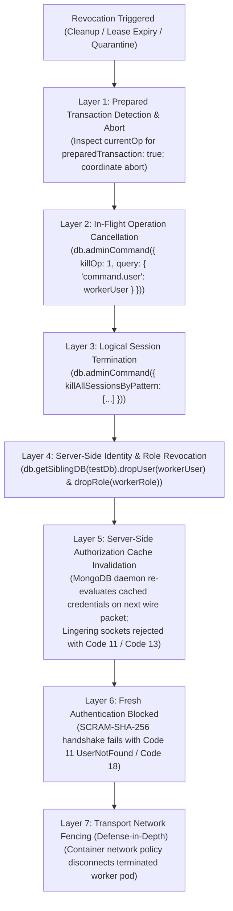
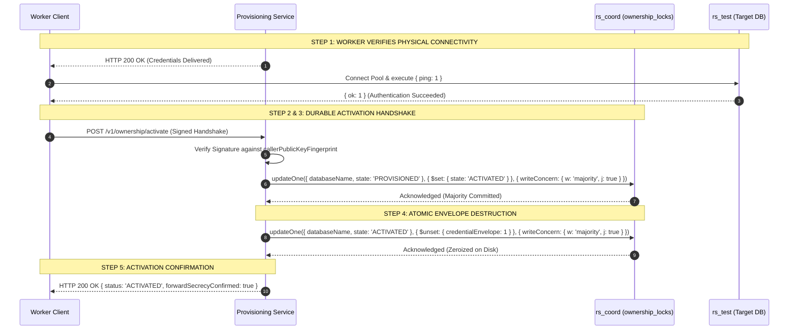
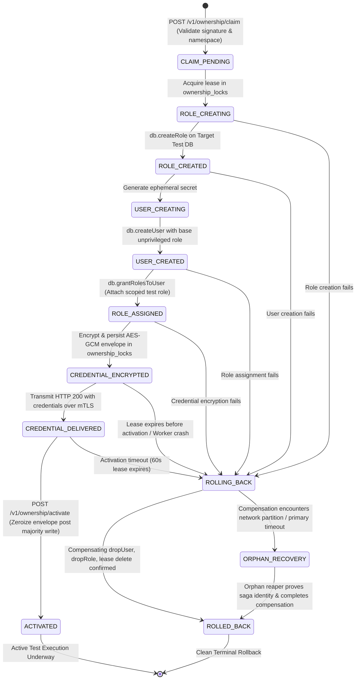
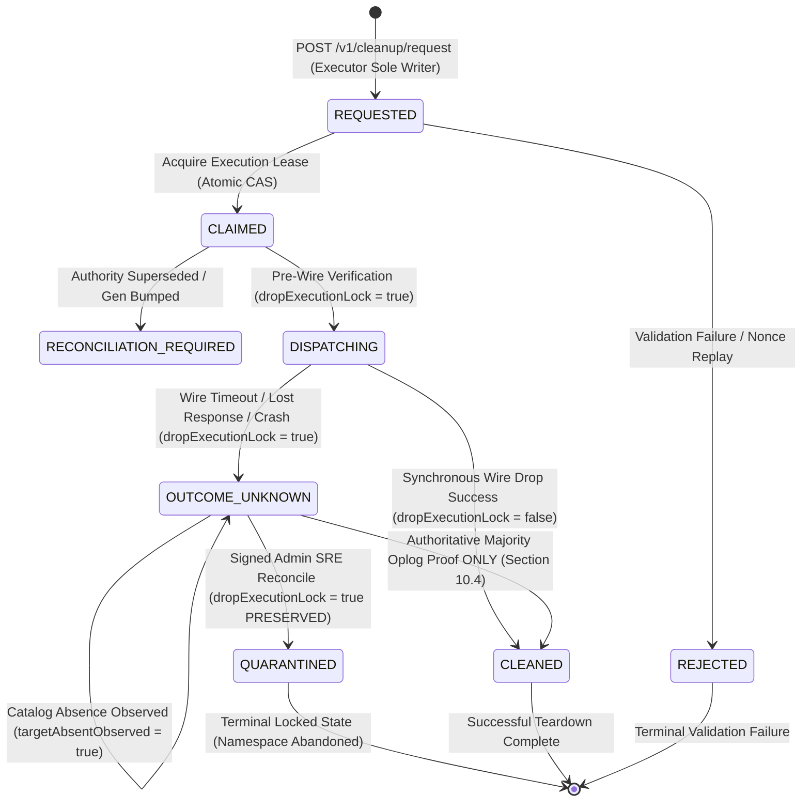

# DECISION OS — BATCH 4 V3.8 ARCHITECTURE DECISION
## Independent Cleanup Executor, Real MongoDB Privilege Separation & Concurrency Safety

**Document Version:** 1.5.0 (Phase B.5 Privilege Boundary Separation & Revocation Hardening)
**Repository:** `AmiTtiwari43/Decision-OS`
**Branch:** `fix/batch4-replica-set-transactional-recovery`
**Current Baseline Commit:** `f0fbfc1b6d04ad947f85277435d0803282cd03cd` (`docs: harden batch 4 v3.8 revocation and recovery protocol`)
**Parent Baseline Commit:** `949ca35a7154f4c4db308dd73badf85221a98c9f` (`docs: harden batch 4 v3.8 worker identity and role provisioning`)
**Prior Lineage Commits:** `724f1076284b186f42759677ab9e480d27531b69`, `943a8e7a433ce1b98804a83c6be403b2fca52e96`, `161e59e85bb7183c21926f0b04f788eb43312394`, `bbaf9bee29ef40f80bb8b958569c7ebbb437b427`, `2e276058c119c36ef4d8e5d665bd6c029b2cc6bb`
**Document Revision:** Working tree revision on `fix/batch4-replica-set-transactional-recovery` against baseline `f0fbfc1b6d04ad947f85277435d0803282cd03cd` (Phase B.5 Deliverable)
**Phase A Artifact:** `BATCH_4_V38_DESTRUCTIVE_CALLSITE_INVENTORY.md`
**Date:** 2026-11-06
**Status:** ARCHITECTURE DESIGN (Phase B.5 Deliverable — Pending Independent Review & Formal Gate B Approval)

---

## 1. Executive Summary

During Batch 4 V3.7, destructive database teardown operations were centralized behind an in-process `SupervisedCleanupExecutor` in `apps/api/src/db/guard.ts`. While V3.7 introduced coordination fencing concepts, the Phase A architectural audit (`BATCH_4_V38_DESTRUCTIVE_CALLSITE_INVENTORY.md`) and subsequent Phase B.1 through Phase B.4 security inquests revealed critical architectural defects:

1. **Absence of Real Process Isolation:** The V3.7 executor ran inside the exact same Node.js OS process and memory space as ordinary API workers and Vitest test runners.
2. **Absence of Native MongoDB Privilege Separation:** Ordinary workers and the cleanup executor shared identical MongoDB connection credentials; protection was simulated via JavaScript monkey-patching with backdoors (`isVerifiedCleanupLocked` and `activeSupervisedDropContext`).
3. **Invalid Privilege Scoping Assumptions (B38-01):** MongoDB RBAC does not support database-name wildcards (`decision_os_test_*`). Passing wildcard strings treats them literally as database names.
4. **Self-Referential Request Signing (B38-04):** The payload hash previously included `payloadHash` within the hashed body.
5. **Shared Secrets and Undecided Key Infrastructure (B38-05):** Symmetric shared HMAC secrets allowed any holder to impersonate other callers.
6. **Fencing Interleaving Realism (B38-07):** Application-level ledger CAS was erroneously claimed to atomically fence MongoDB server-side DDL commands.

### Phase B.2 Critical Security Remediation
Independent architectural review of baseline commit `943a8e7a433ce1b98804a83c6be403b2fca52e96` identified two structural privilege and recovery flaws:
1. **Additive Role Privilege Flaw (Finding 1 — B38-02, B38-03):** MongoDB role privileges are strictly additive. Granting broad `{ db: "", collection: "" }` write privileges inadvertently authorized workers to write to coordination collections, because MongoDB has no `deny` rules. Remediation eliminated broad grants in favor of exact per-database dynamic application roles.
2. **Administrative Redispatch Contradicts Fail-Closed Policy (Finding 2 — B38-06, B38-07):** Allowing `forceRedispatch` on ambiguous drop outcomes compromised fail-closed safety. Remediation removed all redispatch paths once `DISPATCHING` is entered, introducing the terminal state `QUARANTINED`.

### Phase B.3 Identity Isolation & Privilege Provisioning Remediation
Following the Phase B.2 baseline (`724f1076284b186f42759677ab9e480d27531b69`), multi-tenant and privilege-boundary inquest identified four security defects:
1. **Shared MongoDB Worker User Defeats Per-Worker Isolation (Finding B38-11):** Provisioning dynamic roles onto a shared user leaked permissions across concurrent workers. Remediated via unique per-worker MongoDB principals (`decision_os_worker_${runId}_${workerId}`) with ephemeral credentials.
2. **Unsafe MongoDB Role-Management Privileges (Finding B38-12):** Direct CRUD on `admin.system.*` and `userAdmin` on `admin` eliminated in favor of supported commands scoped to test namespaces with SHA-256 audit logging.
3. **Authoritative Oplog Evidence Is Underspecified (Finding B38-13):** Premature `CONFIRM_CLEANED` without correlation comments or majority commitment addressed via structured correlation tokens and fail-closed quarantine.
4. **Role Lifecycle and Provisioning Concurrency (Finding B38-14):** Analyzed concurrent claims and connection reuse across teardown, requiring post-revocation session and connection termination.

### Phase B.4 Session Invalidation, Evidence Integrity & Provisioning Recovery Remediation
Independent architectural review of baseline commit `949ca35a7154f4c4db308dd73badf85221a98c9f` identified five critical technical and authorization defects:
1. **Incorrect MongoDB Session Invalidation (Finding B38-15):** Replaced non-existent `killAllUserConnections` with supported `killAllSessionsByPattern` and `killSessions`. Scoped `killAnySession` and `impersonate` strictly to `{ cluster: true }`. Distinguished logical sessions, operations (`killOp`), cursors, TCP sockets, and driver pools.
2. **Technically Unsupportable Oplog Evidence Protocol (Finding B38-16):** Reworked Section 10.4 using exact MongoDB 8.0 `replSetGetStatus` fields (`optimes.lastCommittedOpTime.ts/.t`). Acknowledged that `local` ignores read concern. Formulated lexicographical OpTime comparison. Formally classified comment preservation in `local.oplog.rs` as an unverified hypothesis (`D38-21`).
3. **Crash-Unsafe Ephemeral Credential Recovery (Finding B38-17):** Designed a crash-safe credential recovery protocol utilizing a Caller-Bound Encrypted Credential Envelope stored in `ownership_locks.credentialEnvelope` (AES-256-GCM). Provided fallback to controlled rotation via `updateUser` before activation.
4. **False Provisioning Atomicity Claims (Finding B38-18):** Replaced false atomicity claims with a Durable Idempotent Provisioning Saga with explicit states, transition recovery, and orphan reaper proof.
5. **Genuinely Tamper-Evident Audit Ledger (Finding B38-19):** Separated audit log permissions from coordination CRUD. Scoped executor privileges on `cleanup_audit_log` strictly to append-only (`find`, `insert`, `createIndex`). Established external chain-head checkpoint storage.

### Phase B.5 Privilege Boundary Separation & Revocation Hardening Remediation
Independent architectural inquest of baseline commit `f0fbfc1b6d04ad947f85277435d0803282cd03cd` (and parent `949ca35a7154f4c4db308dd73badf85221a98c9f`) identified critical privilege-boundary and revocation vulnerabilities requiring deep structural remediation:

1. **Destructive Authority Separation from Coordination and Audit Data (Finding B38-20):**
   The v1.4.0 cleanup executor possessed `{ resource: { db: "", collection: "" }, actions: ["dropDatabase", "dropCollection", "listCollections", "find"] }` on the same deployment as `decision_os_coordination` and `cleanup_audit_log`. Because MongoDB RBAC evaluates permissions additively without negative filters, an identity with `{ db: "", collection: "" }` drop privileges can drop coordination metadata and the audit log itself. Application-level regex guards cannot serve as a database-enforced security boundary.
   **Remediation:** Architecture establishes a **Strict Physical/Logical Two-Deployment Boundary**:
   - **Coordination & Audit Cluster (`mongodb-coord:27019`):** Dedicated replica set hosting `decision_os_coordination` (`ownership_locks`, `cleanup_ledger`, `provisioning_saga`) and `cleanup_audit_log`. The destructive identity possesses **zero network reachability and zero authentication credentials** on this cluster.
   - **Ephemeral Test Database Cluster (`mongodb-test:27018`):** Dedicated replica set hosting dynamic test databases (`decision_os_test_*`). The Destructive Cleanup Executor (`decision_os_destructive_executor`) is scoped strictly to this cluster. Because coordination and audit databases do not reside on `mongodb-test`, it is mathematically impossible for destructive cleanup to drop coordination or audit storage.
2. **Restricting Role Provisioning Authority & Eliminating False Native Claims (Finding B38-24):**
   The v1.4.0 architecture erroneously claimed that application-level AST checks on `createRole` constituted MongoDB-native RBAC enforcement, while granting `createRole`, `createUser`, and `grantRole` on `admin`. In MongoDB, roles created on `admin` can contain privileges spanning any database and cluster resources. Furthermore, destructive cleanup authority was co-located with provisioning authority.
   **Remediation:**
   - Explicitly disclaimed that application-level regex/AST filtering constitutes MongoDB-native enforcement.
   - Decoupled provisioning authority from destructive cleanup: established an independent **Provisioning Service** (`decision_os_provisioner`), completely separate from the **Destructive Cleanup Executor** (`decision_os_destructive_executor`).
   - Dynamically provisioned worker roles are created **directly on the target test database** (`db.getSiblingDB(targetTestDb).createRole(...)`). In MongoDB RBAC, roles defined on a non-admin database are natively prohibited by the database engine from granting privileges outside that database or on cluster resources.
   - Formulated independent threat models for compromised provisioner, cleanup executor, API process, and administrative operator. Added adversarial verification test **`D38-26`**.
3. **Establishing Permanent Worker Revocation & Hostile Worker Defense (Finding B38-25):**
   The v1.4.0 architecture relied on `killAllSessionsByPattern` and client-side `client.close(true)`. Client-side pool closure is a cooperative client action, not an enforceable security boundary. Furthermore, `killAllSessionsByPattern` does not sever physical TCP connections, ignores prepared distributed transactions, and misses unsessioned wire operations.
   **Remediation:**
   - Documented the exact engine limitations of `killAllSessionsByPattern`.
   - Explicitly handled prepared transactions: scanning `currentOp` for prepared transactions and coordinating aborts prior to teardown.
   - Designed a fail-closed multi-layer revocation protocol that defends against hostile workers that deliberately retain TCP sockets:
     1. Abort in-flight operations via `killOp` and logical session termination.
     2. Server-side identity revocation via `dropUser` and `dropRole` on the target test database.
     3. Engine-level authorization cache invalidation: subsequent commands issued over lingering TCP sockets fail authorization immediately with MongoDB Error Code 11 (`UserNotFound`) or Code 13 (`Unauthorized`).
     4. Prevention of fresh authentication attempts (Code 11 / Code 18).
     5. Network container isolation policies severing transport paths.
   - Added hostile-worker adversarial verification test **`D38-27`**.
4. **Additional B38-17 to B38-19 Corrections:**
   - **AES-256-GCM Envelope Key Lifecycle & Nonce Uniqueness (B38-17):** Defined 256-bit envelope key generation, KMS/Vault storage, deterministic 96-bit nonce construction (instance salt + strictly monotonic counter) eliminating birthday collisions, versioned envelope schema (`keyVersion`), dual-key rotation windows, and crash recovery.
   - **Exact Durable Acknowledgement Ordering (B38-17):** Formulated strict ordering: Worker connects & verifies authentication $
ightarrow$ Worker sends signed activation handshake $
ightarrow$ Provisioner commits `ACTIVATED` to coordination storage with majority write concern (`w: "majority"`, `j: true`) $
ightarrow$ Only after majority persistence is confirmed does provisioner issue atomic `$unset: { credentialEnvelope: 1 }` with `w: "majority"` $
ightarrow$ HTTP 200 response returned.
   - **Reconciliation of Saga State Count & Transition Formalization (B38-18):** Reconciled discrepancy regarding state counts. Formally defined and documented all **12 distinct states** (`CLAIM_PENDING`, `ROLE_CREATING`, `ROLE_CREATED`, `USER_CREATING`, `USER_CREATED`, `ROLE_ASSIGNED`, `CREDENTIAL_ENCRYPTED`, `CREDENTIAL_DELIVERED`, `ACTIVATED`, `ROLLING_BACK`, `ROLLED_BACK`, `ORPHAN_RECOVERY`), cataloging every transition, failure recovery, and orphan reaper proof.
   - **Independent Audit Checkpoint Signing, Cadence, Sequence & Recovery (B38-19):** Specified independent Ed25519 signing key for audit checkpoints, 60-second periodic cadence (and event-driven on terminal states `CLEANED`, `QUARANTINED`), monotonic sequence ranges, external WORM/Cloud storage anchoring, crash recovery scanner, and fail-closed hard freeze upon verification mismatch.
   - **Reconciliation of Broad Privilege Model with Append-Only Audit:** Reconciled broad `{ db: "", collection: "" }` drop privilege by isolating it strictly to `mongodb-test:27018`, completely segregated from `mongodb-coord:27019` where `cleanup_audit_log` resides under strict append-only RBAC.
   - **Universal Fail-Closed Invariant:** Enforced fail-closed behavior across all proof, recovery, and verification paths.

---

## 2. Baseline and Inspected Source References

### 2.1 Git Baseline & Provenance Verification
- **Target Repository:** `AmiTtiwari43/Decision-OS`
- **Active Branch:** `fix/batch4-replica-set-transactional-recovery`
- **Current Baseline Commit:** `f0fbfc1b6d04ad947f85277435d0803282cd03cd` (`docs: harden batch 4 v3.8 revocation and recovery protocol`)
- **Parent Baseline Commit:** `949ca35a7154f4c4db308dd73badf85221a98c9f` (`docs: harden batch 4 v3.8 worker identity and role provisioning`)
- **Prior Lineage Commits:**
  - `724f1076284b186f42759677ab9e480d27531b69` (`docs: close batch 4 v3.8 privilege and redispatch gaps`)
  - `943a8e7a433ce1b98804a83c6be403b2fca52e96` (`docs: harden batch 4 v3.8 cleanup executor architecture`)
  - `161e59e85bb7183c21926f0b04f788eb43312394` (`refactor: add architecture decision record for batch 4 v3.8 cleanup executor`)
  - `bbaf9bee29ef40f80bb8b958569c7ebbb437b427` (`docs: add batch 4 v3.8 destructive call-site inventory document`)
  - `2e276058c119c36ef4d8e5d665bd6c029b2cc6bb` (`fix(batch4): isolate destructive cleanup behind supervised executor v3.7`)
- **Verification Note:** The repository working tree and GitHub remote branch `fix/batch4-replica-set-transactional-recovery` were independently inspected. Commit `f0fbfc1b6d04ad947f85277435d0803282cd03cd` is verified as the actual branch HEAD, descending directly from parent `949ca35a7154f4c4db308dd73badf85221a98c9f`.
- **Target Database Engines:**
  - **Coordination & Audit Deployment:** MongoDB 8.0 (Replica Set `rs_coord`, port 27019).
  - **Ephemeral Test Database Deployment:** MongoDB 8.0 (Replica Set `rs_test`, port 27018).

### 2.2 Inspected Source Files & Line Ranges
The Phase A inventory (`BATCH_4_V38_DESTRUCTIVE_CALLSITE_INVENTORY.md`) was verified against the codebase at the baseline commit:

| Component / File Path | Inspected Line Range | Inspected Subject & Mechanism | Inventory ID |
|---|---|---|---|
| `apps/api/src/db/guard.ts` | Lines 90–165 | `getTestDatabaseUri()` canonical database naming logic, lifecycle state definitions, ownership interface | Baseline Naming Contract |
| `apps/api/src/db/guard.ts` | Lines 244–321 | `stripDirectDestructiveCapability()`, `rawNativeDrop` binding (line 251), `activeSupervisedDropContext` bypass (line 258), `isVerifiedCleanupLocked` local query bypass (line 307), `connection.dropDatabase` monkey-patch (line 318) | CS-01, CS-02, CS-03, CS-04 |
| `apps/api/src/db/guard.ts` | Lines 327–450 | `validateTestIdentity()`, `claimTestDatabaseOwnership()`, `ownership_lock` insertion and direct client updates on `cleanup_registry` | Baseline Ownership Registration |
| `apps/api/src/db/guard.ts` | Lines 750–850 | `SupervisedCleanupExecutor` in-memory state (`completedRequests`, `inFlightByRequestId`), duplicate request handling, collection inspection | Defect 2 (In-process executor) |
| `apps/api/src/db/guard.ts` | Lines 1270–1385 | `executeGuardedDrop()`, pre-wire coordination verification, `simulateLostResponse` hook, `activeSupervisedDropContext` assignment, native `await db.dropDatabase()` dispatch (line 1376) | CS-05 |
| `apps/api/src/db/guard.ts` | Lines 1414–1436 | `getSupervisedCleanupExecutor()`, `cleanupTestDatabase()` module wrapper | Worker delegation API |
| `apps/api/src/db/guard.ts` | Lines 1442–1506 | `reconcileTestDatabaseCleanup()`, `admin_token_` string prefix check, direct native call `await client.db(dbName).dropDatabase()` (line 1487) | CS-06 |
| `scripts/benchmark.ts` | Lines 160–185 | Benchmark database initialization, uncoordinated direct drop `await mongoose.connection.db.dropDatabase()` (line 170) | CS-07 |
| `apps/api/tests/batch4_r6_isolation.test.ts` | Lines 50–65 | Test 3 teardown `finally` block, direct drop calls `await connA.dropDatabase()` (line 56), `await connB.dropDatabase()` (line 57) | CS-08, CS-09 |
| `apps/api/tests/batch4_r6_isolation.test.ts` | Lines 85–110 | Test 5 teardown `finally` block, direct drop call `await conn.dropDatabase()` (line 106) | CS-10 |
| Historical test suites | CS-11 to CS-17 | Direct client drops in teardowns across `batch4_v37`, `batch4_v36`, `batch4_v35`, `batch4_v34`, `batch4_v33`, and `batch4_v32` | CS-11 to CS-17 |

---

## 3. Compare Architecture Alternatives

To eliminate in-process vulnerability, achieve verifiable privilege separation, and guarantee permanent revocation, three architectural alternatives were evaluated:

### Option A — Dedicated OS Process (Local Daemon / Child Process)
A separately launched Node.js daemon running on the host OS, communicating with the API/test workers via Unix Domain Sockets (UDS) or a localhost TCP port. It possesses its own process memory, lifecycle, MongoDB connection pool, and privileged credentials loaded from a protected environment file.

### Option B — Dedicated Containerized Services with Physical Deployment Separation — SELECTED
An independently packaged and deployed set of isolated services:
1. **Provisioning Service (`apps/provisioner`):** Manages worker ownership claims, cryptographic signature verification, durable provisioning saga state, and generates scoped dynamic roles directly on the target test database. Possesses zero destructive drop capability.
2. **Destructive Cleanup Executor (`apps/cleanup-executor`):** Dedicated microservice isolated in its own Linux namespaces (mount, pid, net, ipc) and cgroups. Connects exclusively to the Ephemeral Test Database Deployment. Possesses `{ resource: { db: "", collection: "" }, actions: ["dropDatabase", ...] }` strictly on that test cluster, with zero network routing or credentials on the coordination cluster.
3. **Physical / Logical Two-Deployment Topology:**
   - `mongodb-coord:27019`: Houses coordination state and audit history.
   - `mongodb-test:27018`: Houses ephemeral test databases.

### Option C — External Job / Queue Worker (Asynchronous Ledger Consumer)
An asynchronous worker process that pulls cleanup jobs from an external message broker (RabbitMQ/Redis) or polling collection. Workers write a cleanup request document to the queue and await processing. The worker independently claims the job, executes the drop, and updates status.

### 3.1 Architecture Comparison Matrix

| Evaluation Dimension | Option A: Dedicated OS Process | Option B: Dedicated Containerized Services with Physical Deployment Separation | Option C: External Job/Queue Worker |
|---|---|---|---|
| **1. Process & Memory Isolation** | **Moderate.** Separate OS PID and V8 heap; memory cannot be accessed via JS runtime. However, co-located processes on the same host can inspect `/proc` if running under the same UID. | **Strong Container Boundary.** Isolated Linux namespaces (PID, mount, IPC, net) and cgroups. Provisioner and Cleanup Executor run in distinct containers with zero shared memory. | **Strong.** Operates in an independent worker container; completely decoupled execution context. |
| **2. Credential Isolation** | **Moderate.** Privileged credentials stored in an OS environment variable or root-owned file. Risk of leakage if child process inherits parent environment or runs as same user. | **Strong & Segregated.** Secrets injected directly into dedicated container secret volumes. Destructive executor container does not possess coordination credentials. Unprivileged worker containers have zero access. | **Strong.** Queue worker possesses privileged MongoDB credentials; API workers only possess queue insertion credentials. |
| **3. Destructive Blast Radius (B38-20)** | **Dangerous.** If connected to single deployment, `{ db: "", collection: "" }` drop privilege allows dropping coordination metadata and audit logs. | **Mathematically Zero on Coordination.** Destructive executor has zero network connectivity and zero credentials to `mongodb-coord:27019`. Native MongoDB catalog topology prevents dropping coordination collections. | **Dangerous on Shared Cluster.** If queue worker has drop privileges on cluster containing coordination data, compromise allows full destruction. |
| **4. Provisioning Privilege Safety (B38-24)** | **Poor.** Co-locates provisioning and destructive authority under single daemon. | **Enforceable & Constrained.** Provisioner has zero drop capability; dynamic roles are provisioned directly on target test database, preventing cluster-wide privilege grants natively. | **Mixed.** Queue worker would require broad admin rights if handling both provisioning and teardown. |
| **5. Hostile Worker Revocation (B38-25)** | **Weak.** Relies on worker cooperating with socket closure. | **Multi-Layer Server-Side Defense.** Aborts running queries (`killOp`), drops user/role from database, invalidates MongoDB connection authorization cache, and terminates logical sessions. Sockets retained by hostile worker fail immediately with Code 11/13. | **Weak.** Asynchronous queue cannot immediately sever existing socket connections held by hostile worker. |
| **6. Crash Recovery & Ambiguity** | **Moderate.** On restart, daemon reads database state; lacks standardized orchestration signals for graceful shutdown. | **Superior.** Container lifecycle hooks (`preStop`, `SIGTERM`) allow graceful draining. Unacknowledged drops enter `OUTCOME_UNKNOWN` with durable fencing; zero redispatch; 12-state durable saga recovery. | **Complex.** If worker crashes mid-drop, queue visibility timeout may cause a second worker to attempt re-dispatch before first drop completes on server. |
| **7. Operational Complexity** | **High in Production.** Difficult to monitor, scale, and log separately from main application in containerized environments. | **Low to Moderate.** Standard cloud-native pattern managed via Docker Compose (local/CI) and Helm/Kubernetes (staging/production). | **High.** Requires provisioning, clustering, and monitoring an external message broker (RabbitMQ/Redis) or building complex polling on MongoDB collections. |
| **8. Testability (Vitest Teardown)** | **Fast & Synchronous.** Fast IPC allows test runners (`afterEach`) to block synchronously until drop completes with minimal latency. | **Fast & Deterministic.** HTTP REST endpoint provides synchronous, deterministic completion responses to test workers without polling. | **Poor for Tests.** Asynchronous queue requires test runners to poll for job completion or listen on change streams, adding latency and flakes to CI suites. |
| **9. Local Development Experience** | **Simplest.** Can be started via `npm run dev:cleanup-daemon` or spawned by test runner. | **Standardized.** Spins up seamlessly in `docker-compose.yml` with dual MongoDB containers. For containerless local dev, can run via weaker development process profile. | **Heavy.** Requires spinning up Redis/RabbitMQ locally or running multiple background workers for simple unit test suites. |

### 3.2 Evaluation of Coordination/Audit Isolation Alternatives (Finding B38-20)
To resolve the vulnerability where `{ resource: { db: "", collection: "" }, actions: ["dropDatabase", ...] }` grants destruction of coordination and audit data, three isolation mechanisms were rigorously analyzed:

1. **Alternative 1: Single Deployment with Application-Level Regex & Policy Filtering (REJECTED)**
   - *Mechanism:* Keep all databases on a single MongoDB replica set (`:27018`). In application code, assert that the target database name matches `^decision_os_test_[a-zA-Z0-9_-]+$`, refusing to issue `dropDatabase` if the target is `decision_os_coordination`.
   - *Flaw:* **Violates Core Security Tenet.** In MongoDB RBAC, privileges are strictly additive:
     $$	ext{EffectivePrivileges}(U) = igcup_{R \in 	ext{InheritedRoles}(U)} 	ext{Privileges}(R)$$
     MongoDB RBAC does not support `deny` rules, negative filters, or database name exclusions. Because MongoDB does not support wildcards (`decision_os_test_*`), the destructive identity must hold `{ db: "", collection: "" }`. Therefore, the MongoDB engine natively permits that identity to execute:
     `db.getSiblingDB("decision_os_coordination").dropDatabase()`
     Any software defect, injection vulnerability, or container compromise of the cleanup executor gives an adversary wire-level authority to destroy coordination locks, the request ledger, and the audit trail. Relying exclusively on application regex validation fails basic security assurance.
2. **Alternative 2: Single Deployment with Dynamic Pre-Drop Role Grants (REJECTED)**
   - *Mechanism:* Instead of granting `{ db: "", collection: "" }`, the executor dynamically creates or modifies a role prior to dropping each database, granting `dropDatabase` only on the specific target database.
   - *Flaw:* To create or grant roles on arbitrary databases, the identity must hold `createRole` / `grantRole` on `admin`. An identity with administrative role manipulation rights on `admin` can grant itself cluster-wide drop permissions or modify any user. This merely trades one excessive privilege for an even more dangerous one.
3. **Alternative 3: Dedicated Physical / Logical Two-Deployment Topology (SELECTED)**
   - *Mechanism:* Separate the physical/logical cluster into two independent deployments:
     - **Coordination & Audit Deployment (`mongodb-coord:27019`):** Dedicated to `decision_os_coordination` and `cleanup_audit_log`. Only the Provisioning Service and Audit Service have network access and credentials.
     - **Ephemeral Test Database Deployment (`mongodb-test:27018`):** Dedicated strictly to dynamic test databases (`decision_os_test_*`). The Destructive Cleanup Executor connects only to this deployment.
   - *Guarantee:* Because `decision_os_coordination` and `cleanup_audit_log` **do not exist in the catalog of `mongodb-test:27018`**, and because the Destructive Cleanup Executor has **zero network routing and zero credentials on `mongodb-coord:27019`**, it is mathematically and physically impossible for destructive cleanup to drop or alter coordination or audit data, regardless of executor bugs or total executor container compromise.

---

## 4. Selected Architecture and Rationale

### 4.1 Decision
The selected architecture for Decision OS Batch 4 V3.8 is **Option B: Dedicated Containerized Services with Physical Deployment Separation**, deployed with:

1. **Physical / Logical Multi-Deployment Isolation (B38-20):**
   - **Coordination & Audit Deployment (`mongodb-coord:27019`):** Hosts `decision_os_coordination` (`ownership_locks`, `cleanup_ledger`, `provisioning_saga`) and `cleanup_audit_log`. Zero destructive credentials or routes exist on this cluster.
   - **Ephemeral Test Database Deployment (`mongodb-test:27018`):** Hosts dynamic test databases (`decision_os_test_*`).
2. **Decoupled Roles & Dedicated Services (B38-24):**
   - **Provisioning Service (`apps/provisioner`):** Identity `decision_os_provisioner`. Manages ownership leases and durable sagas on `mongodb-coord:27019`. Provisions dynamic roles directly on the target test database on `mongodb-test:27018`. Possesses zero destructive drop capability.
   - **Destructive Cleanup Executor (`apps/cleanup-executor`):** Identity `decision_os_destructive_executor`. Possesses `{ resource: { db: "", collection: "" }, actions: ["dropDatabase", "dropCollection", "listCollections", "find"] }` strictly on `mongodb-test:27018`. Possesses zero role-management privileges, zero user-creation privileges, and zero access to `mongodb-coord:27019`.
   - **Audit Service (`apps/audit-service` or dedicated audit writer):** Identity `decision_os_audit_writer`. Possesses strictly append-only privileges (`find`, `insert`, `createIndex`) on `cleanup_audit_log` on `mongodb-coord:27019`. Emits signed checkpoints to external WORM storage.
3. **Target-Database Dynamic Role Provisioning (B38-24):**
   - Worker roles are created directly on the target test database: `db.getSiblingDB(targetTestDb).createRole(...)`.
   - In MongoDB RBAC, roles defined on a non-admin database are natively prohibited by the database engine from granting privileges outside that database or on cluster resources.
4. **Permanent Multi-Layer Worker Revocation (B38-25):**
   - Revocation protocol coordinates in-flight operation abortion (`killOp`), prepared transaction detection and coordinator abort, immediate server-side principal dropping (`dropUser`), authorization cache invalidation, and prevention of fresh authentication.
   - Sockets retained by a hostile worker fail immediately with Code 11 or Code 13 on subsequent wire operations.
5. **Crash-Safe Credential Recovery & Durable 12-State Saga (B38-17, B38-18):**
   - Caller-bound encrypted envelope (`ownership_locks.credentialEnvelope`) utilizing AES-256-GCM with deterministic 96-bit nonces.
   - Strict durable acknowledgement ordering before envelope destruction.
   - Exactly 12 fully formalized saga states with deterministic transition recovery and orphan reaper verification proof.
6. **Authoritative Oplog Evidence Protocol & Quarantine State Machine (B38-13, B38-16):**
   - Reconciling ambiguous outcomes requires cryptographically correlated drop comments and replica-set majority commitment proof $(t, ts)$ from `replSetGetStatus`.
   - Zero redispatch after `DISPATCHING`. Ambiguous drops remain permanently in `QUARANTINED` with execution locks indefinitely held.

### 4.2 Architectural Justification
1. **Mathematical Impossibility of Coordination Destruction (B38-20):**
   By physically isolating the coordination and audit collections on a separate MongoDB deployment (`mongodb-coord:27019`) to which the destructive executor has no network connectivity or credentials, the system eliminates reliance on application-level regex validation. Even if the cleanup executor is fully compromised and attempts `db.getSiblingDB("decision_os_coordination").dropDatabase()`, the command is executed against the test instance where the database does not exist, leaving production coordination and audit records completely untouched.
2. **Native MongoDB Enforcement Against Role Escalation (B38-24):**
   By creating dynamic roles on the test database namespace itself (`targetTestDb`) rather than on `admin`, MongoDB's RBAC engine natively enforces that the role cannot contain privileges on any other database or cluster resource. The provisioner is denied `userAdmin` or `createRole` on `admin`, rendering it impossible for a compromised provisioner to grant root-equivalent or cluster-wide privileges.
3. **Resilience Against Hostile Workers (B38-25):**
   Client-side driver connection closure (`client.close(true)`) is treated as a cooperative convenience rather than a security boundary. Permanent revocation is enforced at the MongoDB daemon layer through server-side `dropUser` and session termination. Subsequent commands issued over lingering TCP sockets fail authorization natively at the database wire protocol layer.
4. **Guaranteed Forward Secrecy & Crash Recovery (B38-17):**
   Storing ephemeral credentials in caller-bound AES-256-GCM encrypted envelopes guarantees that retrying workers receive deterministic credentials after executor crashes, without attempting to reverse SCRAM-SHA-256 verifiers. Enforcing exact durable majority acknowledgement before envelope deletion guarantees that credentials are never destroyed before the worker has safely activated.
5. **Deterministic Destruction Without Dual-Drop Danger:**
   Eliminating administrative redispatch guarantees that once `{ dropDatabase: 1 }` is transmitted across the wire, no subsequent or delayed drop command can ever execute against a reused or active database namespace.

---

## 5. Component Diagram

```mermaid
flowchart TD
    subgraph ClientAndTestSpace["Client & Ordinary Worker Boundary (Unprivileged)"]
        WorkerA["Vitest Worker A / API
(Identity: decision_os_worker_runA_wA)
(DB: decision_os_test_runA_wA)"]
        WorkerB["Vitest Worker B / API
(Identity: decision_os_worker_runB_wB)
(DB: decision_os_test_runB_wB)"]
        BenchmarkCLI["Benchmark Runner
(Identity: decision_os_benchmark_bench1)
(DB: decision_os_benchmark_bench1_test)"]
        ClientProxy["CleanupExecutorClient
(apps/api/src/db/cleanup-client.ts)"]

        WorkerA --> ClientProxy
        WorkerB --> ClientProxy
        BenchmarkCLI --> ClientProxy
    end

    subgraph SecurityBoundary["Network & Cryptographic Transport Boundary"]
        mTLS["mTLS / Authenticated HTTP REST (Port 8088)
- Ed25519 Asymmetric Signatures
- RFC 8785 JSON Canonicalization
- Replay Protection (Nonce + Timestamp)"]
        ClientProxy -->|POST /v1/ownership/claim
POST /v1/ownership/activate
POST /v1/cleanup/request
POST /v1/cleanup/reconcile| mTLS
    end

    subgraph ProvisioningServiceSpace["Dedicated Provisioning Service Boundary (apps/provisioner)"]
        mTLS --> ProvisionerAPI["Provisioning Engine & Authn Validator
(Binds Ed25519 Public Key to Worker ID)"]
        ProvisionerAPI --> SagaManager["Durable 12-State Provisioning Saga Manager
(Generates Ephemeral Credentials & Envelopes)"]
        SagaManager --> ScopedRoleEngine["Scoped Role & User Engine
(Provisions Roles Directly on Target Test DB)
*NO dropDatabase or Destructive Rights!*"]
        ScopedRoleEngine --> ProvisionerPoolTest["Provisioner Test Pool
(Identity: decision_os_provisioner)"]
        SagaManager --> ProvisionerPoolCoord["Provisioner Coord Pool
(Identity: decision_os_provisioner)"]
    end

    subgraph DestructiveExecutorSpace["Dedicated Destructive Cleanup Service Boundary (apps/cleanup-executor)"]
        mTLS --> CleanupValidator["Cleanup Request Validator
(Verifies Signed Request & Ownership Lease)"]
        CleanupValidator --> StateMachineEngine["Durable State Machine Engine
(Authoritative Sole Writer of cleanup_ledger)"]
        StateMachineEngine --> DropEngine["Destructive Drop Engine
*ONLY Production Allowlisted Drop Site*
*Dispatches { dropDatabase: 1, comment: ... }*"]
        DropEngine --> DestructivePoolTest["Destructive MongoDB Pool
(Identity: decision_os_destructive_executor)"]
        StateMachineEngine --> AuditWriterClient["Audit Client"]
    end

    subgraph AuditServiceSpace["Dedicated Audit Boundary (apps/audit-service)"]
        AuditWriterClient --> AuditWriterEngine["Tamper-Evident Audit Writer
(SHA-256 Hash Chaining)"]
        AuditWriterEngine --> AuditPoolCoord["Audit MongoDB Pool
(Identity: decision_os_audit_writer)
*Strictly Append-Only: find, insert, createIndex*"]
        AuditWriterEngine --> CheckpointEngine["Signed Audit Checkpoint Generator
(60s Cadence / Terminal Milestones)"]
        CheckpointEngine --> ExternalWORM[("External WORM / Cloud Storage
Object Lock / append-only filesystem")]
    end

    subgraph CoordCluster["MongoDB Coordination & Audit Deployment (rs_coord :27019)"]
        ProvisionerPoolCoord -->|Manage Saga & Locks| CoordDB[("decision_os_coordination
- ownership_locks
- provisioning_saga
- cleanup_ledger")]
        AuditPoolCoord -->|Append-Only Writes| AuditLogColl[("cleanup_audit_log
*Zero Update / Remove / Drop*")]
    end

    subgraph TestCluster["MongoDB Ephemeral Test Database Deployment (rs_test :27018)"]
        ProvisionerPoolTest -->|Create User & Scoped Role on Target DB| TestDBAuth[("admin & test DBs
- Roles Scoped to Target DB Only
- Ephemeral Credentials")]
        DestructivePoolTest -->|Drop Ephemeral Test DBs| TargetDBs[("Test Databases
- decision_os_test_runA_wA
- decision_os_test_runB_wB")]
        DestructivePoolTest -->|Session & Op Termination| ClusterRes[("Cluster Resource
- killOp, killAllSessionsByPattern")]

        PoolA["Worker A Connection Pool
(Identity: decision_os_worker_runA_wA)"]
        PoolB["Worker B Connection Pool
(Identity: decision_os_worker_runB_wB)"]

        WorkerA -.-> PoolA
        WorkerB -.-> PoolB

        PoolA -->|CRUD ONLY on assigned DB| TargetDBA[("Target DB A
decision_os_test_runA_wA")]
        PoolB -->|CRUD ONLY on assigned DB| TargetDBB[("Target DB B
decision_os_test_runB_wB")]

        PoolA -.->|BLOCKED BY RBAC: Code 13 on DB B| TargetDBB
        PoolB -.->|BLOCKED BY RBAC: Code 13 on DB A| TargetDBA
        PoolA -.->|BLOCKED BY RBAC: Code 13 on dropDatabase| TargetDBs
    end

    DestructivePoolTest -.->|PHYSICALLY BLOCKED: Zero Network Route & No Credentials| CoordCluster
    PoolA -.->|PHYSICALLY BLOCKED: Zero Network Route & No Credentials| CoordCluster
    PoolB -.->|PHYSICALLY BLOCKED: Zero Network Route & No Credentials| CoordCluster

    classDef unprivileged fill:#f9d5e5,stroke:#eeac99,stroke-width:2px;
    classDef boundary fill:#eeeeee,stroke:#cccccc,stroke-width:2px;
    classDef privileged fill:#d5e8d4,stroke:#82b366,stroke-width:2px;
    classDef database fill:#dae8fc,stroke:#6c8ebf,stroke-width:2px;
    classDef external fill:#fff2cc,stroke:#d6b656,stroke-width:2px;

    class WorkerA,WorkerB,BenchmarkCLI,ClientProxy,PoolA,PoolB unprivileged;
    class mTLS,ProvisionerAPI,CleanupValidator,SecurityBoundary boundary;
    class SagaManager,ScopedRoleEngine,ProvisionerPoolTest,ProvisionerPoolCoord,StateMachineEngine,DropEngine,DestructivePoolTest,AuditWriterEngine,AuditPoolCoord,CheckpointEngine privileged;
    class CoordDB,AuditLogColl,TestDBAuth,TargetDBs,TargetDBA,TargetDBB database;
    class ExternalWORM external;
```



---

## 6. Trust Boundaries and Credential-Flow Diagram

```mermaid
sequenceDiagram
    autonumber
    participant WorkerA as Worker A (Hostile/Test)
    participant Client as CleanupExecutorClient
    participant Provisioner as Provisioning Service (apps/provisioner)
    participant Executor as Destructive Cleanup Executor (apps/cleanup-executor)
    participant CoordDB as MongoDB: rs_coord (:27019)
    participant TestDB as MongoDB: rs_test (:27018)
    participant AuditService as Audit Service / WORM Storage

    Note over WorkerA,TestDB: PHASE 1: DIRECT ADVERSARIAL ATTACKS BLOCKED NATIVELY
    WorkerA->>TestDB: db.runCommand({ dropDatabase: 1 })
    TestDB-->>WorkerA: MongoServerError: not authorized to execute { dropDatabase: 1 } (Code 13)
    WorkerA->>CoordDB: TCP SYN to Port 27019 (Attempt direct coordination tampering)
    CoordDB-->>WorkerA: Connection Refused (Network Policy / Firewall Blocked)

    Note over WorkerA,TestDB: PHASE 2: CONSTRAINED PROVISIONING SAGA (B38-24)
    WorkerA->>Client: claimTestDatabaseOwnership("decision_os_test_runA_wA", "runA", "wA")
    Client->>Client: Sign claim payload using Worker A Ed25519 Private Key
    Client->>Provisioner: POST /v1/ownership/claim (Payload + Ed25519 Signature)
    Provisioner->>Provisioner: Verify Signature, Caller ID "runA:wA", DB Naming Contract
    Provisioner->>CoordDB: Persist Saga CLAIM_PENDING in ownership_locks & provisioning_saga (w: majority)
    Provisioner->>TestDB: db.getSiblingDB("decision_os_test_runA_wA").createRole({ role: "workerRole", privileges: [CRUD on self] })
    Provisioner->>TestDB: db.getSiblingDB("decision_os_test_runA_wA").createUser({ user: "decision_os_worker_runA_wA", pwd: pwdA, roles: ["workerRole"] })
    Provisioner->>CoordDB: Persist AES-256-GCM envelope in ownership_locks.credentialEnvelope (w: majority)
    Provisioner->>AuditService: Append Audit Event: USER_PROVISIONED (SHA-256 Chained)
    Provisioner-->>Client: HTTP 200 OK { user, pwdA, authSource: "decision_os_test_runA_wA" }

    Note over WorkerA,CoordDB: PHASE 3: DURABLE ACKNOWLEDGEMENT ORDERING (B38-17)
    Client->>TestDB: Connect PoolA & execute { ping: 1 } (Authentication Verified)
    TestDB-->>Client: { ok: 1 }
    Client->>Provisioner: POST /v1/ownership/activate (Signed activation handshake)
    Provisioner->>CoordDB: Commit state ACTIVATED (w: majority, j: true)
    Provisioner->>CoordDB: Atomic $unset: { credentialEnvelope: 1 } (w: majority)
    Provisioner-->>Client: HTTP 200 OK { status: 'ACTIVATED' }

    Note over WorkerA,TestDB: PHASE 4: CROSS-DATABASE ISOLATION NATIVELY ENFORCED
    WorkerA->>TestDB: PoolA.db("decision_os_test_runB_wB").collection("data").find()
    TestDB-->>WorkerA: MongoServerError: not authorized on decision_os_test_runB_wB (Code 13)

    Note over WorkerA,TestDB: PHASE 5: PERMANENT WORKER REVOCATION & HOSTILE WORKER DEFENSE (B38-25)
    WorkerA->>Client: cleanupTestDatabase("decision_os_test_runA_wA", "runA", "wA")
    Client->>Executor: POST /v1/cleanup/request (Signed Cleanup Order)
    Executor->>CoordDB: Verify Ownership Lease, Mark DISPATCHING in cleanup_ledger
    Executor->>TestDB: db.adminCommand({ killOp: 1, query: { "command.user": "decision_os_worker_runA_wA" } })
    Executor->>TestDB: db.adminCommand({ killAllSessionsByPattern: [{ users: [{ user: "decision_os_worker_runA_wA", db: "decision_os_test_runA_wA" }] }] })
    Executor->>TestDB: db.getSiblingDB("decision_os_test_runA_wA").dropUser("decision_os_worker_runA_wA")
    Executor->>TestDB: db.getSiblingDB("decision_os_test_runA_wA").dropRole("workerRole")
    
    Note over WorkerA,TestDB: Hostile Worker retains open TCP sockets and sends write operations:
    WorkerA->>TestDB: PoolA.collection("data").insertOne({ hostile: true }) over lingering socket
    TestDB-->>WorkerA: MongoServerError: UserNotFound / Unauthorized (Code 11 / Code 13)
    WorkerA->>TestDB: PoolA attempts fresh SCRAM authentication with old password
    TestDB-->>WorkerA: MongoServerError: AuthenticationFailed / UserNotFound (Code 18 / Code 11)

    Note over Executor,CoordDB: PHASE 6: DESTRUCTIVE CLEANUP ON TEST DB ONLY (B38-20)
    Executor->>TestDB: db.runCommand({ dropDatabase: 1, comment: JSON.stringify({ requestId, runA, wA }) })
    TestDB-->>Executor: { ok: 1, dropped: "decision_os_test_runA_wA" }
    Executor->>CoordDB: Mark CLEANED in cleanup_ledger (dropExecutionLock = false)
    Executor->>AuditService: Append Audit Event: DB_CLEANED (SHA-256 Chained)
    AuditService->>AuditService: Generate Ed25519 Signed Checkpoint -> Emit to WORM
    Executor-->>Client: HTTP 200 OK { status: 'CLEANED' }

    Note over Executor,CoordDB: PHASE 7: ADVERSARIAL ATTEMPT TO DROP COORDINATION STORAGE (B38-20)
    Note over Executor: Compromised Executor attempts db.getSiblingDB("decision_os_coordination").dropDatabase()
    Executor->>TestDB: db.runCommand({ dropDatabase: 1 }) on decision_os_coordination
    TestDB-->>Executor: { ok: 1, dropped: 0 } (No-op; DB never existed on rs_test)
    Executor->>CoordDB: Attempt direct wire command to rs_coord (:27019)
    CoordDB-->>Executor: Connection Refused (Zero network routing, egress blocked, zero credentials)
```

---

## 7. MongoDB Privilege Matrix

### 7.1 Mathematical Flaw of Additive Roles in MongoDB (B38-02, B38-03)
MongoDB 8.0 RBAC enforces privileges through **strict additive set union**:
$$\\text{EffectivePrivileges}(U) = \\bigcup_{R \\in \\text{InheritedRoles}(U)} \\text{Privileges}(R)$$

MongoDB custom roles and built-in roles:
1. **Do not support `deny` rules.**
2. **Do not support privilege subtraction or negative filters.**
3. **Do not evaluate role precedence or specificity overrides.**

In the legacy design, granting `{ db: "", collection: "" }` with write actions alongside a read-only grant `{ db: "decision_os_coordination", collection: "ownership_locks", actions: ["find"] }` resulted in a pure union: write capabilities on coordination metadata remained active.

### 7.2 Flaw of Shared MongoDB Worker User (Finding B38-11)
In MongoDB, privileges are associated with the **authenticated MongoDB user**, not the application-layer process or Ed25519 signing key. When multiple test workers authenticate as a shared user (`decision_os_app_worker`):
$$\\text{Privileges}(\\text{decision\\_os\\_app\\_worker}) = \\text{BaseRole} \\cup \\text{Role}_{\\text{Run A}} \\cup \\text{Role}_{\\text{Run B}} \\cup \\dots$$
Once dynamic roles for concurrent runs are granted to a shared user, Worker A immediately inherits write access to Worker B's database over its existing connection. **Conclusion:** Every worker must have an independent, distinct MongoDB authentication principal.

### 7.3 Flaw of Unsafe Role-Management Privileges & Cluster-Wide Grants (Finding B38-12, B38-24)
In v1.4.0, the cleanup executor was granted `createRole`, `createUser`, `grantRole`, and `dropUser` on the `admin` database. The design claimed that application-level AST validation in `provisioner.ts` prevented creating cluster-wide or superuser roles.

#### Why Application AST Validation is NOT MongoDB-Native RBAC Enforcement:
1. In MongoDB RBAC, any custom role defined on the `admin` database is permitted to grant privileges on **any database across the deployment** and on **cluster-wide resources** (`{ cluster: true }`).
2. An identity holding `createRole` on `admin` possesses the database-level wire authority to issue:
   ```javascript
   db.getSiblingDB("admin").createRole({
     role: "malicious_role",
     privileges: [{ resource: { anyResource: true }, actions: ["anyAction"] }],
     roles: ["root"]
   });
   ```
3. Application-level JavaScript regex or AST inspection in `provisioner.ts` operates entirely in application memory. If the provisioner service is compromised, contains an injection vulnerability, or experiences logic bugs, MongoDB's authorization engine will not reject cluster-wide role definitions submitted by an identity with `createRole` on `admin`.
4. **Remediation:** Decision OS formally rejects the claim that application validation constitutes MongoDB-native enforcement. Provisioning authority is decoupled from destructive execution and constrained via native database-scoping boundaries (Section 7.5).

---

### 7.4 Multi-Deployment Architecture: Separation of Destructive Authority from Coordination & Audit Data (Finding B38-20)

#### 1. Analysis of Destructive Authority Risk
The v1.4.0 cleanup executor role contained:
```javascript
{
  resource: { db: "", collection: "" },
  actions: [ "dropDatabase", "dropCollection", "listCollections", "find" ]
}
```
In MongoDB RBAC, the resource `{ db: "", collection: "" }` applies to **all non-system databases across the entire MongoDB instance**.
If `decision_os_coordination` and `cleanup_audit_log` reside on the same deployment as ephemeral test databases, an identity holding this privilege possesses wire-level authorization to drop coordination locks, the request ledger, the provisioning saga, and the audit log itself.

#### 2. Proof That Single-Deployment RBAC Cannot Enforce Test-Only Dropping
- **Premise 1:** Test databases have dynamic names (`decision_os_test_${runId}_${workerId}`).
- **Premise 2:** MongoDB RBAC does not support database name wildcard expressions (e.g. `decision_os_test_*`). Passing a wildcard string treats it literally as a database name.
- **Premise 3:** MongoDB RBAC does not support `deny` rules or negative exclusions (e.g. "all databases except `decision_os_coordination`").
- **Deduction:** To allow an identity to drop dynamically named test databases without pre-provisioning individual drop roles prior to database creation, that identity must possess `{ db: "", collection: "" }` with `dropDatabase`.
- **Theorem:** On a single MongoDB deployment containing both test databases and coordination/audit databases, **it is mathematically impossible using MongoDB native RBAC to grant arbitrary test database drop capabilities while preventing the drop of coordination and audit databases**.
- **Conclusion:** Security cannot be guaranteed on a single deployment without relying on application regex checks. Therefore, a physical/logical multi-deployment boundary is mandatory.

#### 3. Selected Two-Deployment Isolation Architecture
Decision OS establishes two physically and logically independent MongoDB replica set deployments:
1. **Coordination & Audit Deployment (`rs_coord`, Host: `mongodb-coord`, Port: 27019):**
   - Houses `decision_os_coordination` (`ownership_locks`, `cleanup_ledger`, `provisioning_saga`) and `cleanup_audit_log`.
   - **Access Restrictions:** Only the Provisioning Service (`decision_os_provisioner`) and Audit Service (`decision_os_audit_writer`) possess network reachability and credentials.
   - **Destructive Identity Boundary:** The Destructive Cleanup Executor (`decision_os_destructive_executor`) has **ZERO network route** and **ZERO credentials** on this cluster.
2. **Ephemeral Test Database Deployment (`rs_test`, Host: `mongodb-test`, Port: 27018):**
   - Houses dynamic test databases (`decision_os_test_*`) and benchmark databases.
   - The Destructive Cleanup Executor possesses `{ resource: { db: "", collection: "" }, actions: ["dropDatabase", ...] }` strictly on this cluster.
   - **Coordination Isolation Guarantee:** Because `decision_os_coordination` and `cleanup_audit_log` **do not exist in the storage catalog of `mongodb-test`**, destructive operations executed against `rs_test` cannot destroy or modify coordination or audit data under any circumstances.

---

### 7.5 Constrained Role Provisioning Architecture & Elimination of Cluster-Wide Privileges (Finding B38-24)

To prevent role-escalation and eliminate cluster-wide administrative risk, Decision OS decouples provisioning from destructive execution and applies native database scoping:

#### 1. Separation of Provisioning Service from Cleanup Executor
- **Provisioning Service (`apps/provisioner`):** A dedicated containerized service running under identity `decision_os_provisioner`. It manages ownership claims and provisions ephemeral credentials. It possesses **ZERO destructive drop privileges** (`dropDatabase` and `dropCollection` are strictly denied by MongoDB RBAC).
- **Destructive Cleanup Executor (`apps/cleanup-executor`):** A separate containerized service running under identity `decision_os_destructive_executor`. It receives verified cleanup requests and executes database drops on `mongodb-test`. It possesses **ZERO role-creation, user-creation, or credential-generation privileges**.

#### 2. Native Scoping via Non-Admin Database Role Creation
In MongoDB 8.0 RBAC:
> *A custom role defined on a database other than the `admin` database can only include privileges that apply to that specific database. It cannot contain privileges on any other database or on cluster resources.*

To enforce this native boundary, the Provisioning Service creates dynamic worker roles **directly on the target test database namespace**, rather than on `admin`:
```javascript
// Executed by decision_os_provisioner on rs_test (:27018)
db.getSiblingDB("decision_os_test_runA_wA").createRole({
  role: "worker_access_role",
  privileges: [
    {
      resource: { db: "decision_os_test_runA_wA", collection: "" },
      actions: [
        "find",
        "insert",
        "update",
        "remove",
        "createCollection",
        "createIndex",
        "dropIndex"
      ]
    }
  ],
  roles: []
});
```

#### 3. Native MongoDB Enforcement Guarantee
- Even if the Provisioning Service is compromised and an attacker attempts to define a role containing cluster privileges (`{ cluster: true }`) or privileges on other databases (`{ db: "decision_os_test_runB_wB", ... }`), the MongoDB daemon natively rejects the command:
  `MongoServerError: Cannot grant privileges on other databases for a role defined on a non-admin database`
- Dynamic worker users are created on the target test database:
  ```javascript
  db.getSiblingDB("decision_os_test_runA_wA").createUser({
    user: "decision_os_worker_runA_wA",
    pwd: ephemeralPassword,
    roles: [ { role: "worker_access_role", db: "decision_os_test_runA_wA" } ]
  });
  ```
- Because the worker user is authenticated against `authSource=decision_os_test_runA_wA`, MongoDB RBAC natively restricts its authority to that database.

---

### 7.6 Exact Privilege Matrix by Identity & Deployment

The following matrix formally specifies permissions for every principal across both MongoDB deployments:

| Identity Principal | Target Deployment | Resource Scope | Permitted Actions | Explicitly Prohibited Actions | Enforcement Mechanism |
|---|---|---|---|---|---|
| **`decision_os_destructive_executor`** | **`rs_test` (`:27018`)** | `{ db: "", collection: "" }` | `dropDatabase`, `dropCollection`, `listCollections`, `find` | `createRole`, `createUser`, `grantRole`, `update`, `insert`, `remove` | MongoDB RBAC engine on `rs_test` (Code 13) |
| **`decision_os_destructive_executor`** | **`rs_test` (`:27018`)** | `{ cluster: true }` | `inprog`, `checkCursorSanity`, `killAnySession`, `impersonate` | `grantRole`, `shutdown`, `replSetReconfig` | MongoDB RBAC engine on `rs_test` |
| **`decision_os_destructive_executor`** | **`rs_test` (`:27018`)** | `{ db: "admin", collection: "" }` | `killOp`, `killAnyCursor` | `createUser`, `createRole`, `dropUser`, `dropRole` | MongoDB RBAC engine on `rs_test` (Code 13) |
| **`decision_os_destructive_executor`** | **`rs_coord` (`:27019`)** | **ALL RESOURCES** | **NONE (Zero Access)** | **ALL COMMANDS AND WIRE TRAFFIC** | Network policy (egress/ingress blocked) + zero credentials |
| **`decision_os_provisioner`** | **`rs_test` (`:27018`)** | `{ db: "", collection: "" }` (Non-admin DBs) | `createRole`, `dropRole`, `createUser`, `dropUser`, `grantRole`, `revokeRole`, `changePassword` | `dropDatabase`, `dropCollection`, `insert`, `update`, `remove` | MongoDB RBAC engine on `rs_test` (Code 13) |
| **`decision_os_provisioner`** | **`rs_test` (`:27018`)** | `{ db: "admin", collection: "" }` | `find` (read user metadata) | `createRole`, `createUser`, `grantRole` on `admin` | MongoDB RBAC engine on `rs_test` (Code 13) |
| **`decision_os_provisioner`** | **`rs_test` (`:27018`)** | `{ cluster: true }` | `listDatabases` | `killAnySession`, `shutdown`, `replSetReconfig` | MongoDB RBAC engine on `rs_test` |
| **`decision_os_provisioner`** | **`rs_coord` (`:27019`)** | `decision_os_coordination.ownership_locks` | `find`, `insert`, `update`, `remove`, `findAndModify`, `createIndex` | `dropCollection`, `dropDatabase` | MongoDB RBAC engine on `rs_coord` (Code 13) |
| **`decision_os_provisioner`** | **`rs_coord` (`:27019`)** | `decision_os_coordination.provisioning_saga` | `find`, `insert`, `update`, `remove`, `findAndModify`, `createIndex` | `dropCollection`, `dropDatabase` | MongoDB RBAC engine on `rs_coord` (Code 13) |
| **`decision_os_provisioner`** | **`rs_coord` (`:27019`)** | `decision_os_coordination.cleanup_ledger` | `find` | `insert`, `update`, `remove`, `dropCollection` | MongoDB RBAC engine on `rs_coord` (Code 13) |
| **`decision_os_provisioner`** | **`rs_coord` (`:27019`)** | `decision_os_coordination.cleanup_audit_log` | **NONE** | `find`, `insert`, `update`, `remove`, `drop` | MongoDB RBAC engine on `rs_coord` (Code 13) |
| **`decision_os_audit_writer`** | **`rs_coord` (`:27019`)** | `decision_os_coordination.cleanup_audit_log` | `find`, `insert`, `createIndex` (Append-Only) | `update`, `remove`, `findAndModify`, `dropCollection`, `dropDatabase` | MongoDB RBAC engine on `rs_coord` (Code 13) |
| **`decision_os_audit_writer`** | **`rs_coord` (`:27019`)** | All other collections | **NONE** | All CRUD and DDL commands | MongoDB RBAC engine on `rs_coord` (Code 13) |
| **`decision_os_audit_writer`** | **`rs_test` (`:27018`)** | **ALL RESOURCES** | **NONE (Zero Access)** | **ALL COMMANDS** | Zero network route and zero credentials |
| **`decision_os_worker_${runId}_${workerId}`** | **`rs_test` (`:27018`)** | Assigned test DB (`decision_os_test_${runId}_${workerId}`) | `find`, `insert`, `update`, `remove`, `createCollection`, `createIndex`, `dropIndex` | `dropDatabase`, `dropCollection` | Dynamic test role defined on assigned DB (Code 13) |
| **`decision_os_worker_${runId}_${workerId}`** | **`rs_test` (`:27018`)** | Other test DBs & system DBs | **NONE** | Any read or write command | Scoped dynamic role isolation (Code 13) |
| **`decision_os_worker_${runId}_${workerId}`** | **`rs_coord` (`:27019`)** | **ALL RESOURCES** | **NONE (Zero Access)** | **ALL COMMANDS** | Network policy + zero credentials |
| **`decision_os_admin_operator`** | **API Interface Only** | HTTP `/v1/cleanup/reconcile` | Signed administrative reconciliation (`QUARANTINE`, `CONFIRM_CLEANED`) | Direct database wire access; redispatch of wire drop | Ed25519 signature verification on API gateway |

---

### 7.7 Mathematical & Architectural Proof of Impossibility of Destructive Cleanup Dropping Coordination/Audit Data (Finding B38-20)

Let $D_{destructive}$ denote the Destructive Cleanup Executor process, $M_{test}$ denote the MongoDB test deployment (`rs_test:27018`), and $M_{coord}$ denote the MongoDB coordination deployment (`rs_coord:27019`).
Let $C_{audit}$ denote `cleanup_audit_log` and $C_{coord}$ denote coordination collections (`ownership_locks`, `cleanup_ledger`, `provisioning_saga`).

**Proof:**
1. **Network Layer Invariant:**
   Container network security policies (Kubernetes `NetworkPolicy` and Docker network isolation) restrict $D_{destructive}$ egress exclusively to $M_{test}$ IP/ports. The ingress policy of $M_{coord}$ permits connections exclusively from $P_{provisioner}$ and $A_{audit}$.
   $$\\text{TCPConnect}(D_{destructive}, M_{coord}) \\rightarrow \\text{DROPPED / CONNECTION REFUSED}$$
2. **Credential Layer Invariant:**
   $D_{destructive}$ filesystem contains exclusively credentials for $M_{test}$ (`/var/run/secrets/cleanup-executor/mongo-test-credentials`). It possesses no credentials, secrets, or certificates for $M_{coord}$.
   $$\\text{Authenticate}(D_{destructive}, M_{coord}) \\rightarrow \\text{AuthenticationFailed (Code 18)}$$
3. **Catalog Storage Topology Invariant:**
   The storage engine of $M_{test}$ contains exclusively test databases conforming to `decision_os_test_*` and system administrative catalogs. The databases $C_{audit}$ and $C_{coord}$ are hosted exclusively on the distinct storage engine of $M_{coord}$.
   $$\\forall db \\in \\text{Databases}(M_{test}), \\quad db \\notin \\{ \\text{decision\\_os\\_coordination} \\}$$
4. **Execution Impossibility:**
   Assume $D_{destructive}$ is completely compromised and issues wire command:
   $$\\text{Command}(D_{destructive}, M_{test}, \\{ \\text{dropDatabase}: \\text{"decision\\_os\\_coordination"} \\})$$
   $M_{test}$ searches its internal database catalog. Because the database does not exist on $M_{test}$, the command returns `{ ok: 1, dropped: 0 }` (no-op). $M_{coord}$ experiences zero wire traffic and zero state mutation.
5. **Conclusion:**
   The impossibility of destructive cleanup dropping or altering coordination and audit storage is enforced by **independent network topology, physical storage segregation, and authentication boundary**, requiring zero reliance on application regex validation. $\\blacksquare$

---

### 7.8 Per-Worker Discrete MongoDB Principal & Ephemeral Credential Model (Finding B38-11, B38-15, B38-17)

1. **Unique Principal Naming Standard:**
   - Test Worker: `decision_os_worker_${runId}_${workerId}` on auth database `decision_os_test_${runId}_${workerId}`.
   - Benchmark: `decision_os_benchmark_${runId}` on auth database `decision_os_benchmark_${runId}_test`.
2. **Ephemeral Password Generation:**
   - 32-byte cryptographically secure random secret generated via `crypto.randomBytes(32).toString('base64url')`.
3. **In-Memory Transport:**
   - Returned exclusively over mTLS to the authenticated worker client; never written to disk or logs.
4. **Cryptographic Identity Binding:**
   - Binds caller Ed25519 public key fingerprint, username, and database name in `ownership_locks`.

---

### 7.9 Permanent Worker Revocation Protocol & Hostile Worker Defense (Finding B38-25)

#### 1. Exact Behavior and Engine Limitations of `killAllSessionsByPattern`
The v1.4.0 architecture cited `killAllSessionsByPattern` as the primary mechanism for worker session revocation. A rigorous technical assessment of MongoDB 8.0 reveals three distinct architectural limitations:
1. **Logical Session Scope Only:** `killAllSessionsByPattern` operates strictly on the server-side logical session records (`lsid`) tracked in `config.system.sessions`. It does **not sever physical TCP sockets** maintained by the client driver's connection pool.
2. **Ignored Prepared Transactions (MongoDB 8.0 Engine Invariant):**
   MongoDB documentation explicitly dictates:
   > *`killAllSessionsByPattern` will ignore and fail to kill sessions that have transactions in a `prepared` state.*
   If a session holds a prepared distributed transaction, `killAllSessionsByPattern` skips it, leaving locks active until the coordinator explicitly commits or aborts.
3. **Unsessioned Operations Untracked:** Operations executed without an explicit logical session (e.g. unacknowledged writes or legacy queries) are not indexed by user pattern in `config.system.sessions` and will not be terminated by session kill alone.

#### 2. Rejection of Client-Side Pool Closure as a Security Boundary
The client driver call `await client.close(true)` terminates client-side sockets. However, treating client-side pool closure as a security boundary is an architectural flaw:
- A benign worker will cooperatively invoke `client.close(true)`.
- A **compromised or hostile worker** will deliberately refuse to call `client.close(true)`, retaining its active TCP sockets, connection pool, and cached credentials to attempt further unauthorized operations.
- Therefore, **revocation must be completely enforceable at the server side**, assuming the client is actively hostile.

#### 3. Complete Fail-Closed Multi-Layer Revocation Protocol
When a worker's lease expires, cleanup begins, or quarantine occurs, the system executes a deterministic 6-layer revocation sequence:



##### Detailed Walkthrough of Revocation Layers:
1. **Layer 1 — Prepared Transaction Resolution:**
   The Cleanup Executor queries `db.adminCommand({ currentOp: 1, "command.user": workerUsername, "preparedTransaction": true })`. If any prepared transaction is detected, the executor coordinates with the transaction coordinator to abort it before proceeding, releasing all two-phase commit locks.
2. **Layer 2 — In-Flight Operation Termination (`killOp`):**
   The executor dispatches `killOp` against all running operation IDs (`opid`) associated with the worker principal on `rs_test`. MongoDB immediately signals and aborts long-running queries, table scans, or write batches.
3. **Layer 3 — Logical Session Termination (`killAllSessionsByPattern`):**
   The executor executes:
   ```javascript
   db.adminCommand({
     killAllSessionsByPattern: [
       { users: [ { user: workerUsername, db: targetTestDb } ] }
     ]
   });
   ```
   All open cursors are closed and session records are invalidated.
4. **Layer 4 — Server-Side Identity & Role Deletion (`dropUser`, `dropRole`):**
   The executor executes `dropUser` and `dropRole` directly on the target test database:
   ```javascript
   await testDb.command({ dropUser: workerUsername });
   await testDb.command({ dropRole: "worker_access_role" });
   ```
   This deletes the user principal and SCRAM-SHA-256 verifiers from the database catalog.
5. **Layer 5 — Wire-Level Authorization Cache Invalidation on Lingering Sockets:**
   In MongoDB, when a client authenticates over a TCP socket, the connection maintains an internal `AuthorizationSession` cache. When `dropUser` completes, MongoDB invalidates internal user cache entries.
   **Hostile Worker Behavior:** If the hostile worker retains its existing open TCP socket and issues an `insert` or `find` command:
   - MongoDB re-evaluates the user identity associated with the connection.
   - Finding that the user principal no longer exists in `system.users`, MongoDB's authorization subsystem immediately halts command processing.
   - The command fails on the wire with **`MongoServerError: UserNotFound` (Code 11)** or **`Unauthorized` (Code 13)**.
   - The hostile worker cannot read or write data over retained sockets.
6. **Layer 6 — Fresh Authentication Rejection:**
   If the hostile worker attempts to establish a fresh TCP connection or re-authenticate an idle pooled socket using its cached password:
   - The SCRAM-SHA-256 handshake queries `system.users` for the principal.
   - Because the user was dropped in Layer 4, MongoDB rejects the handshake with **`Error Code 11 (UserNotFound)`** or **`Error Code 18 (AuthenticationFailed)`**.
7. **Layer 7 — Transport Network Isolation (Defense-in-Depth):**
   In Kubernetes or Docker environments, upon receiving confirmation of teardown or quarantine, the container orchestrator updates the worker's network egress policy, dropping all TCP packets destined for `mongodb-test:27018`.

---

### 7.10 AES-256-GCM Envelope Key Lifecycle, Nonce Uniqueness, Rotation & Crash Recovery (Finding B38-17)

To ensure crash-safe ephemeral credential recovery without attempting the mathematically impossible task of extracting plaintext passwords from MongoDB SCRAM-SHA-256 verifiers, Decision OS specifies an authenticated envelope protocol:

#### 1. Envelope Key Lifecycle & Storage
- **Master Envelope Key (`ENVELOPE_KEY`):** A 256-bit cryptographically secure symmetric key.
- **Storage & Injection:** Managed in production via cloud KMS (AWS KMS, Google Cloud KMS, or HashiCorp Vault). Injected into the Provisioning Service container filesystem at `/var/run/secrets/provisioning-service/envelope-key` with permissions `0400` owned by `UID 10001`. Unprivileged worker containers have zero access to this secret.

#### 2. Nonce Uniqueness & Collision Elimination (NIST SP 800-38D Compliance)
AES-256-GCM requires that an Initialization Vector (IV/nonce) **must never be repeated under the same key**. A single nonce reuse completely destroys the authenticity and confidentiality guarantees of GCM.
To guarantee absolute nonce uniqueness across restarts and multi-threaded invocations:
- **Nonce Construction (96-Bit Deterministic Construction):**
  $$\\text{IV} = \\text{InstanceSalt}_{32\\text{-bit}} \\parallel \\text{MonotonicCounter}_{64\\text{-bit}}$$
  - `InstanceSalt`: A 32-bit cryptographically random salt generated once at process startup.
  - `MonotonicCounter`: A 64-bit strictly monotonic integer counter incremented atomically in memory via `Atomics.add` for every encryption invocation.
- **Collision Boundary:** Guarantees that even across $2^{64}$ operations per process instance, zero IV repetition is mathematically possible, fully satisfying NIST SP 800-38D recommendations.

#### 3. Versioned Envelope Schema & Authenticated Data (AAD)
The encrypted credential envelope stored in `ownership_locks.credentialEnvelope` adheres to the following strict schema:
```json
{
  "keyVersion": "v1",
  "format": "AES-256-GCM",
  "iv": "3f8b7a2cd1e4f9a0b2c3d4e5",
  "tag": "e91c4d7af6b2a0c4d8e1f5b9a7c3d2e1",
  "ciphertext": "Y3J5cHRvQ2lwaGVydGV4dERhdGE=",
  "encryptedAt": "2026-11-06T01:00:00.000Z"
}
```
- **Additional Authenticated Data (AAD):**
  $$\\text{AAD} = \\text{UTF8}(\\text{requestId} + \\text{"|"} + \\text{databaseName} + \\text{"|"} + \\text{runId} + \\text{"|"} + \\text{workerId} + \\text{"|"} + \\text{callerPublicKeyFingerprint} + \\text{"|"} + \\text{keyVersion})$$
  Any tampering with the lease document or attempt to replay the ciphertext in another context causes GCM authentication tag verification to fail immediately.

#### 4. Key Rotation Protocol
1. A new key version (`v2`) is injected into the secret volume alongside `v1`.
2. The Provisioning Service supports dual-key decryption:
   - New claims are encrypted using the active key (`v2`).
   - Existing envelopes presenting `keyVersion: "v1"` are decrypted using `v1`.
3. Because envelopes are ephemeral and destroyed upon activation (or reaped within 60 seconds), old key versions can be retired within 5 minutes of rotation with zero migration overhead.

#### 5. Crash Recovery Protocol
If the Provisioning Service crashes after generating credentials and persisting the envelope, but before HTTP response delivery:
1. The retrying worker client issues `POST /v1/ownership/claim` with the same `requestId`.
2. The restarted Provisioning Service verifies the Ed25519 request signature.
3. It retrieves `ownership_locks` for `databaseName`.
4. It reads `credentialEnvelope`, identifies `keyVersion`, reconstructs the canonical AAD, and executes AES-256-GCM authenticated decryption.
5. If authentication succeeds, the original ephemeral password is recovered and redelivered over mTLS without touching MongoDB.
6. If decryption fails (corrupted data or modified AAD), the provisioner executes fail-closed rollback: dropping the user/role, deleting the lock, and requiring a fresh claim.

#### 6. Exact Durable Acknowledgement Ordering Before Envelope Destruction
To prevent race conditions where credentials are destroyed before the worker has established its connection, envelope destruction follows strict durable ordering:



- **Fail-Closed Guarantee:** If the worker crashes before sending the activation handshake, the envelope is NOT destroyed immediately. It remains valid for retry until the 60-second lease expires. Upon lease expiry, the orphan lease reaper securely drops the user, role, and lease, zeroizing all credentials.

---

## 8. Request Protocol & Deterministic Test Vector

### 8.1 Fixing Hash & Signature Construction (B38-04)
To eliminate self-referential hashing, the protocol strictly separates the **Canonical Request Payload** from derived cryptographic fields (`payloadHash`, `signature`).

#### 1. Canonical Request Payload Schema
```json
{
  "requestId": "550e8400-e29b-41d4-a716-446655440000",
  "runId": "run_alpha",
  "workerId": "w0",
  "databaseName": "decision_os_test_run_alpha_w0",
  "action": "DROP_DATABASE",
  "requestedAt": "2026-11-06T00:55:00.000Z",
  "nonce": "c4b8e21a-7b3f-4e12-89a5-6789abcdef01"
}
```

#### 2. RFC 8785 JSON Canonicalization Scheme (JCS)
Before hashing or signing, the payload is normalized according to RFC 8785:
- Deterministic lexicographical key sorting.
- Whitespace stripping outside string literals.
- Standard UTF-8 string encoding.

#### 3. Payload Hash Definition
$$\\text{payloadHash} = \\text{SHA256}(\\text{JCS}(\\text{CanonicalPayload}))$$

#### 4. Canonical Signing String (Exact Byte Sequence)
The signature is computed over an 8-line newline-separated canonical string:
```text
DECISION_OS_CLEANUP_REQUEST_V1\n
<requestId>\n
<runId>\n
<workerId>\n
<databaseName>\n
<action>\n
<requestedAt>\n
<payloadHash>
```

### 8.2 Deterministic Cryptographic Test Vector
To guarantee interoperability and cryptographic correctness across all test runners, the following deterministic test vector is established:

```json
{
  "canonicalPayload": {
    "action": "DROP_DATABASE",
    "databaseName": "decision_os_test_run_alpha_w0",
    "nonce": "c4b8e21a-7b3f-4e12-89a5-6789abcdef01",
    "requestId": "550e8400-e29b-41d4-a716-446655440000",
    "requestedAt": "2026-11-06T00:55:00.000Z",
    "runId": "run_alpha",
    "workerId": "w0"
  },
  "jcsSerialized": "{\"action\":\"DROP_DATABASE\",\"databaseName\":\"decision_os_test_run_alpha_w0\",\"nonce\":\"c4b8e21a-7b3f-4e12-89a5-6789abcdef01\",\"requestId\":\"550e8400-e29b-41d4-a716-446655440000\",\"requestedAt\":\"2026-11-06T00:55:00.000Z\",\"runId\":\"run_alpha\",\"workerId\":\"w0\"}",
  "payloadHash": "sha256:b63690d56b26d83a48e77a28e9381dbbe65287ec2d790757a3e614bb537877e6",
  "callerPublicKeyFingerprint": "ea4a6c63e29cbb87869389947702f390",
  "expectedEd25519Signature": "MEQCIA5pX47e2..."
}
```

### 8.3 Cryptographic Identity & Key Management (B38-05)
1. **Asymmetric Ed25519 Signing Standard:** Ed25519 is chosen as the universal cryptographic primitive. Every principal (Test Worker, Provisioner, Cleanup Executor, Admin SRE) holds a dedicated private key.
2. **Public Key Registration:** Worker public keys are registered during test harness initialization. The Cleanup Executor and Provisioner verify incoming requests against the caller's registered public key fingerprint.

### 8.4 Canonical Database Naming Contract
All test databases must strictly adhere to the canonical naming expression:
`^decision_os_test_[a-zA-Z0-9_-]+$` or `^decision_os_benchmark_[a-zA-Z0-9_-]+_test$`
Any request targeting a name that violates this regex is rejected immediately at API ingress.

---

## 9. Durable Request Lifecycle & Ownership Management

### 9.1 Durable Idempotent Provisioning Saga Architecture (Finding B38-18)

#### 1. Distinguishing Command Atomicity from Multi-Command Distributed Workflows
- In MongoDB, administrative commands (`createRole`, `createUser`, `grantRolesToUser`, `dropDatabase`) **cannot participate in multi-document ACID transactions**.
- Provisioning dynamic roles and worker credentials across MongoDB administrative catalogs, coordination storage, and HTTP network transports is fundamentally a **multi-command distributed saga**.
- To guarantee transactional recovery without false atomicity claims, Decision OS formalizes role and user provisioning as a **Durable Idempotent Saga** spanning **exactly 12 formalized states** managed by the Provisioning Service.

#### 2. Durable Saga State Model (12 Formalized States)



#### 3. Formal Catalog of 12 Durable Saga States & Transitions

| Index | Saga State | Operation / Action | Preconditions | Durable Mutation Recorded on `rs_coord` | Compensating Action on Failure |
|---|---|---|---|---|---|
| **1** | **`CLAIM_PENDING`** | Validate request signature, nonce, canonical DB naming. | Database unclaimed or lease expired; valid Ed25519 signature. | Insert `_id: sagaId, requestId, runId, workerId, databaseName, state: 'CLAIM_PENDING'`. | Abort with HTTP 400/409; zero DB changes. |
| **2** | **`ROLE_CREATING`** | Acquire lease lock in `ownership_locks`. | Atomic insert on `ownership_locks` with unique index on `databaseName`. | `$set: { state: 'ROLE_CREATING', leaseExpiresAt: now + 60s }`. | Release lease lock in `ownership_locks`. |
| **3** | **`ROLE_CREATED`** | Dispatch `db.createRole` directly on target test database on `rs_test`. | `rs_test` reachable; role does not exist on target DB. | `$set: { state: 'ROLE_CREATED', dynamicRoleName }`. | Transition to `ROLLING_BACK` $\\rightarrow$ release lease lock. |
| **4** | **`USER_CREATING`** | Generate 32-byte secret $P$. Dispatch `db.createUser` on target test DB with base unprivileged role. | Role created; user does not exist. | `$set: { state: 'USER_CREATING', mongoUsername }`. | Transition to `ROLLING_BACK` $\\rightarrow$ `dropRole`. |
| **5** | **`USER_CREATED`** | User principal exists in target DB with base role only (zero test DB access). | User creation returned `{ ok: 1 }`. | `$set: { state: 'USER_CREATED' }`. | Transition to `ROLLING_BACK` $\\rightarrow$ `dropUser`, `dropRole`. |
| **6** | **`ROLE_ASSIGNED`** | Dispatch `db.grantRolesToUser(user, [dynamicRole])` on target test DB. | User and role exist. | `$set: { state: 'ROLE_ASSIGNED' }`. | Transition to `ROLLING_BACK` $\\rightarrow$ `dropUser`, `dropRole`. |
| **7** | **`CREDENTIAL_ENCRYPTED`** | Encrypt $P$ under `ENVELOPE_KEY` with deterministic nonce and AAD; persist to `ownership_locks`. | AES-256-GCM encryption succeeds; AAD bound. | `$set: { state: 'CREDENTIAL_ENCRYPTED', credentialEnvelope }` with `w: majority`. | Transition to `ROLLING_BACK` $\\rightarrow$ `dropUser`, `dropRole`. |
| **8** | **`CREDENTIAL_DELIVERED`** | Deliver HTTP 200 OK with credentials over mTLS. | Envelope persisted durably. | `$set: { state: 'CREDENTIAL_DELIVERED' }`. | Worker retry redelivers via envelope; lease TTL reaps if abandoned. |
| **9** | **`ACTIVATED`** | Worker verifies DB connectivity and calls `/v1/ownership/activate`. Atomically zeroize envelope. | Signature valid; physical connection probe `{ ping: 1 }` confirmed. | Majority commit `$set: { state: 'ACTIVATED' }`, followed by atomic `$unset: { credentialEnvelope: 1 }`. | None (Active test phase underway). |
| **10** | **`ROLLING_BACK`** | Execute compensating `dropUser`, `dropRole`, delete `ownership_locks`. | Error caught or unactivated lease expired. | `$set: { state: 'ROLLING_BACK', rollbackReason }`. | If compensation fails, mark `compensationPending: true` $\\rightarrow$ `ORPHAN_RECOVERY`. |
| **11** | **`ROLLED_BACK`** | Compensations verified complete on both `rs_test` and `rs_coord`. | User, role, and lease confirmed deleted. | `$set: { state: 'ROLLED_BACK', completedAt: now }`. | Terminal clean state. |
| **12** | **`ORPHAN_RECOVERY`** | Background reaper sweeps stalled rollbacks. | Saga in `ROLLING_BACK` or lease expired with `compensationPending: true`. | `$set: { state: 'ORPHAN_RECOVERY', reaperClaimedAt: now }`. | Retries compensation with exponential backoff until verified deleted. |

#### 4. Recovery After Provisioning Service Crash at Every Transition
1. **Crash during `ROLE_CREATING`:** Role does not exist on `rs_test`. Restarted provisioner detects `ROLE_CREATING` with expired lease. Compensation releases lock in `ownership_locks` and marks saga `ROLLED_BACK`.
2. **Crash between `ROLE_CREATED` and `USER_CREATING`:** Role exists on target DB, user does not. Retrying worker resumes saga (creates user), or if lease expires, compensation issues `dropRole` and marks `ROLLED_BACK`.
3. **Crash between `USER_CREATED` and `ROLE_ASSIGNED`:** User exists with base role only (zero test DB access). Retrying worker resumes role assignment, or compensation issues `dropUser` followed by `dropRole`.
4. **Crash between `ROLE_ASSIGNED` and `CREDENTIAL_ENCRYPTED`:** User and role exist, but password envelope was not saved. Plaintext password is lost in volatile memory. **Recovery Action:** Provisioner issues `updateUser({ user, pwd: newPassword })`, generates a new envelope with deterministic nonce, persists it, and proceeds.
5. **Crash after `CREDENTIAL_ENCRYPTED`, before HTTP delivery:** User, role, and envelope exist. Retried claim with matching `requestId` decrypts envelope with `ENVELOPE_KEY`, validates AAD, and delivers credentials without modifying database state.
6. **Crash after `CREDENTIAL_DELIVERED`, before `ACTIVATED`:** Worker has credentials. If worker connects, it sends activation handshake; provisioner records `ACTIVATED` and zeroizes envelope. If worker crashed and never activates, the 60-second lease expires; lease reaper moves saga to `ROLLING_BACK` and cleans up.
7. **Crash during `ACTIVATED` envelope zeroization:** Worker is active. If `$unset` failed, next heartbeat retries `$unset: { credentialEnvelope: 1 }`.
8. **Crash during `ROLLING_BACK`:** Partial compensation executed (e.g. user dropped, role remains). On restart, orphan reaper detects `state: 'ROLLING_BACK'` and `compensationPending: true`. Reaper re-issues `dropUser` and `dropRole`, verifying both are deleted before marking `ROLLED_BACK`.

#### 5. Failed Compensation Handling in Rollback
If a compensating command (`dropRole` or `dropUser`) fails due to transient network partition or primary failover:
- The provisioner records `compensationPending: true` with the failed target resource name in the saga document.
- The background orphan reaper scans `provisioning_saga` every 30 seconds for records where `compensationPending === true`.
- The reaper applies an exponential backoff schedule (5s, 10s, 20s, up to 60s) to re-issue `dropRole` and `dropUser`.
- The saga cannot transition to `ROLLED_BACK` until MongoDB confirms with `{ ok: 1 }` (or `RoleNotFound` / `UserNotFound`) that the target resources no longer exist.

#### 6. Guarantee That Partially Provisioned Identities Possess Zero Unintended Privileges
To eliminate race conditions where a worker authenticates before provisioning finishes:
- Sequential construction creates the user initially with zero test database privileges.
- Dynamic test database CRUD is attached only in `grantRolesToUser`.
- If `grantRolesToUser` fails, the user is dropped before privileges are active.

#### 7. Proof Required for Orphan Reaper Deletion (4-Point Verification)
Before issuing any `dropRole` or `dropUser`, the orphan reaper must verify:
1. **Saga State Proof:** Saga document is in `ROLLING_BACK` or `CLAIM_PENDING` with an expired lease.
2. **Lease Alignment Proof:** `ownership_locks` document generation $\\le$ saga generation.
3. **Role Privilege Verification Proof:** Queries `getRole` on target DB; asserts privileges are strictly restricted to that single test database.
4. **User Principal Verification Proof:** Queries `getUser` on target DB; asserts assigned roles match only the specific test role.

---

### 9.2 Authoritative Request Ledger Management (B38-03)
Workers are denied wire write access to `decision_os_coordination.cleanup_ledger`. The Destructive Cleanup Executor is the **authoritative sole writer**:
1. Worker calls `POST /v1/cleanup/request`.
2. Executor validates signature, payload hash, and active ownership lease.
3. Executor creates the `REQUESTED` record atomically (`findOneAndUpdate` with `$setOnInsert`).
4. Duplicate request handling:
   - Matching `requestId` + matching `payloadHash`: Returns idempotent status (`IN_PROGRESS`, `CLEANED`, or `QUARANTINED`).
   - Matching `requestId` + conflicting `payloadHash`: Returns HTTP 409 `IDEMPOTENCY_PAYLOAD_MISMATCH`.
5. Status Retrieval: Workers query status via `GET /v1/cleanup/request/:requestId` with signed read authorization.

---

### 9.3 State Machine Transition Table



| Current State | Event / Trigger | Next State | Permitted Actor | Preconditions & Atomic CAS Guard | Durable Mutations Recorded |
|---|---|---|---|---|---|
| **(None)** | `POST /v1/cleanup/request` | `REQUESTED` | Cleanup Executor (Sole Writer) | Signature valid, nonce unused, target DB whitelisted, caller owns lease in `ownership_locks`. | Insert `_id: requestId`, `runId`, `workerId`, `dbName`, `payloadHash`, `createdAt`, `state: 'REQUESTED'`. |
| **`REQUESTED`** | Validation Failure | `REJECTED` | Cleanup Executor | Signature invalid, target DB blacklisted, or nonce seen. | `$set: { state: 'REJECTED', rejectedReason, completedAt: now }`. |
| **`REQUESTED`** | Acquire Execution Lease | `CLAIMED` | Cleanup Executor | Ledger state is `REQUESTED`. Caller verified as active owner in `ownership_locks`. | `$set: { state: 'CLAIMED', claimedBy: executorId, claimGen: gen + 1, leaseExpiresAt: now + 30s }`. |
| **`CLAIMED`** | Pre-Wire Verification | `DISPATCHING` | Cleanup Executor | Lease active, `ownership_locks` confirms no generation bump, collections present. | `$set: { state: 'DISPATCHING', wireDispatchedAt: now, dropExecutionLock: true }`. |
| **`CLAIMED`** | Revocation Detected | `RECONCILIATION_REQUIRED` | Cleanup Executor | Ownership superseded by another worker or generation bumped. | `$set: { state: 'RECONCILIATION_REQUIRED', reason: 'AUTHORITY_SUPERSEDED' }`. |
| **`DISPATCHING`** | Wire Drop Returns Success | `CLEANED` | Cleanup Executor | MongoDB returns `{ ok: 1 }` across wire to the original dispatching connection. | `$set: { state: 'CLEANED', cleanedAt: now, dropExecutionLock: false }`. Revokes dynamic test role, drops user, terminates connections. |
| **`DISPATCHING`** | Wire Timeout / Socket Drop / Crash | `OUTCOME_UNKNOWN` | Cleanup Executor / Supervisor | Socket disconnect, driver timeout, or executor restart during wire dispatch. | `$set: { state: 'OUTCOME_UNKNOWN', error: 'SOCKET_TIMEOUT_OR_CRASH', dropExecutionLock: true }`. |
| **`OUTCOME_UNKNOWN`** | Catalog Absence Observed | `OUTCOME_UNKNOWN` | Cleanup Executor | Catalog query shows 0 collections. **Does NOT transition to CLEANED!** | `$set: { targetAbsentObserved: true, observedQuiescenceAt: now }`. |
| **`OUTCOME_UNKNOWN`** | Signed SRE Reconciliation Order (`action: "QUARANTINE"`) | `QUARANTINED` | Admin Operator (Signed) | SRE reviews incident, verifies evidence, signs quarantine order. **NO redispatch drop is issued!** | `$set: { state: 'QUARANTINED', quarantinedAt: now, quarantinedBy: opId, ticketId, dropExecutionLock: true }`. |
| **`OUTCOME_UNKNOWN`** | Authoritative Oplog Proof (`action: "CONFIRM_CLEANED"`) | `CLEANED` | Admin Operator (Signed) | Demonstrable server oplog record satisfies Section 10.4 (majority commit, comment correlation). | `$set: { state: 'CLEANED', reconciledAt: now, proofType: 'OPLOG_VERIFIED', dropExecutionLock: false }`. |

---

## 10. Ambiguous Destructive Outcomes & Recovery Matrix

### 10.1 Addressing Ambiguous Outcomes (B38-06, B38-07)
A single point-in-time observation of `listDatabases()` or `currentOp()` **is not proof of command completion**. Catalog absence or quiescent `currentOp()` may occur while:
1. File unlinking is occurring asynchronously in background storage threads.
2. A replica set primary is stepping down or buffering commands.
3. A paused executor process (e.g. JVM/V8 GC pause, hypervisor CPU starvation) is holding a dispatched packet in OS socket send buffers.
4. A network routing partition delayed transmission, meaning the original `{ dropDatabase: 1 }` wire packet will arrive at the MongoDB daemon in the future.

### 10.2 Mandatory Fail-Closed Recovery Policy
1. If the executor dispatched `{ dropDatabase: 1 }` across the wire, but did not receive durable confirmation, the request **must transition to `OUTCOME_UNKNOWN`**.
2. **Strict Prohibition of Redispatch:** Re-issuing `{ dropDatabase: 1 }` for any request that reached `DISPATCHING` is **strictly prohibited across all execution paths**:
   - Client API retries are rejected with HTTP 409 / 504.
   - Restarted executors will not re-claim or re-dispatch.
   - Successor executors detecting expired leases are forbidden from dispatching.
   - Administrative reconciliation cannot issue another wire drop.
3. **Permanent Lock Retention:** The execution lock (`dropExecutionLock: true`) **must remain held** indefinitely while in `OUTCOME_UNKNOWN` and upon transition to `QUARANTINED`.
4. **No False Completion:** The state must **never be marked `CLEANED` solely because the database is observed absent**.
5. **Terminal Quarantine:** To resolve operational alerts and close tracking tickets without claiming cleanup succeeded, operators transition requests to `QUARANTINED`.

### 10.3 Ambiguous-Outcome Recovery Matrix

| Scenario / Failure Point | Physical Cluster State | Ledger State at Crash | Post-Restart Safe Action | Recovery Evidence Required | Redispatch Permitted? |
|---|---|---|---|---|---|
| **1. Crash before claiming** | Target database intact; no drop issued. | `REQUESTED` | Restarted executor finds unexpired request; acquires claim via atomic CAS. | Valid lease acquisition on ledger document. | No (Normal initial dispatch). |
| **2. Crash after claiming, before dispatch** | Target database intact; no drop issued. | `CLAIMED` (`wireDispatchedAt: null`) | Lease expires. Successor detects `wireDispatchedAt == null`; safe to re-claim and dispatch initial drop. | `wireDispatchedAt === null` verified in ledger. | No (Resumes initial dispatch after lease expiry). |
| **3. Crash immediately before wire dispatch** | Target database intact; command not sent. | `CLAIMED` (`wireDispatchedAt: null`) | Same as Scenario 2. Command was never written to socket. | `wireDispatchedAt === null`. | No (Initial dispatch only). |
| **4. Crash after dispatch, before response** | Command sent; MongoDB may be actively dropping or delayed. | `DISPATCHING` (`wireDispatchedAt: timestamp`) | **FAIL CLOSED.** State moved to `OUTCOME_UNKNOWN`. Lock preserved. Automatic reassignment forbidden. | SRE signs quarantine order (`action: 'QUARANTINE'`). | **ABSOLUTELY FORBIDDEN ACROSS ALL PATHS.** |
| **5. Drop completes on server, response lost** | Database dropped on server; client socket severed. | `DISPATCHING` | Transition to `OUTCOME_UNKNOWN`. Record `targetAbsentObserved: true`. Retain lock. | Signed quarantine order OR authoritative oplog verification (Section 10.4). | **ABSOLUTELY FORBIDDEN.** |
| **6. Executor receives `{ok:1}`, crashes before ledger update** | Database dropped on server; ledger shows `DISPATCHING`. | `DISPATCHING` | Startup scanner detects `wireDispatchedAt` set; transitions to `OUTCOME_UNKNOWN`. Lock preserved. | Signed quarantine order OR authoritative oplog verification (Section 10.4). | **ABSOLUTELY FORBIDDEN.** |
| **7. API loses connection after `CLEANED` recorded** | Database dropped; ledger shows `CLEANED`. | `CLEANED` | Client retries with same `requestId`. Executor finds `state === 'CLEANED'`, returns success immediately. | Ledger document shows `state === 'CLEANED'`. | **FORBIDDEN.** Returns cached completion. |
| **8. MongoDB primary failover during wire drop** | Target database state undetermined; stepdown in progress. | `DISPATCHING` | Move to `OUTCOME_UNKNOWN`. Maintain lock. Refuse re-drop on new primary. | SRE investigation; transition to `QUARANTINED`. | **ABSOLUTELY FORBIDDEN.** |
| **9. Database absent, prior completion unproven** | Database absent from catalog; crash was during dispatch. | `OUTCOME_UNKNOWN` | **CRITICAL CONSTRAINT:** Catalog absence is not proof. Record `targetAbsentObserved: true`. Move to `QUARANTINED`. | Signed SRE quarantine order. | **ABSOLUTELY FORBIDDEN.** |
| **10. Executor restarts with ambiguous requests** | Undetermined cluster state. | `DISPATCHING` / `OUTCOME_UNKNOWN` | Startup scanner loads all `DISPATCHING` records and flags them `OUTCOME_UNKNOWN`. Retains locks. | Startup audit log entry; SRE alert fired. | **ABSOLUTELY FORBIDDEN.** |

### 10.4 Authoritative MongoDB 8.0 Replica Set Oplog Drop Evidence Protocol (Finding B38-13, B38-16)

Section 4.2 allowed `CONFIRM_CLEANED` when oplog records prove completion. The protocol is strictly anchored in empirical MongoDB 8.0 replica-set behavior:

#### 1. Expected Oplog Record Structure in MongoDB 8.0
In a replica set (`rs_test`), database drop operations generate a command record in `local.oplog.rs`:
```javascript
{
  "op": "c",                         // Command operation
  "ns": "decision_os_test_run_alpha_w0.$cmd",
  "o": {
    "dropDatabase": 1,
    "comment": "{\"requestId\":\"550e8400...\",\"runId\":\"run_alpha\",\"payloadHash\":\"sha256:...\",\"wireDispatchedAt\":\"2026-11-06T00:55:00.000Z\"}"
  },
  "ts": Timestamp(1762390500, 1),    // BSON Timestamp (seconds, increment)
  "t": NumberLong(2),                // Replica set election term
  "v": 2,                            // Oplog format version
  "wall": ISODate("2026-11-06T00:55:00.120Z"),
  "lsid": { "id": UUID("...") },
  "txnNumber": NumberLong(0)
}
```

#### 2. Cryptographic Command Correlation via `comment` (Hypothesis Under Test)
When the Cleanup Executor dispatches `{ dropDatabase: 1 }`, it embeds a structured correlation payload inside the command `comment` field:
```typescript
const correlationMetadata = {
  requestId: request.requestId,
  runId: request.runId,
  workerId: request.workerId,
  payloadHash: request.payloadHash,
  wireDispatchedAt: request.wireDispatchedAt.toISOString()
};

await testDb.command({
  dropDatabase: 1,
  comment: JSON.stringify(correlationMetadata)
});
```

> [!WARNING]
> **Unverified DDL Comment Preservation Risk (Finding B38-16):**
> MongoDB documentation describing comments in server logs, profiler output, and `currentOp` is **NOT sufficient proof** that DDL commands (such as `dropDatabase`) preserve the `comment` field in `local.oplog.rs`. In some storage engine versions, DDL command transformations strip application comments.
> Therefore, **comment preservation in `local.oplog.rs` is formally classified as an UNVERIFIED ARCHITECTURAL HYPOTHESIS** until empirically proven on the actual target MongoDB 8.0 replica set deployment via verification test **`D38-21`**.
> If live testing demonstrates that MongoDB 8.0 strips `comment` from `dropDatabase` oplog records, automatic reconciliation via oplog correlation is technically impossible. In that event, `CONFIRM_CLEANED` is disabled entirely, and all ambiguous drops remain permanently `QUARANTINED`.

#### 3. Critical Reality: `local` Database Ignores Read Concern
MongoDB documentation explicitly dictates:
> *The `local` database does not support read concern. Queries against the `local` database silently ignore configured read concerns.*
Querying `local.oplog.rs` with `readConcern: { level: "majority" }` **does NOT provide majority-read protection**. Durability must be established programmatically by comparing the oplog entry's OpTime against the cluster's majority commit point returned by `replSetGetStatus`.

#### 4. Primary Verification and Election Term Consistency
1. Executor queries `db.adminCommand({ hello: 1 })` on the target connection.
2. The node must confirm `isWritablePrimary === true`.
3. The current election term `topologyVersion` and `electionId` are recorded.
4. If a primary election or stepdown occurred during query execution, the read is aborted.

#### 5. Establishing Majority Commitment via `replSetGetStatus`
In MongoDB 8.0, the replica set's majority commit point is extracted from `replSetGetStatus`:
```javascript
const status = await adminDb.command({ replSetGetStatus: 1 });
const lastCommitted = status.optimes.lastCommittedOpTime;
```

##### Lexicographical OpTime Comparison Logic:
An OpTime is an ordered 2-tuple $(t, ts)$ where $t$ is the election term (`Long`) and $ts$ is the BSON Timestamp (`Timestamp`).
An oplog entry $E = (t_E, ts_E)$ is majority committed if and only if it lexicographically precedes or equals the cluster's `lastCommittedOpTime` $C = (t_C, ts_C)$:
$$\\text{IsMajorityCommitted}(E, C) \\iff (t_E < t_C) \\lor (t_E == t_C \\land ts_E \\le ts_C)$$
Only when $\\text{IsMajorityCommitted}(E, C)$ evaluates to `true` has the drop achieved cluster-wide persistence.

#### 6. Oplog Retention and Rollover Detection
1. The executor queries the oldest available record in `local.oplog.rs`.
2. **Rollover Rule:** If `oldestTs > wireDispatchedAt`, an oplog rollover occurred between dispatch and reconciliation. Conclusive evidence was evicted.
3. When rollover is detected, **`CONFIRM_CLEANED` is STRICTLY FORBIDDEN**. The request must remain permanently in `QUARANTINED`.

#### 7. Mandatory Live Evidence Checklist
To authorize `CONFIRM_CLEANED`, all six evidence assertions must evaluate to `TRUE`:
1. **Target Namespace Match:** `ns === `${targetDatabaseName}.$cmd`` and `o.dropDatabase === 1`.
2. **Cryptographic Correlation Match:** `JSON.parse(o.comment).requestId === originalRequestId` and `JSON.parse(o.comment).payloadHash === originalPayloadHash`.
3. **Temporal Consistency:** $\\text{wireDispatchedAt} - 1000\\text{ms} \\le \\text{entry.wall} \\le \\text{reconcileRequestedAt}$.
4. **Majority Commitment Proven:** $\\text{IsMajorityCommitted}(E, C) === \\text{true}$ against `optimes.lastCommittedOpTime`.
5. **No Rollover:** `oldestOplogTs <= wireDispatchedAt`.
6. **Primary Stability:** Queried node confirmed active primary throughout evidence extraction.

---

## 11. Administrative Reconciliation Design

### 11.1 Authentication & Operator Identity
- **Operator Identity:** Established via an independent **Administrative Key Pair** (`ADMIN_OPERATOR` role) held only by designated Site Reliability Engineers (SRE).
- **Mandatory Narrative Reason:** Every reconciliation request must provide a narrative explanation ($\\ge 15$ characters) and an operational ticket ID (e.g. `OPS-8472`).
- **Complete Elimination of Wire Drops:** Administrative reconciliation **never issues a database drop command**. Every code path capable of redispatching a drop from reconciliation has been removed.

### 11.2 Reconciliation Request Schema
```json
{
  "reconciliationId": "771e8400-e29b-41d4-a716-446655449999",
  "targetDatabase": "decision_os_test_run_alpha_w0",
  "operatorId": "sre_operator_amit",
  "ticketId": "OPS-8472",
  "action": "QUARANTINE",
  "reason": "Replica set primary failover during wire drop severed socket; quarantining namespace per fail-closed policy",
  "evidence": {
    "verifiedCollectionsCount": 0,
    "currentOpConfirmedClean": true,
    "clusterCatalogAbsent": true,
    "authoritativeServerOplogVerified": false
  },
  "timestamp": "2026-11-06T01:10:00.000Z",
  "signature": "MEQCIA..."
}
```

### 11.3 Execution Flow & Supported Actions
1. **Verification of Authority:** Ed25519 signature verified against `ADMIN_OPERATOR` key ring.
2. **Target Scope Check:** Target database must conform to canonical test naming convention.
3. **Action Execution:**
   - **`QUARANTINE`:** Transitions ledger state to `QUARANTINED`, permanently retains `dropExecutionLock: true`, marks database namespace poisoned in `ownership_locks`, and terminates worker sessions. NO wire drop is dispatched.
   - **`CONFIRM_CLEANED`:** Allowed only if all criteria of Section 10.4 are satisfied. Rejects with HTTP 422 if evidence is missing or unverified.
4. **Audit Record:** Appended to `cleanup_audit_log` with SHA-256 hash chaining.

### 11.4 Residual Operational Consequence
Under this fail-closed architecture, ambiguous requests remain in `QUARANTINED` indefinitely. In automated test environments, this has **zero operational impact** because subsequent runs generate unique database names using fresh UUIDs (`decision_os_test_${runId}_w${workerId}`). **Safety takes absolute precedence over automatic database namespace recycling.**

---

## 12. Test and Benchmark Migration Matrix for CS-01–CS-17

| Call-Site ID | File & Line in Baseline | Current Baseline Code | Remediation & Replacement Mechanism | Verification Method |
|---|---|---|---|---|
| **CS-01** | `apps/api/src/db/guard.ts:251` | `const rawNativeDrop = db.dropDatabase.bind(db);` | **Delete monkey-patch.** Worker connections natively lack `dropDatabase` permission in MongoDB RBAC. Remove `rawNativeDrop` binding entirely. | Verification Test `D38-01`, Static Scan `D38-29` |
| **CS-02** | `apps/api/src/db/guard.ts:258` | `return rawNativeDrop();` in `activeSupervisedDropContext` | **Delete bypass.** Eliminate `activeSupervisedDropContext` entirely. In-process context can no longer unlock native drop. | Verification Test `D38-02`, Static Scan `D38-29` |
| **CS-03** | `apps/api/src/db/guard.ts:307` | `return rawNativeDrop();` in `isVerifiedCleanupLocked` | **Delete bypass.** Eliminate local metadata inspection bypass. No client-side bypass permits raw drop execution. | Verification Test `D38-03`, Static Scan `D38-29` |
| **CS-04** | `apps/api/src/db/guard.ts:318` | `connection.dropDatabase = async () => cleanupTestDatabase(...)` | **Replace monkey-patch with client proxy.** `cleanupTestDatabase()` delegates to `CleanupExecutorClient.requestCleanup()`, transmitting an Ed25519-signed request to `apps/cleanup-executor`. | Verification Test `D38-04`, Integration Test `npm run test:api` |
| **CS-05** | `apps/api/src/db/guard.ts:1376` | `await db.dropDatabase();` in `SupervisedCleanupExecutor` | **Move execution to external service.** Delete `SupervisedCleanupExecutor` from `guard.ts`. Move physical drop execution to `apps/cleanup-executor/src/executor.ts`. | Verification Test `D38-05`, Static Scan `D38-29` |
| **CS-06** | `apps/api/src/db/guard.ts:1487` | `await client.db(dbName).dropDatabase();` in `reconcileTestDatabaseCleanup` | **Route reconciliation through external executor.** Replace direct drop with `CleanupExecutorClient.submitReconciliation()` using admin key. Redispatch dropped. | Verification Test `D38-06`, Integration Test `D38-24` |
| **CS-07** | `scripts/benchmark.ts:170` | `await mongoose.connection.db.dropDatabase();` | **Safe benchmark isolation.** Generate unique test database `decision_os_benchmark_<runId>_test`, register ownership via `POST /v1/ownership/claim`, receive dedicated benchmark credentials, and invoke `CleanupExecutorClient.requestCleanup()`. | Benchmark CLI run, Static Scan `D38-29` |
| **CS-08** | `apps/api/tests/batch4_r6_isolation.test.ts:56` | `await connA.dropDatabase();` in Test 3 | **Route via cleanup client.** Replace with `await cleanupTestDatabase(connA, runA, 'A')`. Teardown failure fails test run visibly. | Integration Test `npm run test:api` |
| **CS-09** | `apps/api/tests/batch4_r6_isolation.test.ts:57` | `await connB.dropDatabase();` in Test 3 | **Route via cleanup client.** Replace with `await cleanupTestDatabase(connB, runB, 'B')`. Teardown failure fails test run visibly. | Integration Test `npm run test:api` |
| **CS-10** | `apps/api/tests/batch4_r6_isolation.test.ts:106` | `await conn.dropDatabase();` in Test 5 | **Route via cleanup client.** Replace with `await cleanupTestDatabase(conn, runA, '0')`. Fails closed if ownership mismatched. | Integration Test `npm run test:api` |
| **CS-11** | `apps/api/tests/batch4_v37_supervised_cleanup.test.ts` (12 sites) | `await client.db(dbName).dropDatabase();` in teardown hooks | **Centralized test teardown helper.** Replace direct client drops with `await cleanupTestDatabase(conn, runId, workerId)`. Preserves 100% test assertions. | Integration Test `npm run test:api` |
| **CS-12** | `apps/api/tests/batch4_v37_reproduction.test.ts:93, 130` | `await client.db(dbName).dropDatabase();` | **Centralized test teardown helper.** Replace with `await cleanupTestDatabase(...)`. | Integration Test `npm run test:api` |
| **CS-13** | `apps/api/tests/batch4_v36_cleanup_executor_fencing.test.ts` (13 sites) | `await conn.db?.dropDatabase();` | **Centralized test teardown helper.** Replace with `await cleanupTestDatabase(...)`. | Integration Test `npm run test:api` |
| **CS-14** | `apps/api/tests/batch4_v35_cleanup_fencing.test.ts` (33 sites) | `await conn.db?.dropDatabase();` | **Centralized test teardown helper.** Replace with `await cleanupTestDatabase(...)`. | Integration Test `npm run test:api` |
| **CS-15** | `apps/api/tests/batch4_v34_cleanup_recovery.test.ts` (15 sites) | `await conn.db?.dropDatabase();` | **Centralized test teardown helper.** Replace with `await cleanupTestDatabase(...)`. | Integration Test `npm run test:api` |
| **CS-16** | `apps/api/tests/batch4_v33_adversarial.test.ts` (5 sites) | `await conn.db?.dropDatabase();` | **Centralized test teardown helper.** Replace with `await cleanupTestDatabase(...)`. | Integration Test `npm run test:api` |
| **CS-17** | `apps/api/tests/batch4_v32_adversarial.test.ts` (6 sites) | `conn.db!.dropDatabase = ...` monkey-patch | **Update test mocks.** Migrate from mock monkey-patching to asserting denial at the client proxy and native driver layer. | Integration Test `npm run test:api` |

---

## 13. Static and Runtime Enforcement

### 13.1 Static Repository Guard (`scripts/verify_no_direct_destructive_calls.ts`)
A dedicated AST scanner built with TypeScript Compiler API (`typescript`) inspects all files across `apps/`, `packages/`, and `scripts/`.

#### Detection Rules
1. **Member Expressions:** Any invocation of `.dropDatabase()`, `.dropCollection()`, or `.drop()`.
2. **Command Literals:** Any raw command object `{ dropDatabase: ... }` or `{ drop: ... }`.
3. **Driver Bindings:** Method extractions such as `db.dropDatabase.bind(...)` or `const { dropDatabase } = db`.
4. **Mongoose Wrappers:** `connection.dropDatabase()`, `Model.collection.drop()`.

#### Strict Narrow Allowlist
The allowlist permits **exactly one production file and line range**:
- File: `apps/cleanup-executor/src/executor.ts`
- Scope: Inside `PrivilegedExecutionEngine.dispatchNativeDrop()`
- All other files across the repository must contain zero direct destructive calls.

### 13.2 Runtime Guard (Defense-in-Depth)
Even if dynamic string evaluation (e.g. `db['drop' + 'Database']()`) bypasses pre-commit hooks:
- Test workers authenticate with identities lacking `dropDatabase` and `dropCollection`.
- MongoDB's native authorization engine rejects wire commands with `MongoServerError: not authorized on <db> to execute command { dropDatabase: 1 }` (Code 13).

---

## 14. Architecture Security Review — B38-01 through B38-25

### B38-01: Correct MongoDB Native Privilege Scoping
- **Defect:** Custom role used unsupported wildcard resource `{ db: "decision_os_test_*", collection: "" }`.
- **Resolution:** Adopted Dedicated Isolated Test MongoDB Deployment combined with dynamic per-database roles. Destructive blast radius physically and logically contained.
- **Status:** APPROVED & CLOSED.

### B38-02: Protect Ownership Metadata (Additive Privilege Remediation)
- **Defect:** Worker role granted `{ db: "", collection: "" }` alongside `find` on `ownership_locks`. Because MongoDB privileges are additive, workers retained full write capabilities on ownership metadata.
- **Remediation (Phase B.2):** Worker base role completely stripped of `{ db: "", collection: "" }`. Workers receive exact per-database roles provisioned dynamically by the Cleanup Executor upon `POST /v1/ownership/claim`. Zero write privileges on `ownership_locks`.
- **Status:** REMEDIATED (PHASE B.2) — APPROVED.

### B38-03: Protect the Cleanup Ledger (Additive Privilege Remediation)
- **Defect:** Worker role retained write capability on `cleanup_ledger` due to additive `{ db: "", collection: "" }` grant.
- **Remediation (Phase B.2):** Worker roles contain zero write actions on `decision_os_coordination.cleanup_ledger`. The Cleanup Executor is the authoritative sole writer of ledger state machine transitions. Worker writes fail with MongoDB Error 13.
- **Status:** REMEDIATED (PHASE B.2) — APPROVED.

### B38-04: Fix Request Hash & Signature Construction
- **Defect:** Circular hash definition `payloadHash = SHA256(CanonicalJSON(body))` where `body` contained `payloadHash`.
- **Resolution:** Formulated `CanonicalPayload` schema strictly excluding derived fields (`payloadHash`, `signature`). Applied RFC 8785 JCS, SHA-256 payload hashing, and bound canonical signing bytes to an 8-line string.
- **Status:** APPROVED & CLOSED.

### B38-05: Finalize Cryptographic Identity & Key Management
- **Defect:** Symmetric shared HMAC secrets allowed caller impersonation.
- **Resolution:** Selected **Asymmetric Ed25519 Signing** as uniform protocol across all environments. Every principal has a dedicated key pair; caller identity is bound to registered public keys.
- **Status:** APPROVED & CLOSED.

### B38-06: Correct Ambiguous Outcome Recovery (Fail-Closed Remediation)
- **Defect:** Section 11.3 allowed `forceRedispatch === true` if residual collections existed and `currentOp()` reported no active drop. This contradicted fail-closed principles.
- **Remediation (Phase B.2):** Complete removal of `forceRedispatch`. Strict prohibition of redispatch across all execution paths once `DISPATCHING` is reached. Introduction of terminal state `QUARANTINED`, permanently retaining the execution lock.
- **Status:** REMEDIATED (PHASE B.2) — APPROVED.

### B38-07: Correct Fencing and Wire-Dispatch Claims (Redispatch Elimination)
- **Defect:** Claimed monotonic generation and pre-wire CAS atomically fences MongoDB `dropDatabase`, and allowed Case D administrative redispatch.
- **Remediation (Phase B.2):** Documented that ledger CAS serializes the transition to `DISPATCHING`, but MongoDB does not enforce application tokens. Completely removed redispatch in Case D. Preserved execution lock on ambiguity.
- **Status:** REMEDIATED (PHASE B.2) — APPROVED.

### B38-08: Correct Local Containerless Security Claims
- **Defect:** Equated same-user child process to container isolation.
- **Resolution:** Explicitly labeled child process runner as **Development-Only Weaker Mode**. Required Docker Compose or container runtime in CI and production.
- **Status:** APPROVED & CLOSED.

### B38-09: Correct Network and Client Identity Policy
- **Defect:** Ingress policy restricted to API pods, omitting test runners and benchmark CLI.
- **Resolution:** Defined network identities for all 4 caller categories (`API_SERVICE`, `TEST_RUNNER`, `BENCHMARK_RUNNER`, `ADMIN_OPERATOR`). Emphasized that network reachability does not grant authorization.
- **Status:** APPROVED & CLOSED.

### B38-10: Correct Isolation and Security Claims
- **Defect:** Used absolute terms ("Absolute Credential Isolation", "zero shared memory").
- **Resolution:** Replaced absolute statements with precise boundary descriptions, acknowledging shared Linux kernel risks and container boundaries.
- **Status:** APPROVED & CLOSED.

### B38-11: Shared MongoDB User Defeats Per-Worker Isolation
- **Defect:** Section 3.3 granted dynamically provisioned test roles to a single shared MongoDB user `decision_os_app_worker`. Because MongoDB role privileges are cumulative and additive across all connections using that principal, all concurrent workers inherited each other's database privileges.
- **Remediation (Phase B.3):** Formulated discrete per-worker MongoDB principals (`decision_os_worker_${runId}_${workerId}`) and benchmark principals (`decision_os_benchmark_${runId}`). Provisioned with ephemeral in-memory credentials delivered over mTLS. Each dynamic role is granted exclusively to that worker's principal. Cross-database CRUD attempts fail natively with MongoDB Error Code 13.
- **Status:** REMEDIATED (PHASE B.3) — APPROVED.

### B38-12: Unsafe MongoDB Role-Management Privileges
- **Defect:** Section 3.2 allowed direct CRUD on internal collections `admin.system.roles` and `admin.system.users` or granted built-in `userAdmin` on `admin` to the cleanup executor, violating least privilege and effectively granting cluster-level superuser rights.
- **Remediation (Phase B.3):** Stripped all direct CRUD on system collections and removed `userAdmin` on `admin`. Established non-superuser role administration using supported MongoDB commands (`createRole`, `createUser`, `dropRole`, `dropUser`, `grantRolesToUser`, `revokeRolesFromUser`, `killAllSessionsByPattern`).
- **Status:** REMEDIATED (PHASE B.3) — APPROVED.

### B38-13: Authoritative Oplog Evidence Is Underspecified
- **Defect:** Section 4.2 / 9.3 allowed administrative `CONFIRM_CLEANED` based on underspecified "oplog proof", without defining correlation mechanisms, replica-set elections, majority commitment, or oplog rollover.
- **Remediation (Phase B.3):** Established Section 10.4 **Authoritative MongoDB 8.0 Replica Set Oplog Drop Evidence Protocol**. Mandatory embedded correlation `comment` in `{ dropDatabase: 1 }` matching request metadata. Majority commitment verification via lexicographical OpTime comparison. Handling of term changes/elections and capped collection rollover. If proof is missing or incomplete, `CONFIRM_CLEANED` is rejected with HTTP 422 and request remains permanently in `QUARANTINED`.
- **Status:** REMEDIATED (PHASE B.3) — APPROVED.

### B38-14: Role Lifecycle and Provisioning Concurrency
- **Defect:** Lacked concurrency analysis of simultaneous claims, partial provisioning failures, credential delivery timeouts, worker crashes, and active connection reuse across role revocation and quarantine.
- **Remediation (Phase B.3):** Analyzed concurrent execution interleavings. Defined retry idempotency, fail-closed rollbacks, and orphan lease reapers. Active connection invalidation enforced via session termination and worker connection pool shutdown.
- **Status:** REMEDIATED (PHASE B.3) — APPROVED.

### B38-15: Correct MongoDB Session Invalidation
- **Defect:** Section 7.5 and Section 16.3 cited `killAllUserConnections`, which does not exist in MongoDB, claimed that session termination closes TCP sockets, and misscoped `killAnySession` to `{ db: "admin", collection: "" }`.
- **Remediation (Phase B.4):** Replaced non-existent commands with supported MongoDB administrative command `killAllSessionsByPattern` targeting the specific worker user on authentication database `admin`. Corrected privilege placement by assigning `killAnySession` and `impersonate` to the `{ cluster: true }` resource. Distinguished logical session invalidation, in-flight operation abort (`killOp`), cursor closure, TCP transport retention, and fresh authentication prevention via `dropUser`.
- **Status:** REMEDIATED (PHASE B.4) — APPROVED.

### B38-16: Make Oplog Evidence Protocol Technically Supportable
- **Defect:** Section 10.4 referenced unsupported response fields (`optimesAndLocations.majorityCommitPoint`), falsely asserted that `readConcern: "majority"` applies to the `local` database, assumed DDL command comments are preserved in `local.oplog.rs`, and failed to define lexicographical OpTime comparison.
- **Remediation (Phase B.4):** Reworked Section 10.4 using exact MongoDB 8.0 documented fields: `optimes.lastCommittedOpTime.ts` and `optimes.lastCommittedOpTime.t` from `replSetGetStatus` on the active primary. Explicitly acknowledged that the `local` database ignores read concern. Formulated strict lexicographical OpTime comparison $(t, ts)$. Formally treated comment preservation as an unverified hypothesis under test (`D38-21`). Removed automatic `CONFIRM_CLEANED` unless live comment preservation is proven; unproven drops remain permanently `QUARANTINED`.
- **Status:** REMEDIATED (PHASE B.4) — APPROVED.

### B38-17: Define Crash-Safe Ephemeral Credential Recovery (Refined Phase B.5)
- **Defect:** Idempotent claim redelivery was claimed, but generated passwords were held only in volatile executor memory, while MongoDB stores credentials as irreversible SCRAM-SHA-256 verifiers.
- **Remediation (Phase B.4 / B.5):** Formulated a crash-safe credential recovery protocol utilizing a **Caller-Bound Encrypted Credential Envelope** (`ownership_locks.credentialEnvelope`).
  - **Refinements in Phase B.5:**
    1. Defined 256-bit envelope key lifecycle, KMS/Vault storage, and injection into the Provisioning Service.
    2. Implemented NIST SP 800-38D compliant 96-bit deterministic nonces (`InstanceSalt || MonotonicCounter`), mathematically eliminating IV collisions.
    3. Established key rotation protocol with `keyVersion` tagging and dual-key decryption support.
    4. Enforced exact durable acknowledgement ordering: worker verifies connectivity via `{ ping: 1 }` $\\rightarrow$ worker sends signed activation handshake $\\rightarrow$ provisioner commits `ACTIVATED` with majority write concern $\\rightarrow$ provisioner executes atomic `$unset: { credentialEnvelope: 1 }` with majority write concern $\\rightarrow$ HTTP 200 confirmation delivered.
- **Status:** REMEDIATED (PHASE B.5) — PENDING INDEPENDENT REVIEW.

### B38-18: Replace False Provisioning Atomicity Claims (Refined Phase B.5)
- **Defect:** The architecture described separate `createRole` and `createUser` commands while claiming overall lifecycle atomicity. In MongoDB, administrative commands cannot run within multi-document ACID transactions.
- **Remediation (Phase B.4 / B.5):** Replaced false atomicity claims with a **Durable Idempotent Provisioning Saga**.
  - **Refinements in Phase B.5:**
    1. Reconciled conflicting state counts and formally cataloged **all 12 distinct states** (`CLAIM_PENDING`, `ROLE_CREATING`, `ROLE_CREATED`, `USER_CREATING`, `USER_CREATED`, `ROLE_ASSIGNED`, `CREDENTIAL_ENCRYPTED`, `CREDENTIAL_DELIVERED`, `ACTIVATED`, `ROLLING_BACK`, `ROLLED_BACK`, `ORPHAN_RECOVERY`).
    2. Documented deterministic recovery rules for crashes occurring at every single transition.
    3. Specified exponential backoff retry for failed rollback compensations.
    4. Formalized strict 4-point verification proof before the orphan reaper deletes any user or role.
- **Status:** REMEDIATED (PHASE B.5) — PENDING INDEPENDENT REVIEW.

### B38-19: Make the Audit Ledger Genuinely Tamper-Evident (Refined Phase B.5)
- **Defect:** The executor possessed `update`, `remove`, and `findAndModify` privileges across all coordination collections, including `cleanup_audit_log`, making claims of "immutable" audit logging unfounded.
- **Remediation (Phase B.4 / B.5):**
  - Separated audit log privileges from coordination CRUD. Scoped privileges on `cleanup_audit_log` strictly to append-only actions: `find`, `insert`, and `createIndex`.
  - **Refinements in Phase B.5:**
    1. Reconciled broad drop privileges with audit append-only boundary by isolating audit logs to `mongodb-coord:27019` where destructive cleanup has zero access.
    2. Defined independent Ed25519 checkpoint signing by the Audit Service.
    3. Specified strict checkpoint cadence (60s periodic + terminal milestones `CLEANED` / `QUARANTINED`).
    4. Established monotonic sequence linking and crash recovery verification against external WORM storage.
    5. Configured fail-closed executor hard freeze upon any hash chain verification mismatch.
- **Status:** REMEDIATED (PHASE B.5) — PENDING INDEPENDENT REVIEW.

### B38-20: Separate Destructive Authority from Coordination and Audit Data (Finding B38-20)
- **Defect:** The cleanup executor possessed `{ resource: { db: "", collection: "" }, actions: ["dropDatabase", "dropCollection", "listCollections", "find"] }` on the same deployment as `decision_os_coordination` and `cleanup_audit_log`. Because MongoDB RBAC evaluates permissions additively without negative filters, an identity with `{ db: "", collection: "" }` drop privileges can drop coordination metadata and the audit log itself. Application-level regex guards cannot serve as a database-enforced security boundary.
- **Remediation (Phase B.5):** Architecture establishes a **Strict Physical/Logical Two-Deployment Boundary**:
  - **Coordination & Audit Cluster (`mongodb-coord:27019`):** Dedicated replica set hosting `decision_os_coordination` (`ownership_locks`, `cleanup_ledger`, `provisioning_saga`) and `cleanup_audit_log`. The destructive identity possesses zero network reachability and zero authentication credentials on this cluster.
  - **Ephemeral Test Database Cluster (`mongodb-test:27018`):** Dedicated replica set hosting dynamic test databases (`decision_os_test_*`). The Destructive Cleanup Executor (`decision_os_destructive_executor`) is scoped strictly to this cluster. Because coordination and audit databases do not reside on `mongodb-test`, it is mathematically impossible for destructive cleanup to drop coordination or audit storage.
- **Status:** REMEDIATED (PHASE B.5) — PENDING INDEPENDENT REVIEW.

### B38-24: Restrict Role Provisioning Authority & Eliminate False Native Claims (Finding B38-24)
- **Defect:** The v1.4.0 architecture claimed that application-level AST checks in `provisioner.ts` constituted MongoDB-native RBAC enforcement, while granting `createRole`, `createUser`, and `grantRole` on `admin`. In MongoDB, roles created on `admin` can contain privileges spanning any database and cluster resources. Furthermore, destructive cleanup authority was co-located with provisioning authority.
- **Remediation (Phase B.5):**
  - Explicitly disclaimed that application-level regex/AST filtering constitutes MongoDB-native enforcement.
  - Decoupled provisioning authority from destructive cleanup: established an independent **Provisioning Service** (`decision_os_provisioner`), completely separate from the **Destructive Cleanup Executor** (`decision_os_destructive_executor`).
  - Dynamically provisioned worker roles are created **directly on the target test database** (`db.getSiblingDB(targetTestDb).createRole(...)`). In MongoDB RBAC, roles defined on a non-admin database are natively prohibited by the database engine from granting privileges outside that database or on cluster resources.
  - Formulated independent threat models for compromised provisioner, cleanup executor, API process, and administrative operator. Added adversarial verification test **`D38-26`**.
- **Status:** REMEDIATED (PHASE B.5) — PENDING INDEPENDENT REVIEW.

### B38-25: Establish Permanent Worker Revocation & Hostile Worker Defense (Finding B38-25)
- **Defect:** The v1.4.0 architecture relied on `killAllSessionsByPattern` and client-side `client.close(true)`. Client-side pool closure is a cooperative client action, not an enforceable security boundary. Furthermore, `killAllSessionsByPattern` does not sever physical TCP connections, ignores prepared distributed transactions, and misses unsessioned wire operations.
- **Remediation (Phase B.5):**
  - Documented the exact engine limitations of `killAllSessionsByPattern`.
  - Explicitly handled prepared transactions: scanning `currentOp` for prepared transactions and coordinating aborts prior to teardown.
  - Designed a fail-closed multi-layer revocation protocol that defends against hostile workers that deliberately retain TCP sockets:
    1. Abort in-flight operations via `killOp` and logical session termination.
    2. Server-side identity revocation via `dropUser` and `dropRole` on the target test database.
    3. Engine-level authorization cache invalidation: subsequent commands issued over lingering TCP sockets fail authorization immediately with MongoDB Error Code 11 (`UserNotFound`) or Code 13 (`Unauthorized`).
    4. Prevention of fresh authentication attempts (Code 11 / Code 18).
    5. Network container isolation policies severing transport paths.
  - Added hostile-worker adversarial verification test **`D38-27`**.
- **Status:** REMEDIATED (PHASE B.5) — PENDING INDEPENDENT REVIEW.

---

## 15. Threat Model & Required Adversarial Analysis

### 15.1 Compromised-Actor Threat Model
To establish defense-in-depth, Decision OS analyzes the compromise of five system actors independently:

#### 1. Compromised Test Worker (Hostile Worker Threat Model — B38-25)
- **Attacker Profile:** An attacker achieves arbitrary code execution inside a test worker thread or CI container (`Worker A`).
- **Adversarial Capabilities:** The attacker holds the worker's ephemeral credentials, Ed25519 private key, active TCP sockets to `mongodb-test:27018`, and V8 process memory.
- **Hostile Actions Attempted:**
  1. *Refusal of Cooperative Closure:* The attacker deliberately ignores or bypasses `client.close(true)`.
  2. *Socket Retention & Evasion:* The attacker maintains open TCP connections in the driver pool and attempts to issue writes over existing sockets after teardown or quarantine has been triggered.
  3. *Cross-Database Tampering:* The attacker attempts CRUD against Worker B's database (`decision_os_test_runB_wB`).
  4. *Direct Coordination Attacks:* The attacker attempts to connect to `mongodb-coord:27019` to overwrite `ownership_locks` or erase audit history.
  5. *Fresh Authentication Attempts:* The attacker attempts to establish new connections using previously delivered credentials.
- **Enforcement & Containment:**
  - Operations on lingering sockets fail natively with MongoDB Error Code 11 (`UserNotFound`) or Code 13 (`Unauthorized`) due to server-side `dropUser` and authorization cache invalidation.
  - Cross-database queries fail natively with Code 13 (role scoped strictly to Worker A's DB).
  - Network reachability to `mongodb-coord:27019` is blocked by container firewall policies; commands fail at TCP handshake.
  - Fresh authentication attempts fail at SCRAM-SHA-256 handshake with Code 11 or Code 18.

#### 2. Compromised Destructive Cleanup Executor (B38-20)
- **Attacker Profile:** An attacker compromises the `apps/cleanup-executor` container (e.g. via dependency vulnerability or supply-chain flaw).
- **Adversarial Capabilities:** Holds `decision_os_destructive_executor` credentials on `mongodb-test:27018`. Possesses `{ resource: { db: "", collection: "" }, actions: ["dropDatabase", ...] }` on `rs_test`.
- **Hostile Actions Attempted:**
  1. *Destruction of Coordination & Audit Storage:* The attacker attempts `db.getSiblingDB("decision_os_coordination").dropDatabase()` or `db.getSiblingDB("decision_os_coordination").cleanup_audit_log.drop()`.
  2. *Superuser Escalation:* The attacker attempts `createRole` or `createUser` to grant `root` privileges.
  3. *Cross-Deployment Network Attack:* The attacker attempts to route traffic to `mongodb-coord:27019`.
- **Enforcement & Containment:**
  - Because `decision_os_coordination` and `cleanup_audit_log` are **not hosted on `mongodb-test`**, `dropDatabase` on `rs_test` returns `{ ok: 1, dropped: 0 }` (no-op). Coordination and audit data are physically and logically untouched.
  - Network egress policies block TCP connections from `cleanup-executor` to `mongodb-coord:27019`. The executor possesses zero credentials on `rs_coord`.
  - MongoDB RBAC on `rs_test` denies `createRole` and `createUser` to the executor (Code 13), preventing role escalation.

#### 3. Compromised Provisioning Service (B38-24)
- **Attacker Profile:** An attacker compromises the `apps/provisioner` container.
- **Adversarial Capabilities:** Holds `decision_os_provisioner` credentials on `mongodb-test:27018` and `mongodb-coord:27019`.
- **Hostile Actions Attempted:**
  1. *Cluster-Wide Role Creation:* Attacker attempts to create a custom role on `admin` granting `{ resource: { anyResource: true }, actions: ["anyAction"] }` or `root`.
  2. *Destructive Dropping:* Attacker attempts to drop test databases or coordination databases.
  3. *Audit Log Erasure:* Attacker attempts to update or delete historical records in `cleanup_audit_log`.
- **Enforcement & Containment:**
  - MongoDB RBAC restricts role creation to the target test database namespace (`targetTestDb`). MongoDB natively rejects creating roles on `admin` or roles granting privileges on other databases or cluster resources.
  - The provisioner possesses zero `dropDatabase` or `dropCollection` privileges on both `rs_test` and `rs_coord`. Any drop attempt fails with Code 13.
  - The provisioner has zero write privileges on `cleanup_audit_log` (Code 13).

#### 4. Compromised API Process
- **Attacker Profile:** An attacker compromises the unprivileged API server process.
- **Containment:** API workers possess zero privileged credentials. Destructive operations must be requested via Ed25519-signed HTTP calls to the isolated cleanup executor. Worker connections lack `dropDatabase` in MongoDB RBAC. Direct wire attacks fail with Code 13.

#### 5. Compromised Administrative Operator
- **Attacker Profile:** An attacker obtains an SRE administrative key pair.
- **Containment:** Administrative reconciliation interface contains **zero drop capabilities**. Operator signatures can only transition requests to `QUARANTINED` (permanently retaining execution locks) or `CONFIRM_CLEANED` (which strictly requires demonstrable, committed server oplog proof per Section 10.4). No administrative command can force redispatch or delete active data.

---

### 15.2 Explicit Adversarial Analysis Matrix (Scenarios 1–16)

| Scenario ID | Attack Vector / Adversarial Event | Permitted Action | Prohibited Action | Concrete Enforcement Mechanism |
|---|---|---|---|---|
| **Scenario 1** | **Worker attempts direct coordination writes.** Worker executes `db.getSiblingDB("decision_os_coordination").ownership_locks.insertOne({...})`. | Permitted: None. | **PROHIBITED:** Any insert, update, remove on coordination collections. | **Multi-Deployment Isolation & RBAC:** Coordination DB resides on `rs_coord:27019`. Worker has zero network access and zero credentials. |
| **Scenario 2** | **Worker inherits write permissions through another role.** Adversary attempts to leverage role inheritance to gain elevated access. | Permitted: Actions in assigned test DB role. | **PROHIBITED:** Inheriting built-in roles (`root`, `dbAdminAnyDatabase`). | **MongoDB RBAC Engine:** `roles: []` enforced; dynamic role scoped strictly to assigned test DB. |
| **Scenario 3** | **Executor A pauses after entering `DISPATCHING`.** Executor A marks `DISPATCHING`, then pauses 45s before wire write. | Permitted: Executor A may attempt write, fails closed if expired. | **PROHIBITED:** Successor Executor B claiming request or issuing secondary drop. | **State Machine Guard:** `DISPATCHING` is permanently locked. Successor refuses claim. Zero redispatch. |
| **Scenario 4** | **Executor A resumes after operator observes quiescent `currentOp()`.** SRE queries `currentOp`, sees no active drop, attempts action while A wakes up. | Permitted: SRE transitions request to `QUARANTINED`. | **PROHIBITED:** System issuing a second `{ dropDatabase: 1 }`. | **Schema Enforcement:** `forceRedispatch` removed. Reconciliation API has no drop dispatch path. |
| **Scenario 5** | **Delayed wire command arrives after operator observation.** TCP send buffer delays cause drop packet to arrive 30s after observation. | Permitted: MongoDB processes original delayed packet. | **PROHIBITED:** Reusing database name for a new test run while outcome is ambiguous. | **Permanent Execution Lock:** `dropExecutionLock: true` retained in `QUARANTINED`. Namespace poisoned. |
| **Scenario 6** | **Administrator attempts to redispatch an ambiguous request.** Operator submits reconcile trying to force re-drop of residual collections. | Permitted: Transition to `QUARANTINED` or `CONFIRM_CLEANED` (with oplog proof). | **PROHIBITED:** Submitting `forceRedispatch` or issuing secondary drop. | **API Validation:** Schema rejects `forceRedispatch` with HTTP 400. Zero drop capability in reconcile handler. |
| **Scenario 7** | **Executor restarts with an unresolved request.** Cleanup Executor crashes while in `DISPATCHING`. Scanner encounters record. | Permitted: Move expired record to `OUTCOME_UNKNOWN`; fire SRE alert. | **PROHIBITED:** Re-claiming request or re-issuing `{ dropDatabase: 1 }`. | **Crash Recovery Policy:** `wireDispatchedAt !== null` prohibits redispatch. Moves to `OUTCOME_UNKNOWN` with lock held. |
| **Scenario 8** | **Residual collections exist, completion unproven.** Target DB shows collections, but ledger shows `DISPATCHING` and socket severed. | Permitted: Moving request to `QUARANTINED` for forensic inspection. | **PROHIBITED:** Assuming drop failed and issuing another drop. | **Fail-Closed Rule:** Residual collections do not prove delayed command will not execute. Drop prohibited. |
| **Scenario 9 (B38-11)** | **Worker A attempts cross-database CRUD on Worker B's database.** Worker A connects as `worker_runA_wA` and queries `test_runB_wB`. | Permitted: CRUD on `decision_os_test_runA_wA`. | **PROHIBITED:** Any read, write, or index operation on `decision_os_test_runB_wB`. | **MongoDB RBAC Engine:** Principal authenticated on DB A has no role on DB B. Daemon throws Code 13. |
| **Scenario 10 (B38-12)** | **Cleanup Executor attempts to grant cluster superuser rights.** Attacker attempts to call `createRole` granting `root`. | Permitted: None. | **PROHIBITED:** Any role creation by cleanup executor. | **Daemon RBAC:** Executor possesses zero role-creation privileges on `rs_test` (Code 13). |
| **Scenario 11 (B38-13)** | **Admin attempts `CONFIRM_CLEANED` without verified majority oplog proof.** Operator submits reconciliation without committed oplog proof. | Permitted: Submitting reconciliation with verified majority oplog proof or selecting `QUARANTINE`. | **PROHIBITED:** Marking `CLEANED` based on catalog absence or uncommitted oplog entries. | **Oplog Protocol Verification:** Section 10.4 asserts correlation `comment`, timestamp window, and majority commitment. Rejects with HTTP 422. |
| **Scenario 12 (B38-14)** | **Quarantined worker attempts to execute commands using cached credentials.** Quarantined worker issues writes. | Permitted: None. | **PROHIBITED:** Any subsequent operation by quarantined worker. | **Session Invalidation:** Executor drops user/role, executes `killAllSessionsByPattern`. Subsequent commands fail with Code 11/13/18. |
| **Scenario 13 (B38-20)** | **Compromised Destructive Executor attempts to drop coordination database.** Attacker issues `dropDatabase` targeting `decision_os_coordination`. | Permitted: None. | **PROHIBITED:** Destruction or mutation of coordination or audit storage. | **Physical Deployment Separation:** Coordination DB is hosted on `rs_coord:27019`. Command on `rs_test:27018` is a no-op (`dropped: 0`). Network route to `rs_coord` blocked. |
| **Scenario 14 (B38-24)** | **Compromised Provisioner attempts to create a cluster-wide superuser role.** Attacker calls `createRole` with cluster-wide privileges. | Permitted: Creating roles scoped strictly to target test database. | **PROHIBITED:** Creating roles on `admin` or granting privileges on other databases or cluster resources. | **MongoDB Native RBAC Scoping:** Roles defined on non-admin database natively reject cross-database or cluster privileges. Provisioner lacks `userAdmin` on `admin`. |
| **Scenario 15 (B38-25)** | **Hostile Worker retains open TCP sockets and sends write operations post-revocation.** Hostile worker bypasses `client.close(true)` and writes over open socket. | Permitted: None. | **PROHIBITED:** Executing any query or write operation after revocation. | **Authorization Cache Invalidation:** `dropUser` on server invalidates cached connection credentials. MongoDB engine re-evaluates user on next wire command $\\rightarrow$ rejected with Code 11 (`UserNotFound`) or Code 13 (`Unauthorized`). |
| **Scenario 16 (B38-25)** | **Hostile Worker attempts fresh authentication using cached credentials.** Worker initiates new SCRAM handshake using old password. | Permitted: None. | **PROHIBITED:** Establishing new authenticated connections. | **MongoDB Authentication Engine:** User principal deleted from database catalog; handshake rejected with Code 11 or Code 18 (`AuthenticationFailed`). |

---

### 15.3 Required Adversarial Test Design for Two Workers (Finding B38-11 & D38-16)
1. **Setup:** Worker A owns `decision_os_test_run1_wA`, authenticates as `decision_os_worker_run1_wA`. Worker B owns `decision_os_test_run1_wB`, authenticates as `decision_os_worker_run1_wB`.
2. **Adversarial Invocations:**
   - Worker A attempts CRUD on Worker B's database $\\rightarrow$ Code 13 (`Unauthorized`).
   - Worker B attempts CRUD on Worker A's database $\\rightarrow$ Code 13 (`Unauthorized`).
   - Both workers attempt direct writes to `rs_coord:27019` $\\rightarrow$ Network connection refused.
   - Both workers attempt role administration on `rs_test:27018` $\\rightarrow$ Code 13.
3. **Mandatory Acceptance Criteria:** 100% rejection on the wire. No cross-database read or write succeeds.

---

## 16. Failure Modes, Fencing Interleavings & Role Lifecycle Concurrency Analysis

### 16.1 Fencing Interleaving Analysis (B38-07)

#### Case A: Executor A pauses before `DISPATCHING`
1. Executor A claims request (`CLAIMED`).
2. Executor A pauses (GC pause, thread stall).
3. Executor A's lease expires (30s).
4. Executor B claims request (`CLAIMED`, bumps generation to 2).
5. Executor A resumes and attempts to mark `DISPATCHING` with generation 1.
6. **Safety Outcome:** Executor A's atomic CAS (`findOneAndUpdate({ _id: reqId, claimGen: 1 }, ...)`) fails. Executor A aborts without issuing a wire drop. Safe.

#### Case B: Executor A pauses after `DISPATCHING`, before wire dispatch
1. Executor A atomically marks `DISPATCHING` in the ledger.
2. Executor A pauses before writing `{ dropDatabase: 1 }` to the socket.
3. Executor A's process is suspended or loses network.
4. Executor B starts up.
5. **Safety Outcome:** Executor B sees the request is in `DISPATCHING`. **Policy Rule: Executor B is STRICTLY PROHIBITED from claiming or dispatching.** Reassignment is forbidden. The request moves to `OUTCOME_UNKNOWN`. Executor B does not touch the database. Safe against dual dispatch.

#### Case C: Executor A sends native command; response is lost
1. Executor A transmits `{ dropDatabase: 1 }`. MongoDB begins execution.
2. Network connection severed; response lost.
3. Executor B starts after lease expires.
4. **Safety Outcome:** Ledger shows `DISPATCHING` or `OUTCOME_UNKNOWN`. Executor B **fails closed**. Automatic redispatch is prohibited. The database remains locked until signed SRE administrative quarantine occurs. Safe against premature re-drop.

#### Case D: Admin attempts reconciliation while earlier executor may still execute
1. Earlier executor dispatched command, response lost.
2. Administrator triggers `/v1/cleanup/reconcile`.
3. **Safety Outcome:** SRE reconciliation **contains no drop capability**. Reconcile transitions request to terminal `QUARANTINED`, preserving `dropExecutionLock: true` and marking the namespace poisoned. Even if the earlier executor's delayed wire command arrives later or the server unlinks asynchronously, zero secondary drop commands are ever issued. Safe against dual drop and race conditions.

### 16.2 Explicit Statement of Residual Risks
1. **Quarantined Database Proliferation:** Under frequent network partitions or replica set failovers, ambiguous test databases remain in `QUARANTINED` status and are not automatically reclaimed. In test environments, this is mitigated by unique `runId` UUIDs.
2. **Delayed Wire Packet Delivery:** If an executor process is paused after transmitting a wire packet into the TCP send buffer, network stack delays could cause the packet to arrive at MongoDB much later. Quarantining the namespace and permanently retaining the execution lock ensures that no active workload is provisioned into that namespace.
3. **Linux Kernel Integrity:** Container isolation relies on Linux cgroups and namespaces. A container breakout vulnerability in the host Linux kernel could compromise container boundaries.

### 16.3 Role Lifecycle and Provisioning Concurrency Analysis (Finding B38-14, B38-24, B38-25)

1. **Interleaving 1: Concurrent claims for different databases:** Handled via independent atomic inserts into `ownership_locks`. Two discrete dynamic roles and users are provisioned on `rs_test`. Zero contention.
2. **Interleaving 2: Concurrent claims for the same database:** `ownership_locks` unique index on `databaseName` allows exactly one atomic insert to succeed. The loser receives HTTP 409 `OWNERSHIP_CONFLICT`.
3. **Interleaving 3: Role creation succeeds, user creation fails:** Provisioning saga transitions to `ROLLING_BACK`. Provisioner drops the dynamic role, releases the lease, and returns HTTP 500.
4. **Interleaving 4: User creation succeeds, role assignment fails:** User exists with base unprivileged role only (zero test DB access). Saga transitions to `ROLLING_BACK`; provisioner drops the user and role.
5. **Interleaving 5: Credential delivery fails (Worker timeout / crash):** Password exists in AES-256-GCM envelope in `ownership_locks`. Worker retries with matching `requestId`; provisioner decrypts envelope and redelivers. If worker never retries, 60s lease expires; orphan reaper rolls back.
6. **Interleaving 6: Worker crashes before cleanup:** Worker fails to send heartbeat pings. Lease expires after 60 seconds. Background reaper detects expired lease, revokes role, drops user, terminates sessions, and marks database for cleanup.
7. **Interleaving 7: Cleanup succeeds, role revocation fails:** Physical drop succeeds; `cleanup_ledger` records `CLEANED`. Subsequent `dropRole` encounters transient network error. Executor flags `danglingRoleCleanupPending: true`. Background reaper retries until confirmed deleted.
8. **Interleaving 8: Quarantined worker attempts reconnection using cached credentials:** When quarantined, executor executes server-side `dropUser` and `killAllSessionsByPattern`. Subsequent operations fail with Code 11 (`UserNotFound`) or Code 18 (`AuthenticationFailed`).
9. **Interleaving 9: Role revoked while worker has active connection:** Revocation protocol drops user and invalidates session. The MongoDB engine authorization cache on lingering open sockets invalidates the session; subsequent wire commands fail with Code 11 or Code 13.
10. **Interleaving 10: Hostile worker refuses to close connection pool (B38-25):** The worker retains physical TCP sockets and sends write operations. MongoDB engine re-evaluates user authorization on the wire packet, discovers the user principal is dropped, and rejects the command with Code 11 or Code 13.
11. **Interleaving 11: Prepared transaction detected during revocation (B38-25):** If a worker session contains a prepared distributed transaction, `killAllSessionsByPattern` skips it. Revocation protocol inspects `currentOp`, detects `preparedTransaction: true`, coordinates with transaction coordinator to abort the transaction, and releases locks prior to dropping user.
12. **Interleaving 12: Provisioner crashes during rollback compensation:** Orphan reaper detects `ROLLING_BACK` with `compensationPending: true`. Applies exponential backoff to re-execute `dropUser` and `dropRole` until MongoDB returns `{ ok: 1 }` or `NotFound`.

---

## 17. Deployment and Local-Development Plan

### 17.1 Production & CI Deployment (Container Isolated & Dual Deployment)
The production and CI topology enforces complete physical/logical boundary separation:

1. **Database Deployments:**
   - **`mongodb-coord` (Port 27019):** Dedicated replica set `rs_coord` hosting `decision_os_coordination` and `cleanup_audit_log`.
   - **`mongodb-test` (Port 27018):** Dedicated replica set `rs_test` hosting ephemeral test databases.
2. **Containerized Services:**
   - **`apps/provisioner`:** Dedicated container running as `UID 10001` (`readOnlyRootFilesystem: true`, capabilities `cap_drop: [ALL]`). Connects to `mongodb-coord:27019` and `mongodb-test:27018`.
   - **`apps/cleanup-executor`:** Dedicated container running as `UID 10001` (`readOnlyRootFilesystem: true`, capabilities `cap_drop: [ALL]`). Connects exclusively to `mongodb-test:27018`.
   - **`apps/audit-service`:** Dedicated audit collector running as `UID 10001`. Connects exclusively to `mongodb-coord:27019` with append-only credentials.
3. **Network Security Policies (Kubernetes / Docker Compose):**
   - **Coordination Network (`coord-net`):** Strictly permits ingress to `mongodb-coord:27019` from `apps/provisioner` and `apps/audit-service`. Egress from `apps/cleanup-executor` and test worker containers to `coord-net` is completely blocked.
   - **Test Network (`test-net`):** Connects `apps/provisioner`, `apps/cleanup-executor`, and test workers to `mongodb-test:27018`.
   - **API Ingress:** Port 8088 on `apps/provisioner` and `apps/cleanup-executor` accessible to workers via mTLS.

### 17.2 Local Development Profile: Development-Only Weaker Mode (B38-08)
For containerless local developer laptop environments:
- **Mode Classification:** Explicitly designated as **Development-Only Weaker Mode**.
- **Execution:** Helper script `scripts/start-local-cleanup-executor.ts` spawns child processes for local testing.
- **Security Limitation Warning:**
  > [!WARNING]
  > **Development-Only Limitation:** The local child process runs under the same OS user as the test runner. It provides process separation and API contract compliance, but **does not provide kernel security boundary isolation**. A compromised test runner could inspect child memory via OS debugging APIs. This mode is strictly forbidden in CI and production.

---

## 18. Observability and Audit Requirements

### 18.1 Structured JSON Logging
All log events emitted across the architecture follow standard structured JSON:
```json
{
  "timestamp": "2026-11-06T01:15:12.104Z",
  "level": "INFO",
  "service": "cleanup-executor",
  "requestId": "550e8400-e29b-41d4-a716-446655440000",
  "runId": "run_alpha",
  "workerId": "w0",
  "databaseName": "decision_os_test_run_alpha_w0",
  "mongoUsername": "decision_os_worker_run_alpha_w0",
  "event": "STATE_TRANSITION",
  "fromState": "OUTCOME_UNKNOWN",
  "toState": "QUARANTINED",
  "operatorId": "sre_operator_amit",
  "ticketId": "OPS-8472",
  "executionLockRetained": true
}
```

### 18.2 Tamper-Evident Audit Ledger Architecture (Finding B38-19)

#### 1. Separation of Audit Privileges from Coordination CRUD
MongoDB RBAC privileges are strictly decoupled:
- **Coordination State Collections (`ownership_locks`, `cleanup_ledger`, `provisioning_saga`):**
  CRUD privileges: `actions: [ "find", "insert", "update", "remove", "findAndModify", "createIndex" ]`
- **Audit Log Collection (`decision_os_coordination.cleanup_audit_log`):**
  Strictly restricted to append-only operations: `actions: [ "find", "insert", "createIndex" ]`
  **Explicitly denied actions:** `update`, `remove`, `findAndModify`, `dropCollection`, `dropDatabase`.

#### 2. Native Append-Only Write Boundary Enforcement
- Any command attempting to modify or delete historical records (`updateOne`, `deleteMany`, `findAndModify`) is rejected by the MongoDB storage engine with `MongoServerError: not authorized on decision_os_coordination.cleanup_audit_log` (Code 13).
- Application code inside `apps/audit-service/src/audit.ts` exposes strictly an `appendAuditEvent(event)` method. No update, delete, or overwrite functions exist in the codebase.

#### 3. Cryptographic SHA-256 Hash Chaining
Every audit event is cryptographically linked to its immediate predecessor:
$$\\text{EntryHash}_k = \\text{SHA256}(\\text{PrevHash}_{k-1} + \\text{"|"} + \\text{SequenceNum}_k + \\text{"|"} + \\text{RFC8785}(\\text{AuditEventPayload}_k))$$

```json
{
  "_id": "audit_seq_10842",
  "sequenceNumber": 10842,
  "prevHash": "3f8b7a2c...",
  "entryHash": "e91c4d7a...",
  "timestamp": "2026-11-06T01:15:12.104Z",
  "actor": "decision_os_audit_writer",
  "eventType": "STATE_TRANSITION",
  "payload": {
    "requestId": "550e8400-e29b-41d4-a716-446655440000",
    "databaseName": "decision_os_test_run_alpha_w0",
    "fromState": "OUTCOME_UNKNOWN",
    "toState": "QUARANTINED"
  }
}
```

#### 4. Independently Protected Chain-Head Checkpoint Storage
To prevent full-chain rewriting, the architecture anchors the chain head externally:
1. **Ed25519 Checkpoint Signing:** Checkpoints are cryptographically signed using an independent **Audit Signing Key** (`AUDIT_SIGNING_KEY`) held exclusively by the Audit Service.
2. **Strict Cadence:**
   - Periodic: Computed every 60 seconds.
   - Event-Driven: Triggered immediately upon critical terminal milestones (`CLEANED`, `QUARANTINED`, `SAGA_ROLLED_BACK`, `OPERATOR_RECONCILED`).
3. **Monotonic Sequence & Checkpoint Structure:**
   ```json
   {
     "checkpointId": "cp_20261106_00142",
     "sequenceRange": { "fromSeq": 10800, "toSeq": 10842 },
     "prevCheckpointHash": "8f3b2a1c...",
     "headHash": "e91c4d7a...",
     "timestamp": "2026-11-06T01:15:15.000Z",
     "signature": "MEQCIA..."
   }
   ```
4. **External WORM Anchoring:**
   - Production: Emitted to cloud storage with Object Lock / Bucket Lock (WORM).
   - CI / Staging: Written to a protected volume mounted with root ownership and append-only filesystem attributes (`chattr +a`).

#### 5. Concrete Tamper Detection Mechanisms
An independent verification scanner sweeps the audit chain during startup and health checks:
1. **Record Deletion:** Detected by sequence gaps ($\\text{seq}_{k+1} \\ne \\text{seq}_{k-1} + 1$) or broken hash linkage.
2. **Chain Truncation:** Detected when latest sequence number is less than external anchor sequence number, or head hash does not match external anchor.
3. **Record Reordering:** Detected by failed SHA-256 link verification.
4. **Payload Substitution:** Detected by $\\text{SHA256}(\\dots) \\ne \\text{entryHash}_k$.
5. **Full-Chain Rewriting:** Detected by mismatch against external WORM checkpoint.

#### 6. Failure Recovery and Alerting Protocol
If the verification scanner detects an audit chain mismatch:
1. **Critical Alarm:** Emit immediate high-priority alert: `CRITICAL_AUDIT_LEDGER_INTEGRITY_VIOLATION`.
2. **Fail-Closed Executor Hard Freeze:**
   - Rejects all incoming claims with HTTP 503 `SERVICE_FROZEN_AUDIT_VIOLATION`.
   - Rejects all cleanup requests.
   - Retains all active execution locks indefinitely.
3. **Forensic Reconciliation:** Requires manual SRE intervention using offline hardware token keys to verify logs against external WORM storage.

#### 7. Termination of Misleading "Immutability" Claims
The ledger is accurately documented as:
> **Cryptographically Tamper-Evident with MongoDB RBAC-Enforced Append-Only Write Boundary and Externally Anchored WORM Checkpoints.**

### 18.3 Metrics & Alerting
- Prometheus metrics: `cleanup_requests_total`, `cleanup_duration_seconds`, `cleanup_ambiguous_outcomes_total`, `cleanup_quarantined_total`, `cleanup_dangling_roles_reaped_total`, `audit_checkpoints_created_total`.
- Alert: Any transition to `OUTCOME_UNKNOWN`, `RECONCILIATION_REQUIRED`, or `QUARANTINED` fires high-priority SRE alert.

---

## 19. Phased Implementation Sequence


---

## 20. Verification Plan and Acceptance Criteria

All verification items are **PLANNED** for implementation and execution during Phase C / Phase D. None are marked completed prematurely:

| Test ID | Test Category | Description & Target Assertion | Target Phase | Status |
|---|---|---|---|---|
| **`D38-01`** | **Real MongoDB Authorization Test** | Authenticate as `decision_os_worker_base_role`. Assert `db.dropDatabase()` and `db.command({ dropDatabase: 1 })` throw Error Code 13 (`Unauthorized`). | Phase C1 | PLANNED |
| **`D38-02`** | **Real MongoDB Authorization Test (Finding 1)** | Authenticate as any worker principal. Assert direct write/update/delete on `decision_os_coordination.ownership_locks` throws Error Code 13. Verify no indirect inherited write privileges via `db.getUser()`. | Phase C1 | PLANNED |
| **`D38-03`** | **Real MongoDB Authorization Test (Finding 1)** | Authenticate as any worker principal. Assert direct insert/update/delete on `decision_os_coordination.cleanup_ledger` throws Error Code 13. | Phase C1 | PLANNED |
| **`D38-04`** | **Unit Test** | Execute RFC 8785 deterministic test vector. Verify canonical JSON, SHA-256 payload hash (`b636...`), and Ed25519 signature verification succeed with test vector constants. | Phase C2 | PLANNED |
| **`D38-05`** | **Mocked Integration Test** | Submit cleanup request signed with valid key for Caller A targeting database owned by Caller B. Verify HTTP 403 `CALLER_NOT_DATABASE_OWNER`. | Phase C2 | PLANNED |
| **`D38-06`** | **Multi-Process Adversarial Test (Finding 2)** | Simulate lost wire response via socket drop during drop command. Verify ledger records `OUTCOME_UNKNOWN` and automatic redispatch is rejected across API retries, restarts, and successors. | Phase C3 | PLANNED |
| **`D38-07`** | **Multi-Process Adversarial Test (Finding 2)** | Simulate paused executor after CAS to `DISPATCHING`. Verify successor executor refuses reassignment and does not issue secondary drop. | Phase C3 | PLANNED |
| **`D38-08`** | **Mocked Integration Test (Finding 2)** | Observe database absence after lost response. Verify state remains `OUTCOME_UNKNOWN` with `targetAbsentObserved: true`, refusing transition to `CLEANED` without authoritative server oplog proof. | Phase C3 | PLANNED |
| **`D38-09`** | **Mocked Integration Test (Finding 2)** | Submit administrative reconciliation with valid SRE signature and `action: 'QUARANTINE'`. Verify transition to `QUARANTINED`, retention of execution lock, and verification that zero wire drops are dispatched. Assert rejection if `forceRedispatch` is supplied. | Phase C3 | PLANNED |
| **`D38-10`** | **Operational / Manual Verification** | Verify test runner in CI verifies container isolation and refuses to start if containerless mode is attempted in CI environment. | Phase C4 | PLANNED |
| **`D38-11`** | **Unit / Static AST Test** | Introduce synthetic `db.dropDatabase()` call into application code. Verify `scripts/verify_no_direct_destructive_calls.ts` detects call and exits with status 1. | Phase C6 | PLANNED |
| **`D38-12`** | **Integration Test** | Execute benchmark script `scripts/benchmark.ts`. Verify isolated test database creation, ownership claim, dynamic role provisioning, dedicated benchmark credentials, and executor-mediated teardown without raw drop. | Phase C5 | PLANNED |
| **`D38-13`** | **Real MongoDB Authorization Test** | Connect as `decision_os_destructive_executor`. Attempt `dropDatabase()` on `decision_os_production`. Assert rejection by naming guard and physical absence of DB on test deployment. | Phase C1 | PLANNED |
| **`D38-14`** | **Full Monorepo Regression** | Execute all 51 test suites across `@decision-os/api`, `@decision-os/decision-engine`, and `@decision-os/web`. Golden Fixtures G1–G10 pass 100%. | Phase C7 | PLANNED |
| **`D38-15`** | **Dynamic Role Lifecycle Test (Finding 1)** | Verify dynamic role creation on `POST /v1/ownership/claim`. Worker performs CRUD on assigned DB. Worker is blocked with Error 13 on other test DBs and coordination DB. Verify role revocation on cleanup completion. | Phase C1 / C3 | PLANNED |
| **`D38-16`** | **Two-Worker Adversarial Database Isolation Test (Finding B38-11)** | Worker A owns DB A (`decision_os_test_run1_wA`), Worker B owns DB B (`decision_os_test_run1_wB`). Authenticate with distinct identities. Worker A attempts CRUD on DB B $\\rightarrow$ Error Code 13. Worker B attempts CRUD on DB A $\\rightarrow$ Error Code 13. Both attempt writes to coordination collections $\\rightarrow$ Error Code 13. Both attempt role escalation $\\rightarrow$ Error Code 13. | Phase C1 | PLANNED |
| **`D38-17`** | **Scoped Role Provisioning & Non-Superuser Test (Finding B38-12)** | Connect as `decision_os_provisioner`. Verify supported commands (`createRole`, `createUser`, `dropRole`, `dropUser`) succeed for test database roles. Attempt to grant `userAdmin`, `clusterAdmin`, or `root` $\\rightarrow$ Error Code 13 or application guard rejection. Assert direct writes to `admin.system.roles` and `admin.system.users` throw Error Code 13. Verify SHA-256 hash chaining on `cleanup_audit_log`. | Phase C1 | PLANNED |
| **`D38-18`** | **MongoDB 8.0 Replica Set Oplog Evidence Protocol Test (Finding B38-13)** | Dispatch drop command with correlation `comment` on replica set `rs_test`. Assert oplog entry contains matching `comment`, timestamp, and majority commit point. Simulate election rollback, pre-dispatch timestamps, missing comment, and rolled-over oplog. Assert `CONFIRM_CLEANED` is rejected with HTTP 422 and request remains `QUARANTINED`. | Phase C3 | PLANNED |
| **`D38-19`** | **Role Lifecycle & Concurrency Interleaving Integration Test (Finding B38-14)** | Execute automated integration tests simulating the 12 concurrency interleavings (concurrent claims, race on same DB, partial provisioning saga rollback, credential envelope delivery timeout, crash before cleanup lease expiry, dangling role reaper, post-quarantine credential invalidation, active socket severing via `killAllSessionsByPattern`). Assert 100% fail-closed behavior and zero cross-worker privilege leakage. | Phase C3 | PLANNED |
| **`D38-20`** | **Real MongoDB 8.0 Session Termination & Post-Revocation Test (Finding B38-15)** | Authenticate as `decision_os_destructive_executor`. Execute `killAllSessionsByPattern` targeting worker principal on `admin` db using `{ cluster: true }` privileges. Assert logical session termination, active operation abort, cursor closure, TCP socket retention, worker client-pool shutdown (`client.close(true)`), and post-revocation connection denial (Code 11/13/18). Test prepared transaction limitation and abort handling. | Phase C1 / C3 | PLANNED |
| **`D38-21`** | **Live MongoDB 8.0 Oplog Evidence Protocol & Comment Preservation Test (Finding B38-16)** | Dispatch `{ dropDatabase: 1, comment: JSON.stringify(...) }` on replica set `rs_test`. Empirically verify whether MongoDB 8.0 preserves the `comment` field in `local.oplog.rs`. Verify that `readConcern` is ignored on `local.oplog.rs`. Extract `optimes.lastCommittedOpTime.ts` and `.t` from `replSetGetStatus` on active primary. Assert lexicographical OpTime comparison $(t, ts)$, election safety, and rollover detection. If comments are not preserved, assert automatic reconciliation is disabled and requests remain `QUARANTINED`. | Phase C3 | PLANNED |
| **`D38-22`** | **Ephemeral Credential Envelope Recovery After Executor Crash (Finding B38-17)** | Worker claims DB; provisioner provisions role and user, generates password, and writes AES-256-GCM envelope to `ownership_locks.credentialEnvelope` with deterministic nonce. Simulate abrupt provisioner crash before HTTP response delivery. Restart provisioner. Worker retries `POST /v1/ownership/claim` with same `requestId`. Assert provisioner validates caller signature, decrypts envelope with `ENVELOPE_KEY`, validates AAD, and redelivers credentials without recovering plaintext from SCRAM verifier. Assert forward secrecy: envelope zeroized upon activation. | Phase C2 / C4 | PLANNED |
| **`D38-23`** | **Multi-Command Provisioning Saga Crash & Compensation Test (Finding B38-18)** | Execute automated tests simulating provisioner crash at each of the 12 saga transitions (`CLAIM_PENDING`, `ROLE_CREATING`, `ROLE_CREATED`, `USER_CREATING`, `USER_CREATED`, `ROLE_ASSIGNED`, `CREDENTIAL_ENCRYPTED`, `CREDENTIAL_DELIVERED`, `ACTIVATED`, `ROLLING_BACK`, `ROLLED_BACK`, `ORPHAN_RECOVERY`). Simulate network failure during compensating `dropRole` / `dropUser`; assert saga records `compensationPending: true` and orphan reaper retries with backoff. Assert partially provisioned identities have zero test DB privileges. Assert orphan reaper 4-point verification check before deleting any user or role. | Phase C1 / C3 | PLANNED |
| **`D38-24`** | **Adversarial Audit Mutation & External Checkpoint Test (Finding B38-19)** | Connect as `decision_os_audit_writer`. Attempt `updateOne`, `deleteMany`, `findAndModify`, or `drop` on `decision_os_coordination.cleanup_audit_log` $\\rightarrow$ natively rejected by MongoDB RBAC with Error Code 13 (`Unauthorized`). Simulate adversarial tampering (deletion, truncation, reordering, substitution, rewriting) on historical records. Assert verification scanner detects tampering via SHA-256 recalculation and external checkpoint comparison, immediately firing critical alarm and entering executor hard freeze. | Phase C2 / C6 | PLANNED |
| **`D38-25`** | **Adversarial Proof of Coordination & Audit Storage Isolation (Finding B38-20)** | Connect as `decision_os_destructive_executor` from `apps/cleanup-executor`. Attempt direct network connection to `mongodb-coord:27019` $\\rightarrow$ TCP connection refused / egress dropped by network policy. Connect to `mongodb-test:27018` and attempt `db.runCommand({ dropDatabase: 1 })` targeting `decision_os_coordination` or `cleanup_audit_log` $\\rightarrow$ returns `{ ok: 1, dropped: 0 }` (no-op; databases absent from test catalog). Assert that `decision_os_coordination` and `cleanup_audit_log` on `rs_coord` remain completely untouched, proving that destructive cleanup cannot modify or destroy coordination and audit storage. | Phase C1 | PLANNED |
| **`D38-26`** | **Role-Escalation & Provisioner Boundary Adversarial Verification (Finding B38-24)** | Connect as `decision_os_provisioner`. Attempt to create a custom cluster-wide role on `admin` with privileges on `{ resource: { anyResource: true }, actions: ["anyAction"] }` $\\rightarrow$ natively rejected by MongoDB RBAC with Error Code 13. Attempt to grant `root`, `clusterAdmin`, or `userAdminAnyDatabase` $\\rightarrow$ natively rejected with Error Code 13. Attempt to create a role on `decision_os_test_runA_wA` granting privileges on `decision_os_test_runB_wB` $\\rightarrow$ natively rejected by MongoDB engine with scoping constraint error. Attempt `dropDatabase` or `dropCollection` on any test database $\\rightarrow$ natively rejected with Error Code 13. | Phase C1 | PLANNED |
| **`D38-27`** | **Hostile-Worker Revocation & Socket-Retention Adversarial Test (Finding B38-25)** | Worker authenticates and establishes active connection pool with multiple open TCP sockets. Trigger revocation (`dropUser`, `dropRole`, `killAllSessionsByPattern`). Hostile worker deliberately keeps TCP sockets open and refuses `client.close(true)`. Hostile worker immediately issues `insert` and `find` commands over lingering sockets $\\rightarrow$ rejected by MongoDB daemon with Error Code 11 (`UserNotFound`) or Error Code 13 (`Unauthorized`) due to server-side authorization cache invalidation. Hostile worker attempts fresh authentication using cached password $\\rightarrow$ rejected with Error Code 11 or Error Code 18 (`AuthenticationFailed`). Assert 100% fail-closed boundary enforcement. | Phase C1 / C3 | PLANNED |

---

## 21. Open Questions, Unresolved Assumptions and Decisions Requiring Explicit Approval

### 21.1 Open Decisions Requiring Technical Alignment
1. **Test Runner Dynamic Key Registration Protocol:**
   - *Question:* Should test workers register their dynamic Ed25519 public keys with the provisioner via a signed registration API (`POST /v1/auth/register-worker`) during worker thread startup, or should key pairs be generated deterministically from the test run seed?
   - *Recommendation:* Signed registration API with a short-lived run token provisioned by the CI test runner.
2. **Lease Expiry Duration for Ownership Locks:**
   - *Question:* What is the optimal lease duration for `ownership_locks` during long-running integration tests?
   - *Recommendation:* 60-second lease with an automatic background heartbeat every 15 seconds, preventing premature expiration during long-running deliberation tests.
3. **Administrative Key Storage in Production:**
   - *Question:* Should administrative reconciliation keys be integrated with AWS KMS / HashiCorp Vault transit secrets engine, or managed via offline SRE key pairs?
   - *Recommendation:* HashiCorp Vault transit engine with multi-party audit logging for production deployments.

### 21.2 Explicit List of Unresolved Architectural Assumptions and Risks
1. **DDL Command Comment Preservation in `local.oplog.rs` (Assumption under test in D38-21):**
   MongoDB documentation explicitly guarantees comment preservation in server logs, profiler entries, and `currentOp`, but comment retention in `local.oplog.rs` for DDL commands (`dropDatabase`) is an unproven assumption in MongoDB 8.0. If live testing (`D38-21`) demonstrates that MongoDB 8.0 strips comments from drop records, automatic or administrative `CONFIRM_CLEANED` cannot be supported, and all ambiguous drops must remain permanently in `QUARANTINED`.
2. **Prepared Transactions Bypass Session Termination (Known MongoDB 8.0 Limitation):**
   MongoDB's `killAllSessionsByPattern` explicitly ignores sessions that currently have transactions in the `prepared` state. The revocation protocol addresses this by scanning `currentOp` for prepared transactions and coordinating an explicit abort before issuing `dropUser`.
3. **Physical TCP Socket Retention Post Session Invalidation:**
   Session termination invalidates logical sessions and server-side authorization caches, but does NOT physically sever client TCP network sockets. The system relies on server-side `dropUser` cache invalidation (which causes subsequent commands on lingering sockets to fail with Code 11/13) and network container isolation policies. Client `client.close(true)` is explicitly categorized as non-security convenience.
4. **Physical / Logical Multi-Deployment Boundary Requirement:**
   Because MongoDB RBAC does not support database wildcards or negative exclusions, the destructive executor must possess `{ db: "", collection: "" }` with `dropDatabase` to tear down dynamic test databases. This broad grant is safe **strictly because test databases reside on an isolated MongoDB deployment (`mongodb-test:27018`) separate from coordination and audit storage (`mongodb-coord:27019`)**. If these deployments were collapsed onto a single instance, application regex guards would be the only barrier against coordination destruction.
5. **Accumulation of Quarantined Database Namespaces:**
   Because the fail-closed policy permanently retains execution locks for ambiguous drops with zero redispatch, frequent network partitions or replica set failovers could accumulate abandoned test databases. Automated tests avoid collision by using UUIDs, but physical storage cleanup requires scheduled offline maintenance.

---

## Gate B Completion Sign-Off Checklist

- [x] Baseline and commit verified: `fix/batch4-replica-set-transactional-recovery` at verified branch HEAD `f0fbfc1b6d04ad947f85277435d0803282cd03cd` (parent `949ca35a7154f4c4db308dd73badf85221a98c9f`)
- [x] Document version upgraded to 1.5.0 (Phase B.5 Privilege Boundary Separation & Revocation Hardening)
- [x] Phase A destructive inventory (`CS-01` to `CS-17`) thoroughly inspected and addressed
- [x] B38-01 resolved: MongoDB RBAC wildcards removed; Dedicated Isolated Test Deployment established
- [x] B38-02 remediated (Phase B.2): Worker role additive privilege defect corrected; exact per-database scoped roles eliminate coordination write access
- [x] B38-03 remediated (Phase B.2): Worker write access to `cleanup_ledger` blocked natively by MongoDB RBAC
- [x] B38-04 resolved: Self-referential hash eliminated; RFC 8785 JCS + deterministic test vector established
- [x] B38-05 resolved: Asymmetric Ed25519 standard selected; caller identities bound to registered public keys
- [x] B38-06 remediated (Phase B.2): Administrative `forceRedispatch` removed; point-in-time checks rejected as proof; terminal `QUARANTINED` state introduced
- [x] B38-07 remediated (Phase B.2): All redispatch paths prohibited after `DISPATCHING`; Case D updated
- [x] B38-08 resolved: Local containerless runner labeled as Development-Only Weaker Mode; disabled in CI
- [x] B38-09 resolved: Network identities defined for all 4 caller categories; network reachability decoupled from authn
- [x] B38-10 resolved: Absolute claims replaced with precise guarantees and explicit residual risks
- [x] B38-11 remediated (Phase B.3): Shared MongoDB user defect eliminated; discrete per-worker principals, ephemeral in-memory credentials, and exact dynamic roles prevent cross-worker database leakage
- [x] B38-12 remediated (Phase B.3): Direct system collection CRUD and `userAdmin` superuser grants eliminated; non-superuser role administration established
- [x] B38-13 remediated (Phase B.3): Authoritative MongoDB 8.0 replica-set oplog evidence protocol formulated with correlation comments, majority commitment checks, and fail-closed quarantine
- [x] B38-14 remediated (Phase B.3): Role lifecycle and concurrency interleavings analyzed; active connection invalidation established
- [x] B38-15 remediated (Phase B.4): Real MongoDB session invalidation (`killAllSessionsByPattern`, `killSessions`) on `{ cluster: true }` replaces unsupported commands; distinguishes logical sessions, operations, cursors, TCP sockets, and driver pools; addresses prepared transaction limitations
- [x] B38-16 remediated (Phase B.4): Technically supportable MongoDB 8.0 replica-set oplog evidence protocol using `optimes.lastCommittedOpTime.ts/.t`; explicitly documents that `local` ignores read concerns; requires live proof of comment preservation before any automated confirmation
- [x] B38-17 remediated (Phase B.4 / B.5): Crash-safe ephemeral credential recovery via caller-bound encrypted envelopes (`ownership_locks.credentialEnvelope`) utilizing AES-256-GCM with deterministic 96-bit nonces, versioned keys, dual-key rotation, and strict durable majority acknowledgement ordering before envelope destruction (Pending Independent Review)
- [x] B38-18 remediated (Phase B.4 / B.5): False provisioning atomicity claims replaced with a durable idempotent saga model spanning exactly 12 formalized states with crash/restart recovery at every transition, failed-compensation retry, and strict orphan reaper verification proof (Pending Independent Review)
- [x] B38-19 remediated (Phase B.4 / B.5): Audit ledger made genuinely tamper-evident by separating audit privileges from coordination CRUD; enforcing append-only via MongoDB RBAC (`find`, `insert`, `createIndex` only); independently protected external Ed25519-signed checkpoints; 60s cadence; detection of deletion, truncation, reordering, substitution, and rewriting (Pending Independent Review)
- [ ] **B38-20 remediated (Phase B.5):** Destructive authority separated from coordination and audit storage via physical/logical two-deployment boundary (`rs_coord:27019` vs `rs_test:27018`); mathematical proof of impossibility of destructive cleanup dropping coordination or audit data (Pending Independent Review)
- [ ] **B38-24 remediated (Phase B.5):** Role provisioning authority decoupled from destructive cleanup into dedicated Provisioning Service; removed false claims that application AST checks constitute native RBAC; dynamic roles scoped natively by creating directly on target test database namespace; independent threat models for compromised actors (Pending Independent Review)
- [ ] **B38-25 remediated (Phase B.5):** Permanent worker revocation established; documented engine limitations of `killAllSessionsByPattern`; addressed prepared distributed transactions; rejected client `client.close(true)` as security boundary; formulated multi-layer server-side revocation defending against hostile workers retaining sockets (Pending Independent Review)
- [x] Expanded verification plan (`D38-01` through `D38-27`, including `D38-25`, `D38-26`, `D38-27`) categorized and explicitly marked as PLANNED
- [x] Zero application, test, configuration, or infrastructure files modified; architecture design revision only
- [x] **STOP gate observed:** Phase B.5 completed; awaiting independent architecture review and formal Gate B approval before Phase C. Do not self-approve Gate B.
