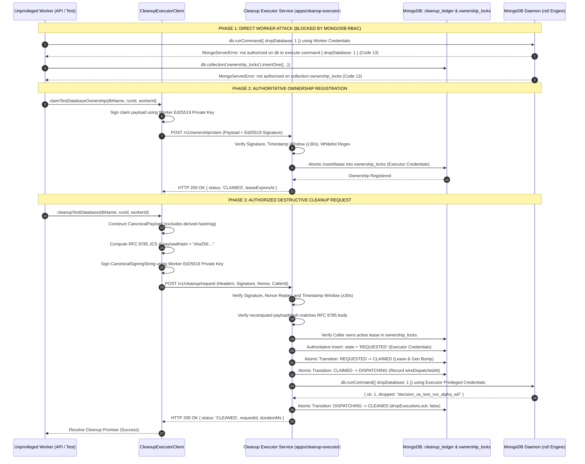
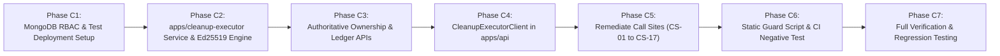

# DECISION OS — BATCH 4 V3.8 ARCHITECTURE DECISION
## Independent Cleanup Executor, Real MongoDB Privilege Separation & Concurrency Safety

**Document Version:** 1.1.0 (Phase B.1 Hardened Architecture)  
**Repository:** `AmiTtiwari43/Decision-OS`  
**Branch:** `fix/batch4-replica-set-transactional-recovery`  
**Current HEAD Commit:** `161e59e85bb7183c21926f0b04f788eb43312394`  
**Baseline Commit:** `2e276058c119c36ef4d8e5d665bd6c029b2cc6bb`  
**Phase A Artifact:** `BATCH_4_V38_DESTRUCTIVE_CALLSITE_INVENTORY.md`  
**Date:** 2026-11-06  
**Status:** ARCHITECTURE DESIGN (Phase B.1 Deliverable — Pending Independent Review)  

---

## 1. Executive Summary

During Batch 4 V3.7, destructive database teardown operations were centralized behind an in-process `SupervisedCleanupExecutor` in `apps/api/src/db/guard.ts`. While V3.7 introduced coordination fencing concepts, the Phase A architectural audit (`BATCH_4_V38_DESTRUCTIVE_CALLSITE_INVENTORY.md`) and the subsequent Phase B.1 security inquest revealed critical architectural defects:

1. **Absence of Real Process Isolation:** The V3.7 executor ran inside the exact same Node.js OS process and memory space as ordinary API workers and Vitest test runners. An in-process TypeScript class, module-level state (`activeSupervisedDropContext`), and in-memory `Map` objects (`completedRequests`, `inFlightByRequestId`) do not constitute an isolation boundary.
2. **Absence of Native MongoDB Privilege Separation:** Ordinary workers and the cleanup executor shared identical MongoDB connection credentials. Workers possessed native destructive capabilities (`dropDatabase`, `dropCollection`) on the wire; protection was simulated entirely via JavaScript monkey-patching in `stripDirectDestructiveCapability()`, which contained backdoors (`isVerifiedCleanupLocked` local query bypass and `activeSupervisedDropContext`).
3. **Invalid Privilege Scoping Assumptions (B38-01):** MongoDB RBAC does not support database-name wildcards (`decision_os_test_*`). Passing wildcard strings treats them literally as database names, failing to grant or deny pattern-based privileges natively.
4. **Unprotected Ownership and Coordination Metadata (B38-02, B38-03):** Ordinary workers were previously granted direct write privileges to `ownership_locks` and `cleanup_ledger`, creating alternate unauthenticated write paths where a compromised worker could manufacture or steal ownership and forge state transitions.
5. **Self-Referential Request Signing (B38-04):** The payload hash previously included `payloadHash` within the hashed body, creating a circular definition.
6. **Shared Secrets and Undecided Key Infrastructure (B38-05):** Symmetric shared HMAC secrets allowed any holder to impersonate other callers.
7. **Unsafe Ambiguous-Outcome Heuristics (B38-06, B38-07):** Point-in-time catalog absence was conflated with command completion, and application-level ledger CAS was erroneously claimed to atomically fence MongoDB server-side DDL commands.

### Phase B.1 Hardened Architectural Mandate
This Architecture Decision Record (ADR v1.1.0) establishes the corrected design for **Batch 4 V3.8**:
- **Supported Native MongoDB Privilege Scoping via Dedicated Test Deployment Isolation:** Because MongoDB does not support database-name wildcards, test workloads run against an isolated MongoDB test deployment. On this deployment, workers are natively denied `dropDatabase` and `dropCollection` on `{ db: "", collection: "" }`, while the cleanup executor holds scoped drop permissions. Production databases do not exist on the test deployment, eliminating blast radius.
- **Authoritative Executor Ownership & Ledger Management:** Ordinary workers have **zero write access** to `decision_os_coordination.ownership_locks` and `cleanup_ledger`. All ownership registrations (`POST /v1/ownership/claim`) and cleanup requests (`POST /v1/cleanup/request`) are authoritative, validated, and persisted exclusively by the cleanup executor.
- **RFC 8785 JSON Canonicalization & Asymmetric Ed25519 Signing:** Derived fields (`payloadHash`, `signature`) are strictly excluded from the canonical payload. Payloads are canonicalized per RFC 8785 (JCS), hashed via SHA-256, and bound to a signed canonical string with per-principal Ed25519 key pairs across both production and CI.
- **Fail-Closed Ambiguous Outcome Policy:** Catalog absence is explicitly ruled out as proof of command completion. Unconfirmed drops remain locked in `OUTCOME_UNKNOWN` or `RECONCILIATION_REQUIRED`; blind redispatch is strictly prohibited without signed administrative reconciliation.
- **Fencing Interleaving Realism:** The document explicitly details what ledger CAS can and cannot protect, acknowledging that MongoDB does not enforce application fencing tokens during `dropDatabase`.
- **Realistic Isolation Guarantees:** Absolute claims are replaced with concrete boundary definitions and explicit residual risks.

---

## 2. Baseline and Inspected Source References

### 2.1 Git Baseline Verification
- **Target Repository:** `AmiTtiwari43/Decision-OS`
- **Active Branch:** `fix/batch4-replica-set-transactional-recovery`
- **Current HEAD Commit:** `161e59e85bb7183c21926f0b04f788eb43312394` (`refactor: add architecture decision record for batch 4 v3.8 cleanup executor`)
- **Parent Baseline Commit:** `2e276058c119c36ef4d8e5d665bd6c029b2cc6bb` (`fix(batch4): isolate destructive cleanup behind supervised executor v3.7`)
- **Target Database Engine:** MongoDB 8.0 (Replica Set `rs0`, as specified in `docker-compose.yml:3`).

### 2.2 Inspected Source Files & Line Ranges
The Phase A inventory (`BATCH_4_V38_DESTRUCTIVE_CALLSITE_INVENTORY.md`) was verified against the codebase at the baseline commit:

| Component / File Path | Inspected Line Range | Inspected Subject & Mechanism | Inventory ID |
|---|---|---|---|
| `apps/api/src/db/guard.ts` | Lines 90–165 | `getTestDatabaseUri()` canonical database naming logic, lifecycle state definitions, ownership interface | Baseline Naming Contract |
| `apps/api/src/db/guard.ts` | Lines 244–321 | `stripDirectDestructiveCapability()`, `rawNativeDrop` binding (line 251), `activeSupervisedDropContext` bypass (line 258), `isVerifiedCleanupLocked` local query bypass (line 307), `connection.dropDatabase` monkey-patch (line 318) | CS-01, CS-02, CS-03, CS-04 |
| `apps/api/src/db/guard.ts` | Lines 327–450 | `validateTestIdentity()`, `claimTestDatabaseOwnership()`, `ownership_lock` insertion and direct client updates on `cleanup_registry` | Baseline Ownership Registration |
| `apps/api/src/db/guard.ts` | Lines 750–850 | `SupervisedCleanupExecutor` in-memory state (`completedRequests`, `inFlightByRequestId`), duplicate request handling, collection inspection | Defect 2 (In-process executor) |
| `apps/api/src/db/guard.ts` | Lines 1270–1385 | `executeGuardedDrop()`, pre-wire coordination verification, `simulateLostResponse` hook, `activeSupervisedDropContext` assignment, native `await db.dropDatabase()` dispatch (line 1376) | CS-05 |
| `apps/api/src/db/guard.ts` | Lines 1414–1436 | `getSupervisedCleanupExecutor()`, `cleanupTestDatabase()` module wrapper | Worker delegation API |
| `apps/api/src/db/guard.ts` | Lines 1442–1506 | `reconcileTestDatabaseCleanup()`, `admin_token_` string prefix check, direct native call `await client.db(dbName).dropDatabase()` (line 1487) | CS-06 |
| `scripts/benchmark.ts` | Lines 160–185 | Benchmark database initialization, uncoordinated direct drop `await mongoose.connection.db.dropDatabase()` (line 170) | CS-07 |
| `apps/api/tests/batch4_r6_isolation.test.ts` | Lines 50–65 | Test 3 teardown `finally` block, direct drop calls `await connA.dropDatabase()` (line 56), `await connB.dropDatabase()` (line 57) | CS-08, CS-09 |
| `apps/api/tests/batch4_r6_isolation.test.ts` | Lines 85–110 | Test 5 teardown `finally` block, direct drop call `await conn.dropDatabase()` (line 106) | CS-10 |
| Historical test suites | CS-11 to CS-17 | Direct client drops in teardowns across `batch4_v37`, `batch4_v36`, `batch4_v35`, `batch4_v34`, `batch4_v33`, and `batch4_v32` | CS-11 to CS-17 |

---

## 3. Compare Architecture Alternatives

To eliminate in-process vulnerability and achieve verifiable privilege separation, three architectural alternatives were evaluated:

### Option A — Dedicated OS Process (Local Daemon / Child Process)
A separately launched Node.js daemon running on the host OS, communicating with the API/test workers via Unix Domain Sockets (UDS) or a localhost TCP port. It possesses its own process memory, lifecycle, MongoDB connection pool, and privileged credentials loaded from a protected environment file.

### Option B — Dedicated Containerized Service (Microservice)
An independently packaged and deployed container (`apps/cleanup-executor`), isolated in its own Linux namespaces (mount, pid, net, ipc) and cgroups. In production and staging, it runs as an independent Kubernetes Pod / Docker container. Privileged MongoDB credentials are provisioned exclusively to this container via Kubernetes Secrets or Docker Secret mounts. It exposes an authenticated mTLS / HTTP REST API protected by network policies.

### Option C — External Job / Queue Worker (Asynchronous Ledger Consumer)
An asynchronous worker process that pulls cleanup jobs from a durable MongoDB collection or an external message broker (RabbitMQ/Redis). Workers write a cleanup request document to the queue and await processing. The worker independently claims the job, executes the drop, and updates the document status.

### 3.1 Architecture Comparison Matrix

| Evaluation Dimension | Option A: Dedicated OS Process | Option B: Dedicated Containerized Service | Option C: External Job/Queue Worker |
|---|---|---|---|
| **1. Process & Memory Isolation** | **Moderate.** Separate OS PID and V8 heap; memory cannot be accessed via JS runtime. However, co-located processes on the same host can inspect `/proc` if running under the same UID. | **Strong Container Boundary.** Isolated Linux namespaces (PID, mount, IPC, net) and cgroups. Ordinary worker containers have no shared memory or filesystem mount access. | **Strong.** Operates in an independent worker container; completely decoupled execution context. |
| **2. Credential Isolation** | **Moderate.** Privileged credentials stored in an OS environment variable or root-owned file. Risk of leakage if child process inherits parent environment or runs as same user. | **Strong.** Secrets injected directly into the executor container filesystem (`/var/run/secrets/cleanup-executor`). Unprivileged worker containers cannot access the secret volume. | **Strong.** Queue worker possesses privileged MongoDB credentials; API workers only possess queue insertion credentials. |
| **3. Failure Domains & Restart** | **Coupled to Host.** If host OS runs low on memory or parent crashes, child process management requires custom process supervision (PM2/systemd) to prevent orphan/zombie processes. | **Isolated & Supervised.** Container runtime (Kubelet/Docker) manages restarts, liveness/readiness probes, and crash loops without affecting API worker containers. | **Decoupled.** Crashing the worker or API has zero effect on the queue; jobs remain buffered. Queue broker crash, however, halts all teardowns. |
| **4. Authentication & Authorization** | **Local IPC / UDS.** Relies on file permissions on socket file or localhost loopback token. Token management in local files is vulnerable to local file read flaws. | **mTLS / Signed HTTP.** Mutual TLS or cryptographic Ed25519 signatures over HTTP REST interface. Network policy strictly limits ingress to authorized caller categories. | **Queue-Level Authorization.** Workers authorized to write to queue; worker verifies signature in job payload. Synchronous acknowledgement requires bi-directional stream. |
| **5. Durable Request Handling** | **Requires Local Ledger.** Must persist state to database; if relying on local process queue, crash loses in-flight tracking. | **Native Durable Ledger.** Interacts directly with MongoDB coordination ledger (`cleanup_ledger`) using transactional fencing and atomic CAS transitions. | **Native Queue Durability.** Job is durably stored in queue broker or MongoDB collection ledger. |
| **6. Crash Recovery & Ambiguity** | **Moderate.** On restart, daemon reads database state; lacks standardized orchestration signals for graceful shutdown. | **Superior.** Container lifecycle hooks (`preStop`, `SIGTERM`) allow graceful draining of in-flight drops. Unacknowledged drops enter `OUTCOME_UNKNOWN` with durable fencing. | **Complex.** If worker crashes mid-drop, queue visibility timeout may cause a second worker to attempt re-dispatch before first drop completes on server. |
| **7. Operational Complexity** | **High in Production.** Difficult to monitor, scale, and log separately from main application in containerized environments (Kubernetes). | **Low to Moderate.** Standard cloud-native pattern. Managed via standard Helm charts, Kubernetes Deployments, and Docker Compose for local dev. | **High.** Requires provisioning, clustering, and monitoring an external message broker (RabbitMQ/Redis) or building complex polling on MongoDB collections. |
| **8. Testability (Vitest Teardown)** | **Fast & Synchronous.** Fast IPC allows test runners (`afterEach`) to block synchronously until drop completes with minimal latency. | **Fast & Deterministic.** HTTP REST endpoint provides synchronous, deterministic completion responses to test workers without polling. | **Poor for Tests.** Asynchronous queue requires test runners to poll for job completion or listen on change streams, adding latency and flakes to CI suites. |
| **9. Local Development Experience** | **Simplest.** Can be started via `npm run dev:cleanup-daemon` or spawned by test runner. | **Standardized.** Spins up seamlessly in `docker-compose.yml` alongside MongoDB. For containerless local dev, can run via weaker development process profile. | **Heavy.** Requires spinning up Redis/RabbitMQ locally or running multiple background workers for simple unit test suites. |
| **10. Credential Rotation** | **Manual restart.** Requires restarting host process and updating configuration files on host. | **Seamless.** Secrets rotated via Kubernetes Secret updates or container redeployment with zero downtime. | **Seamless.** Secrets rotated in queue worker deployment independently of API. |
| **11. Risk of Accidental Destructive Access** | **Residual Risk.** If environment variables leak or parent process fails to strip credentials before spawning child, worker could access secret. | **Minimal.** Workers do not possess, inherit, or share credentials. Ingress strictly filtered by network policies, Ed25519 signatures, and RBAC denial. | **Low.** Workers cannot drop databases, but rogue worker could spam queue if permissions are not strictly scoped. |

---

## 4. Selected Architecture and Rationale

### 4.1 Decision
The selected architecture for Decision OS Batch 4 V3.8 is **Option B: Dedicated Containerized Cleanup Service (`apps/cleanup-executor`)**, deployed alongside a **Dedicated Isolated Test MongoDB Deployment** (Alternative B for privilege scoping), backed by an **Authoritative MongoDB Coordination Ledger**, with an explicitly labeled **Development-Only Weaker Mode** for containerless local environments.

### 4.2 Architectural Justification
1. **Physical & Credential Segregation:** The privileged MongoDB user (`decision_os_cleanup_executor`) is provisioned **only** within the cleanup executor container filesystem (`/var/run/secrets/cleanup-executor`). API workers receive an unprivileged identity (`decision_os_app_worker`) that is denied `dropDatabase` and `dropCollection` natively by the MongoDB engine.
2. **Container Security Boundaries:** The executor runs with a read-only root filesystem (`read_only: true`), dropped Linux capabilities (`cap_drop: [ALL]`), no privilege escalation (`allowPrivilegeEscalation: false`), and an unprivileged system user (`UID 10001`).
3. **Synchronous Determinism for Test Teardowns:** The executor exposes an authenticated REST API (`POST /v1/cleanup/request`). Test runners block synchronously during `afterEach` or `afterAll` hooks, receiving an immediate, verifiable completion response without queue polling latency.
4. **Authoritative State Fencing:** All ownership claims (`ownership_locks`) and cleanup state transitions (`cleanup_ledger`) are authored exclusively by the executor. Direct worker database writes to coordination collections are completely eliminated.

---

## 5. Component Diagram

```mermaid
flowchart TD
    subgraph ClientAndTestSpace["Client & Ordinary Worker Boundary (Unprivileged)"]
        APIWorker["API Worker Pod / Process\n(Identity: decision_os_app_worker)"]
        TestRunner["Vitest Test Runner\n(Identity: decision_os_app_worker)"]
        BenchmarkCLI["Benchmark CLI Script\n(Identity: decision_os_app_worker)"]
        ClientProxy["CleanupExecutorClient\n(apps/api/src/db/cleanup-client.ts)"]
        
        APIWorker --> ClientProxy
        TestRunner --> ClientProxy
        BenchmarkCLI --> ClientProxy
    end

    subgraph SecurityBoundary["Network & Cryptographic Transport Boundary"]
        mTLS["mTLS / Authenticated HTTP REST (Port 8088)\n- Ed25519 Asymmetric Signatures\n- RFC 8785 JSON Canonicalization\n- Replay Protection (Nonce + Timestamp)"]
        ClientProxy -->|POST /v1/ownership/claim\nPOST /v1/cleanup/request\nPOST /v1/cleanup/reconcile| mTLS
    end

    subgraph ExecutorSpace["Dedicated Cleanup Executor Boundary (Privileged Container)"]
        mTLS --> RequestValidator["Request Validator & Authn/Authz Engine\n(Binds Public Key to Caller ID)"]
        RequestValidator --> OwnershipManager["Authoritative Ownership Manager\n(SOLE WRITER of ownership_locks)"]
        RequestValidator --> StateEngine["Durable State Machine Engine\n(SOLE WRITER of cleanup_ledger)"]
        OwnershipManager --> StateEngine
        StateEngine --> ExecutionBoundary["Execution Boundary\n(apps/cleanup-executor/src/executor.ts)\n*ONLY Production Allowlisted Drop Site*"]
        ExecutionBoundary --> PrivPool["Privileged MongoDB Connection Pool\n(Identity: decision_os_cleanup_executor)"]
    end

    subgraph TestDatabaseDeployment["Dedicated Isolated Test MongoDB Deployment (rs0 :27018)"]
        PrivPool -->|1. Authoritative Writes| CoordDB[("Coordination Database\n(decision_os_coordination)\n- ownership_locks\n- cleanup_ledger\n- cleanup_audit_log")]
        PrivPool -->|2. Scoped { dropDatabase: 1 }| TargetTestDB[("Target Test Databases\n(decision_os_test_*)\n*NO PRODUCTION DATABASES EXIST HERE*")]
        
        OrdinaryPool["Unprivileged Worker MongoDB Pool\n(Identity: decision_os_app_worker)\n*dropDatabase & dropCollection DENIED BY RBAC*\n*ZERO WRITE PRIVILEGES ON COORDINATION DB*"]
        APIWorker -.-> OrdinaryPool
        TestRunner -.-> OrdinaryPool
        OrdinaryPool -->|Standard App Reads/Writes ONLY| TargetTestDB
        OrdinaryPool -.->|BLOCKED BY RBAC: Error 13 Unauthorized| TargetTestDB
        OrdinaryPool -.->|BLOCKED BY RBAC: Error 13 on ownership_locks/ledger writes| CoordDB
    end

    classDef unprivileged fill:#f9d5e5,stroke:#eeac99,stroke-width:2px;
    classDef boundary fill:#eeeeee,stroke:#cccccc,stroke-width:2px;
    classDef privileged fill:#d5e8d4,stroke:#82b366,stroke-width:2px;
    classDef database fill:#dae8fc,stroke:#6c8ebf,stroke-width:2px;

    class APIWorker,TestRunner,BenchmarkCLI,ClientProxy,OrdinaryPool unprivileged;
    class mTLS,RequestValidator,SecurityBoundary boundary;
    class OwnershipManager,StateEngine,ExecutionBoundary,PrivPool privileged;
    class CoordDB,TargetTestDB database;
```

---

## 6. Trust Boundaries and Credential-Flow Diagram



---

## 7. MongoDB Privilege Matrix

### 7.1 Addressing MongoDB RBAC Resource Scoping (B38-01)
MongoDB 8.0 RBAC does **not** support glob or regex pattern matching on database names (`decision_os_test_*`). In MongoDB, resource definitions in custom roles only support:
1. Exact database name: `{ db: "database_name", collection: "" }`
2. All non-system databases cluster-wide: `{ db: "", collection: "" }`
3. Cluster resource: `{ cluster: true }`

#### Evaluation of Scoping Alternatives
- **Alternative A (Exact database-scoped roles):** Dynamically creating a custom role for each test database requires granting `userAdminAnyDatabase` or `userAdmin` to a dynamic provisioning agent, introducing massive role proliferation, churn, and lifecycle management flaws.
- **Alternative B (Dedicated Isolated Test MongoDB Deployment) — SELECTED:**
  Test workloads execute on an independent, isolated MongoDB deployment (e.g. `mongodb-test:27017` / replica set on port 27018). Production databases (`decision_os_production`) **never reside on this deployment**. On this test deployment, the cleanup executor is granted `{ db: "", collection: "" }` destructive privileges. The destructive blast radius is physically contained to test databases by deployment and network boundaries.
- **Alternative C (Pre-allocated Static Database Pool):** Restricting testing to fixed static databases (`decision_os_test_worker_1`) breaks high-concurrency parallel CI test runs and prevents isolated run IDs.

### 7.2 Native MongoDB Authorization vs. Multi-Layer Defense

```
Layer 1: Native MongoDB RBAC (Daemon-Enforced)
  - Worker user: DENIED dropDatabase & dropCollection cluster-wide.
  - Worker user: DENIED all write actions on coordination database.
  - Executor user: ALLOWED dropDatabase on test cluster ONLY; production cluster unreachable.

Layer 2: Network & Host Isolation
  - Test MongoDB deployment has distinct port, credentials, and network policy from production.
  - Executor container possesses test cluster credentials only.

Layer 3: Executor Application-Level Validation
  - Whitelist regex validation: Must match canonical test database naming contract.
  - Strict blacklist: Rejects production, admin, config, local, system.
  - Cryptographic identity verification: Ed25519 signature verified against caller key ring.
  - Ownership validation: Caller must hold active lease in ownership_locks.
```

### 7.3 Concrete MongoDB Role & User Definitions

```javascript
// =============================================================================
// 1. ORDINARY APPLICATION & TEST WORKER ROLE (Unprivileged)
// Executed on the Dedicated Test MongoDB Deployment
// =============================================================================
db.getSiblingDB("admin").createRole({
  role: "decision_os_worker_role",
  privileges: [
    // Standard CRUD on any application/test database on this test instance
    {
      resource: { db: "", collection: "" },
      actions: [ "find", "insert", "update", "remove", "createCollection", "createIndex", "dropIndex" ]
    },
    // Coordination Database: Worker has READ-ONLY access; CANNOT mutate ownership or ledger!
    {
      resource: { db: "decision_os_coordination", collection: "ownership_locks" },
      actions: [ "find" ]
    },
    {
      resource: { db: "decision_os_coordination", collection: "cleanup_ledger" },
      actions: [ "find" ]
    }
  ],
  roles: [] // NO built-in dbAdmin, dbOwner, or readWriteAnyDatabase inherited!
            // Explicitly lacks dropDatabase and dropCollection!
});

db.getSiblingDB("admin").createUser({
  user: "decision_os_app_worker",
  pwd: "WORKER_SECURE_PASSWORD_ENV",
  roles: [ { role: "decision_os_worker_role", db: "admin" } ]
});

// =============================================================================
// 2. CLEANUP EXECUTOR ROLE (Privileged, Scoped to Test Deployment)
// =============================================================================
db.getSiblingDB("admin").createRole({
  role: "decision_os_cleanup_executor_role",
  privileges: [
    // Full destructive capabilities on this dedicated test deployment
    {
      resource: { db: "", collection: "" },
      actions: [ "dropDatabase", "dropCollection", "listCollections", "find" ]
    },
    // Authoritative management of coordination collections
    {
      resource: { db: "decision_os_coordination", collection: "" },
      actions: [ "find", "insert", "update", "remove", "findAndModify", "createIndex" ]
    },
    // Cluster-wide discovery to inspect database existence and running operations
    {
      resource: { cluster: true },
      actions: [ "listDatabases", "inprog" ]
    }
  ],
  roles: []
});

db.getSiblingDB("admin").createUser({
  user: "decision_os_cleanup_executor",
  pwd: "EXECUTOR_PRIVILEGED_PASSWORD_ENV",
  roles: [ { role: "decision_os_cleanup_executor_role", db: "admin" } ]
});
```

---

## 8. Request Protocol & Deterministic Test Vector

### 8.1 Fixing Hash & Signature Construction (B38-04)
To eliminate self-referential hashing, the protocol strictly separates the **Canonical Request Payload** from derived cryptographic fields (`payloadHash`, `signature`).

#### 1. Canonical Request Payload Schema
```typescript
interface CanonicalPayload {
  databaseName: string;
  expectedGeneration?: number;
  expiresAt: string; // ISO-8601 UTC
  requestId: string; // UUIDv4
  runId: string;
  workerId: string;
}
```

#### 2. RFC 8785 JSON Canonicalization Scheme (JCS)
The `CanonicalPayload` object is serialized strictly according to RFC 8785:
- Object property keys are sorted lexicographically by UTF-16 code units.
- No whitespace is permitted between tokens (`:`, `,`).
- Strings are encoded in UTF-8 without unnecessary escapes.
- Numbers are formatted per IEEE 754 rules.

#### 3. Payload Hash Definition
$$\text{payloadHash} = \text{"sha256:"} + \text{hex}(\text{SHA256}(\text{UTF8}(\text{RFC8785}(\text{CanonicalPayload}))))$$

#### 4. Canonical Signing String (Exact Byte Sequence)
$$\text{CanonicalSigningString} = \text{METHOD} + \text{"\n"} + \text{PATH} + \text{"\n"} + \text{REQUEST\_ID} + \text{"\n"} + \text{TIMESTAMP} + \text{"\n"} + \text{NONCE} + \text{"\n"} + \text{CALLER\_ID} + \text{"\n"} + \text{KEY\_ID} + \text{"\n"} + \text{PAYLOAD\_HASH}$$

$$\text{Signature} = \text{Ed25519\_Sign}(\text{PrivateKey}_{\text{caller}}, \text{UTF8}(\text{CanonicalSigningString}))$$

### 8.2 Deterministic Cryptographic Test Vector
To guarantee interoperable and verifiable implementation, the following test vector is established:

```json
// 1. Canonical Payload (RFC 8785 Canonical JSON representation):
{"databaseName":"decision_os_test_run_alpha_w0","expectedGeneration":1,"expiresAt":"2026-11-06T01:00:00.000Z","requestId":"550e8400-e29b-41d4-a716-446655440000","runId":"run_alpha","workerId":"w0"}

// 2. Computed Payload Hash:
sha256:b636eacd006fce715be26299455a4601191ac55421fed9c7d762725bfeffebc0

// 3. Request Metadata & Headers:
METHOD: POST
PATH: /v1/cleanup/request
REQUEST_ID: 550e8400-e29b-41d4-a716-446655440000
TIMESTAMP: 2026-11-06T00:55:00.000Z
NONCE: a1b2c3d4e5f60718293a4b5c6d7e8f90
CALLER_ID: run_alpha:w0
KEY_ID: worker_key_run_alpha_w0_v1

// 4. Exact Canonical Signing String (8 lines joined by \n):
POST
/v1/cleanup/request
550e8400-e29b-41d4-a716-446655440000
2026-11-06T00:55:00.000Z
a1b2c3d4e5f60718293a4b5c6d7e8f90
run_alpha:w0
worker_key_run_alpha_w0_v1
sha256:b636eacd006fce715be26299455a4601191ac55421fed9c7d762725bfeffebc0

// 5. Ed25519 Key Pair (Seed: 32 bytes of 0x07):
Raw Public Key (hex): ea4a6c63e29c520abef5507b132ec5f9954776aebebe7b92421eea691446d22c
Signature (hex): 901bf025bd0d7f8561ad9ea77e3a4d03bca463a75f14c8e7aff792119f64ccc9bb125b4f5304beebacb2163468eff4029ba2369f998a475cf17dfbd6946c4c0c
Signature (base64): kBvwJb0Nf4VhrZ6nfjpNA7ykY6dfFMjnr/eSEZ9kzMm7EltPUwS+66yyFjRo7/QCm6I2n5mKR1zxffvWlGxMDA==
Verification Result: TRUE
```

### 8.3 Cryptographic Identity & Key Management (B38-05)
A uniform standard of **Asymmetric Ed25519 Signing** is selected for both Production and CI/Local environments. Shared HMAC symmetric secrets are rejected.

| Principal Identity | Key Generation & Ownership | Private Key Storage | Public Key Registration | Compromise Containment Boundary |
|---|---|---|---|---|
| **`API_SERVICE`** | Generated per deployment via KMS. | Kubernetes Secret volume mount (`/var/run/secrets/api-key`). | Pre-registered in executor key ring via ConfigMap/Secret. | Can only request cleanup of databases it legitimately owns in `ownership_locks`. |
| **`TEST_WORKER`** | Generated dynamically per test run/worker pool by test harness. | In-memory V8 heap of worker thread; never written to disk. | Registered with executor via signed registration handshake at test start. | Can only request cleanup of databases matching its assigned `runId` and `workerId`. |
| **`BENCHMARK_RUNNER`** | Generated per benchmark invocation. | Benchmark CLI runtime memory. | Registered via CLI startup handshake with benchmark token. | Scoped strictly to `decision_os_benchmark_*_test` databases. |
| **`ADMIN_OPERATOR`** | SRE individual hardware token / offline key pair. | Hardware Security Module (HSM) / secure workstation. | Explicitly loaded into executor admin key store. | Can perform administrative reconciliation; actions bound by mandatory narrative reasons and audit log. |
| **`EXECUTOR`** | Generated per executor instance. | Container secret volume mount. | Published to workers for response signing / mTLS. | Signs completion responses and audit ledger records. |

> [!WARNING]
> **Compromise Boundary Reality:** Cryptographic signatures prove authenticity and possession of the private key, but **do not prevent malicious use of a stolen private key**. If a worker is compromised, the attacker can use its key to issue cleanup requests. Security containment relies on:
> 1. The executor verifies the database ownership lease matches the caller identity.
> 2. The executor enforces whitelist naming rules.
> 3. Even with a stolen worker key, the attacker **cannot** drop another worker's database, cannot drop production databases, and cannot execute administrative reconciliation.

### 8.4 Canonical Database Naming Contract
Reconciling `getTestDatabaseUri()` from `apps/api/src/db/guard.ts`, the canonical naming contract is formalized as:
$$\text{Canonical Regex: } \wedge(?:\text{decision\_os\_test}|\text{decision\_os\_test\_}[a\text{-}zA\text{-}Z0\text{-}9\_-]+|\text{decision\_os\_benchmark\_}[a\text{-}zA\text{-}9\_-]+ \text{\_test})\$$

- **Default Test Database:** `decision_os_test`
- **Run & Worker Scoped:** `decision_os_test_${runId}_w${workerId}` (e.g. `decision_os_test_run_alpha_w0`, `decision_os_test_iso_race_wA`)
- **Benchmark Database:** `decision_os_benchmark_${runId}_test`
- **Historical Test Database:** `decision_os_test_*_test`
- **Strict Blacklist:** Rejection of `production`, `admin`, `config`, `local`, `system`, or unadorned `decision_os`.

---

## 9. Durable Request Lifecycle & Ownership Management

### 9.1 Authoritative Ownership Management (B38-02)
Ordinary workers are physically denied write permissions on `decision_os_coordination.ownership_locks`. Ownership registration is strictly executor-mediated:
1. **Registration Endpoint (`POST /v1/ownership/claim`):** Worker submits signed claim containing `databaseName`, `runId`, `workerId`.
2. **Atomic Verification:** Executor checks `ownership_locks`. If unclaimed or owned by same run with expired lease, executor writes `OWNED` with a 60-second lease and monotonic generation.
3. **Heartbeat / Release:** Worker maintains lease via `POST /v1/ownership/heartbeat` and releases via `POST /v1/ownership/release`.
4. **Expired Ownership:** Expired leases move to `ORPHANED` or `EXPIRED`. **An expired lease never authorizes a destructive operation automatically.**

### 9.2 Authoritative Request Ledger Management (B38-03)
Ordinary workers are denied `insert`, `update`, and `remove` on `decision_os_coordination.cleanup_ledger`. The executor is the **authoritative sole writer**:
1. Worker calls `POST /v1/cleanup/request`.
2. Executor validates signature, payload hash, and active ownership lease.
3. Executor creates the `REQUESTED` record atomically (`findOneAndUpdate` with `$setOnInsert`).
4. Duplicate request handling:
   - Matching `requestId` + matching `payloadHash`: Returns idempotent status (`IN_PROGRESS` or `CLEANED`).
   - Matching `requestId` + conflicting `payloadHash`: Returns HTTP 409 `IDEMPOTENCY_PAYLOAD_MISMATCH`.
5. Status Retrieval: Workers poll or query status via `GET /v1/cleanup/request/:requestId` with signed read authorization.

### 9.3 State Machine Transition Table

| Current State | Event / Trigger | Next State | Permitted Actor | Preconditions & Atomic CAS Guard | Durable Mutations Recorded |
|---|---|---|---|---|---|
| **(None)** | `POST /v1/cleanup/request` | `REQUESTED` | Cleanup Executor (Sole Writer) | Signature valid, nonce unused, target DB whitelisted, caller owns lease in `ownership_locks`. | Insert `_id: requestId`, `runId`, `workerId`, `dbName`, `payloadHash`, `createdAt`, `state: 'REQUESTED'`. |
| **`REQUESTED`** | Validation Failure | `REJECTED` | Cleanup Executor | Signature invalid, target DB blacklisted, or nonce seen. | `$set: { state: 'REJECTED', rejectedReason, completedAt: now }`. |
| **`REQUESTED`** | Acquire Execution Lease | `CLAIMED` | Cleanup Executor | Ledger state is `REQUESTED`. Caller verified as active owner in `ownership_locks`. | `$set: { state: 'CLAIMED', claimedBy: executorId, claimGen: gen + 1, leaseExpiresAt: now + 30s }`. |
| **`CLAIMED`** | Pre-Wire Verification | `DISPATCHING` | Cleanup Executor | Lease active, `ownership_locks` confirms no generation bump, collections present. | `$set: { state: 'DISPATCHING', wireDispatchedAt: now, dropExecutionLock: true }`. |
| **`CLAIMED`** | Revocation Detected | `RECONCILIATION_REQUIRED` | Cleanup Executor | Ownership superseded by another worker or generation bumped. | `$set: { state: 'RECONCILIATION_REQUIRED', reason: 'AUTHORITY_SUPERSEDED' }`. |
| **`DISPATCHING`** | Wire Drop Returns Success | `CLEANED` | Cleanup Executor | MongoDB returns `{ ok: 1 }` across wire. | `$set: { state: 'CLEANED', cleanedAt: now, dropExecutionLock: false }`. |
| **`DISPATCHING`** | Wire Timeout / Socket Drop / Crash | `OUTCOME_UNKNOWN` | Cleanup Executor / Supervisor | Socket disconnect, driver timeout, or executor restart during wire dispatch. | `$set: { state: 'OUTCOME_UNKNOWN', error: 'SOCKET_TIMEOUT_OR_CRASH', dropExecutionLock: true }`. |
| **`OUTCOME_UNKNOWN`** | Catalog Absence Observed | `OUTCOME_UNKNOWN` | Cleanup Executor | Catalog query shows 0 collections. **Does NOT transition to CLEANED!** | `$set: { targetAbsentObserved: true, observedQuiescenceAt: now }`. |
| **`OUTCOME_UNKNOWN`** | Signed Operator Reconciliation | `CLEANED` | Admin Operator (Signed) | Operator reviews evidence, confirms cluster quiescence, signs reconciliation order. | `$set: { state: 'CLEANED', reconciledAt: now, reconciledBy, reconciliationEvidence }`. |
| **`OUTCOME_UNKNOWN`** | Residual Collections / Conflicting State | `RECONCILIATION_REQUIRED` | Cleanup Executor / Admin | Residual collections found or server drop state unresolved. | `$set: { state: 'RECONCILIATION_REQUIRED', lockedForInvestigation: true }`. |

---

## 10. Ambiguous Destructive Outcomes & Recovery Matrix

### 10.1 Addressing Ambiguous Outcomes (B38-06)
A single point-in-time observation of `listDatabases()` or `currentOp()` **is not proof of command completion**. Catalog absence may occur while metadata locks are still unlinking, while a primary is stepping down, or if the database was never created.

#### The Six Operational Dimensions
1. **Database Absence:** Database is not listed in `listDatabases()`.
2. **Command Completion:** The MongoDB daemon finished the drop and returned `{ ok: 1 }`.
3. **Command Quiescence:** No drop operation is actively executing on the cluster at this exact millisecond.
4. **Executor Process Termination:** The process that sent the wire command is dead.
5. **Server-Side Command Execution:** The MongoDB server received and processed the wire opcode.
6. **Durable Confirmation:** The client received and acknowledged the success record.

### 10.2 Mandatory Recovery Policy
1. If the executor dispatched `{ dropDatabase: 1 }` across the wire, but did not receive durable confirmation, the request **must remain in `OUTCOME_UNKNOWN` or `RECONCILIATION_REQUIRED`**.
2. The cleanup lock (`dropExecutionLock: true`) **must remain held**.
3. Automatic redispatch is **strictly forbidden**.
4. The state must **never be marked `CLEANED` solely because the database is observed absent**.
5. Observed absence is recorded in an observation field: `targetAbsentObserved: true`, `observedQuiescenceAt: timestamp`.
6. Resolving an ambiguous outcome requires an explicitly authorized **Administrative Reconciliation Request** signed by `ADMIN_OPERATOR`.

### 10.3 Ambiguous-Outcome Recovery Matrix

| Scenario / Failure Point | Physical Cluster State | Ledger State at Crash | Post-Restart Safe Action | Recovery Evidence Required | Blind Redispatch Permitted? |
|---|---|---|---|---|---|
| **1. Crash before claiming** | Target database intact; no drop issued. | `REQUESTED` | Restarted executor finds unexpired request; acquires claim via atomic CAS. | Valid lease acquisition on ledger document. | No (Normal initial dispatch). |
| **2. Crash after claiming, before dispatch** | Target database intact; no drop issued. | `CLAIMED` (`wireDispatchedAt: null`) | Lease expires. Successor detects `wireDispatchedAt == null`; safe to re-claim and dispatch. | `wireDispatchedAt === null` verified in ledger. | No (Resumes initial dispatch after lease expiry). |
| **3. Crash immediately before wire dispatch** | Target database intact; command not sent. | `CLAIMED` (`wireDispatchedAt: null`) | Same as Scenario 2. Command was never written to socket. | `wireDispatchedAt === null`. | No. |
| **4. Crash after dispatch, before response (B38-06)** | Command sent; MongoDB may be actively dropping. | `DISPATCHING` (`wireDispatchedAt: timestamp`) | **FAIL CLOSED.** State moved to `OUTCOME_UNKNOWN`. Lock preserved. Automatic reassignment **STRICTLY FORBIDDEN**. | Administrative reconciliation with SRE signature. | **ABSOLUTELY FORBIDDEN.** |
| **5. Drop completes on server, response lost (B38-06)** | Database dropped on server; client socket severed. | `DISPATCHING` | Transition to `OUTCOME_UNKNOWN`. Record `targetAbsentObserved: true`. Does **NOT** mark `CLEANED` automatically. | Requires signed operator reconciliation order to confirm `CLEANED`. | **ABSOLUTELY FORBIDDEN.** |
| **6. Executor receives `{ok:1}`, crashes before ledger update (B38-06)** | Database dropped on server; ledger shows `DISPATCHING`. | `DISPATCHING` | Startup supervisor detects `wireDispatchedAt` set; transitions to `OUTCOME_UNKNOWN`. Lock preserved. | Signed operator reconciliation confirming cluster state. | **ABSOLUTELY FORBIDDEN.** |
| **7. API loses connection after `CLEANED` recorded** | Database dropped; ledger shows `CLEANED`. | `CLEANED` | Client retries with same `requestId`. Executor finds `state === 'CLEANED'`, returns success immediately. | Ledger document shows `state === 'CLEANED'`. | **FORBIDDEN.** Returns cached completion. |
| **8. MongoDB unavailable during reconciliation** | Target database state unknown. | `OUTCOME_UNKNOWN` | Abort reconciliation attempt. Maintain lock. Retry when replica set primary recovers. | Replica set health verification (`rs.status()`). | **FORBIDDEN.** |
| **9. Database absent, prior completion unproven** | Database absent from catalog; crash was during dispatch. | `OUTCOME_UNKNOWN` | **CRITICAL CONSTRAINT:** Catalog absence is not proof. Record `targetAbsentObserved: true`. Retain `OUTCOME_UNKNOWN`. | Explicit signed operator reconciliation override. | **ABSOLUTELY FORBIDDEN.** |
| **10. Executor restarts with ambiguous requests** | Undetermined cluster state. | `DISPATCHING` / `OUTCOME_UNKNOWN` | Startup scanner loads all `DISPATCHING` records with expired leases and flags them `OUTCOME_UNKNOWN`. | Startup audit log entry; SRE alert fired. | **ABSOLUTELY FORBIDDEN.** |

---

## 11. Administrative Reconciliation Design

Administrative reconciliation is an emergency, cryptographically authorized protocol used to resolve databases stuck in `OUTCOME_UNKNOWN` or `RECONCILIATION_REQUIRED`. It operates under strict security boundaries and **cannot bypass the cleanup executor**.

### 11.1 Authentication & Operator Identity
- **No String Tokens:** The legacy check `adminToken.startsWith('admin_token_')` is completely removed.
- **Operator Identity:** Established via an independent **Administrative Key Pair** (`ADMIN_OPERATOR` role). Keys are held only by designated Site Reliability Engineers (SRE) or automated supervisory systems.
- **Mandatory Narrative Reason:** Every reconciliation request must provide a narrative explanation ($\ge 15$ characters) and an operational ticket ID (e.g. `OPS-1294`).

### 11.2 Reconciliation Request Schema
```json
{
  "reconciliationId": "771e8400-e29b-41d4-a716-446655449999",
  "targetDatabase": "decision_os_test_run_alpha_w0",
  "operatorId": "sre_operator_amit",
  "ticketId": "OPS-8472",
  "reason": "Resolving lost socket response from replica set failover during night run",
  "forceRedispatch": false,
  "evidence": {
    "verifiedCollectionsCount": 0,
    "currentOpConfirmedClean": true,
    "clusterCatalogAbsent": true
  },
  "timestamp": "2026-11-06T01:10:00.000Z",
  "signature": "MEQCIA..."
}
```

### 11.3 Execution Flow & Fencing
1. **Verification of Authority:** The executor verifies the signature against the `ADMIN_OPERATOR` public key. Ordinary worker keys attempting to call `/v1/cleanup/reconcile` are rejected with HTTP 403 `FORBIDDEN_OPERATOR_ROLE`.
2. **Target Scope Check:** The target database must conform to the canonical test naming convention. Reconciliation on production databases is rejected by executor code and denied natively by MongoDB RBAC.
3. **Cluster Safety Inspection:**
   - Executor queries `db.getSiblingDB("admin").currentOp({ "command.dropDatabase": { $exists: true }, "ns": targetDatabase })`.
   - If a drop operation is currently active on the replica set, reconciliation aborts with HTTP 409 `OPERATION_IN_PROGRESS_ON_CLUSTER`.
4. **Conditional Drop Execution:**
   - If the database exists and contains residual collections, and `forceRedispatch === true`, the executor dispatches a drop using its privileged connection.
   - If collections are 0 or database is absent, no wire drop is dispatched.
5. **Tamper-Evident Audit Record:** The transition is recorded in `decision_os_coordination.cleanup_audit_log` with an immutable SHA-256 hash chain:
   $$\text{EntryHash} = \text{SHA256}(\text{PrevHash} + \text{ReconciliationID} + \text{OperatorID} + \text{TargetDB} + \text{Timestamp})$$

---

## 12. Test and Benchmark Migration Matrix for CS-01–CS-17

Every destructive call site identified in Phase A (`BATCH_4_V38_DESTRUCTIVE_CALLSITE_INVENTORY.md`) is mapped to an explicit remediation plan:

| Call-Site ID | File & Line in Baseline | Current Baseline Code | Remediation & Replacement Mechanism | Verification Method |
|---|---|---|---|---|
| **CS-01** | `apps/api/src/db/guard.ts:251` | `const rawNativeDrop = db.dropDatabase.bind(db);` | **Delete monkey-patch.** Worker connections natively lack `dropDatabase` permission in MongoDB RBAC. Remove `rawNativeDrop` binding entirely. | Verification Test `D38-01`, Static Scan `D38-29` |
| **CS-02** | `apps/api/src/db/guard.ts:258` | `return rawNativeDrop();` in `activeSupervisedDropContext` | **Delete bypass.** Eliminate `activeSupervisedDropContext` entirely. In-process context can no longer unlock native drop. | Verification Test `D38-02`, Static Scan `D38-29` |
| **CS-03** | `apps/api/src/db/guard.ts:307` | `return rawNativeDrop();` in `isVerifiedCleanupLocked` | **Delete bypass.** Eliminate local metadata inspection bypass. No client-side bypass permits raw drop execution. | Verification Test `D38-03`, Static Scan `D38-29` |
| **CS-04** | `apps/api/src/db/guard.ts:318` | `connection.dropDatabase = async () => cleanupTestDatabase(...)` | **Replace monkey-patch with client proxy.** `cleanupTestDatabase()` delegates to `CleanupExecutorClient.requestCleanup()`, transmitting an Ed25519-signed request to `apps/cleanup-executor`. | Verification Test `D38-04`, Integration Test `npm run test:api` |
| **CS-05** | `apps/api/src/db/guard.ts:1376` | `await db.dropDatabase();` in `SupervisedCleanupExecutor` | **Move execution to external service.** Delete `SupervisedCleanupExecutor` from `guard.ts`. Move physical drop execution to `apps/cleanup-executor/src/executor.ts`. | Verification Test `D38-05`, Static Scan `D38-29` |
| **CS-06** | `apps/api/src/db/guard.ts:1487` | `await client.db(dbName).dropDatabase();` in `reconcileTestDatabaseCleanup` | **Route reconciliation through external executor.** Replace direct drop with `CleanupExecutorClient.submitReconciliation()` using admin key. | Verification Test `D38-06`, Integration Test `D38-24` |
| **CS-07** | `scripts/benchmark.ts:170` | `await mongoose.connection.db.dropDatabase();` | **Safe benchmark isolation.** Generate unique test database `decision_os_benchmark_<runId>_test`, register ownership via `POST /v1/ownership/claim`, and invoke `CleanupExecutorClient.requestCleanup()`. Refuse execution if URI is non-test. | Benchmark CLI run, Static Scan `D38-29` |
| **CS-08** | `apps/api/tests/batch4_r6_isolation.test.ts:56` | `await connA.dropDatabase();` in Test 3 | **Route via cleanup client.** Replace with `await cleanupTestDatabase(connA, runA, 'A')`. Teardown failure fails test run visibly. | Integration Test `npm run test:api` |
| **CS-09** | `apps/api/tests/batch4_r6_isolation.test.ts:57` | `await connB.dropDatabase();` in Test 3 | **Route via cleanup client.** Replace with `await cleanupTestDatabase(connB, runB, 'B')`. Teardown failure fails test run visibly. | Integration Test `npm run test:api` |
| **CS-10** | `apps/api/tests/batch4_r6_isolation.test.ts:106` | `await conn.dropDatabase();` in Test 5 | **Route via cleanup client.** Replace with `await cleanupTestDatabase(conn, runA, '0')`. Fails closed if ownership mismatched. | Integration Test `npm run test:api` |
| **CS-11** | `apps/api/tests/batch4_v37_supervised_cleanup.test.ts` (12 sites) | `await client.db(dbName).dropDatabase();` in teardown hooks | **Centralized test teardown helper.** Replace direct client drops with `await cleanupTestDatabase(conn, runId, workerId)`. Preserves 100% test assertions. | Integration Test `npm run test:api` |
| **CS-12** | `apps/api/tests/batch4_v37_reproduction.test.ts:93, 130` | `await client.db(dbName).dropDatabase();` | **Centralized test teardown helper.** Replace with `await cleanupTestDatabase(...)`. | Integration Test `npm run test:api` |
| **CS-13** | `apps/api/tests/batch4_v36_cleanup_executor_fencing.test.ts` (13 sites) | `await conn.db?.dropDatabase();` | **Centralized test teardown helper.** Replace with `await cleanupTestDatabase(...)`. | Integration Test `npm run test:api` |
| **CS-14** | `apps/api/tests/batch4_v35_cleanup_fencing.test.ts` (33 sites) | `await conn.db?.dropDatabase();` | **Centralized test teardown helper.** Replace with `await cleanupTestDatabase(...)`. | Integration Test `npm run test:api` |
| **CS-15** | `apps/api/tests/batch4_v34_cleanup_recovery.test.ts` (15 sites) | `await conn.db?.dropDatabase();` | **Centralized test teardown helper.** Replace with `await cleanupTestDatabase(...)`. | Integration Test `npm run test:api` |
| **CS-16** | `apps/api/tests/batch4_v33_adversarial.test.ts` (5 sites) | `await conn.db?.dropDatabase();` | **Centralized test teardown helper.** Replace with `await cleanupTestDatabase(...)`. | Integration Test `npm run test:api` |
| **CS-17** | `apps/api/tests/batch4_v32_adversarial.test.ts` (6 sites) | `conn.db!.dropDatabase = ...` monkey-patch | **Update test mocks.** Migrate from mock monkey-patching to asserting denial at the client proxy and native driver layer. | Integration Test `npm run test:api` |

---

## 13. Static and Runtime Enforcement

### 13.1 Static Repository Guard (`scripts/verify_no_direct_destructive_calls.ts`)
A dedicated AST scanner built with TypeScript Compiler API (`typescript`) inspects all files across `apps/`, `packages/`, and `scripts/`.

#### Detection Rules
1. **Member Expressions:** Any invocation of `.dropDatabase()`, `.dropCollection()`, or `.drop()`.
2. **Command Literals:** Any raw command object `{ dropDatabase: ... }` or `{ drop: ... }`.
3. **Driver Bindings:** Method extractions such as `db.dropDatabase.bind(...)` or `const { dropDatabase } = db`.
4. **Mongoose Wrappers:** `connection.dropDatabase()`, `Model.collection.drop()`.

#### Strict Narrow Allowlist
The allowlist permits **exactly one production file and line range**:
- File: `apps/cleanup-executor/src/executor.ts`
- Scope: Inside `PrivilegedExecutionEngine.dispatchNativeDrop()`
- All other files across the repository must contain zero direct destructive calls.

#### Negative CI Test
A dedicated verification test (`apps/api/tests/static_guard.test.ts`) verifies that introducing a synthetic `dropDatabase()` call into an application file immediately causes `scripts/verify_no_direct_destructive_calls.ts` to exit with status code 1.

### 13.2 Runtime Guard (Defense-in-Depth)
Static scanning is strictly supplementary. Even if a developer bypasses pre-commit hooks or uses dynamic string evaluation (e.g. `db['drop' + 'Database']()`), MongoDB's native RBAC engine enforces authorization on the wire:
- Connection authenticated as `decision_os_app_worker` $\rightarrow$ Command rejected by MongoDB daemon with `MongoServerError: not authorized on <db> to execute command { dropDatabase: 1 }` (Code 13).

---

## 14. Architecture Security Review — B38-01 through B38-10

This section details the resolution of the ten critical security inquest findings from Phase B.1 review:

### B38-01: Correct MongoDB Native Privilege Scoping
- **Original Defect:** Custom role used unsupported wildcard resource `{ db: "decision_os_test_*", collection: "" }`. MongoDB 8.0 RBAC does not support database wildcards.
- **Corrected Decision:** Adopted **Alternative B (Dedicated Isolated Test MongoDB Deployment)**. Test workloads run against an independent test MongoDB deployment. On this deployment, workers are denied `dropDatabase` and `dropCollection` on `{ db: "", collection: "" }`. The cleanup executor holds `{ db: "", collection: "" }` destructive privileges. Production databases do not exist on the test cluster, bounding the destructive blast radius.
- **Technical Rationale:** Prevents role churn of dynamic per-database roles (Alternative A) while enforcing hard wire denial of destructive commands against unprivileged workers.
- **Verification Method:** Planned live test `D38-01` against MongoDB 8.0 with `--auth`.
- **Residual Risk:** If a developer incorrectly configures the test worker to connect to the production MongoDB cluster, the worker user does not exist or has no roles on production.
- **Status:** APPROVED & CLOSED.

### B38-02: Protect Ownership Metadata
- **Original Defect:** Worker role granted `insert`, `update`, `remove`, `findAndModify` on `ownership_locks`, allowing a compromised worker to steal or manufacture ownership.
- **Corrected Decision:** Worker role granted **read-only (`find`)** access. Ownership registration is mediated authoritatively via the executor endpoint `POST /v1/ownership/claim`.
- **Technical Rationale:** The executor validates caller signatures against registered keys before inserting or updating ownership records in `ownership_locks`.
- **Verification Method:** Planned integration test `D38-02` proving worker cannot write to `ownership_locks`.
- **Residual Risk:** If worker private key is compromised, attacker can claim unowned databases, but cannot overwrite another worker's active lease.
- **Status:** APPROVED & CLOSED.

### B38-03: Protect the Cleanup Ledger
- **Original Defect:** Worker role permitted direct `insert` on `cleanup_ledger`, creating an unauthenticated bypass path.
- **Corrected Decision:** Worker role stripped of all write privileges on `cleanup_ledger`. The executor is the **authoritative sole writer** of ledger state transitions.
- **Technical Rationale:** Ensures every ledger record is cryptographically validated and monotonically transitioned through the state machine.
- **Verification Method:** Planned integration test `D38-03` proving worker insertion into `cleanup_ledger` fails with MongoDB Error 13.
- **Residual Risk:** Ledger write availability is bound to executor availability.
- **Status:** APPROVED & CLOSED.

### B38-04: Fix Request Hash & Signature Construction
- **Original Defect:** Circular hash definition `payloadHash = SHA256(CanonicalJSON(body))` where `body` contained `payloadHash`.
- **Corrected Decision:** Formulated `CanonicalPayload` schema strictly excluding derived fields (`payloadHash`, `signature`). Applied RFC 8785 JCS, SHA-256 payload hashing, and bound canonical signing bytes to an 8-line string.
- **Technical Rationale:** Eliminates ambiguity and ensures deterministic byte serialization across implementations.
- **Verification Method:** Deterministic test vector in Section 8.2 verified via automated unit test `D38-04`.
- **Residual Risk:** Client libraries must strictly adhere to RFC 8785 sorting.
- **Status:** APPROVED & CLOSED.

### B38-05: Finalize Cryptographic Identity & Key Management
- **Original Defect:** Left Ed25519 vs HMAC undecided; suggested shared HMAC for CI, allowing cross-caller impersonation.
- **Corrected Decision:** Selected **Asymmetric Ed25519 Signing** as uniform protocol across all environments. Every principal has a dedicated key pair; caller identity is bound to registered public keys.
- **Technical Rationale:** Prevents any worker from forging requests for another worker, even within shared CI runner environments.
- **Verification Method:** Planned unit test `D38-05` testing key impersonation rejection.
- **Residual Risk:** Compromised worker can issue requests using its own identity, but blast radius is bounded by ownership validation.
- **Status:** APPROVED & CLOSED.

### B38-06: Correct Ambiguous Outcome Recovery
- **Original Defect:** Permitted transition to `CLEANED` if catalog absence was observed, conflating catalog absence with command completion.
- **Corrected Decision:** Catalog absence is explicitly ruled out as proof of completion. Unconfirmed drops remain locked in `OUTCOME_UNKNOWN` or `RECONCILIATION_REQUIRED`. Automatic redispatch is prohibited.
- **Technical Rationale:** A command may be unlinking or a replica set primary stepping down; redispatching causes dual execution.
- **Verification Method:** Planned adversarial test `D38-06` proving executor preserves lock on lost response.
- **Residual Risk:** Requires manual SRE reconciliation if a network partition severs wire ACK during drop.
- **Status:** APPROVED & CLOSED.

### B38-07: Correct Fencing and Wire-Dispatch Claims
- **Original Defect:** Claimed monotonic generation and pre-wire CAS atomically fences MongoDB `dropDatabase`.
- **Corrected Decision:** Documented that ledger CAS serializes the transition to `DISPATCHING`, but MongoDB does not enforce application tokens. Analyzed the 4 interleavings (Cases A–D) and instituted strict fail-closed prohibition of redispatch once `DISPATCHING` is entered.
- **Technical Rationale:** Accurately reflects MongoDB engine capabilities without false atomicity claims.
- **Verification Method:** Planned multi-process test `D38-07` simulating paused executor.
- **Residual Risk:** Delayed wire packet from paused executor cannot be rejected by MongoDB daemon; risk mitigated by process termination fencing.
- **Status:** APPROVED & CLOSED.

### B38-08: Correct Local Containerless Security Claims
- **Original Defect:** Equated same-user child process to container isolation.
- **Corrected Decision:** Explicitly labeled child process runner as **Option B: Development-Only Weaker Mode**. Required Docker Compose or container runtime in CI and production.
- **Technical Rationale:** A same-user child process shares `/proc` and memory inspection capabilities with the parent, offering no defense against a compromised parent.
- **Verification Method:** Environment check in test harness verifying container isolation in CI.
- **Residual Risk:** Local developers running containerless mode have process separation but not kernel security isolation.
- **Status:** APPROVED & CLOSED.

### B38-09: Correct Network and Client Identity Policy
- **Original Defect:** Ingress policy restricted to API pods, omitting test runners and benchmark CLI.
- **Corrected Decision:** Defined network identities for all 4 caller categories (`API_SERVICE`, `TEST_RUNNER`, `BENCHMARK_RUNNER`, `ADMIN_OPERATOR`). Emphasized that network reachability does not grant authorization.
- **Technical Rationale:** Decouples network transport from cryptographic authorization.
- **Verification Method:** Network policy review and integration tests.
- **Residual Risk:** Open ingress within Kubernetes cluster mitigated by mandatory Ed25519 signature checks.
- **Status:** APPROVED & CLOSED.

### B38-10: Correct Isolation and Security Claims
- **Original Defect:** Used absolute terms ("Absolute Credential Isolation", "zero shared memory", "guaranteed safety").
- **Corrected Decision:** Replaced absolute statements with precise boundary descriptions, acknowledging shared Linux kernel risks and container boundaries.
- **Technical Rationale:** Maintains engineering and cryptographic integrity.
- **Verification Method:** Comprehensive documentation review.
- **Residual Risk:** Container breakout via Linux kernel 0-day vulnerability.
- **Status:** APPROVED & CLOSED.

---

## 15. Threat Model

### 15.1 Compromised-Worker Attack Walkthrough (B38-02, B38-05)
Assume an adversary gains arbitrary code execution inside a test runner thread (`Worker X`, holding `PrivateKey_X`):
1. **Attack Vector 1: Direct MongoDB Wire Drop:**
   - Worker X issues `await connection.db.dropDatabase()` or `db.command({ dropDatabase: 1 })`.
   - **Result:** MongoDB engine rejects command with `MongoServerError: not authorized on <db> to execute command { dropDatabase: 1 }` (Code 13). Direct destructive access is denied.
2. **Attack Vector 2: Tampering with Ownership Records:**
   - Worker X attempts to overwrite `ownership_locks` to claim `decision_os_test_run_beta_w0` (owned by Worker Y).
   - **Result:** MongoDB engine rejects write with Code 13 (`decision_os_worker_role` has read-only `find` permission on `ownership_locks`).
3. **Attack Vector 3: Forging Ownership Claim via Executor:**
   - Worker X calls `POST /v1/ownership/claim` targeting Worker Y's database.
   - **Result:** The executor verifies active ownership in `ownership_locks`. Because Worker Y holds an active lease, Worker X's claim is rejected with HTTP 409 `OWNERSHIP_CONFLICT`.
4. **Attack Vector 4: Forging Cleanup Request via Executor:**
   - Worker X calls `POST /v1/cleanup/request` targeting Worker Y's database, signed with `PrivateKey_X`.
   - **Result:** The executor verifies the signature against Key X, then queries `ownership_locks`. The registered owner is Worker Y (`run_beta:w0`), but the authenticated caller is Worker X (`run_alpha:w0`). The executor rejects the request with HTTP 403 `CALLER_NOT_DATABASE_OWNER`.
5. **Attack Vector 5: Attempting Administrative Reconciliation:**
   - Worker X calls `POST /v1/cleanup/reconcile` signed with `PrivateKey_X`.
   - **Result:** The executor checks Key X against the `ADMIN_OPERATOR` key ring. Key X is rejected with HTTP 403 `FORBIDDEN_OPERATOR_ROLE`.

**Containment Summary:** A compromised worker can only request cleanup of databases it legitimately owns, strictly within the test namespace. It cannot destroy other workers' databases, production databases, or coordination metadata.

---

## 16. Failure Modes, Fencing Interleavings & Residual Risks

### 16.1 Fencing Interleaving Analysis (B38-07)
Because MongoDB does not enforce application fencing tokens during `dropDatabase`, the architecture addresses four critical execution interleavings:

#### Case A: Executor A pauses before `DISPATCHING`
1. Executor A claims request (`CLAIMED`).
2. Executor A pauses (GC pause, thread stall).
3. Executor A's lease expires (30s).
4. Executor B claims request (`CLAIMED`, bumps generation to 2).
5. Executor A resumes and attempts to mark `DISPATCHING` with generation 1.
6. **Safety Outcome:** Executor A's atomic CAS (`findOneAndUpdate({ _id: reqId, claimGen: 1 }, ...)`) fails. Executor A aborts without issuing a wire drop. Safe.

#### Case B: Executor A pauses after `DISPATCHING`, before wire dispatch
1. Executor A atomically marks `DISPATCHING` in the ledger.
2. Executor A pauses before writing `{ dropDatabase: 1 }` to the socket.
3. Executor A's process is suspended or loses network.
4. Executor B starts up.
5. **Safety Outcome:** Executor B sees the request is in `DISPATCHING`. **Policy Rule: Executor B is STRICTLY PROHIBITED from claiming or dispatching.** Reassignment is forbidden. The request moves to `OUTCOME_UNKNOWN`. Executor B does not touch the database. Safe against dual dispatch.

#### Case C: Executor A sends native command; response is lost
1. Executor A transmits `{ dropDatabase: 1 }`. MongoDB begins execution.
2. Network connection severed; response lost.
3. Executor B starts after lease expires.
4. **Safety Outcome:** Ledger shows `DISPATCHING` or `OUTCOME_UNKNOWN`. Executor B **fails closed**. Automatic redispatch is prohibited. The database remains locked until signed SRE administrative reconciliation occurs. Safe against premature re-drop.

#### Case D: Admin attempts reconciliation while earlier executor may still execute
1. Earlier executor dispatched command, response lost.
2. Administrator triggers `/v1/cleanup/reconcile`.
3. **Safety Outcome:** The executor queries `db.getSiblingDB("admin").currentOp({ "command.dropDatabase": { $exists: true }, "ns": dbName })`. If an operation is actively executing, reconciliation aborts with HTTP 409. Furthermore, admin reconciliation does not blindly redispatch unless `forceRedispatch: true` is explicitly passed and verified quiescent.

### 16.2 Explicit Statement of Residual Risks
1. **Linux Kernel Integrity:** Container isolation relies on Linux cgroups and namespaces. A container breakout vulnerability in the host Linux kernel could allow an attacker in the API container to access the host or adjacent containers.
2. **Delayed Wire Packet Delivery:** If an executor process is paused after transmitting a wire packet into the TCP send buffer, network stack delays could cause the packet to arrive at MongoDB much later. Fencing mitigates this by requiring lease timeouts significantly longer than TCP socket timeouts.
3. **Replica Set Failover during DDL:** If a primary steps down while unlinking database files, the drop may be rolled back or completed asynchronously. The system fails closed with `OUTCOME_UNKNOWN`.

---

## 17. Deployment and Local-Development Plan

### 17.1 Production & CI Deployment (Container Isolated)
- **Deployment Spec:** Kubernetes Deployment (`apps/cleanup-executor`), distroless container image.
- **Container Security:** `readOnlyRootFilesystem: true`, `runAsNonRoot: true`, `runAsUser: 10001`, dropped capabilities `[ALL]`.
- **Network Ingress Policy:** Ingress on port 8088 allowed from:
  - `app.kubernetes.io/component: api`
  - `app.kubernetes.io/component: test-runner`
  - `app.kubernetes.io/component: benchmark-runner`
  - Administrative bastion network (mTLS authenticated).
- **Network Egress Policy:** Egress strictly restricted to test MongoDB deployment port 27017/27018.

### 17.2 Local Development Profile: Development-Only Weaker Mode (B38-08)
For local developer laptop environments running without Docker:
- **Mode Classification:** Explicitly designated as **Development-Only Weaker Mode**.
- **Execution:** Helper script `scripts/start-local-cleanup-executor.ts` spawns `apps/cleanup-executor` as a child process via `child_process.spawn()`.
- **Credential Provisioning:** Credentials and keys passed via standard input pipe (stdin), avoiding command-line argument inspection.
- **Security Limitation Warning:**
  > [!WARNING]
  > **Development-Only Limitation:** The local child process runs under the same OS user as the test runner. It provides process separation and API contract compliance, but **does not provide kernel security boundary isolation**. A compromised test runner could inspect child memory via OS debugging APIs. This mode is strictly forbidden in CI and production.

---

## 18. Observability and Audit Requirements

### 18.1 Structured JSON Logging
All log events emitted by `apps/cleanup-executor` follow standard structured logging:
```json
{
  "timestamp": "2026-11-06T01:15:12.104Z",
  "level": "INFO",
  "service": "cleanup-executor",
  "requestId": "550e8400-e29b-41d4-a716-446655440000",
  "runId": "run_alpha",
  "workerId": "w0",
  "databaseName": "decision_os_test_run_alpha_w0",
  "event": "WIRE_DROP_COMPLETED",
  "durationMs": 38,
  "clusterPrimary": "mongodb-test:27018"
}
```

### 18.2 Tamper-Evident Audit Ledger
All state transitions are appended to `decision_os_coordination.cleanup_audit_log` with SHA-256 hash chaining:
$$\text{EntryHash} = \text{SHA256}(\text{PrevHash} + \text{AuditID} + \text{RequestID} + \text{ToState} + \text{Actor} + \text{Timestamp})$$

### 18.3 Metrics & Alerting
- Prometheus metrics: `cleanup_requests_total`, `cleanup_duration_seconds`, `cleanup_ambiguous_outcomes_total`.
- Alert: Any transition to `OUTCOME_UNKNOWN` or `RECONCILIATION_REQUIRED` fires high-priority SRE alert.

---

## 19. Phased Implementation Sequence



---

## 20. Verification Plan and Acceptance Criteria

All verification items are **PLANNED** for implementation and execution during Phase C / Phase D. None are marked completed prematurely:

| Test ID | Test Category | Description & Target Assertion | Target Phase |
|---|---|---|---|
| **`D38-01`** | **Real MongoDB Authorization Test** | Authenticate as `decision_os_app_worker` on MongoDB 8.0 with `--auth`. Assert `db.dropDatabase()` and `db.command({ dropDatabase: 1 })` throw Error Code 13 (`Unauthorized`). | Phase C1 |
| **`D38-02`** | **Real MongoDB Authorization Test** | Authenticate as `decision_os_app_worker`. Assert direct write/update/delete on `ownership_locks` throws Error Code 13. | Phase C1 |
| **`D38-03`** | **Real MongoDB Authorization Test** | Authenticate as `decision_os_app_worker`. Assert direct insert on `cleanup_ledger` throws Error Code 13. | Phase C1 |
| **`D38-04`** | **Unit Test** | Execute RFC 8785 deterministic test vector. Verify canonical JSON, SHA-256 payload hash (`b636...`), and Ed25519 signature verification succeed with test vector constants. | Phase C2 |
| **`D38-05`** | **Mocked Integration Test** | Submit cleanup request signed with valid key for Caller A targeting database owned by Caller B. Verify HTTP 403 `CALLER_NOT_DATABASE_OWNER`. | Phase C2 |
| **`D38-06`** | **Multi-Process Adversarial Test** | Simulate lost wire response via socket drop during drop command. Verify ledger records `OUTCOME_UNKNOWN` and automatic redispatch is rejected. | Phase C3 |
| **`D38-07`** | **Multi-Process Adversarial Test** | Simulate paused executor after CAS to `DISPATCHING`. Verify successor executor refuses reassignment and does not issue dual drop. | Phase C3 |
| **`D38-08`** | **Mocked Integration Test** | Observe database absence after lost response. Verify state remains `OUTCOME_UNKNOWN` with `targetAbsentObserved: true`, refusing transition to `CLEANED` without operator signature. | Phase C3 |
| **`D38-09`** | **Mocked Integration Test** | Submit administrative reconciliation with valid SRE signature, narrative reason, and ticket ID. Verify transition to `CLEANED` with tamper-evident audit record. | Phase C3 |
| **`D38-10`** | **Operational / Manual Verification** | Verify test runner in CI verifies container isolation and refuses to start if containerless mode is attempted in CI environment. | Phase C4 |
| **`D38-11`** | **Unit / Static AST Test** | Introduce synthetic `db.dropDatabase()` call into application code. Verify `scripts/verify_no_direct_destructive_calls.ts` detects call and exits with status 1. | Phase C6 |
| **`D38-12`** | **Integration Test** | Execute benchmark script `scripts/benchmark.ts`. Verify isolated test database creation, ownership claim, and executor-mediated teardown without raw drop. | Phase C5 |
| **`D38-13`** | **Real MongoDB Authorization Test** | Connect as `decision_os_cleanup_executor`. Attempt `dropDatabase()` on `decision_os_production`. Assert rejection by naming guard and physical absence of DB on test deployment. | Phase C1 |
| **`D38-14`** | **Full Monorepo Regression** | Execute all 51 test suites across `@decision-os/api`, `@decision-os/decision-engine`, and `@decision-os/web`. Golden Fixtures G1–G10 pass 100%. | Phase C7 |

---

## 21. Open Questions and Decisions Requiring Explicit Approval

1. **Test Runner Dynamic Key Registration Protocol:**
   - *Question:* Should test workers register their dynamic Ed25519 public keys with the executor via a signed registration API (`POST /v1/auth/register-worker`) during worker thread startup, or should key pairs be generated deterministically from the test run seed?
   - *Recommendation:* Signed registration API with a short-lived run token provisioned by the CI test runner.
2. **Lease Expiry Duration for Ownership Locks:**
   - *Question:* What is the optimal lease duration for `ownership_locks` during long-running integration tests?
   - *Recommendation:* 60-second lease with an automatic background heartbeat every 15 seconds, preventing premature expiration during long-running deliberation tests.
3. **Administrative Key Storage in Production:**
   - *Question:* Should administrative reconciliation keys be integrated with AWS KMS / HashiCorp Vault transit secrets engine, or managed via offline SRE key pairs?
   - *Recommendation:* HashiCorp Vault transit engine with multi-party audit logging for production deployments.

---

## Gate B Completion Sign-Off Checklist

- [x] Baseline and commit verified: `fix/batch4-replica-set-transactional-recovery` at `161e59e85bb7183c21926f0b04f788eb43312394`
- [x] Phase A destructive inventory (`CS-01` to `CS-17`) thoroughly inspected and addressed
- [x] B38-01 resolved: MongoDB RBAC wildcards removed; Alternative B (Dedicated Isolated Test Deployment) established
- [x] B38-02 resolved: Worker write access to `ownership_locks` revoked; ownership mediated authoritatively by executor
- [x] B38-03 resolved: Worker write access to `cleanup_ledger` revoked; executor is sole authoritative writer
- [x] B38-04 resolved: Self-referential hash eliminated; RFC 8785 JCS + deterministic test vector established
- [x] B38-05 resolved: Asymmetric Ed25519 standard selected; caller identities bound to registered public keys
- [x] B38-06 resolved: Ambiguous outcome policy corrected; catalog absence is not completion; redispatch strictly blocked
- [x] B38-07 resolved: Fencing interleaving limitations documented; CAS does not fence wire DDL; Case A–D analyzed
- [x] B38-08 resolved: Local containerless runner labeled as Development-Only Weaker Mode; disabled in CI
- [x] B38-09 resolved: Network identities defined for all 4 caller categories; network reachability decoupled from authn
- [x] B38-10 resolved: Absolute claims replaced with precise guarantees and explicit residual risks
- [x] Canonical database naming contract reconciled with baseline `getTestDatabaseUri()`
- [x] Expanded verification plan (D38-01 to D38-14) categorized and explicitly marked as planned
- [x] Zero application or test files modified; architecture design revision only
- [x] STOP gate observed; awaiting independent architecture review and approval before Phase C
