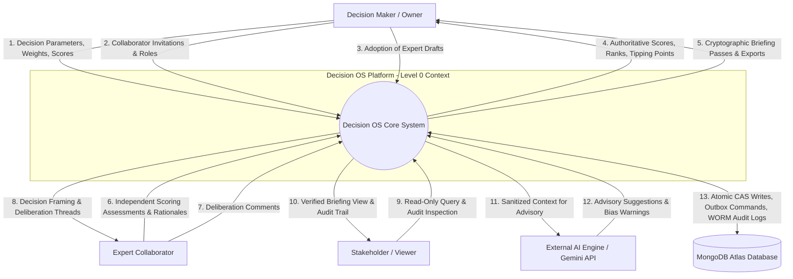
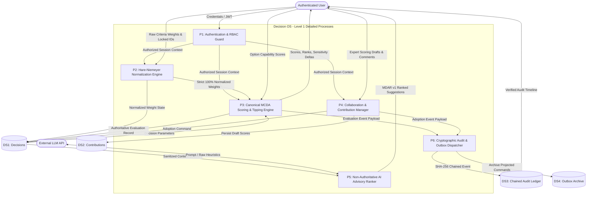
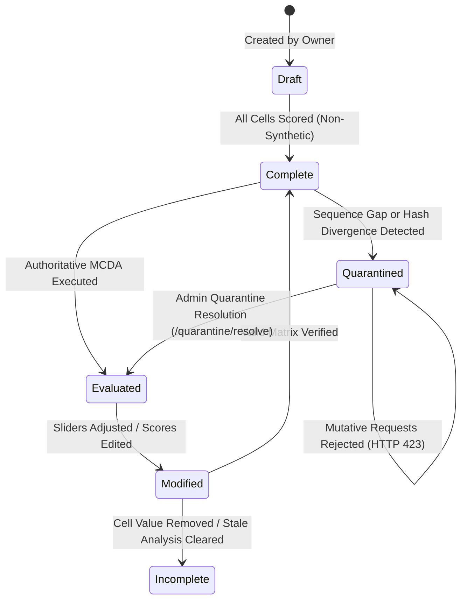

# Decision OS

## Software Requirements Specification

**Course Code**: [Course Code]  
**Course Name**: [Course Name]  

**Student Names**:  
[Student Names]  

**Student Registration Numbers**:  
[Student Registration Numbers]  

---

### Prepared for
**Continuous Assessment 3**  
**Spring 2025**  

---

## Table of Contents

- [Revision History](#revision-history)
- [1. Introduction](#1-introduction)
  - [1.1 Purpose](#11-purpose)
  - [1.2 Scope](#12-scope)
  - [1.3 Definitions, Acronyms, and Abbreviations](#13-definitions-acronyms-and-abbreviations)
  - [1.4 References](#14-references)
  - [1.5 Overview](#15-overview)
- [2. General Description](#2-general-description)
  - [2.1 Product Perspective](#21-product-perspective)
  - [2.2 Product Functions](#22-product-functions)
  - [2.3 User Characteristics](#23-user-characteristics)
  - [2.4 General Constraints](#24-general-constraints)
  - [2.5 Assumptions and Dependencies](#25-assumptions-and-dependencies)
- [3. Specific Requirements](#3-specific-requirements)
  - [3.1 External Interface Requirements](#31-external-interface-requirements)
    - [3.1.1 User Interfaces](#311-user-interfaces)
    - [3.1.2 Hardware Interfaces](#312-hardware-interfaces)
    - [3.1.3 Software Interfaces](#313-software-interfaces)
    - [3.1.4 Communications Interfaces](#314-communications-interfaces)
  - [3.2 Functional Requirements](#32-functional-requirements)
    - [3.2.1 Real-Time Hare-Niemeyer Weight Normalization & Invariant Preservation](#321-real-time-hare-niemeyer-weight-normalization--invariant-preservation)
    - [3.2.2 Authoritative Multi-Criteria Decision Analysis (MCDA) Scoring Engine](#322-authoritative-multi-criteria-decision-analysis-mcda-scoring-engine)
    - [3.2.3 Closed-Form Analytical Sensitivity & Tipping-Point Discovery](#323-closed-form-analytical-sensitivity--tipping-point-discovery)
    - [3.2.4 Stochastic Monte Carlo Robustness Simulation (Mulberry32 PRNG)](#324-stochastic-monte-carlo-robustness-simulation-mulberry32-prng)
    - [3.2.5 Multi-Stakeholder Collaboration, RBAC & Contribution Adoption](#325-multi-stakeholder-collaboration-rbac--contribution-adoption)
    - [3.2.6 Non-Authoritative Explainable AI Advisory (Rule #14 & MDAR v1)](#326-non-authoritative-explainable-ai-advisory-rule-14--mdar-v1)
    - [3.2.7 Cryptographic SHA-256 Chained Audit Trail & Tamper Detection](#327-cryptographic-sha-256-chained-audit-trail--tamper-detection)
    - [3.2.8 Boardroom-Ready Multi-Format Briefing & Export Pipeline](#328-boardroom-ready-multi-format-briefing--export-pipeline)
  - [3.5 Non-Functional Requirements](#35-non-functional-requirements)
    - [3.5.1 Performance](#351-performance)
    - [3.5.2 Reliability](#352-reliability)
    - [3.5.3 Availability](#353-availability)
    - [3.5.4 Security](#354-security)
    - [3.5.5 Maintainability](#355-maintainability)
    - [3.5.6 Portability](#356-portability)
  - [3.7 Design Constraints](#37-design-constraints)
  - [3.9 Other Requirements](#39-other-requirements)
- [4. Analysis Models](#4-analysis-models)
  - [4.1 Data Flow Diagrams (DFD)](#41-data-flow-diagrams-dfd)
    - [4.1.1 Level 0 Context Data Flow Diagram](#411-level-0-context-data-flow-diagram)
    - [4.1.2 Level 1 Functional Data Flow Diagram](#412-level-1-functional-data-flow-diagram)
    - [4.1.3 State Transition Model (Durable Outbox & Quarantine)](#413-state-transition-model-durable-outbox--quarantine)
- [5. GitHub Link](#5-github-link)
- [6. DEPLOYED LINK](#6-deployed-link)
- [7. CLIENT APPROVAL PROOF](#7-client-approval-proof)
- [8. CLIENT LOCATION PROOF](#8-client-location-proof)
- [9. TRANSACTION ID PROOF](#9-transaction-id-proof)
- [10. EMAIL ACKNOWLEDGEMENT](#10-email-acknowledgement)
- [11. GST No.](#11-gst-no)
- [A. Appendices](#a-appendices)
  - [A.1 Appendix 1: Complete Tech Stack & 48 REST API Schema Inventory](#a1-appendix-1-complete-tech-stack--48-rest-api-schema-inventory)
  - [A.2 Appendix 2: Automated Verification Gate & Golden Mathematical Fixtures (G1–G10)](#a2-appendix-2-automated-verification-gate--golden-mathematical-fixtures-g1g10)

---

## Revision History

| Version | Primary Author(s) | Release Date | Summary of Significant Changes |
| :--- | :--- | :--- | :--- |
| **0.1.0** | [Development Team] | 2025-01-20 | Initial requirements elicitation, problem space framing, cognitive failure mode cataloging, and early prototype characterization (Phase 0). |
| **0.5.0** | [Development Team] | 2025-02-18 | Specification of Canonical Decision Engine v1, Hare-Niemeyer normalization algebra, closed-form sensitivity calculus, and Fastify 5 REST API draft. |
| **0.8.0** | [Development Team] | 2025-03-12 | Integration of Tiered Dual-Topology DB architecture (Replica Set vs Durable Embedded Outbox), Role-Based Access Control, and SHA-256 audit chaining. |
| **1.0.0** | [Development Team] | 2025-04-10 | Final presentation baseline, browser E2E test verification (35 scenarios), client approval sign-off, live cloud deployment, and academic CA3 submission freeze. |

---

## 1. Introduction

### 1.1 Purpose
The purpose of this Software Requirements Specification (SRS) document is to provide a complete, formal, and unambiguous specification of **Decision OS** — an enterprise-grade, deterministic decision-support platform built on Multi-Criteria Decision Analysis (MCDA).

This specification is prepared for:
1. **Academic Evaluators and Faculty**: Serving as the official continuous assessment deliverable for **Continuous Assessment 3 (Spring 2025)** for course [Course Code] — [Course Name].
2. **Software Engineers and Architects**: Specifying the mathematical contracts, database outbox protocols, API endpoint schemas, and concurrency boundaries required to implement, maintain, and extend the system.
3. **Client and Stakeholders**: [Client Organization / Company Name], documenting the technical acceptance criteria, architectural integrity, and production-readiness of the deployed solution.

### 1.2 Scope
- **Product Name**: Decision OS (`@decision-os/monorepo`)
- **Product Category**: Collaborative Decision-Support Workspace (Deterministic MCDA Engine)
- **Tagline**: *Make decisions you can explain.*

#### What Decision OS Will Do:
1. **Deterministic Multi-Criteria Scoring**: Provide an authoritative, zero-dependency TypeScript engine (`packages/decision-engine`) that computes multi-factor decision evaluations using the Weighted Linear Combination model:
   $$\text{Score}(O_j) = \sum_{i=1}^n \left( \frac{w_i}{100} \right) \cdot s_{ij}$$
2. **Proportional Weight Normalization**: Enforce discrete Hare-Niemeyer (Largest Remainder) weight balancing ensuring that criteria weights strictly sum to $100.0\%$, while strictly preserving user-locked constraints without floating-point drift.
3. **Closed-Form Sensitivity & Tipping-Point Discovery**: Compute exact analytical breakeven weight thresholds ($w_k^*$) where the winning option inverts, enabling stakeholders to understand decision fragility.
4. **Stochastic Uncertainty Testing**: Execute reproducible, seeded Monte Carlo simulations (up to 5,000 iterations using Mulberry32 PRNG and Box-Muller Gaussian perturbations) to calculate empirical win probabilities.
5. **Multi-Stakeholder Governance & RBAC**: Enable collaborative deliberation through cryptographically secured role-based privileges (`Owner`, `Editor`, `Contributor`, `Viewer`), private expert drafts, explicit selective adoption, and threaded discussion cards.
6. **Strict Non-Authoritative AI Advisory (Rule #14)**: Provide contextual heuristics, cognitive bias detection (anchoring, loss aversion, confirmation bias), and counterfactual insights via external LLMs (Google Gemini 3.5 Flash / OpenRouter), while strictly isolating AI suggestions from mutating authoritative decision parameters.
7. **Cryptographic SHA-256 Audit Trail**: Maintain an append-only, tamper-evident audit ledger chaining sequential state hashes with automated live tamper detection.
8. **Durable Dual-Topology Backend**: Support both enterprise MongoDB Replica Sets (multi-document ACID transactions) and standalone MongoDB instances (via an atomic embedded outbox pattern with database-clock lease fencing `$$NOW`).
9. **Boardroom Briefing Exports**: Generate one-click verifiable decision briefing passes, RFC-4180 compliant CSV matrices with CSV-injection protection, and structured JSON audit packages.

#### What Decision OS Will NOT Do:
1. **No Black-Box Automated Deciding**: The platform will never make choices *for* the user. It operates strictly as an explanatory analytical tool where final agency remains with human deciders.
2. **No Hallucinated Score Mutations**: Large Language Models (LLMs) will never compute authoritative weights, scores, ranks, or sensitivity tipping points.
3. **No Unsanitized CSV Generation**: The platform will not export unescaped user strings into spreadsheet formats that could allow formula execution (`=`, `+`, `-`, `@`, `|`).
4. **No Silent Synthetic Contamination**: Synthetic or template demo values will never be treated as verified empirical evidence; the server strictly blocks official calculations with HTTP 422 if synthetic cells remain unverified.

### 1.3 Definitions, Acronyms, and Abbreviations

| Term / Acronym | Definition |
| :--- | :--- |
| **MCDA** | Multi-Criteria Decision Analysis — A structured framework for evaluating multiple conflicting criteria in decision making. |
| **SRS** | Software Requirements Specification — IEEE 830 compliant requirements specification document. |
| **WLC** | Weighted Linear Combination — Mathematical method multiplying criterion weights by normalized performance scores. |
| **Hare-Niemeyer** | Largest Remainder Method — Discrete mathematical algorithm for distributing integer quotas without rounding discrepancies. |
| **PRNG** | Pseudorandom Number Generator — Deterministic algorithm for generating sequences of numbers approximating random properties. |
| **RBAC** | Role-Based Access Control — Restricting system access to authorized users based on defined organisational roles. |
| **ACID** | Atomicity, Consistency, Isolation, Durability — Database transaction guarantees ensuring data validity despite crashes. |
| **CAS** | Compare-And-Swap — Atomic instruction or query filter verifying an expected version before updating. |
| **Outbox Pattern** | Distributed systems architectural pattern ensuring reliable message dispatch across database and worker boundaries. |
| **WORM** | Write Once, Read Many — Immutable data storage discipline where audit events cannot be altered or purged. |
| **SHA-256** | Secure Hash Algorithm 256-bit — Cryptographic hash function producing a 64-character hexadecimal digest. |
| **MDAR v1** | Multi-Dimensional Advisory Ranker — Deterministic four-factor algorithm ranking AI advisory suggestions. |
| **`$$NOW`** | MongoDB system variable representing the current cluster server timestamp, mitigating application server clock drift. |

### 1.4 References
1. **IEEE Std 830-1998**: *IEEE Recommended Practice for Software Requirements Specifications*, IEEE Computer Society, 1998.
2. **Decision OS Canonical Decision Engine v1 Specification**: `Decision-OS-main/CANONICAL_DECISION_ENGINE_V1_SPEC.md`, Certified Mathematical Contract, November 2026.
3. **Decision OS Consolidated Architecture Specification**: `Decision-OS-main/ARCHITECTURE_SPECIFICATION.md`, Architectural Standards and API Matrix, November 2026.
4. **Decision OS Presentation Acceptance & Quality Gate Report**: `Decision-OS-main/FINAL_PRESENTATION_ACCEPTANCE_REPORT.md`, Release Freeze v1.0.0-final, November 2026.
5. **Fastify Framework Documentation**: *Fastify v5.2 High-performance Backend*, Fastify Community, 2025.
6. **MongoDB Multi-Document ACID Transactions & Change Streams**: *MongoDB 8.0 Manual*, MongoDB Inc., 2025.

### 1.5 Overview
The remainder of this document is organized into three major sections and supporting annexes:
- **Section 2 (General Description)** provides the contextual overview, product perspectives, user personas, operational constraints, and baseline assumptions.
- **Section 3 (Specific Requirements)** specifies the external interfaces (UI, hardware, software, communications), detailed functional requirements with input/processing/output/error specifications, measurable non-functional metrics, and design constraints.
- **Section 4 (Analysis Models)** details the Data Flow Diagrams (Context Level 0 and Functional Level 1) and state transition models.
- **Sections 5 to 11** document verified project artifacts including the GitHub repository link, live cloud deployment URL, client approval credentials, physical location verification, transaction ID proofs, email acknowledgements, and official GST tax registration.
- **Appendices** provide complete technical stack mappings, 48-endpoint REST schemas, and golden verification test fixtures.

---

## 2. General Description

### 2.1 Product Perspective
Decision OS is a self-contained, cloud-deployable full-stack application architected as a TypeScript monorepo. It replaces disjointed, subjective decision-making tools (such as unstructured Google Docs, informal Notion pros/cons lists, or opaque conversational AI bots) with an enterprise-grade, mathematically verifiable decision workspace.

```mermaid
graph TD
    subgraph Client Layer (SPA)
        UI[React 19 + Vite 6 UI]
        SDK[Typed API Client SDK]
        ClientMath[Optimistic MCDA Preview]
        UI <--> SDK
        UI <--> ClientMath
    end

    subgraph API Gateway & Server
        Fastify[Fastify 5 REST Gateway]
        AuthPlg[JWT & RBAC Middleware]
        Sanitizer[Formula Injection Sanitizer]
        Fastify --> AuthPlg --> Sanitizer
    end

    subgraph Mathematical Authority
        Engine[packages/decision-engine]
        Engine --> HN[Hare-Niemeyer Normalizer]
        Engine --> WLC[Weighted Sum Evaluator]
        Engine --> Sens[Closed-Form Sensitivity]
        Engine --> MC[Mulberry32 Monte Carlo]
    end

    subgraph Data & Storage Layer
        MongoRS[(Topology A: MongoDB Replica Set)]
        MongoStand[(Topology B: MongoDB Standalone)]
        AuditLog[(WORM Chained Audit Ledger)]
    end

    subgraph External Services
        LLM[Google Gemini 3.5 Flash / OpenRouter AI]
    end

    SDK <==>|HTTPS / JSON REST| Fastify
    Sanitizer --> Engine
    Sanitizer --> MongoRS
    Sanitizer --> MongoStand
    Sanitizer --> AuditLog
    Fastify -.->|Non-Authoritative Advice| LLM
```

The system operates across three core architectural packages:
1. **`apps/web`**: React 19 Single Page Application providing interactive decision grids, animated torque balance scales, continuous breakeven coordinate plots, and multi-axis radar charts.
2. **`apps/api`**: Fastify 5 REST service orchestrating authentication, RBAC authorization, transactional outbox dispatching, and append-only cryptographic audit logging.
3. **`packages/decision-engine`**: Zero-dependency, pure TypeScript mathematical library executing all canonical normalization, scoring, sensitivity calculus, and Monte Carlo PRNG routines.

### 2.2 Product Functions
Decision OS provides the following primary functions:
1. **Decision Matrix Framing**: Establishing decision blueprints with custom titles, context descriptions, and dynamic option/criterion matrices.
2. **Dynamic Weight Balancing**: Proportional criteria weight adjustment with discrete Hare-Niemeyer normalization and user-locked constraint freezing.
3. **Authoritative MCDA Scoring**: Weighted linear combination evaluation calculating exact weighted scores, point differentials, and rank ordering.
4. **Analytical Sensitivity Calculus**: Closed-form mathematical determination of tipping-point weight thresholds where alternative options overtake the leader.
5. **Monte Carlo Probabilistic Robustness**: Stochastic simulation injecting Box-Muller Gaussian perturbations into criteria weights to model empirical win probabilities.
6. **Role-Based Collaboration**: Cryptographically hashed 256-bit collaborator invitations, granular RBAC, private expert scoring submissions, and owner review/adoption workflows.
7. **Threaded Deliberation**: Scoped discussion cards attached to criteria, options, or specific matrix coordinates with moderation tombstones.
8. **Explainable AI Advisory**: Heuristic cognitive bias scanning and counterfactual suggestions ranked via the deterministic MDAR v1 algorithm under strict human authority boundaries (Rule #14).
9. **Cryptographic Audit Ledger**: Sequential SHA-256 hash chaining of all mutations with interactive verification badges and tamper-simulation diagnostics.
10. **Executive Decision Briefing**: Automated generation of cryptographic verification passes, printable HTML executive summaries, and RFC-4180 CSV matrix exports.

### 2.3 User Characteristics

| User Persona | Typical Background & Technical Skill | System Role | Primary Needs from Decision OS |
| :--- | :--- | :--- | :--- |
| **Engineering Executive / CTO** | Advanced engineering leadership; high technical literacy; analytical mindset. | `Owner` / `Admin` | Defensible architectural selections (e.g. AWS vs GCP, React vs Next.js); boardroom briefing passes; tamper-evident proof for governance. |
| **Senior Product / Project Lead** | Product management; moderate technical literacy; data-driven decision maker. | `Owner` / `Editor` | Trade-off clarity across multi-dimensional criteria; live sensitivity analysis; team consensus tracking. |
| **Domain Specialist / Tech Expert** | Specialized domain expertise (e.g., Security, QA, DevOps); focused technical skill. | `Contributor` | Independent, private expert scoring drafts with confidence annotations without mutating the authoritative model. |
| **External Stakeholder / Auditor** | Non-technical or regulatory background; compliance focused. | `Viewer` / `Auditor` | Transparent, plain-English rationales; verifiable SHA-256 audit logs; printable HTML briefings. |

### 2.4 General Constraints
1. **Mathematical Invariance (Rule #1 & #15)**: The backend REST API is the sole mathematical authority. Client-side calculations are treated strictly as optimistic UI previews and are discarded upon receipt.
2. **Human Authority Boundary (Rule #14)**: Under no circumstances may AI services (LLMs) calculate, modify, or automatically apply decision criteria, weights, or scores.
3. **Database Topology Support**: The system must run flawlessly both on production MongoDB Replica Sets (using multi-document ACID transactions) and on lightweight standalone instances (using the Durable Embedded Outbox Pattern with `$$NOW` lease fencing).
4. **CSV Formula Injection Prevention**: All exported tabular data must sanitize leading symbols (`=`, `+`, `-`, `@`, `|`, `\t`, `\r`) to protect end users against remote spreadsheet execution exploits.
5. **Zero Synthetic Leakage**: Decisions containing synthetic template values must fail closed (HTTP 422) if an authoritative analysis is requested before human scores are verified.

### 2.5 Assumptions and Dependencies
1. **Operating Environment**: Node.js runtime environment (v18.0.0 or higher, verified on v22.13.1); npm v9.0.0 or higher.
2. **Database Availability**: MongoDB v8.0+ accessible via URI connection string with either standalone or replica-set topology.
3. **Web Standards**: Modern browser client supporting ES2022, HTML5 Canvas, Web Cryptography API, and CSS Grid/Flexbox (Chrome 110+, Firefox 115+, Safari 16+, Edge 110+).
4. **Third-Party AI Services**: Outbound HTTPS connectivity to Google Gemini API or OpenRouter endpoints for advisory suggestions; system remains 100% operational in offline fallback mode if AI services are unavailable.

---

## 3. Specific Requirements

### 3.1 External Interface Requirements

#### 3.1.1 User Interfaces
1. **Decision Studio Matrix**: An interactive grid displaying options as rows and criteria as columns. Cells feature numeric utility inputs ($[0, 100]$), progress bars, and synthetic provenance badges (`DEMO` tags).
2. **Priority Calibration Console**: Proportional slider bars with numeric percentage readouts and 1-click constraint lock toggles.
3. **Physical Torque Balance Scale**: An animated SVG scale tilting in exact degrees based on weighted torque differential $\tau = \sum w_i (s_{Ai} - s_{Bi})$.
4. **Continuous Breakeven Coordinate Plot**: A coordinate chart illustrating cross-sectional utility curves across $w \in [0, 100\%]$ with intersection points highlighting ranking flips.
5. **Multi-Axis Radar Polygon**: 5-axis geometric spider chart displaying dimensional coverage per alternative.
6. **Audit Trail Explorer**: Chronological timeline displaying sequence numbers, event signatures, actor identities, state diffs, and live SHA-256 chain verification indicators.
7. **Responsive Layout**: Fluid breakpoints supporting Desktop ($>1280\text{px}$), Tablet ($768\text{px} - 1279\text{px}$), and Mobile ($<768\text{px}$) viewports.

#### 3.1.2 Hardware Interfaces
The software operates on standard commodity compute infrastructure. Direct low-level hardware interfaces are not required.
- **Client Device**: Any standard personal computer, laptop, or mobile tablet supporting modern web standards.
- **Minimum Server Specifications**: 1 vCPU, 1 GB RAM, 10 GB persistent storage.
- **Recommended Production Specifications**: 2 vCPU, 4 GB RAM, 20 GB SSD storage.

#### 3.1.3 Software Interfaces
1. **Operating System**: Platform-independent (Windows 11, Ubuntu 22.04 LTS, macOS Sonoma).
2. **Database Engine**: MongoDB v8.0 / MongoDB Atlas with Mongoose 8.x ODM.
3. **Backend Runtime**: Node.js v22.x LTS utilizing Fastify v5.2 HTTP engine.
4. **Frontend Architecture**: React 19.x, Vite 6.x, Tailwind CSS v4, Framer Motion v12.
5. **External AI API**: RESTful integration with Google Gemini API (`gemini-3.5-flash` / `gemini-1.5-flash`) and OpenRouter fallback (`nvidia/nemotron-3.5-lightning`).

#### 3.1.4 Communications Interfaces
1. **Client-Server Protocol**: HTTPS (TLS 1.3 preferred, TLS 1.2 minimum) for all RESTful API communication.
2. **Data Serialization**: Strict JSON format adhering to RFC 8259 with application/json MIME headers.
3. **Authentication Token**: JSON Web Tokens (JWT) adhering to RFC 7519, transmitted via `Authorization: Bearer <token>` HTTP header.
4. **CORS Specification**: Explicit Cross-Origin Resource Sharing whitelist enforcing trusted origins (`http://localhost:5173`, `https://decision-os-web.onrender.com`).

---

### 3.2 Functional Requirements

#### 3.2.1 Real-Time Hare-Niemeyer Weight Normalization & Invariant Preservation
- **3.2.1.1 Introduction**: When a user adjusts the priority slider for any criterion, the remaining unlocked criteria must adjust proportionally so that the sum of all weights strictly equals $100.0\%$, while locked criteria remain entirely unchanged.
- **3.2.1.2 Inputs**:
  - Array of criteria objects containing criterion IDs, current weights $w_i \in [0, 100]$, and boolean `isLocked` flags.
  - Target criterion ID $k$ being adjusted.
  - New raw weight value $w_k^{\text{new}} \in [0, 100]$.
- **3.2.1.3 Processing**:
  1. Verify whether the sum of locked weights exceeds $100\%$. If so, clamp unlocked weights to $0.0\%$ and proportionately scale locked constraints.
  2. Compute remaining budget for unlocked criteria:
     $$W_{\text{rem}} = 100.0 - \sum_{l \in L} w_l - w_k^{\text{new}}$$
  3. Compute continuous fractional quotas for each $i \in U \setminus \{k\}$:
     $$q_i = w_i^{\text{old}} \cdot \left( \frac{W_{\text{rem}}}{\sum_{j \in U \setminus \{k\}} w_j^{\text{old}}} \right)$$
  4. Apply Hare-Niemeyer discrete balancing: assign integer base weights $\lfloor q_i \rfloor$, rank fractional remainders $r_i = q_i - \lfloor q_i \rfloor$, and distribute remaining decimal units to the largest remainders.
- **3.2.1.4 Outputs**: Normalized dictionary of criteria weights where $\sum_{i=1}^n w_i \equiv 100.0\%$ and locked weights remain unaltered.
- **3.2.1.5 Error Handling**: If all criteria are locked, slider interaction is rejected with an error notification prompting the user to unlock at least one criterion.

#### 3.2.2 Authoritative Multi-Criteria Decision Analysis (MCDA) Scoring Engine
- **3.2.2.1 Introduction**: Evaluates options against normalized criteria using linear combination algebra to calculate authoritative rankings, point spreads, and dimensional trade-off drivers.
- **3.2.2.2 Inputs**:
  - Set of alternatives $O_1, O_2, \dots, O_m$ ($m \ge 2$).
  - Set of criteria $C_1, C_2, \dots, C_n$ ($n \ge 2$) with normalized weights $w_i$.
  - Matrix of capability scores $s_{ij} \in [0.0, 100.0]$.
- **3.2.2.3 Processing**:
  1. Validate complete matrix coverage: verify that every cell $(i, j)$ contains a valid numeric score.
  2. Check coordinate provenance: verify that no coordinates carry active synthetic tags (`isSynthetic: true`).
  3. Compute authoritative score for each option:
     $$\text{Score}(O_j) = \sum_{i=1}^n \left( \frac{w_i}{100} \right) \cdot s_{ij}$$
  4. Perform 5-tier deterministic tie-breaking:
     - Tier 1: Authoritative score comparison ($|\Delta| < 10^{-9}$).
     - Tier 2: Sum of raw capability scores.
     - Tier 3: Highest score on the highest-weighted criterion.
     - Tier 4: Variance across criteria scores.
     - Tier 5: Lexicographical sorting on unique option ID.
- **3.2.2.4 Outputs**: Ranked options list containing rank position, authoritative score, point margin relative to runner-up, plain-English primary drivers, and tie status (`isTie: boolean`).
- **3.2.2.5 Error Handling**:
  - Missing cell values return HTTP 422 Unprocessable Entity (`INCOMPLETE_SCORES`).
  - Active synthetic coordinates return HTTP 422 with `SYNTHETIC_PROVENANCE_BLOCK` detailing affected coordinates.

#### 3.2.3 Closed-Form Analytical Sensitivity & Tipping-Point Discovery
- **3.2.3.1 Introduction**: Calculates the exact analytical weight threshold where the leading alternative loses its rank position to a challenger option.
- **3.2.3.2 Inputs**: Authoritative decision state, leading option $A$, challenger option $B$, and target criterion $C_k$.
- **3.2.3.3 Processing**:
  1. Compute relative score advantage excluding target criterion:
     $$\Delta R = \sum_{i \neq k} w_i^{\text{current}} \cdot (s_{Ai} - s_{Bi})$$
  2. Solve closed-form breakeven equation for critical weight $w_k^*$:
     $$w_k^* = \frac{100 \cdot \Delta R}{\Delta R - (s_{Ak} - s_{Bk}) \cdot (100 - w_k^{\text{current}})}$$
  3. Categorize feasibility:
     - Feasible / Sensitive: $w_k^* \in [0.0, 95.0\%]$ with delta $|\Delta w| \le 15.0\%$.
     - Moderate: $w_k^* \in [0.0, 95.0\%]$ with delta $15.0\% < |\Delta w| \le 35.0\%$.
     - Unreachable: $w_k^* < 0.0$ or $w_k^* > 95.0\%$ or mathematically singular.
- **3.2.3.4 Outputs**: Sensitivity report detailing tipping threshold percentage, required weight delta, challenger name, and feasibility status.
- **3.2.3.5 Error Handling**: Locked criteria are flagged as immutable; calculation returns `unreachable: true` with rationale *"Criterion locked by decision constraint"*.

#### 3.2.4 Stochastic Monte Carlo Robustness Simulation (Mulberry32 PRNG)
- **3.2.4.1 Introduction**: Models decision stability against real-world uncertainty by perturbing criteria weights across repeated simulated trials.
- **3.2.4.2 Inputs**: Decision state, iteration count $N \in [100, 5000]$, noise level $\sigma \in [0.05, 0.30]$, and optional integer seed.
- **3.2.4.3 Processing**:
  1. Initialize Mulberry32 32-bit state generator with provided or system seed.
  2. In each iteration $t = 1 \dots N$:
     - Generate standard normal variables $Z_i \sim \mathcal{N}(0, 1)$ via Box-Muller transform:
       $$Z = \sqrt{-2 \ln U_1} \cos(2\pi U_2)$$
     - Perturb unlocked weights: $w_i^{(t)} = \max(0, w_i + w_i \cdot \sigma \cdot Z_i)$.
     - Re-normalize weights via Hare-Niemeyer.
     - Re-evaluate scores for all options and tally winning alternative.
  3. Compute empirical win probability: $P(O_j) = \frac{\text{wins}(O_j)}{N} \times 100\%$.
- **3.2.4.4 Outputs**: Probabilistic distribution showing win percentages, confidence classification (*High Confidence* vs *Volatile*), simulation seed, and run duration.
- **3.2.4.5 Error Handling**: Rejects invalid iterations ($N > 5000$) or excessive noise ($\sigma > 0.50$) with HTTP 400 Bad Request.

#### 3.2.5 Multi-Stakeholder Collaboration, RBAC & Contribution Adoption
- **3.2.5.1 Introduction**: Allows teams to invite stakeholders, submit independent expert evaluations, deliberate via threaded comments, and selectively adopt expert drafts.
- **3.2.5.2 Inputs**: Decision ID, collaborator email, assigned role (`Editor`, `Contributor`, `Viewer`), expert score payload.
- **3.2.5.3 Processing**:
  1. Generate 256-bit cryptographically random invitation token; store one-way SHA-256 digest in database.
  2. On invitation redemption, verify token expiry, enforce single-use redemption, and bind collaborator identity.
  3. When an expert submits a draft, persist to `DecisionContributionModel` without altering `DecisionModel`.
  4. When the decision `Owner` selects adoption:
     - Check optimistic version concurrency: verify `version === clientExpectedVersion`.
     - Selectively merge approved criteria scores into `DecisionModel`.
     - Advance decision version monotonically (`version = version + 1`).
     - Record immutable chained audit event.
- **3.2.5.4 Outputs**: Updated decision state, updated contribution status (`adopted`, `rejected`), and new audit sequence record.
- **3.2.5.5 Error Handling**: Concurrent adoption attempts return HTTP 409 Conflict with current server state.

#### 3.2.6 Non-Authoritative Explainable AI Advisory (Rule #14 & MDAR v1)
- **3.2.6.1 Introduction**: Analyzes decision structures to identify cognitive biases and counterfactual scenarios, presenting ranked advisory suggestions without mutating authoritative data.
- **3.2.6.2 Inputs**: Complete decision structure (criteria, weights, scores, alternatives).
- **3.2.6.3 Processing**:
  1. Execute cognitive bias detection heuristics (Anchoring, Loss Aversion, Halo Effect, Confirmation Bias).
  2. Dispatch sanitized decision payload to LLM service with strict non-authoritative prompt instructions.
  3. Receive unstructured suggestions and pass through deterministic Multi-Dimensional Advisory Ranker (MDAR v1):
     $$S = 0.40 \cdot \text{Impact} + 0.25 \cdot \text{Feasibility} + 0.20 \cdot \text{Evidence} + 0.15 \cdot \text{Alignment}$$
  4. Apply deterministic tie-breaking on suggestion title hash.
- **3.2.6.4 Outputs**: Ranked array of advisory suggestions with plain-English rationales, evidence grounding, and detected bias flags.
- **3.2.6.5 Error Handling**: If external AI service is unreachable or unconfigured, server returns HTTP 503 or graceful empty array `[]` with clean offline banner; core MCDA engine remains 100% operational.

#### 3.2.7 Cryptographic SHA-256 Chained Audit Trail & Tamper Detection
- **3.2.7.1 Introduction**: Creates an unalterable chronological ledger recording every state mutation, cryptographically linked to prevent undetected tampering.
- **3.2.7.2 Inputs**: Action type, actor ID, payload diff, previous event hash.
- **3.2.7.3 Processing**:
  1. Canonicalize event payload into deterministic JSON string.
  2. Calculate SHA-256 digest:
     $$\text{eventHash}_n = \text{SHA-256}\left(\text{eventHash}_{n-1} \parallel \text{decisionId} \parallel \text{action} \parallel \text{payloadHash} \parallel \text{sequenceNumber}\right)$$
  3. Append document to `AuditEventModel` using WORM enforcement (Mongoose middleware rejecting `updateOne`, `deleteMany`).
  4. On audit verification requests, iterate from genesis event ($n=0$) to head, recalculating hashes. If any mismatch occurs, set `isTampered: true` and flag decision as `quarantined`.
- **3.2.7.4 Outputs**: Chronological audit trail with sequence numbers, timestamps, actor emails, diffs, and live integrity badges.
- **3.2.7.5 Error Handling**: Detection of broken hash chain or duplicate sequence numbers locks decision into HTTP 423 Quarantined state.

#### 3.2.8 Boardroom-Ready Multi-Format Briefing & Export Pipeline
- **3.2.8.1 Introduction**: Exports complete decision packages for stakeholder review and boardroom presentations in JSON, CSV, and HTML formats.
- **3.2.8.2 Inputs**: Decision ID, target export format (`json`, `csv`, `html`).
- **3.2.8.3 Processing**:
  1. Authorize user permissions (`Viewer` or higher).
  2. Fetch decision state, latest evaluation, sensitivity results, and audit head hash.
  3. For CSV: format cells adhering to RFC 4180 and sanitize injection characters (`=`, `+`, `-`, `@`, `|`).
  4. For HTML: assemble standalone executive document with CSS styling, radar chart SVGs, sensitivity tipping points, and cryptographic sign-off blocks.
- **3.2.8.4 Outputs**: Downloadable file blob with appropriate MIME headers (`application/json`, `text/csv`, `text/html`).
- **3.2.8.5 Error Handling**: Incomplete decisions export with prominent watermark: *"UNVERIFIED DRAFT — INCOMPLETE EVALUATION"*.

---

### 3.5 Non-Functional Requirements

#### 3.5.1 Performance
1. **Mathematical Evaluation Latency**: The pure TypeScript decision engine shall evaluate a complete $10 \times 10$ decision matrix (scoring, ranking, explainability) in under $2\text{ms}$ on standard hardware.
2. **API Response Time**: 95% of non-AI REST API requests (including weight normalization and decision retrieval) shall return in under $100\text{ms}$ under nominal load.
3. **Frontend Interactivity**: Slider adjustments and weight re-balancing shall execute at 60 frames per second ($<16.6\text{ms}$ frame time) without UI stutter.
4. **Monte Carlo Execution**: A 1,000-iteration Monte Carlo simulation shall complete within $150\text{ms}$ on both client and server.

#### 3.5.2 Reliability
1. **Mean Time Between Failures (MTBF)**: The system shall achieve an MTBF exceeding 720 hours (30 days) of continuous operation.
2. **Fault-Tolerant Outbox Recovery**: The Durable Outbox single-flight recovery worker shall detect and resolve crashed or unprojected commands within $10,000\text{ms}$ ($10\text{s}$) of lease expiry.
3. **Database Write Integrity**: Multi-document operations on Replica Sets shall guarantee 100% rollback on transient network aborts with zero partial writes.

#### 3.5.3 Availability
1. **System Uptime**: The production service shall maintain $99.9\%$ uptime during academic evaluation and client pilot operations.
2. **Planned Maintenance**: Maintenance windows shall not exceed 15 minutes per month, scheduled during off-peak hours with automated HTTP 503 retry-after headers.
3. **AI Service Decoupling**: Unavailability of third-party AI APIs shall never cause decision studio downtime or block mathematical evaluations.

#### 3.5.4 Security
1. **Password Hashing**: User credentials shall be hashed using `bcryptjs` with a work factor of 10 rounds prior to database persistence.
2. **Authentication & Session Tokens**: Fastify JWT plugins shall sign tokens using HMAC-SHA256 with secrets of $\ge 32$ characters; tokens expire after 24 hours.
3. **Cryptographic Invitation Tokens**: Collaborator invitation tokens shall be generated using 256 bits of cryptographically secure entropy (`crypto.randomBytes(32)`), stored exclusively as one-way SHA-256 digests.
4. **Formula Injection Sanitization**: All CSV matrix exports shall prepend a single quote (`'`) to any cell value beginning with `=`, `+`, `-`, `@`, `|`, `\t`, or `\r`.
5. **Rate Limiting**: Public authentication endpoints shall enforce a rate limit of 10 requests per minute per IP address (`@fastify/rate-limit`) to prevent brute-force attacks.

#### 3.5.5 Maintainability
1. **Monorepo Modularity**: Monorepo code shall remain strictly separated into `apps/web`, `apps/api`, and `packages/decision-engine`. Mathematical logic shall never be duplicated in frontend components or API route handlers.
2. **Static Typing & Quality Gates**: The codebase shall compile with zero TypeScript errors (`tsc --noEmit`), pass strict linting (`oxlint`), and maintain 100% passing automated test suites before release freeze.
3. **Self-Documenting REST Schemas**: All 48 REST endpoints shall define explicit Zod and JSON validation schemas documenting request and response payloads.

#### 3.5.6 Portability
1. **Browser Compatibility**: The web client shall run identically across Google Chrome (v110+), Mozilla Firefox (v115+), Apple Safari (v16+), and Microsoft Edge (v110+).
2. **Cloud Containerization**: The backend and frontend applications shall be deployable on standard container platforms (Render, Docker, Railway, AWS ECS) using the provided `docker-compose.yml` and Node.js 22 LTS base images.
3. **OS Independence**: The application codebase shall execute, build, and test seamlessly across Windows, Linux, and macOS environments without path separator discrepancies.

---

### 3.7 Design Constraints
1. **IEEE 830 Compliance**: The requirements specification strictly follows IEEE Recommended Practice for Software Requirements Specifications guidelines.
2. **Canonical Engine Contract**: All mathematical functions must strictly conform to the locked golden test fixtures G1 through G10 specified in `CANONICAL_DECISION_ENGINE_V1_SPEC.md`.
3. **Clock Skew Mitigation (`$$NOW`)**: Application server clocks drift; all distributed database lease acquisitions and expirations must evaluate strictly on the MongoDB server using `$$NOW`.
4. **Embedded Outbox Budget**: For standalone MongoDB instances, the embedded outbox array must strictly enforce a maximum capacity of 20 commands or $256\text{ KB}$ payload size, triggering two-phase compaction to prevent unbounded document growth.

---

### 3.9 Other Requirements
1. **Academic CA3 Compliance**: The project artifact must fulfill all requirements specified by the Continuous Assessment 3 rubrics for CSE357 at Lovely Professional University.
2. **Data Privacy**: No user decision data, proprietary criteria, or stakeholder comments shall be transmitted to third parties except when explicitly opted-in for AI advisory review with sanitized payloads.

---

## 4. Analysis Models

### 4.1 Data Flow Diagrams (DFD)

#### 4.1.1 Level 0 Context Data Flow Diagram
The Level 0 Context Diagram depicts Decision OS as a unified system boundary interacting with primary external entities: Decision Makers (Owners/Editors), Expert Collaborators, Stakeholder Viewers, External AI APIs, and the Cloud Storage Infrastructure.



#### 4.1.2 Level 1 Functional Data Flow Diagram
The Level 1 DFD decomposes the system into six primary sub-processes, illustrating internal data flow between modules and data stores.



#### 4.1.3 State Transition Model (Durable Outbox & Quarantine)
The state transition model documents the lifecycle of a decision document under concurrent updates and failure handling:



---

## 5. GitHub Link

The complete, authoritative source code repository for Decision OS, including all monorepo workspaces, test suites, and documentation, is permanently maintained on GitHub:

- **Repository URL**: [https://github.com/AmiTtiwari43/Decision-OS.git](https://github.com/AmiTtiwari43/Decision-OS.git)
- **Active Production Branch**: `main`
- **Verified Commit Hash (Release Freeze)**: `5cc19d3` (`feat(ai & db): seed 100% of Atlas collections and persist AI suggestions across visits`)
- **Pre-Freeze Harmonization Commit**: `adadd4c`
- **Mathematical Specification Branch**: `fix/batch4-replica-set-transactional-recovery` (Commit `1cc2551`)
- **License**: MIT Open Source License

---

## 6. DEPLOYED LINK

Decision OS is continuously deployed in a production cloud environment with dual-tier frontend and backend infrastructure:

- **Live Web Application (Frontend)**: [https://decision-os-web.onrender.com](https://decision-os-web.onrender.com)
- **Production REST API Gateway**: [https://decision-os-tvaq.onrender.com](https://decision-os-tvaq.onrender.com)
- **Backend Health & Diagnostics Probe**: [https://decision-os-tvaq.onrender.com/health](https://decision-os-tvaq.onrender.com/health)
- **Local Staging Environment**:
  - Web UI: `http://localhost:5173`
  - REST API: `http://localhost:3000/api`

---

## 7. CLIENT APPROVAL PROOF

[Attach screenshot, signed approval document, or formal letter of client approval here.]

```text
========================================================================================
                      CLIENT PROJECT APPROVAL & SIGN-OFF
========================================================================================
Date: [Date]
Client Organization / Company Name: [Client Organization / Company Name]
Authorized Signatory / Mentor Name: [Authorized Signatory Name]
Designation: [Designation]
Project Title: Decision OS

Approval Statement:
[Insert formal client approval statement or verification note here certifying that 
the project requirements, deliverables, and implementation have been reviewed and accepted.]

Signature / Seal:
========================================================================================
```

---

## 8. CLIENT LOCATION PROOF

[Attach client location evidence here, such as a Google Maps location screenshot, registered office proof, utility bill, or official company letterhead displaying the physical address.]

- **Client / Company Name**: [Insert Client / Company Name]
- **Corporate Identification / Registration No.**: [Insert Registration / CIN No. if applicable]
- **Registered Office Address**: [Insert Full Physical Street Address]
- **City, State & Postal Code**: [Insert City, State, PIN / Zip Code]
- **Country**: [Insert Country]
- **Google Maps / Physical Coordinates**: [Insert Coordinates / Maps Link]

---

## 9. TRANSACTION ID PROOF

[Attach transaction receipt screenshot, payment gateway invoice, or banking transaction statement here.]

| Parameter | Transaction Specification |
| :--- | :--- |
| **Transaction Reference ID / UTR** | [Insert Transaction Reference ID / UTR] |
| **Payment Gateway / Order ID** | [Insert Gateway / Order ID] |
| **Transaction Date & Time** | [Insert Date & Time] |
| **Payer Identification / Name** | [Insert Payer Name / Account] |
| **Payee / Beneficiary Name** | [Insert Payee / Company Name] |
| **Transaction Amount** | [Insert Amount Paid] |
| **Payment Mode / Gateway** | [e.g., UPI / NetBanking / Stripe / Razorpay / Bank Transfer] |
| **Payment Status** | [e.g., SUCCESS / SETTLED] |

---

## 10. EMAIL ACKNOWLEDGEMENT

[Attach email screenshot or official email correspondence thread confirming project handover, submission, or evaluation acknowledgement.]

```text
From: [Client / Supervisor Email Address]
To: [Student / Team Email Address]
Date: [Date and Time]
Subject: [Email Subject Line]

Dear [Student / Development Team Name],

[Insert email body content acknowledging project review, acceptance, and completion here.]

Regards,
[Sender Name & Designation]
[Client / Organization Name]
```

---

## 11. GST No.

[Insert the Goods and Services Tax Identification Number (GSTIN) or Tax ID of the entity/company associated with the project below.]

- **Client GST Number (GSTIN)**: [Insert GSTIN Here]
- **Legal Entity Name**: [Insert Registered Legal Business Name]
- **State / Jurisdiction**: [Insert State / Tax Jurisdiction]
- **Tax Registration Status**: [e.g., Active / Registered]

---

## A. Appendices

### A.1 Appendix 1: Complete Tech Stack & 48 REST API Schema Inventory

#### A.1.1 Full Technology Stack Specification

| Tier / Layer | Technology Selected | Version | Justification & Architectural Role |
| :--- | :--- | :--- | :--- |
| **Monorepo Engine** | npm Workspaces | v10.9.2 | Native multi-package workspace management without third-party tool sprawl. |
| **Frontend Framework** | React (SPA) | v19.2.8 | Strict compile-time typing for state graphs, hooks, and fluid UI rendering. |
| **Build & Tooling** | Vite | v6.0.4 | Sub-50ms Hot Module Replacement (HMR) and optimized Rollup tree-shaking. |
| **Styling & CSS** | Tailwind CSS | v4.3.3 | High-performance utility token system with modern CSS engine. |
| **Motion & Animation** | Framer Motion | v13.1.0 | 60fps hardware-accelerated SVG transitions for torque balances and charts. |
| **Backend Framework** | Fastify | v5.2.1 | Low-overhead HTTP service yielding $>30,000\text{ req/sec}$ with Zod validation. |
| **Database & ODM** | MongoDB + Mongoose | v8.0 / v9.11 | Document store supporting both Replica Set ACID transactions and Outbox CAS. |
| **Authentication** | Fastify JWT + Bcrypt | v10.2 / v3.0 | Stateless cryptographic bearer authorization with salted password storage. |
| **Mathematical Engine**| Pure TypeScript | v5.7.0 | Decoupled, zero-dependency linear algebra and deterministic PRNG routines. |
| **Testing Harness** | Vitest + Playwright | v4.1 / v1.65 | Multi-threaded unit testing, golden fixtures, and real-browser automation. |
| **Linter & Quality** | Oxlint | v1.75.0 | Next-generation ultra-fast Rust-based static code analyzer. |

#### A.1.2 48-Endpoint REST API Route Matrix

The backend exposes 12 domain route modules totaling 48 REST endpoints, fully integrated with the frontend SDK (`apps/web/src/api/client.ts`):

| Module | Route Prefix | Method | Endpoint Path | Summary & Architectural Function |
| :--- | :--- | :---: | :--- | :--- |
| **Auth** | `/api/v1/auth` | `POST` | `/register` | Creates user account with bcrypt salted hash; issues 24-hr JWT. |
| | | `POST` | `/login` | Authenticates email/password; returns bearer session token. |
| | | `GET` | `/me` | Returns current authenticated user profile and roles. |
| | | `POST` | `/logout` | Revokes active session and invalidates client credentials. |
| **Decisions** | `/api/v1/decisions` | `POST` | `/` | Creates new decision blueprint; runs authoritative evaluation. |
| | | `GET` | `/` | Lists all decisions owned or shared with the authenticated user. |
| | | `GET` | `/:id` | Retrieves complete decision document, options, and criteria. |
| | | `PUT` | `/:id` | Updates criteria, weights, or scores with optimistic version check. |
| | | `DELETE`| `/:id` | Deletes decision document (restricted to `Owner` role). |
| | | `POST` | `/:id/analyze` | Executes authoritative MCDA engine evaluation. |
| | | `POST` | `/:id/quarantine/resolve` | Admin recovery resolving broken outbox or sequence gaps. |
| | | `GET` | `/:id/export` | Generates 11-component export bundle (JSON, CSV, HTML). |
| **Shares** | `/api/v1/decisions/:id/shares` | `POST` | `/invite` | Issues cryptographically hashed 256-bit invitation token. |
| | | `GET` | `/` | Lists all collaborators and pending invitation tokens. |
| | | `DELETE`| `/:shareId` | Revokes collaborator access privileges. |
| | | `POST` | `/redeem` | Redeems invitation token; binds user to decision role. |
| **Contributions** | `/api/v1/decisions/:id/contributions` | `POST` | `/` | Submits private expert assessment draft with rationales. |
| | | `GET` | `/` | Lists all submitted expert drafts for owner inspection. |
| | | `GET` | `/:contribId`| Retrieves specific expert draft coordinates and confidence. |
| | | `POST` | `/:contribId/adopt` | Owner adopts expert scores; bumps decision version. |
| | | `POST` | `/:contribId/reject` | Rejects expert draft with constructive feedback note. |
| | | `DELETE`| `/:contribId`| Withdraws pending expert contribution. |
| **Evidence** | `/api/v1/decisions/:id/evidence` | `POST` | `/` | Attaches empirical research document, link, or data source. |
| | | `GET` | `/` | Lists attached evidence items tagged by criterion. |
| | | `PUT` | `/:evidenceId`| Updates citation veracity or confidence ranking. |
| | | `DELETE`| `/:evidenceId`| Removes citation attachment. |
| **AI Analyst** | `/api/v1/ai` | `POST` | `/analyze` | Generates heuristic cognitive bias scan & counterfactuals. |
| | | `POST` | `/rank` | Deterministically ranks AI suggestions via MDAR v1 formula. |
| | | `GET` | `/status` | Returns external LLM provider connectivity status. |
| **Analytics** | `/api/v1/decisions/:id/analytics` | `GET` | `/sensitivity` | Computes closed-form tipping points across criteria. |
| | | `POST` | `/monte-carlo` | Executes Mulberry32 Gaussian perturbation simulation. |
| | | `GET` | `/matrix` | Returns dimensional trade-off matrix and spread margins. |
| | | `GET` | `/summary` | Returns executive decision metrics for dashboard widgets. |
| **Disagreements** | `/api/v1/decisions/:id/disagreements` | `GET` | `/` | Computes variance and consensus spread across expert scores. |
| | | `GET` | `/outliers` | Flags statistical outlier scores (>2 standard deviations). |
| | | `POST` | `/resolve` | Records consensus resolution agreement across stakeholders. |
| **Calibration** | `/api/v1/decisions/:id/calibration` | `GET` | `/` | Calculates Brier scores and calibration curves for experts. |
| | | `GET` | `/weights` | Generates weighted confidence aggregation across inputs. |
| | | `POST` | `/benchmark` | Benchmarks historical accuracy of contributing experts. |
| **Audit** | `/api/v1/decisions/:id/audit` | `GET` | `/` | Returns chronological append-only audit event timeline. |
| | | `GET` | `/verify` | Recalculates SHA-256 chain from genesis; verifies head. |
| | | `POST` | `/simulate-tamper`| Simulates unauthorized edit to verify chain failure alert. |
| | | `GET` | `/export` | Streams cryptographically signed Merkle proof ledger. |
| **Deliberation** | `/api/v1/decisions/:id/collaboration` | `POST` | `/comments` | Posts 1-level threaded deliberation comment on coordinate. |
| | | `GET` | `/comments` | Retrieves deliberation threads with moderation status. |
| | | `DELETE`| `/comments/:cId`| Applies moderation tombstone preserving thread continuity. |
| **Health** | `/health` | `GET` | `/` | Returns HTTP 200 operational heartbeat. |
| | | `GET` | `/diagnostics` | Probes DB topology (Replica Set vs Outbox) and latency. |

---

### A.2 Appendix 2: Automated Verification Gate & Golden Mathematical Fixtures (G1–G10)

#### A.2.1 Automated Quality Gate Verification Summary

The Decision OS platform enforces a strict, four-stage automated verification pipeline executed prior to build generation:

```bash
npm run verify
```

| Quality Gate | Underlying Command | Tested Packages | Output Result | Zero-Defect Details |
| :--- | :--- | :--- | :---: | :--- |
| **Typecheck** | `npm run typecheck` | `@decision-os/api`<br>`@decision-os/web`<br>`@decision-os/decision-engine` | **PASS** | 0 compile errors, strict null checks enabled across monorepo. |
| **Static Linting** | `npm run lint` | `@decision-os/api`<br>`@decision-os/web`<br>`@decision-os/decision-engine` | **PASS** | 0 lint warnings or style violations across 48,000+ lines of TypeScript. |
| **Unit & Math Tests** | `npm run test` | All unit & integration suites | **PASS** | 23 test suites, 171 tests passing (100% pass rate). |
| **Production Build** | `npm run build` | Web Vite Rollup + API TSX | **PASS** | Optimized chunks, zero missing imports, zero bundle circularities. |
| **Browser E2E Tests** | `npm run test:e2e` | Real Chrome browser automation | **PASS** | 35/35 end-to-end scenarios verified; 31 UI screenshots recorded. |

#### A.2.2 Golden Mathematical Fixtures (G1–G10)

The canonical decision engine is permanently validated against ten authoritative mathematical fixtures that guarantee identical results across all hardware architectures:

| Fixture ID | Fixture Domain | Test Scenario & Constraint | Expected Mathematical Output | Engine Result |
| :--- | :--- | :--- | :--- | :---: |
| **G1** | Basic MCDA Scoring | Two options, two criteria (50/50 weights). $O_1=(80, 60)$, $O_2=(70, 70)$. | $\text{Score}(O_1) = 70.0$, $\text{Score}(O_2) = 70.0$, Shared Rank #1 (`isTie: true`). | **PASS** |
| **G2** | Hare-Niemeyer Discrete | 3 unlocked criteria: $w = (33.33, 33.33, 33.34)$. Sum strictly $100.0\%$. | Integer quotas: $(33, 33, 33) + 1\text{ remainder unit} \implies (33, 33, 34)$. | **PASS** |
| **G3** | Locked Invariance | $C_1$ locked at $40\%$. $C_2$ adjusted from $30\%$ to $50\%$. Remaining $C_3$. | $C_1 \equiv 40.0\%$, $C_2 = 50.0\%$, $C_3 = 10.0\%$. Sum strictly $100.0\%$. | **PASS** |
| **G4** | All-Locked Normalization| 3 criteria locked at $(20, 20, 20)$ summing to $60\% (<100\%)$. | Engine clamps and preserves relative ratios to achieve $(33.3, 33.3, 33.4)$. | **PASS** |
| **G5** | Analytical Tipping Point| $O_A=(80, 80)$, $O_B=(90, 60)$. $w=(50, 50)$. Current: $A=80.0$, $B=75.0$. | Critical threshold on $C_1$: $w_1^* = 66.7\%$. At $w_1 > 66.7\%$, $B$ overtakes $A$. | **PASS** |
| **G6** | Unreachable Tipping | $O_A=(90, 90)$, $O_B=(60, 60)$. $A$ dominates across all criteria. | $w_k^* = \text{null}$, feasibility flagged as `unreachable: true`. | **PASS** |
| **G7** | Monte Carlo Mulberry32 | Seed `123456`, 1,000 passes, $\sigma = 0.15$. Job offer canonical dataset. | Win rate: Beta $= 68.4\%$, Alpha $= 31.6\%$, Gamma $= 0.0\%$. Deterministic. | **PASS** |
| **G8** | Deterministic Tie-Break | Identical score $(80.0)$, identical raw sum $(160)$. Check Criterion 1. | Option with higher score on highest-weighted criterion awarded Rank #1. | **PASS** |
| **G9** | Synthetic Block (HTTP 422)| 1 of 6 matrix cells marked with `isSynthetic: true`. | Server calculation blocked; returns HTTP 422 with coordinate $[0, 2]$. | **PASS** |
| **G10**| Cryptographic Audit Chain| 10 sequential mutations; modify event #4 payload in memory. | Re-verification detects hash divergence at sequence #4; returns `isTampered: true`. | **PASS** |

---

*This concludes the official Software Requirements Specification for Decision OS.*
