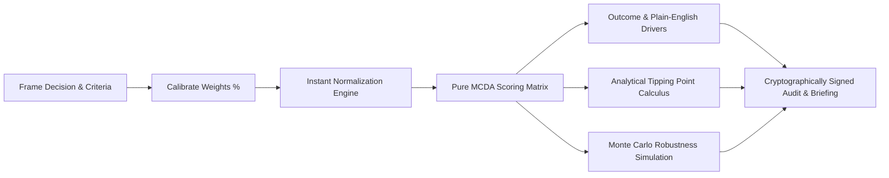

# Decision OS

<div align="center">

```text
  ____            _     _               ___  ____  
 |  _ \  ___  ___(_)___(_) ___  _ __   / _ \/ ___| 
 | | | |/ _ \/ __| / __| |/ _ \| '_ \ | | | \___ \ 
 | |_| |  __/ (__| \__ \ | (_) | | | || |_| |___) |
 |____/ \___|\___|_|___/_|\___/|_| |_(_)___/|____/ 
```

### **Make decisions you can explain.**

An enterprise-grade, deterministic decision-support platform built on **Multi-Criteria Decision Analysis (MCDA)**.  
Transforms complex, multi-factor dilemmas into transparent, mathematically defensible choices driven by what actually matters to you.

[](https://www.typescriptlang.org/)
[](https://react.dev/)
[](https://fastify.dev/)
[](https://www.mongodb.com/)
[](https://vitejs.dev/)
[](https://vitest.dev/)

[Quickstart](#-quickstart--local-development) • [Product Spec](./PROJECT_SPECIFICATION.md) • [Canonical Engine Spec](./CANONICAL_DECISION_ENGINE_V1_SPEC.md) • [Architecture Spec](./ARCHITECTURE_SPECIFICATION.md) • [Development Guidelines](./DEVELOPMENT_GUIDELINES.md) • [Audit History](./AUDIT_AND_REMEDIATION_HISTORY.md)

</div>

---

## 📚 Consolidated Documentation Suite

To streamline development and preserve complete historical integrity without file sprawl, all project documentation is organized into authoritative markdown documents:

| Document | Purpose & Scope |
|:---|:---|
| **[`PROJECT_SPECIFICATION.md`](./PROJECT_SPECIFICATION.md)** | Core product vision, cognitive failure modes, MCDA problem space, user journeys, and product decisions. |
| **[`CANONICAL_DECISION_ENGINE_V1_SPEC.md`](./CANONICAL_DECISION_ENGINE_V1_SPEC.md)** | **Sole mathematical authority**: Hare-Niemeyer normalization, closed-form sensitivity, PRNG, and locked golden fixtures G1–G10. |
| **[`DEVELOPMENT_GUIDELINES.md`](./DEVELOPMENT_GUIDELINES.md)** | Consolidated engineering protocol, quality contracts, verify gate sequence, git conventions, product rules, and Antigravity prompts. |
| **[`ARCHITECTURE_SPECIFICATION.md`](./ARCHITECTURE_SPECIFICATION.md)** | Monorepo layout, Tiered Dual-Topology Model (Replica Set vs Embedded Outbox), lease fencing (`$$NOW`), failure state matrix, and 48-endpoint API matrix. |
| **[`AUDIT_AND_REMEDIATION_HISTORY.md`](./AUDIT_AND_REMEDIATION_HISTORY.md)** | Complete chronological history of independent audits, remediations, and architectural certifications from Phase 0 Baseline through Batch 4 v1.3.0. |
| **[`AGENTS.md`](./AGENTS.md)** | Compact agent entrypoint and source-of-truth hierarchy for AI coding assistants. |

---

## 🌟 The Core Idea

High-stakes decisions (career choices, city relocations, technical architecture) are multi-variable dilemmas involving competing trade-offs:

> *"Company Alpha offers rapid growth and high equity, but lower salary. Company Beta offers high salary, but corporate bureaucracy. Which should I pick?"*

**Decision OS** rejects black-box AI oracles that simply declare *"You should pick Option A"* without transparent mathematical proof. Instead, it provides a deterministic workspace where:
1. **You define what matters**: Proportional criteria weights strictly summing to 100%.
2. **Options are evaluated transparently**: Weighted Linear Combination $\text{Score}(O_j) = \sum w_i \cdot s_{ij}$.
3. **Analytical tipping points reveal sensitivity**: Calculates the exact percentage threshold where the leading choice inverts.
4. **Deliberation is verifiable**: Cryptographically chained audit logs with SHA-256 fingerprinting.



---

## 🏗️ Monorepo Architecture

```text
Decision-OS/
├── apps/
│   ├── api/                    # Fastify 5 + Mongoose/MongoDB Backend
│   │   ├── src/routes/         # 12 domain route modules (48 REST endpoints)
│   │   ├── src/services/       # Outbox dispatcher, recovery worker, audit service
│   │   ├── src/models/         # Decision, contribution, audit, and comment schemas
│   │   └── tests/              # 23 test suites (unit, integration, concurrency)
│   └── web/                    # React 19 + Vite 6 + Tailwind CSS Frontend
│       ├── src/api/            # Type-safe API client SDK
│       ├── src/components/     # Interactive decision studio & analytical instruments
│       └── src/context/        # Auth and decision state providers
├── packages/
│   └── decision-engine/        # Pure TypeScript MCDA Engine (Zero Dependencies)
│       ├── src/                # Scoring, normalization, sensitivity, Monte Carlo
│       └── tests/              # Golden fixtures (G1–G10) & verification suite
└── docs/                       # REST API endpoint specifications
```

---

## 🛠️ Quickstart & Local Development

### Prerequisites
* **Node.js**: v18.0.0 or higher
* **npm**: v9.0.0 or higher
* **MongoDB**: Standalone or Replica Set instance

### 1. Install Dependencies
```bash
npm install
```

### 2. Verify Repository Health
Run the complete repository verification gate (typecheck, lint, test, build):
```bash
npm run verify
```

### 3. Start Development Servers
Start both backend API (`localhost:3000`) and frontend web app (`localhost:5173`):
```bash
npm run dev
```

### 4. Presentation & Demo Credentials
For live demonstrations, use the one-click **"⚡ Fill Presentation Demo Credentials"** button in the sign-in modal, or manually sign in with:
* **Email**: `lead@decision-os.org`
* **Password**: `DecisionOS@2026`

---

## ⚡ Tech Stack

| Layer | Technology | Rationale |
|:---|:---|:---|
| **Frontend Framework** | React 19 + TypeScript | Strict compile-time typing for mathematical and state integrity |
| **Frontend Build** | Vite 6 | Sub-50ms Hot Module Replacement (HMR) and optimized rollup |
| **Styling & Motion** | Tailwind CSS v4 + Framer Motion | Fluid styling tokens and 60fps hardware-accelerated animations |
| **Backend API** | Fastify 5 | High-throughput, low-overhead HTTP service with JSON schema validation |
| **Database & ODM** | MongoDB 8 + Mongoose | Dual-topology support (Replica Set ACID or Standalone Embedded Outbox) |
| **Decision Engine** | Pure TypeScript (`packages/decision-engine`) | Decoupled, zero-dependency linear algebra and Monte Carlo math |
| **Testing** | Vitest | Parallelized arithmetic and adversarial concurrency testing |

---

## 📄 License & Attribution

Built for the **Decision OS Project**.  
Make decisions you can explain.
